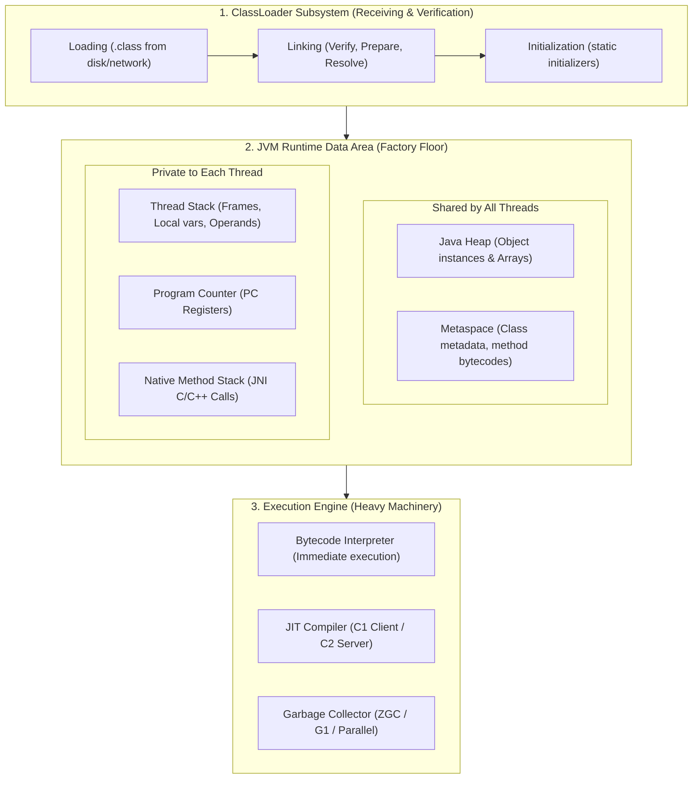

# JVM Architecture, Memory Model & Execution Engine

> **Phase 1: Modern Java Core & Memory Architecture**  
> *Estimated Reading Time: 45 minutes | Level: Foundational to Advanced*

---

## 1. Real-World Mental Model

Think of a running Java application like a modern manufacturing facility:



- **ClassLoader Subsystem:** The receiving dock. It inspects and verifies raw `.class` blueprints before anything is allowed into memory.
- **Metaspace (Native Memory):** The filing cabinet. Contains class metadata, constant pools, method signatures, and static variables.
- **Java Heap (Shared):** The main warehouse. Where all object instances and arrays live.
- **Thread Stacks (Thread-Private):** Individual worker desks. Every thread gets its own call stack with isolated local variables and stack frames.
- **Execution Engine:** The engines and robots. The Interpreter starts executing bytecode immediately, while the **JIT (Just-In-Time) Compiler** identifies "hot code" loops and compiles them directly into bare-metal CPU assembly.

---

## 2. Production Reality: Memory Breakdown

In production microservices (e.g., containerized Spring Boot with Docker), your container memory is **not just `-Xmx`**:

$$\text{Total Resident Set Size (RSS)} = \text{Heap} + \text{Metaspace} + (\text{Thread Count} \times \text{Stack Size}) + \text{Native Memory} + \text{JVM Overhead}$$

### Example Memory Allocation
If you assign a Docker container `1 GB` RAM and configure `-Xmx800m`:
- **Heap (`-Xmx`):** 800 MB
- **Thread Stacks (`-Xss1m`):** 150 active threads = 150 MB
- **Metaspace (`-XX:MaxMetaspaceSize`):** 128 MB
- **JVM Internal buffers & Code Cache:** ~100 MB
- **Total required:** $\approx 1178\text{ MB} \rightarrow$ **Linux OOM-Killer kills your container!**

> [!WARNING] Production Rule of Thumb
> Always allocate `-Xmx` to **60% - 70%** of total container RAM limit. Leave the remaining 30% - 40% for Metaspace, thread stacks, direct byte buffers, and OS buffers.

---

## 3. Under the Hood: Stack Frame Mechanics

Every time a Java method is called, a new **Stack Frame** is pushed onto the current thread's stack. When the method returns, the frame is popped.

A Stack Frame consists of:
1. **Local Variable Table (LVT):** Array storing `this`, method parameters, and local variables.
2. **Operand Stack:** Workspace where bytecode instructions push operands, perform arithmetic, and pop results.
3. **Frame Data:** References to Runtime Constant Pool, method return address, and exception dispatch table.

### Bytecode in Action
Consider this simple Java method:

```java
public int calculateTotal(int price, int quantity) {
    int tax = 5;
    return (price * quantity) + tax;
}
```

When compiled with `javac`, the generated bytecode reveals the exact operand stack operations:

```bytecode
public int calculateTotal(int, int);
  Code:
   0: iconst_5         // Push constant 5 onto operand stack
   1: istore_3         // Pop 5 and store into local variable 3 (tax)
   2: iload_1          // Push parameter 1 (price) onto stack
   3: iload_2          // Push parameter 2 (quantity) onto stack
   4: imul             // Pop both, multiply, push product back
   5: iload_3          // Push tax (5) onto stack
   6: iadd             // Pop product and tax, add them, push sum
   7: ireturn          // Return integer at top of operand stack
```

Notice how the JVM is a **stack-based virtual machine**, not a register-based virtual machine. Every operation moves data through the operand stack!

---

## 4. Interview Traps & Senior Defense

### Question 1: "Where are static variables stored in Java 8 and beyond?"
> **Weak Answer:** "In the PermGen or Metaspace."  
> **Senior Developer Answer:** "In Java 7 and earlier, static fields lived in PermGen. In Java 8, PermGen was replaced by Metaspace, which lives in native process memory. However, **static variables and interned strings were moved to the Java Heap** attached to the `java.lang.Class` instance. Metaspace strictly stores class metadata, bytecode, and method structures, **not** the actual static variable values or objects."

### Question 2: "What is JIT Tiered Compilation and how does HotSpot optimize loops?"
> **Weak Answer:** "JIT makes Java fast by converting bytecode to machine code."  
> **Senior Developer Answer:** "HotSpot uses Tiered Compilation:
> 1. **Interpreter (Tier 0):** Immediate execution with zero startup delay; gathers execution statistics (invocation counters, branch counters).
> 2. **C1 Client Compiler (Tiers 1-3):** Quick compilation with basic optimizations and profiling hooks.
> 3. **C2 Server Compiler (Tier 4):** Deep optimization for hot methods (inlining, loop unrolling, escape analysis, and dead code elimination) directly into native assembly.
> 4. **Deoptimization:** If an assumption is invalidated (e.g. a new subclass is dynamically loaded), HotSpot gracefully bails back to interpreted mode."

---

## 5. Knowledge Check & Mastery Challenge

### Self-Assessment Quiz

1. **Which JVM memory area is shared across all concurrent application threads?**
   - [ ] A) Thread Stack
   - [ ] B) PC Register
   - [x] C) Java Heap
   - [ ] D) Local Variable Array

2. **If a thread attempts a deep recursive function call without a terminating base case, what error is thrown?**
   - [ ] A) `OutOfMemoryError: Java heap space`
   - [ ] B) `OutOfMemoryError: Metaspace`
   - [x] C) `StackOverflowError`
   - [ ] D) `NullPointerException`

3. **What happens during the Escape Analysis optimization in HotSpot C2?**
   - [x] A) If an object does not escape the allocating method, it can be allocated on the stack (scalar replacement) instead of the heap, avoiding GC overhead.
   - [ ] B) It prevents memory leaks by closing database connections automatically.
   - [ ] C) It forces immediate garbage collection when the heap reaches 90% capacity.
   - [ ] D) It moves objects directly to the Old Generation.

---

## 6. Next Recommended Action

Continue to **Topic 2: [Garbage Collection Deep Dive & Tuning](02-garbage-collection.md)** to understand generational memory layouts, G1/ZGC collectors, and stop-the-world mitigation.
