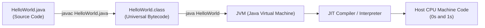

# Java Setup, Anatomy of a Program & The Compiler

> **Phase 1: Java Programming Foundations**  
> *Estimated Reading Time: 30 minutes | Total Practice Effort: ~2.5 hours | Tier: Core Essential*

---

## 1. Purpose & Prerequisites

### Why This Matters in Production
Every enterprise backend application—from a banking service handling millions of ledger transfers to microservices running on AWS—begins with the Java runtime lifecycle. Before writing complex APIs or database transactions, you must understand how Java transforms human-readable text into portable bytecode and how the operating system executes it.

### Prerequisites
None! This is where your journey starts.

---

## 2. Plain-English Mental Model

Think of writing and running a Java program like baking bread using an international recipe:

```
[ Your Java Code (.java) ]  ---> ( The javac Chef ) ---> [ Universal Bytecode (.class) ]
                                                                   |
                                                                   v
                                                      [ The JVM Kitchen Anywhere ]
                                                      (Windows, Linux, macOS, Cloud)
```

1. **The Recipe (`.java` file):** You write instructions in human-friendly English.
2. **The Chef / Translator (`javac` compiler):** The compiler inspects your recipe for grammar mistakes and translates it into an intermediate, universal blueprint called **Bytecode** (`.class` file).
3. **The Kitchen / Virtual Machine (`java` / JVM):** Any computer equipped with a Java Virtual Machine (JVM) can execute that bytecode, whether it runs on Windows, Linux, or a Docker container. This is Java's famous principle: **"Write Once, Run Anywhere" (WORA)**.

---

## 3. Working Code Example: Your First Java Program

Here is the smallest complete, working Java application:

```java
// File: HelloWorld.java
public class HelloWorld {
    public static void main(String[] args) {
        System.out.println("Welcome to Java Backend Engineering!");
    }
}
```

### Exact Output:
```text
Welcome to Java Backend Engineering!
```

### Line-by-Line Anatomy:
- `public class HelloWorld`: In Java, all code must live inside a class. The filename **must exactly match** the public class name (`HelloWorld.java`).
- `public static void main(String[] args)`: The universal entry point where execution begins:
  - `public`: Accessible by the JVM from anywhere.
  - `static`: Callable by the JVM without creating an instance of the `HelloWorld` class first.
  - `void`: Does not return any value back to the OS.
  - `main`: The exact method name the JVM searches for to kick off execution.
  - `String[] args`: An array of text arguments passed from the command line.
- `System.out.println(...)`: Prints a line of text to standard output (your console/terminal).

---

## 4. Under the Hood: Compilation to Execution

When you run a Java program from the command line, two distinct tools execute:



1. **Compilation Phase (`javac`):**  
   Running `javac HelloWorld.java` parses your code into an Abstract Syntax Tree (AST), validates types, and outputs `HelloWorld.class`. This file contains binary bytecode instructions (like `invokevirtual`, `getstatic`, `return`).
2. **Execution Phase (`java`):**  
   Running `java HelloWorld` launches the JVM:
   - **ClassLoader:** Reads `HelloWorld.class` bytes into memory.
   - **Bytecode Verifier:** Asserts the code does not violate memory safety or stack limits.
   - **Execution Engine:** Interprets bytecode or compiles hot loops into native assembly via the Just-In-Time (JIT) compiler.

---

## 5. Common Rookie Mistakes & Compiler Traps

### Trap 1: Filename Mismatch Error
```java
// In file: app.java
public class Server { ... }
```
**Compiler Error:**
```text
error: class Server is public, should be declared in a file named Server.java
```
> [!WARNING] Production Rule
> If a class is declared `public`, its file name **must** match the class name character-for-character, including capitalization.

### Trap 2: Missing or Incorrect `main` Signature
```java
public void main(String args) { ... } // WRONG: Missing static and String[]
```
**Runtime Error:**
```text
Error: Main method not found in class HelloWorld, please define the main method as:
   public static void main(String[] args)
```

---

## 6. Guided Hands-On Exercise

### Challenge: Personalized Welcome & Command-Line Arguments
Write a program named `Greeter.java` that:
1. Prints `"Server initialization started."`
2. Reads the first command-line argument passed to it (`args[0]`) and prints: `"Hello, <name>! Your server is ready."`
3. If no argument is provided, safely prints: `"Hello, Guest! Your server is ready."`

<details>
<summary>💡 Hint 1: Checking Arguments</summary>

You can check if arguments were passed using `if (args.length > 0)`.
</details>

<details>
<summary>💡 Hint 2: String Concatenation</summary>

You can join strings using the `+` operator: `"Hello, " + name + "! Your server is ready."`
</details>

<details>
<summary>✅ Solution</summary>

```java
public class Greeter {
    public static void main(String[] args) {
        System.out.println("Server initialization started.");
        
        String name = (args.length > 0) ? args[0] : "Guest";
        System.out.println("Hello, " + name + "! Your server is ready.");
    }
}
```
</details>

---

## 7. Knowledge Check & Interview Defense

### Quick Quiz
1. **Which component translates `.java` source files into `.class` bytecode?**
   - [ ] A) The JVM
   - [ ] B) The JRE
   - [x] C) The `javac` compiler
   - [ ] D) The ClassLoader

2. **Why must the `main` method be declared `static`?**
   - [x] A) So the JVM can invoke it without needing to instantiate an object of the enclosing class.
   - [ ] B) Because static methods execute 10x faster.
   - [ ] C) To prevent other classes from calling it.
   - [ ] D) Because non-static methods cannot print to the console.

3. **What happens if you run `java HelloWorld.class` instead of `java HelloWorld`?**
   - [ ] A) It executes normally.
   - [x] B) The JVM fails with `Could not find or load main class HelloWorld.class` because it expects the class name, not the file extension.
   - [ ] C) It recompiles the code.
   - [ ] D) It opens the class file in a text editor.

---

### Junior Developer Interview Q&A

#### Q: "What is the difference between JDK, JRE, and JVM?"
> **Model Answer:**  
> - **JVM (Java Virtual Machine):** The runtime engine that executes compiled Java bytecode on the host OS.  
> - **JRE (Java Runtime Environment):** The JVM plus standard Java class libraries (e.g. `java.lang`, `java.util`). It is sufficient to *run* applications.  
> - **JDK (Java Development Kit):** The complete software development bundle containing the JRE, JVM, plus development tools like the compiler (`javac`), debugger (`jdb`), and archiver (`jar`). Developers need the JDK; production runtime servers typically only need a minimal JRE.

---

## 8. Mastery Checklist & Next Step

Before moving on, verify that you can:
- [ ] Install OpenJDK 17 or 21 and verify `javac -version` in your terminal.
- [ ] Create, compile (`javac`), and run (`java`) a Java program from the command line.
- [ ] Explain why Java is platform-independent while the JVM itself is OS-specific.

👉 **Next Lesson:** **[Topic 1.2: Variables, Primitive Data Types & Memory Sizes](02-variables-types.md)**
