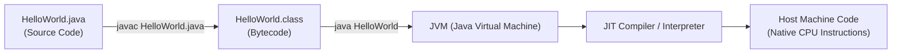

# Java Setup, Anatomy of a Program & The Compiler

> **Phase 1: Java Programming Foundations**  
> *Estimated Reading Time: 30 minutes | Total Practice Effort: ~2.5 hours | Tier: Core Essential*

---

## 1. Purpose & Prerequisites

### Why This Matters in Full Stack Development
In modern software engineering, web applications rarely exist in isolation. A modern system typically pairs a responsive client (such as a React web application or mobile interface) with a secure, high-throughput backend service (such as a Java microservice running Spring Boot). 

Before building enterprise web services or handling REST API requests, you must understand how Java code is written, compiled, and executed by the operating system. Every production service begins as raw Java source code that must be compiled into universal bytecode and executed inside the Java Virtual Machine (JVM).

### Prerequisites
None! This lesson is designed for beginners starting from scratch.

---

## 2. Plain-English Mental Model

Think of writing and running a Java program like baking bread using an international recipe:

```
[ Your Java Code (.java) ]  ---> ( The javac Chef ) ---> [ Universal Bytecode (.class) ]
                                                                   |
                                                                   v
                                                      [ The JVM Kitchen Anywhere ]
                                                      (Windows, Linux, macOS, Cloud)
```

1. **The Recipe (`.java` file):** You write instructions in human-friendly English syntax.
2. **The Chef / Translator (`javac` compiler):** The compiler inspects your recipe for grammar and syntax mistakes. If valid, it translates it into an intermediate, platform-neutral blueprint called **Bytecode** (`.class` file).
3. **The Kitchen / Runtime Engine (`java` / JVM):** Any computer equipped with a Java Virtual Machine (JVM) can execute that bytecode, whether it runs on your local Windows laptop, an engineer's MacBook, or a Linux Docker container deployed in the cloud.

This is Java's foundational design principle: **"Write Once, Run Anywhere" (WORA)**.

---

## 3. Working Code Example: Your First Java Program

Here is the smallest complete, working Java application:

```java
// File: HelloWorld.java
public class HelloWorld {
    public static void main(String[] args) {
        System.out.println("Hello, Full Stack Engineering World!");
    }
}
```

### Exact Output:
```text
Hello, Full Stack Engineering World!
```

### Step-by-Step Code Walkthrough:
- `public class HelloWorld`: In Java, all code must reside inside a class. When a class is declared `public`, the filename **must exactly match** the class name (`HelloWorld.java`).
- `public static void main(String[] args)`: The universal entry point where execution begins:
  - `public`: Accessible by the JVM runtime from outside the class.
  - `static`: Can be invoked directly by the JVM without creating an instance (object) of `HelloWorld` first.
  - `void`: Does not return any value back to the operating system upon completion.
  - `main`: The exact method name the JVM looks for to kick off program execution.
  - `String[] args`: An array of text strings passed from the command line when starting the program.
- `System.out.println(...)`: Sends a line of text to standard output (the terminal or console window) and appends a newline character.

---

## 4. Under the Hood: Compilation to Execution

When you run a Java application from your terminal, two distinct tools work in sequence:



1. **Compilation Phase (`javac`):**  
   Running `javac HelloWorld.java` parses your code into an Abstract Syntax Tree (AST), checks type rules, and produces `HelloWorld.class`. This file contains binary bytecode instructions (such as `invokevirtual`, `getstatic`, `return`).
2. **Execution Phase (`java`):**  
   Running `java HelloWorld` boots the JVM:
   - **ClassLoader:** Reads the binary `.class` file into memory.
   - **Bytecode Verifier:** Asserts the code does not violate memory safety or stack integrity.
   - **Execution Engine:** Interprets bytecode or compiles hot loops into native assembly via the Just-In-Time (JIT) compiler for optimal hardware execution.

---

## 5. Common Rookie Mistakes & Compiler Traps

### Trap 1: Filename Mismatch Error
```java
// In file: app.java
public class MainService {
    public static void main(String[] args) {}
}
```
**Compiler Error:**
```text
error: class MainService is public, should be declared in a file named MainService.java
```
> [!WARNING] Production Rule
> If a class is declared `public`, its file name **must** match the class name character-for-character, including exact casing. Java is strictly case-sensitive.

### Trap 2: Missing or Invalid `main` Method Signature
```java
public void main(String args) { // WRONG: Missing static keyword and String[] array syntax
    System.out.println("Hello");
}
```
**Runtime Error:**
```text
Error: Main method not found in class HelloWorld, please define the main method as:
   public static void main(String[] args)
```

### Trap 3: Running with the `.class` Extension
```bash
java HelloWorld.class
```
**Runtime Error:**
```text
Error: Could not find or load main class HelloWorld.class
Caused by: java.lang.ClassNotFoundException: HelloWorld/class
```
> [!TIP]
> When compiling, pass the file name: `javac HelloWorld.java`.  
> When running, pass the class name: `java HelloWorld` (omit `.class`).

---

## 6. Practical Application: Full Stack Context

In enterprise full-stack development, Java services don't just print to the console—they serve JSON payloads to frontend clients:

```
[ Browser / React App ] 
         | 
   HTTP GET /api/status 
         v 
[ Java Spring Boot Backend ] ---> Executes main() ---> Starts Web Server on Port 8080
```

Every Spring Boot server starts with the very same `public static void main(String[] args)` method you just learned. Understanding this entry point allows you to configure command-line flags, profile environments (development vs production), and pass configuration parameters to your backend application.

---

## 7. Guided Hands-On Exercise

### Challenge: Server Startup Banner & Parameter Reader
Write a complete program named `ServerBootstrap.java` that:
1. Prints a startup banner: `--- Full Stack API Gateway v1.0 ---`
2. Reads the first command-line argument passed to it (`args[0]`) as the active environment name (e.g. `production`, `staging`).
3. If an argument is provided, prints: `Booting server in [ENV] mode on port 8080...` (replacing `[ENV]` with the passed value).
4. If no argument is provided, defaults to printing: `Booting server in [development] mode on port 8080...`

<details>
<summary>💡 Hint 1: Checking Arguments</summary>

You can check if arguments were passed using the array length: `if (args.length > 0)`.
</details>

<details>
<summary>💡 Hint 2: Conditional Value Selection</summary>

You can use a ternary operator or an if-else statement:
```java
String env = (args.length > 0) ? args[0] : "development";
```
</details>

<details>
<summary>✅ Solution</summary>

```java
public class ServerBootstrap {
    public static void main(String[] args) {
        System.out.println("--- Full Stack API Gateway v1.0 ---");
        
        String environment = (args.length > 0) ? args[0] : "development";
        System.out.println("Booting server in [" + environment + "] mode on port 8080...");
    }
}
```

**Testing from the command line:**
```bash
# Compiling:
javac ServerBootstrap.java

# Running without arguments:
java ServerBootstrap
# Output:
# --- Full Stack API Gateway v1.0 ---
# Booting server in [development] mode on port 8080...

# Running with an argument:
java ServerBootstrap production
# Output:
# --- Full Stack API Gateway v1.0 ---
# Booting server in [production] mode on port 8080...
```
</details>

---

## 8. Knowledge Check & Interview Defense

### Quick Quiz
1. **Which JDK tool translates `.java` source files into portable `.class` bytecode?**
   - [ ] A) The JVM
   - [ ] B) The JRE
   - [x] C) The `javac` compiler
   - [ ] D) The ClassLoader

2. **Why must the `main` method be declared `static`?**
   - [x] A) So the JVM can invoke it directly without needing to instantiate an object of the enclosing class.
   - [ ] B) Because static methods run 10x faster than instance methods.
   - [ ] C) To prevent other classes from calling it.
   - [ ] D) Because non-static methods cannot access `System.out`.

3. **What is the primary difference between the JDK and the JRE?**
   - [ ] A) JRE contains the compiler, while JDK contains the runtime engine.
   - [x] B) JDK contains the development tools (`javac`, `jdb`) plus the JRE; JRE only contains the JVM and libraries needed to run code.
   - [ ] C) JDK is only used for desktop apps; JRE is only used for web servers.
   - [ ] D) There is no difference; they are synonyms.

---

### Junior Developer Interview Q&A

#### Q: "What does 'Write Once, Run Anywhere' mean, and what role does bytecode play?"
> **Model Answer:**  
> "'Write Once, Run Anywhere' (WORA) is Java's cross-platform capability. In languages like C++, source code is compiled directly into operating-system-specific machine code (e.g. x86 Windows assembly). In Java, the `javac` compiler outputs an intermediate representation called **bytecode** (`.class` files), which is architecture-neutral.  
> 
> Any machine equipped with an OS-specific Java Virtual Machine (JVM)—whether Windows, macOS, or Linux—can load and execute this bytecode. As a result, developers compile the codebase once, and the resulting artifact runs identically across local development machines, CI/CD pipelines, and cloud Docker containers."

---

## 9. Mastery Checklist & Next Step

Before moving on, verify that you can:
- [ ] Verify your JDK installation in your terminal with `javac -version` and `java -version`.
- [ ] Create, compile (`javac`), and run (`java`) a Java program from the command line.
- [ ] Explain the role of each keyword in `public static void main(String[] args)`.
- [ ] Pass command-line arguments to your program and access them via `args[0]`.

👉 **Next Lesson:** **[Topic 1.2: Variables, Primitive Data Types & Memory Sizes](02-variables-types.md)**
