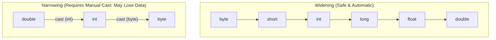

# Variables, Primitive Data Types & Memory Sizes

> **Phase 1: Java Programming Foundations**  
> *Estimated Reading Time: 35 minutes | Total Practice Effort: ~2.5 hours | Tier: Core Essential*

---

## 1. Purpose & Prerequisites

### Why This Matters in Full Stack Development
In any software application—whether managing a user's account balance, validating a form submission from a React frontend, or processing thousands of order IDs per second on the backend—data must be stored in memory.

Java is a **statically-typed language**. Every variable must have an explicitly declared data type before the code compiles. Choosing the correct type prevents data corruption, guarantees memory safety, and ensures that financial numbers and identifiers are never truncated or rounded improperly.

### Prerequisites
- [Topic 1.1: Java Setup, Anatomy of a Program & The Compiler](01-setup-anatomy.md)

---

## 2. Plain-English Mental Model

Think of computer memory (RAM) as a massive warehouse of storage bins. Declaring a variable is like reserving a specific bin, labeling it, and placing a value inside:

```
+---------------+---------------------+--------------------+
| Variable Type | Storage Bin Size    | What Fits Inside   |
+---------------+---------------------+--------------------+
| boolean       | Tiny envelope       | true or false      |
| byte / short  | Small shoebox       | Small whole numbers|
| int           | Standard box        | Standard integers  |
| long          | Large freight crate | Massive numbers    |
| double        | Precision container | Fractional decimals|
+---------------+---------------------+--------------------+
```

In Java, **primitive types** store their actual raw values directly inside their allocated memory slot on the **call stack**. Unlike reference objects, they do not point to separate heap memory locations.

---

## 3. The 8 Primitive Data Types in Java

Java provides exactly eight primitive types, categorized into four groups:

| Type | Size | Default Value | Value Range | Common Use Case |
| :--- | :--- | :--- | :--- | :--- |
| **`byte`** | 1 byte (8 bits) | `0` | `-128` to `127` | Raw binary streams, image buffers |
| **`short`** | 2 bytes (16 bits) | `0` | `-32,768` to `32,767` | Memory-constrained legacy hardware |
| **`int`** | 4 bytes (32 bits) | `0` | `~ -2.14 billion` to `~ +2.14 billion` | Loop counters, general counts, array indices |
| **`long`** | 8 bytes (64 bits) | `0L` | `~ -9.22 quintillion` to `~ +9.22 quintillion` | Database primary keys, timestamps, high-volume IDs |
| **`float`** | 4 bytes (32 bits) | `0.0f` | `~ ±3.4 × 10³⁸` (6–7 decimal digits precision) | Graphics, 3D physics rendering |
| **`double`** | 8 bytes (64 bits) | `0.0d` | `~ ±1.8 × 10³⁰⁸` (15 decimal digits precision) | Scientific calculations, general decimals |
| **`char`** | 2 bytes (16 bits) | `'\u0000'` | `0` to `65,535` (Unicode character) | Single character: `'A'`, `'9'`, `'$'` |
| **`boolean`** | 1 bit (virtual) | `false` | `true` or `false` | Flags, condition checks, status toggles |

---

## 4. Working Code Example: Declaring, Initializing & Casting

```java
// File: DataPlayground.java
public class DataPlayground {
    public static void main(String[] args) {
        // 1. Whole Numbers
        int userAge = 24;
        long transactionId = 9876543210123L; // Note the 'L' suffix for long literals

        // 2. Floating-point numbers
        float taxRate = 0.0825f;              // Note the 'f' suffix for float literals
        double productPrice = 49.99;

        // 3. Characters and Booleans
        char currencySymbol = '$';
        boolean isDiscountApplied = true;

        // 4. Widening (Implicit) Casting: byte -> short -> int -> long -> float -> double
        int smallNumber = 100;
        double convertedDouble = smallNumber; // Automatically widened to 100.0

        // 5. Narrowing (Explicit) Casting: double -> int (Truncates decimal fraction)
        double rawRating = 4.87;
        int starDisplay = (int) rawRating;   // Casts to 4 (fraction is dropped)

        System.out.println("User Age: " + userAge);
        System.out.println("Transaction ID: " + transactionId);
        System.out.println("Total Price: " + currencySymbol + productPrice);
        System.out.println("Tax Rate: " + taxRate);
        System.out.println("Discount Applied: " + isDiscountApplied);
        System.out.println("Widened Value: " + convertedDouble);
        System.out.println("Star Rating (Narrowed): " + starDisplay);
    }
}
```

### Exact Output:
```text
User Age: 24
Transaction ID: 9876543210123
Total Price: $49.99
Tax Rate: 0.0825
Discount Applied: true
Widened Value: 100.0
Star Rating (Narrowed): 4
```

---

## 5. Under the Hood: Type Casting & Memory Representation



### Widening Casting (Implicit)
When assigning a smaller type to a larger type (e.g. `int` into `long` or `double`), Java automatically widens the value because no bits of precision will be lost.

### Narrowing Casting (Explicit)
When forcing a larger type into a smaller type, you must provide an explicit cast: `(targetType) value`.  
> [!CAUTION] Truncation & Overflow
> - Converting `double` to `int` **discards the fractional decimal entirely** (it does not round; `4.99` becomes `4`).
> - Squeezing an `int` larger than `127` into a `byte` causes **integer overflow**, wrapping around into negative values.

```java
int largeNumber = 130;
byte squeezedByte = (byte) largeNumber;
System.out.println(squeezedByte); // Outputs: -126 (due to two's-complement bit wraparound)
```

---

## 6. Common Rookie Mistakes & Traps

### Trap 1: Missing the `L` on Long Literals
```java
long account = 3000000000; // COMPILER ERROR!
```
**Why:** In Java, any whole number literal is treated as a 32-bit `int` by default. `3000000000` exceeds the maximum `int` value (`2,147,483,647`).  
**Fix:** Append an `L` (or `l`):
```java
long account = 3000000000L; // Valid
```

### Trap 2: Integer Division Truncation
```java
int totalItems = 5;
int passedItems = 2;
double successRate = passedItems / totalItems;
System.out.println(successRate); // Outputs: 0.0 (NOT 0.4!)
```
**Why:** Both `passedItems` and `totalItems` are `int`s. Java performs integer division first (`2 / 5 = 0`), and only *afterward* widens `0` to `0.0`.  
**Fix:** Cast at least one operand to `double`:
```java
double successRate = (double) passedItems / totalItems; // Outputs: 0.4
```

### Trap 3: Using `double` or `float` for Money
Floating-point types use IEEE 754 binary representation. Certain decimal fractions cannot be represented exactly in binary:
```java
System.out.println(0.1 + 0.2); // Outputs: 0.30000000000000004
```
> [!IMPORTANT] Production Rule
> Never use `double` or `float` for financial transactions or monetary ledgers in production systems. In production Java backends, always use `java.math.BigDecimal` or store currency amounts as minor units (e.g. cents/paise) in a `long`.

---

## 7. Practical Application: Full Stack Context

When a React frontend submits an order form via JSON:
```json
{
  "orderId": 98213847219,
  "quantity": 3,
  "unitPrice": 12.50,
  "isExpressDelivery": true
}
```
Your Java backend entity maps each property to its optimal type:
- `"orderId"` &rarr; `long` (prevents database ID exhaustion).
- `"quantity"` &rarr; `int` (safe for item counts).
- `"unitPrice"` &rarr; `BigDecimal` or `double` (for non-financial approximations).
- `"isExpressDelivery"` &rarr; `boolean`.

Choosing the right type upfront prevents database migration bugs and serialization errors.

---

## 8. Guided Hands-On Exercise

### Challenge: Order Invoice Summary Calculator
Create a program named `InvoiceCalculator.java` that calculates a billing summary for an e-commerce order:
1. Define the following variables:
   - `itemName` (`String`): `"Mechanical Keyboard"`
   - `quantity` (`int`): `3`
   - `unitPrice` (`double`): `79.99`
   - `taxPercentage` (`double`): `8.5` (representing 8.5%)
   - `isMember` (`boolean`): `true`
2. Apply a `$10.00` discount if `isMember` is `true`.
3. Compute the subtotal, tax amount, and final total.
4. Convert the final total into an approximate whole integer dollar amount using explicit casting.
5. Print a clean receipt matching the format below.

<details>
<summary>💡 Hint 1: Computing Tax</summary>

Tax amount is `subtotal * (taxPercentage / 100.0)`.
</details>

<details>
<summary>💡 Hint 2: Narrowing Cast</summary>

Cast the final total to `int` using `(int) finalTotal`.
</details>

<details>
<summary>✅ Solution</summary>

```java
public class InvoiceCalculator {
    public static void main(String[] args) {
        String itemName = "Mechanical Keyboard";
        int quantity = 3;
        double unitPrice = 79.99;
        double taxPercentage = 8.5;
        boolean isMember = true;

        double subtotal = quantity * unitPrice;
        double discount = isMember ? 10.00 : 0.0;
        double discountedSubtotal = subtotal - discount;
        double taxAmount = discountedSubtotal * (taxPercentage / 100.0);
        double finalTotal = discountedSubtotal + taxAmount;
        int roundedTotal = (int) finalTotal;

        System.out.println("========== ORDER INVOICE ==========");
        System.out.println("Item: " + itemName);
        System.out.println("Quantity: " + quantity + " @ $" + unitPrice);
        System.out.println("Subtotal: $" + subtotal);
        System.out.println("Member Discount: -$" + discount);
        System.out.println("Tax (" + taxPercentage + "%): $" + taxAmount);
        System.out.println("Final Total: $" + finalTotal);
        System.out.println("Rounded Bill (Casted to int): $" + roundedTotal);
        System.out.println("===================================");
    }
}
```

**Terminal Output:**
```text
========== ORDER INVOICE ==========
Item: Mechanical Keyboard
Quantity: 3 @ $79.99
Subtotal: $239.97
Member Discount: -$10.0
Tax (8.5%): $19.54745
Final Total: $249.51745
Rounded Bill (Casted to int): $249
===================================
```
</details>

---

## 9. Knowledge Check & Interview Defense

### Quick Quiz
1. **Which primitive data type is recommended for 64-bit database IDs like order numbers or user IDs?**
   - [ ] A) `int`
   - [ ] B) `short`
   - [x] C) `long`
   - [ ] D) `double`

2. **What is the exact result of `int result = 7 / 2;` in Java?**
   - [ ] A) `3.5`
   - [x] B) `3` (the decimal fraction is discarded in integer division)
   - [ ] C) `4` (it rounds up)
   - [ ] D) Compiler error

3. **Why does `0.1 + 0.2` not equal `0.3` exactly when using double?**
   - [ ] A) Java's compiler has a bug.
   - [ ] B) Doubles only store integers.
   - [x] C) Floating-point numbers use base-2 binary representation (IEEE 754), which cannot represent certain decimal base-10 fractions exactly.
   - [ ] D) Because `+` cannot be used on floating-point numbers.

---

### Junior Developer Interview Q&A

#### Q: "What is the difference between Widening and Narrowing primitive casting, and what risks are involved?"
> **Model Answer:**  
> "Widening conversion happens automatically when a value of a smaller data type is assigned to a larger compatible type (such as `int` to `double` or `byte` to `long`). Because the destination type has more bit-capacity, no information is lost, making it completely type-safe.  
> 
> Narrowing conversion occurs when converting a larger type to a smaller type (such as `double` to `int` or `int` to `byte`). Java enforces an explicit cast `(targetType)` because narrowing carries two primary risks:
> 1. **Loss of precision / Truncation:** Converting floating-point numbers to integers truncates all decimal places.
> 2. **Integer Overflow:** If the number exceeds the destination range (e.g. casting `int 300` to `byte`), the high-order bits are silently discarded, leading to unexpected wraparound values."

---

## 10. Mastery Checklist & Next Step

Before moving on, verify that you can:
- [ ] Name all 8 primitive types and their bit sizes from memory.
- [ ] Explain why floating-point types (`double`/`float`) should not be used for money.
- [ ] Perform explicit casts and explain what happens during integer division.
- [ ] Use `L` and `f` suffixes correctly on literal values.

👉 **Next Lesson:** **[Topic 1.3: Operators, Expressions & Precedence Rules](03-operators.md)**
