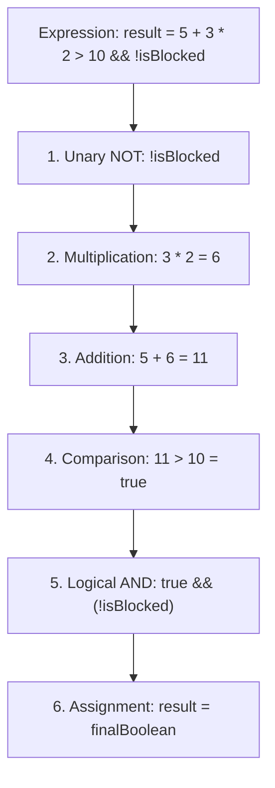

# Operators, Expressions & Precedence Rules

> **Phase 1: Java Programming Foundations**  
> *Estimated Reading Time: 35 minutes | Total Practice Effort: ~2.0 hours | Tier: Core Essential*

---

## 1. Purpose & Prerequisites

### Why This Matters in Full Stack Development
Every algorithm, authorization check, business calculation, and data validation rule relies on operators. When a backend server receives an HTTP request, it evaluates operators to verify permissions:
*Is the authentication token valid **AND** is the user an admin **OR** does the account possess editor privileges?*

Misunderstanding operator precedence or failing to leverage **short-circuit evaluation** can lead to subtle production bugs, security loopholes, or runtime `NullPointerException` crashes.

### Prerequisites
- [Topic 1.2: Variables, Primitive Data Types & Memory Sizes](02-variables-types.md)

---

## 2. Plain-English Mental Model

Think of operators as tools in a math workshop:
- **Operands** are the raw materials (values and variables).
- **Operators** are the actions performed on them (adding, comparing, toggling).
- **Expressions** are the assembly lines that produce a final value.
- **Precedence** is the strict order of operations (just like PEMDAS in mathematics).

```
   (user != null)   &&   (user.getAge() >= 18)
      [Left Operand]  [Operator]  [Right Operand]
   ----------------------------------------------
       Result: true or false (Single Boolean)
```

---

## 3. Categories of Java Operators

### 1. Arithmetic Operators
Used to perform standard mathematical calculations:
- `+` (Addition or String concatenation)
- `-` (Subtraction)
- `*` (Multiplication)
- `/` (Division)
- `%` (Modulus: returns the remainder of division; e.g. `10 % 3` is `1`)

### 2. Relational (Comparison) Operators
Produce a `boolean` result (`true` or `false`):
- `==` (Equal to)
- `!=` (Not equal to)
- `>` (Greater than), `>=` (Greater than or equal to)
- `<` (Less than), `<=` (Less than or equal to)

### 3. Logical Operators & Short-Circuiting
- `&&` (Logical AND): Returns `true` if and only if **both** operands are true.
- `||` (Logical OR): Returns `true` if **at least one** operand is true.
- `!` (Logical NOT): Inverts a boolean value (`!true` becomes `false`).

> [!IMPORTANT] Short-Circuit Evaluation
> - `&&` stops evaluating as soon as the left operand is `false` (because the overall result can never be true).
> - `||` stops evaluating as soon as the left operand is `true` (because the overall result is guaranteed true).
> This prevents crashes when checking for `null` references before accessing methods!

### 4. Unary & Increment / Decrement Operators
- `++x` (Pre-increment): Increments `x` by 1 **first**, then returns the new value.
- `x++` (Post-increment): Returns the current value of `x` **first**, then increments `x`.
- `--x` / `x--` (Pre / Post-decrement): Decreases by 1.

### 5. Compound Assignment Operators
Shorthands combining an operation with assignment:
`+=`, `-=`, `*=`, `/=`, `%=`.  
*(e.g., `balance += 50;` is equivalent to `balance = balance + 50;`)*

---

## 4. Working Code Example: Operators in Action

```java
// File: OperatorDemonstrator.java
public class OperatorDemonstrator {
    public static void main(String[] args) {
        // 1. Modulus & Arithmetic
        int totalRequests = 103;
        int batchSize = 10;
        int remainingItems = totalRequests % batchSize;
        System.out.println("Remaining items after batching: " + remainingItems); // 3

        // 2. Prefix vs Postfix Increment
        int counterA = 5;
        int resultA = ++counterA; // counterA becomes 6, then assigned to resultA
        System.out.println("Prefix: counter=" + counterA + ", result=" + resultA); // 6, 6

        int counterB = 5;
        int resultB = counterB++; // resultB gets 5, then counterB becomes 6
        System.out.println("Postfix: counter=" + counterB + ", result=" + resultB); // 6, 5

        // 3. Short-Circuit Evaluation
        int requestCount = 0;
        boolean isServerHealthy = true;

        // The right-hand side (requestCount++) will NEVER execute because isServerHealthy is true!
        boolean canProceed = isServerHealthy || (++requestCount > 0);
        System.out.println("canProceed: " + canProceed);
        System.out.println("requestCount (was not incremented!): " + requestCount); // 0

        // 4. Ternary Operator: (condition) ? valueIfTrue : valueIfFalse
        int userAge = 20;
        String accessLevel = (userAge >= 18) ? "FULL_ACCESS" : "RESTRICTED";
        System.out.println("Access Level: " + accessLevel);
    }
}
```

### Exact Output:
```text
Remaining items after batching: 3
Prefix: counter=6, result=6
Postfix: counter=6, result=5
canProceed: true
requestCount (was not incremented!): 0
Access Level: FULL_ACCESS
```

---

## 5. Under the Hood: Operator Precedence & Evaluation Order

When an expression contains multiple operators, Java evaluates them in strict precedence order (from highest priority to lowest):

| Priority | Operator Category | Operators | Associativity |
| :--- | :--- | :--- | :--- |
| **1 (Highest)** | Postfix | `expr++`, `expr--` | Left to Right |
| **2** | Unary (Prefix) | `++expr`, `--expr`, `+`, `-`, `!`, `~` | Right to Left |
| **3** | Multiplicative | `*`, `/`, `%` | Left to Right |
| **4** | Additive | `+`, `-` | Left to Right |
| **5** | Relational | `<`, `<=`, `>`, `>=` | Left to Right |
| **6** | Equality | `==`, `!=` | Left to Right |
| **7** | Logical AND | `&&` | Left to Right |
| **8** | Logical OR | `\|\|` | Left to Right |
| **9** | Ternary | `? :` | Right to Left |
| **10 (Lowest)** | Assignment | `=`, `+=`, `-=`, `*=`, `/=`, `%=` | Right to Left |



> [!TIP] Production Rule: Always Use Parentheses
> Never rely on your teammates remembering subtle precedence rules. Use parentheses `()` to make grouping explicit and readable:
> ```java
> // Ambiguous and prone to misunderstanding:
> boolean allow = a || b && c == d;
> 
> // Clear, self-documenting code:
> boolean allow = a || (b && (c == d));
> ```

---

## 6. Common Rookie Mistakes & Compiler Traps

### Trap 1: Accidentally Using Single `&` and `|` instead of `&&` and `||`
- `&&` and `||` are **short-circuit conditional operators**.
- `&` and `|` are **bitwise operators** (or non-short-circuit boolean operators).
```java
String token = null;

// SAFE: Short-circuits immediately. The second check is never reached!
if (token != null && token.length() > 0) { ... }

// DANGEROUS: Evaluates BOTH sides even if token is null!
if (token != null & token.length() > 0) { ... } 
// Throws: java.lang.NullPointerException!
```

### Trap 2: Confusing Assignment `=` with Equality `==`
```java
boolean isActive = false;
if (isActive = true) { // Assigns true to isActive and evaluates to true!
    System.out.println("User is active!"); // Always executes!
}
```
**Fix:** Always use `==` for comparison, or simply write `if (isActive)`.

### Trap 3: Unintended Post-Increment in Return/Assignment
```java
int count = 0;
count = count++; // Traps: Evaluates to 0, then assigns 0 back to count!
System.out.println(count); // Prints: 0 (NOT 1!)
```

---

## 7. Practical Application: Full Stack Security Guard

In web application security filters, operators guard sensitive API endpoints:

```java
// Example: Request authorization check in a backend microservice
boolean isTokenValid = true;
boolean isExpired = false;
boolean isAdminRole = false;
boolean isOwner = true;

// Only allow if token is valid AND not expired AND (user is an Admin OR the resource Owner)
boolean isAuthorized = isTokenValid && !isExpired && (isAdminRole || isOwner);
```
Without parentheses around `(isAdminRole || isOwner)`, operator precedence would evaluate `!isExpired && isAdminRole` first, potentially allowing unauthorized owners with expired tokens to access the endpoint!

---

## 8. Guided Hands-On Exercise

### Challenge: Rate Limiting & User Admission Filter
Create a program named `AccessController.java` to determine whether an incoming web request should be admitted:
1. Define the following variables:
   - `requestCount` (`int`): `45`
   - `maxAllowedRequests` (`int`): `50`
   - `isVipUser` (`boolean`): `false`
   - `hasActiveSession` (`boolean`): `true`
   - `isIpBlacklisted` (`boolean`): `false`
2. Formulate a single boolean expression `isAllowed` that evaluates to `true` if and only if:
   - The user is **NOT** blacklisted, **AND**
   - The user has an active session, **AND**
   - Either the user is a VIP user **OR** their `requestCount` is strictly less than `maxAllowedRequests`.
3. If allowed, increment `requestCount` by 1 using pre-increment.
4. Print the final admission status and updated request count.

<details>
<summary>💡 Hint 1: Logical Combination</summary>

Combine the rules using `!isIpBlacklisted && hasActiveSession && (isVipUser || requestCount < maxAllowedRequests)`.
</details>

<details>
<summary>💡 Hint 2: Pre-Increment</summary>

Use `++requestCount` to increment when access is granted.
</details>

<details>
<summary>✅ Solution</summary>

```java
public class AccessController {
    public static void main(String[] args) {
        int requestCount = 45;
        int maxAllowedRequests = 50;
        boolean isVipUser = false;
        boolean hasActiveSession = true;
        boolean isIpBlacklisted = false;

        boolean isAllowed = !isIpBlacklisted 
                            && hasActiveSession 
                            && (isVipUser || requestCount < maxAllowedRequests);

        if (isAllowed) {
            ++requestCount;
            System.out.println("Access Granted! Updated Request Count: " + requestCount);
        } else {
            System.out.println("Access Denied! Request blocked by security policy.");
        }
    }
}
```

**Terminal Output:**
```text
Access Granted! Updated Request Count: 46
```
</details>

---

## 9. Knowledge Check & Interview Defense

### Quick Quiz
1. **Given `boolean a = false; boolean b = (a && (++x > 0));`, what happens to `x`?**
   - [ ] A) `x` is incremented by 1.
   - [x] B) `x` is unchanged because `&&` short-circuits on the first `false` operand.
   - [ ] C) A compiler error occurs.
   - [ ] D) `x` is reset to 0.

2. **What is the value of `int z = 10 + 2 * 3;`?**
   - [ ] A) 36
   - [x] B) 16 (multiplication has higher precedence than addition)
   - [ ] C) 26
   - [ ] D) 15

3. **What is the difference between `x++` and `++x`?**
   - [x] A) `++x` increments before returning the value in the expression; `x++` returns the original value first, then increments.
   - [ ] B) `++x` only works on doubles; `x++` only works on ints.
   - [ ] C) There is no difference; they are identical in all contexts.
   - [ ] D) `x++` is deprecated in modern Java.

---

### Junior Developer Interview Q&A

#### Q: "Why is short-circuit evaluation critical for defensive programming and null-safety in Java?"
> **Model Answer:**  
> "In Java, attempting to invoke a method or access an instance variable on a `null` reference throws a runtime `NullPointerException`. Short-circuit evaluation (`&&` and `||`) allows developers to write defensive guard expressions in a single statement.  
> 
> For example:  
> `if (order != null && order.getItemsCount() > 0)`  
> 
> If `order` is `null`, the left-hand condition evaluates to `false`. Because `&&` requires both sides to be true, Java immediately stops evaluation and never executes `order.getItemsCount()`. If non-short-circuiting `&` were used instead, both sides would be evaluated unconditionally, resulting in an immediate application crash."

---

## 10. Mastery Checklist & Next Step

Before moving on, verify that you can:
- [ ] List the primary operator categories and their relative precedence.
- [ ] Explain and demonstrate short-circuit evaluation with `&&` and `||`.
- [ ] Accurately predict output differences between `var++` and `++var`.
- [ ] Construct safe compound conditional expressions with defensive null guards.

👉 **Next Lesson:** **[Topic 1.4: Conditional Control Flow (if-else, Ternary, switch)](04-conditionals.md)**
