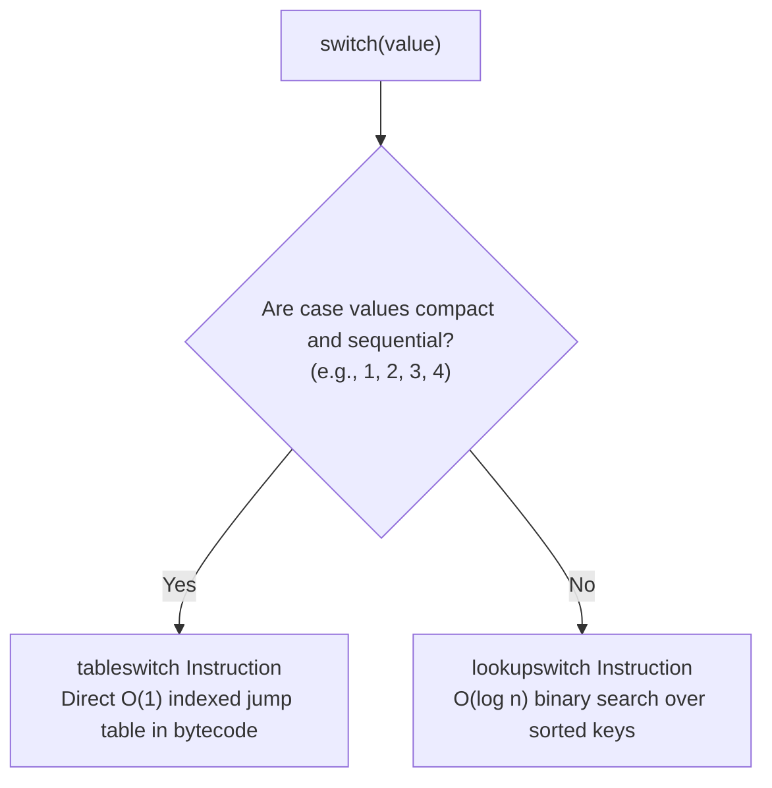

# Conditional Control Flow (if-else, Ternary, switch)

> **Phase 1: Java Programming Foundations**  
> *Estimated Reading Time: 40 minutes | Total Practice Effort: ~2.5 hours | Tier: Core Essential*

---

## 1. Purpose & Prerequisites

### Why This Matters in Full Stack Development
Software is essentially decision-making at scale. In a full-stack system, every API endpoint makes conditional decisions:
- *Has this user paid for a premium subscription?*
- *Is the request payload valid or should we return HTTP 400 Bad Request?*
- *Did the database query succeed (HTTP 200 OK) or fail with a conflict (HTTP 409 Conflict)?*

Mastering conditional structures (`if-else`, ternary expressions, and modern Java 14+ `switch` expressions) ensures your code branches cleanly without confusing nested logic or subtle fall-through bugs.

### Prerequisites
- [Topic 1.3: Operators, Expressions & Precedence Rules](03-operators.md)

---

## 2. Plain-English Mental Model

Think of conditional control flow as a train moving along a railway track:

```
                      [Condition A: User Is Admin?]
                               /         \
                       (Yes)  /           \  (No)
                             v             v
             [Grant Admin Dashboard]   [Condition B: User Is Member?]
                                            /           \
                                    (Yes)  /             \  (No)
                                          v               v
                           [Grant Member Portal]    [Redirect to Login]
```

- **`if / else if / else`** provides sequential branching forks.
- **Guard Clauses** act as emergency brakes, terminating execution early if prerequisites fail.
- **`switch`** acts as a multi-track railway turntable, instantly directing the train to the matching platform based on a single key value.

---

## 3. Core Branching Constructs

### 1. `if`, `else if`, and `else`
Evaluates boolean expressions in top-to-bottom order. As soon as one branch evaluates to `true`, its block executes and the remaining branches are skipped.

```java
int score = 85;
if (score >= 90) {
    System.out.println("Grade: A");
} else if (score >= 80) {
    System.out.println("Grade: B");
} else {
    System.out.println("Grade: C or below");
}
```

### 2. Guard Clause Pattern (Clean Code Best Practice)
Instead of nesting `if` statements inside `if` statements (creating a hard-to-read "Pyramid of Doom"), check for failure conditions first and exit early:

```java
// Anti-pattern: Deep nesting
if (isLoggedIn) {
    if (hasActiveSubscription) {
        if (hasDownloadCredits) {
            processDownload();
        }
    }
}

// Clean pattern: Guard clauses
if (!isLoggedIn) return;
if (!hasActiveSubscription) return;
if (!hasDownloadCredits) return;

processDownload();
```

### 3. Ternary Operator (`? :`)
A concise expression for choosing between two values based on a condition:
```java
String status = (userBalance > 0) ? "ACTIVE" : "SUSPENDED";
```

### 4. Modern Java 14+ Enhanced `switch` Expressions
Traditional Java `switch` statements required tedious `case`, `break;`, and risk accidental fallthrough. Modern Java introduces switch expressions using arrow syntax (`->`), multiple comma-separated case labels, and direct value assignment:

```java
String userRole = "ADMIN";

// Modern switch expression: clean, exhaustive, no breaks needed!
String dashboardRoute = switch (userRole) {
    case "ADMIN", "SUPERADMIN" -> "/admin/console";
    case "STAFF"               -> "/staff/portal";
    case "STUDENT"             -> "/student/courses";
    default                    -> "/login";
};
```

---

## 4. Working Code Example: HTTP Response Dispatcher

```java
// File: HttpResponseDispatcher.java
public class HttpResponseDispatcher {
    public static void main(String[] args) {
        int httpStatusCode = 404;

        // 1. Classical if-else check
        String category;
        if (httpStatusCode >= 200 && httpStatusCode < 300) {
            category = "SUCCESS";
        } else if (httpStatusCode >= 400 && httpStatusCode < 500) {
            category = "CLIENT_ERROR";
        } else if (httpStatusCode >= 500 && httpStatusCode < 600) {
            category = "SERVER_ERROR";
        } else {
            category = "UNKNOWN";
        }

        // 2. Modern switch expression with arrow syntax
        String userFriendlyMessage = switch (httpStatusCode) {
            case 200 -> "Request processed successfully.";
            case 201 -> "Resource created successfully.";
            case 400 -> "Bad request: Check input parameters.";
            case 401, 403 -> "Security error: Unauthorized access.";
            case 404 -> "Resource not found.";
            case 500 -> "Internal server error: Try again later.";
            default  -> {
                // Multi-line block in switch expression requires 'yield'
                String logMessage = "Unhandled status code: " + httpStatusCode;
                yield logMessage;
            }
        };

        System.out.println("Category: " + category);
        System.out.println("Status (" + httpStatusCode + "): " + userFriendlyMessage);
    }
}
```

### Exact Output:
```text
Category: CLIENT_ERROR
Status (404): Resource not found.
```

---

## 5. Under the Hood: `tableswitch` vs `lookupswitch`

How does the JVM optimize `switch` statements compared to long chains of `if-else`?



- In an `if-else` chain, the CPU must evaluate each condition sequentially until a match is found ($O(n)$ time complexity).
- In a `switch` on integer values, the Java compiler emits either:
  1. **`tableswitch`**: If the numbers are consecutive (e.g. 1, 2, 3, 4), the JVM allocates a direct jump table in bytecode. Finding the target branch is a direct index lookup ($O(1)$ constant time).
  2. **`lookupswitch`**: If numbers are sparse (e.g. 100, 404, 9999), the bytecode sorts the keys and performs a binary search ($O(\log n)$ time).

---

## 6. Common Rookie Mistakes & Compiler Traps

### Trap 1: The Missing `break` in Traditional `switch` (Fall-through)
```java
// TRADITIONAL SWITCH GOTCHA
int tier = 1;
switch (tier) {
    case 1:
        System.out.println("Gold Tier"); // No break!
    case 2:
        System.out.println("Silver Tier"); // Executes accidentally!
        break;
}
```
**Output:**
```text
Gold Tier
Silver Tier
```
> [!WARNING]
> In traditional `switch`, forgetting `break;` causes execution to "fall through" into the next case! Use modern arrow switch (`case 1 -> ...`) to eliminate this trap completely.

### Trap 2: Comparing Strings with `==` in Conditionals
```java
String inputRole = "admin";
if (inputRole == "admin") { ... } // RISKY: Compares memory addresses, not string characters!
```
> [!IMPORTANT] Production Rule
> In Java, **never** compare objects (including Strings) using `==`. Always use `.equals()`:
> ```java
> if ("admin".equals(inputRole)) { ... }
> ```

### Trap 3: Dangling `else` and Missing Curly Braces
```java
if (isAuthenticated)
    if (isAdmin)
        openAdminConsole();
else // WARNING: This else binds to 'if (isAdmin)', NOT 'if (isAuthenticated)'!
    redirectToLogin();
```
> [!TIP]
> Always wrap your conditional bodies in curly braces `{}` even if they are only one line long.

---

## 7. Practical Application: Full Stack Role-Based Access Control

In a full-stack REST API, a controller method inspects user roles to decide which API data to return:

```java
public String getDashboardData(String role, boolean isTwoFactorVerified) {
    // 1. Guard against unauthenticated/unverified users
    if (!isTwoFactorVerified) {
        return "ERROR: Two-Factor Authentication Required";
    }

    // 2. Dispatch data access level via switch expression
    return switch (role.toUpperCase()) {
        case "ROOT_ADMIN" -> "Full System Telemetry & User Audit Logs";
        case "MANAGER"    -> "Department Revenue & Staff Schedules";
        case "EMPLOYEE"   -> "Assigned Tasks & Personal Profile";
        default           -> "Public Announcements Only";
    };
}
```

---

## 8. Guided Hands-On Exercise

### Challenge: Order Shipping Cost Calculator
Create a program named `ShippingCalculator.java` that calculates shipping fees based on package weight and destination zone:
1. Define the following variables:
   - `destinationZone` (`String`): `"DOMESTIC_EXPRESS"` (possible values: `"LOCAL"`, `"DOMESTIC_STANDARD"`, `"DOMESTIC_EXPRESS"`, `"INTERNATIONAL"`)
   - `packageWeightKg` (`double`): `4.5`
   - `orderTotal` (`double`): `120.00`
2. Apply the following business rules:
   - If `orderTotal` is `>= $100.00` and the zone is `"LOCAL"` or `"DOMESTIC_STANDARD"`, shipping is **free** (`$0.00`).
   - Otherwise, calculate shipping using a modern switch expression on `destinationZone`:
     - `"LOCAL"` &rarr; Base fee `$5.00` + `$1.00` per kg.
     - `"DOMESTIC_STANDARD"` &rarr; Base fee `$8.00` + `$1.50` per kg.
     - `"DOMESTIC_EXPRESS"` &rarr; Base fee `$15.00` + `$2.50` per kg.
     - `"INTERNATIONAL"` &rarr; Base fee `$30.00` + `$5.00` per kg.
     - Any unknown zone &rarr; Print an error and set fee to `-1.0`.
3. Print the computed shipping cost and final customer invoice total (`orderTotal + shippingCost`).

<details>
<summary>💡 Hint 1: Free Shipping Guard</summary>

Check the free shipping threshold first:
```java
boolean qualifiesForFreeShipping = orderTotal >= 100.0 && 
    ("LOCAL".equals(destinationZone) || "DOMESTIC_STANDARD".equals(destinationZone));
```
</details>

<details>
<summary>💡 Hint 2: Calculating Shipping Fee</summary>

```java
double fee = switch (destinationZone) {
    case "LOCAL" -> 5.0 + (1.0 * packageWeightKg);
    case "DOMESTIC_STANDARD" -> 8.0 + (1.5 * packageWeightKg);
    case "DOMESTIC_EXPRESS" -> 15.0 + (2.5 * packageWeightKg);
    case "INTERNATIONAL" -> 30.0 + (5.0 * packageWeightKg);
    default -> -1.0;
};
```
</details>

<details>
<summary>✅ Solution</summary>

```java
public class ShippingCalculator {
    public static void main(String[] args) {
        String destinationZone = "DOMESTIC_EXPRESS";
        double packageWeightKg = 4.5;
        double orderTotal = 120.00;

        boolean qualifiesForFreeShipping = orderTotal >= 100.0 && 
            ("LOCAL".equals(destinationZone) || "DOMESTIC_STANDARD".equals(destinationZone));

        double shippingCost;
        if (qualifiesForFreeShipping) {
            shippingCost = 0.0;
        } else {
            shippingCost = switch (destinationZone) {
                case "LOCAL" -> 5.00 + (1.00 * packageWeightKg);
                case "DOMESTIC_STANDARD" -> 8.00 + (1.50 * packageWeightKg);
                case "DOMESTIC_EXPRESS" -> 15.00 + (2.50 * packageWeightKg);
                case "INTERNATIONAL" -> 30.00 + (5.00 * packageWeightKg);
                default -> -1.0;
            };
        }

        if (shippingCost < 0) {
            System.out.println("Error: Unrecognized shipping zone '" + destinationZone + "'");
        } else {
            double finalInvoice = orderTotal + shippingCost;
            System.out.println("Order Subtotal: $" + orderTotal);
            System.out.println("Shipping Zone: " + destinationZone + " (" + packageWeightKg + " kg)");
            System.out.println("Shipping Fee: $" + shippingCost);
            System.out.println("Total Amount Due: $" + finalInvoice);
        }
    }
}
```

**Terminal Output:**
```text
Order Subtotal: $120.0
Shipping Zone: DOMESTIC_EXPRESS (4.5 kg)
Shipping Fee: $26.25
Total Amount Due: $146.25
```
</details>

---

## 9. Knowledge Check & Interview Defense

### Quick Quiz
1. **What keyword must be used in a multi-line block within a modern switch expression to return a value?**
   - [ ] A) `return`
   - [x] B) `yield`
   - [ ] C) `break`
   - [ ] D) `output`

2. **Why is the guard clause pattern preferred over deeply nested `if-else` blocks?**
   - [x] A) It flattens code structure, reduces cyclomatic complexity, and makes business rules easier to read and test.
   - [ ] B) Nested `if` statements run 10x slower on modern CPUs.
   - [ ] C) Java limits nesting to a maximum of 3 levels.
   - [ ] D) It avoids heap memory allocation.

3. **What is the outcome if a traditional `switch` block lacks a `break` statement after a matching case?**
   - [ ] A) A compiler error is thrown.
   - [ ] B) The JVM terminates with an exception.
   - [x] C) Execution falls through into subsequent cases regardless of their case values.
   - [ ] D) The default case is automatically executed.

---

### Junior Developer Interview Q&A

#### Q: "What are the advantages of modern Java switch expressions (`->`) over traditional switch statements?"
> **Model Answer:**  
> "Modern Java switch expressions (introduced in Java 14) provide three major improvements:
> 1. **No Accidental Fall-Through:** Arrow syntax (`case ->`) executes only the matched branch. There is no need for manual `break;` statements, eliminating fall-through bugs.
> 2. **Returns a Value Directly:** A switch expression can be assigned directly to a variable (`String res = switch(...)`), reducing boilerplate variable initialization.
> 3. **Multiple Case Labels:** Multiple comma-separated matching values can share the same branch (e.g. `case 401, 403 ->`).
> 4. **Exhaustiveness Checking:** The compiler forces the developer to handle all possible values (or include a `default` branch), preventing unhandled state bugs."

---

## 10. Mastery Checklist & Next Step

Before moving on, verify that you can:
- [ ] Implement multi-branch decisions using `if`, `else if`, and `else`.
- [ ] Refactor nested `if` statements into clean guard clauses with early returns.
- [ ] Write modern Java 14+ switch expressions using arrow syntax (`->`) and `yield`.
- [ ] Safely compare Strings using `.equals()` rather than `==`.

👉 **Next Lesson:** **[Topic 1.5: Iteration & Loops (while, do-while, for, loop controls)](05-loops.md)**
