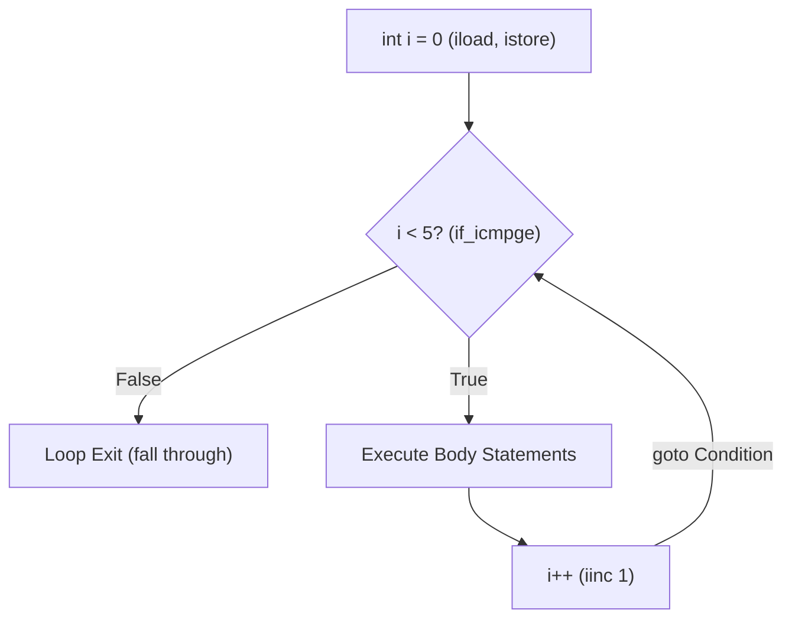

# Iteration & Loops (while, do-while, for, loop controls)

> **Phase 1: Java Programming Foundations**  
> *Estimated Reading Time: 45 minutes | Total Practice Effort: ~3.0 hours | Tier: Core Essential*

---

## 1. Purpose & Prerequisites

### Why This Matters in Full Stack Development
In real-world software engineering, computers excel at executing repetitive tasks with speed and consistency. Consider scenarios such as:
- Processing paginated database records retrieved 50 at a time.
- Retrying an external payment gateway call if a temporary network timeout occurs.
- Generating HTML table rows dynamically from an array of products.

Loops allow your programs to repeat a block of code until a specific condition is met. Understanding the distinct behavior of `while`, `do-while`, standard `for`, and loop jump statements (`break`, `continue`, labeled loops) is essential to avoiding infinite loops and CPU-spinning performance defects.

### Prerequisites
- [Topic 1.4: Conditional Control Flow (if-else, Ternary, switch)](04-conditionals.md)

---

## 2. Plain-English Mental Model

Think of loops like everyday repeating processes:

```
[ while Loop ]                [ do-while Loop ]            [ for Loop ]
"Check ticket BEFORE riding"   "Ride at least ONCE, check   "Turn lap counter 10 times"
(0 or more runs)               ticket before re-entry"      (Fixed count loop)
```

1. **`while` loop:** Checks the condition **before** entering the loop body. If the condition is initially `false`, the body executes **zero** times.
2. **`do-while` loop:** Executes the loop body **first**, then checks the condition at the end. The body is guaranteed to execute **at least once**.
3. **`for` loop:** Bundles initialization, condition check, and loop increment into a single line. Perfect when you know the number of iterations in advance.
4. **Enhanced `for-each` loop:** A clean syntax for traversing every element in an array or collection without manual index counters.

---

## 3. The Anatomy of Java Loops

### 1. Standard `for` Loop
```java
// for (initialization; termination condition; update step)
for (int i = 0; i < 5; i++) {
    System.out.println("Processing item index: " + i);
}
```

### 2. `while` Loop
Ideal when the number of iterations depends on runtime events (e.g., reading until end of file, waiting for a queue to empty):
```java
int attempts = 0;
while (attempts < 3) {
    System.out.println("Attempt #" + attempts);
    attempts++; // Incrementing is mandatory to avoid infinite loop!
}
```

### 3. `do-while` Loop
Ideal for menu prompts or operations that must run at least once before testing:
```java
int responseCode;
do {
    responseCode = pingServer();
} while (responseCode == 503); // Retry as long as service is unavailable
```

### 4. Loop Controls: `break`, `continue`, and Labeled Jumps
- **`break`**: Immediately terminates the enclosing loop and jumps to the statement following the loop.
- **`continue`**: Skips the remaining statements in the current iteration and jumps directly to the next iteration (updating the loop counter).
- **Labeled Loops**: In nested loops, a label allows breaking or continuing an **outer** loop directly from inside an inner loop.

```java
outerLoop:
for (int row = 0; row < 3; row++) {
    for (int col = 0; col < 3; col++) {
        if (row == 1 && col == 1) {
            System.out.println("Target found at [1,1]! Breaking outer loop.");
            break outerLoop; // Exits BOTH loops immediately!
        }
    }
}
```

---

## 4. Working Code Example: Batch Processing & Loop Controls

```java
// File: LoopShowcase.java
public class LoopShowcase {
    public static void main(String[] args) {
        System.out.println("=== 1. Filtering with continue ===");
        // Print only even user IDs between 1 and 6
        for (int userId = 1; userId <= 6; userId++) {
            if (userId % 2 != 0) {
                continue; // Skip odd user IDs
            }
            System.out.println("Dispatching email to User ID: " + userId);
        }

        System.out.println("\n=== 2. Early exit with break ===");
        int[] transactionAmounts = {10, 25, -1, 50, 80}; // -1 represents corrupt data
        for (int amount : transactionAmounts) {
            if (amount < 0) {
                System.out.println("ALERT: Corrupt transaction detected (" + amount + ")! Aborting batch.");
                break;
            }
            System.out.println("Processed valid transaction: $" + amount);
        }

        System.out.println("\n=== 3. do-while Guarantee ===");
        int pageIndex = 1;
        int totalPages = 1;
        do {
            System.out.println("Fetching API data for page: " + pageIndex);
            pageIndex++;
        } while (pageIndex <= totalPages);
    }
}
```

### Exact Output:
```text
=== 1. Filtering with continue ===
Dispatching email to User ID: 2
Dispatching email to User ID: 4
Dispatching email to User ID: 6

=== 2. Early exit with break ===
Processed valid transaction: $10
Processed valid transaction: $25
ALERT: Corrupt transaction detected (-1)! Aborting batch.

=== 3. do-while Guarantee ===
Fetching API data for page: 1
```

---

## 5. Under the Hood: Bytecode Jump Instructions

At the bytecode level, loops are compiled into comparison instructions (`if_icmpge`, `if_icmplt`) paired with unconditional branch instructions (`goto`):



When you write a loop:
1. The compiler places a label before the condition check.
2. If the condition evaluates to `false`, the bytecode jumps (`if_icmpge`) past the end of the loop.
3. When the loop body finishes, an unconditional `goto` instruction jumps back up to the loop condition.
4. **`continue`** simply issues a jump directly to the update instruction (`iinc`).
5. **`break`** issues a jump directly past the loop's concluding bytecode.

---

## 6. Common Rookie Mistakes & Compiler Traps

### Trap 1: Accidental Semicolon on Loop Header
```java
// GOTCHA: Semicolon ends the loop statement immediately!
for (int i = 0; i < 5; i++); 
{
    System.out.println("Hello"); // This block runs ONCE, after the loop finishes!
}
```
> [!CAUTION]
> Placing a semicolon `;` immediately after `for(...)` or `while(...)` creates an empty loop body. The block in braces `{}` becomes an independent local block that executes only once after the loop has already counted to completion.

### Trap 2: Off-By-One Errors (Fencepost Errors)
```java
int[] items = {10, 20, 30}; // Length is 3, valid indices are 0, 1, 2

for (int i = 0; i <= items.length; i++) { // BUG: '<=' instead of '<'
    System.out.println(items[i]);
}
```
**Runtime Error:**
```text
Exception in thread "main" java.lang.ArrayIndexOutOfBoundsException: Index 3 out of bounds for length 3
```
> [!TIP]
> In 0-indexed sequences, standard traversal always uses `< array.length`, never `<=`.

### Trap 3: The Infinite Loop (Forgetting Loop Update)
```java
int count = 0;
while (count < 5) {
    System.out.println("Processing...");
    // Forgot count++;! This loop runs forever, pegging CPU at 100%!
}
```

---

## 7. Practical Application: Full Stack Network Retry with Backoff

In cloud microservices, network connections to databases, caches, or third-party APIs can intermittently fail. Production applications use a retry loop with exponential backoff:

```
[ Request Attempt 1 ] ---> (Failed: 503) ---> Wait 100ms
[ Request Attempt 2 ] ---> (Failed: 503) ---> Wait 200ms
[ Request Attempt 3 ] ---> (Success: 200 OK) ---> Break loop!
```

---

## 8. Guided Hands-On Exercise

### Challenge: Resilient API Client Retry Simulator
Create a program named `ApiRetrySimulator.java` that simulates retrying a failed HTTP network call:
1. Define the following variables:
   - `maxAttempts` (`int`): `5`
   - `attempt` (`int`): `1`
   - `successAttemptTarget` (`int`): `3` (simulates that attempt #3 will succeed)
   - `backoffDelayMs` (`int`): `100` (initial delay in milliseconds)
2. Use a `while` loop that runs as long as `attempt <= maxAttempts`.
3. Inside the loop:
   - Print: `"[Attempt X] Sending request to https://api.store.com/orders..."`
   - Check if `attempt == successAttemptTarget`:
     - If yes, print: `"SUCCESS: HTTP 200 OK received! Response parsed."` and immediately `break` out of the loop.
     - If no, print: `"FAILED: HTTP 503 Service Unavailable. Waiting [Y]ms before retry..."`
   - Double `backoffDelayMs` (`backoffDelayMs *= 2`) for exponential backoff.
   - Increment `attempt`.
4. After the loop, if `attempt > maxAttempts`, print: `"CRITICAL: Maximum retry attempts reached. Request aborted."`

<details>
<summary>💡 Hint 1: Exponential Backoff</summary>

Update the delay inside the failure branch: `backoffDelayMs *= 2;`.
</details>

<details>
<summary>💡 Hint 2: Loop Exit Flag</summary>

Track whether success occurred using a boolean flag `boolean isSuccessful = false;` or check `attempt <= maxAttempts`.
</details>

<details>
<summary>✅ Solution</summary>

```java
public class ApiRetrySimulator {
    public static void main(String[] args) {
        int maxAttempts = 5;
        int attempt = 1;
        int successAttemptTarget = 3;
        int backoffDelayMs = 100;
        boolean isConnected = false;

        while (attempt <= maxAttempts) {
            System.out.println("[Attempt " + attempt + "] Sending request to https://api.store.com/orders...");
            
            if (attempt == successAttemptTarget) {
                System.out.println("SUCCESS: HTTP 200 OK received! Response parsed.");
                isConnected = true;
                break;
            }

            System.out.println("FAILED: HTTP 503 Service Unavailable. Waiting " + backoffDelayMs + "ms before retry...");
            backoffDelayMs *= 2; // Exponential backoff
            attempt++;
        }

        if (!isConnected) {
            System.out.println("CRITICAL: Maximum retry attempts reached. Request aborted.");
        }
    }
}
```

**Terminal Output:**
```text
[Attempt 1] Sending request to https://api.store.com/orders...
FAILED: HTTP 503 Service Unavailable. Waiting 100ms before retry...
[Attempt 2] Sending request to https://api.store.com/orders...
FAILED: HTTP 503 Service Unavailable. Waiting 200ms before retry...
[Attempt 3] Sending request to https://api.store.com/orders...
SUCCESS: HTTP 200 OK received! Response parsed.
```
</details>

---

## 9. Knowledge Check & Interview Defense

### Quick Quiz
1. **Which loop guarantees that its body will execute at least once?**
   - [ ] A) `while` loop
   - [x] B) `do-while` loop
   - [ ] C) `for` loop
   - [ ] D) Enhanced `for-each` loop

2. **What does the `continue` statement do inside a loop?**
   - [ ] A) Terminates the entire loop completely.
   - [x] B) Skips the remaining statements in the current iteration and jumps to the next iteration.
   - [ ] C) Restarts the loop from the initial condition.
   - [ ] D) Exits the enclosing method.

3. **How do you break out of an outer loop from inside a nested inner loop?**
   - [ ] A) Call `break.outer;`
   - [ ] B) Call `break 2;`
   - [x] C) Prefix the outer loop with a label (e.g. `outer: for(...)`) and invoke `break outer;`
   - [ ] D) Nested loops cannot be broken simultaneously.

---

### Junior Developer Interview Q&A

#### Q: "When should you use a `while` loop versus a `for` loop in Java?"
> **Model Answer:**  
> "Use a **`for` loop** when the number of iterations is known before entering the loop—such as iterating from index $0$ to $N-1$ over an array, traversing a fixed range, or performing a task a predetermined number of times. The `for` loop keeps loop initialization, condition, and increment cleanly organized in a single line.  
> 
> Use a **`while` loop** when the number of iterations is non-deterministic and depends on dynamic conditions or external events—such as polling an asynchronous job status, reading lines from an HTTP socket until EOF, or retrying a network operation until a successful response or timeout occurs."

---

## 10. Mastery Checklist & Next Step

Before moving on, verify that you can:
- [ ] Choose the appropriate loop construct (`for`, `while`, `do-while`) for a given problem.
- [ ] Use `break` and `continue` appropriately to control loop flow.
- [ ] Implement labeled break statements to break out of nested iterations.
- [ ] Diagnose and prevent off-by-one errors and infinite loops.

👉 **Next Lesson:** **[Topic 1.6: Methods, Scope & Parameter Passing (Pass-by-Value)](06-methods-scope.md)**
