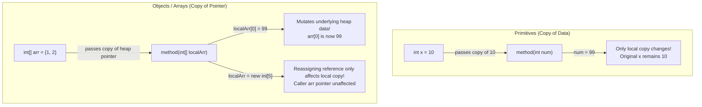

# Methods, Scope & Parameter Passing (Pass-by-Value)

> **Phase 1: Java Programming Foundations**  
> *Estimated Reading Time: 45 minutes | Total Practice Effort: ~3.0 hours | Tier: Core Essential*

---

## 1. Purpose & Prerequisites

### Why This Matters in Full Stack Development
In production systems, monolithic blocks of code with thousands of lines inside a single `main` method are impossible to maintain, test, or debug. **Methods** allow you to decompose complex business processes into small, reusable, and testable units of logic.

Crucially, every developer must understand how Java handles parameters under the hood. One of the most infamous interview questions—and sources of production bugs—is whether Java is "pass-by-value" or "pass-by-reference". Mastering Java's stack frames and parameter-passing mechanics gives you complete confidence when refactoring functions and manipulating shared data.

### Prerequisites
- [Topic 1.5: Iteration & Loops (while, do-while, for, loop controls)](05-loops.md)

---

## 2. Plain-English Mental Model

Think of a method like a specialized workplace office department:

```
[ Caller: main() ]
       |
       | 1. Sends photocopied requisition (Parameter: Pass-by-Value)
       v
[ Department: calculateTax() ]
       |
       | 2. Performs work in its own private office (Stack Frame)
       v
[ Return Value ] ----> Returns final calculated amount back to Caller
```

- When you call a method, Java opens a private temporary workspace for it on the **Call Stack** (called a **Stack Frame**).
- When the method finishes (`return`), that temporary workspace is completely wiped from memory.
- Any parameter passed to a method is **photocopied**. The method works on its own copy—never the original variable.

---

## 3. Anatomy of a Java Method

```java
// [access modifier] [static] [return type] [methodName]([parameters])
public static double calculateTotal(double subtotal, double taxRate) {
    double tax = subtotal * taxRate; // local variable
    return subtotal + tax;           // return value
}
```

### Components:
1. **Access Modifier (`public` / `private`):** Determines who can call this method.
2. **`static`:** Means the method belongs to the class itself and can be called without instantiating an object (e.g. `Math.sqrt()`).
3. **Return Type:** The data type of the result returned by the method. If nothing is returned, the return type is `void`.
4. **Method Name:** Verb-based camelCase identifier (e.g., `calculateTotal`, `findUserById`).
5. **Parameters:** Comma-separated list of inputs with declared types.
6. **Method Signature:** The method name combined with its parameter types (e.g., `calculateTotal(double, double)`). Return types are **not** part of the signature.

---

## 4. The Golden Rule: Java is Strictly Pass-by-Value

> [!IMPORTANT]
> **Java is 100% strictly Pass-by-Value. There are no exceptions.**  
> What does "value" mean?
> - For **primitives** (`int`, `double`, `boolean`, etc.), the value is the **actual raw bits/number**.
> - For **objects and arrays**, the value is the **memory address reference** pointing to the heap.



---

## 5. Working Code Example: Proving Pass-by-Value

```java
// File: PassByValueDemo.java
import java.util.Arrays;

public class PassByValueDemo {
    public static void main(String[] args) {
        // 1. Primitive Demonstration
        int originalNumber = 50;
        modifyPrimitive(originalNumber);
        System.out.println("After modifyPrimitive: " + originalNumber); // Still 50!

        // 2. Reference Demonstration: Modifying Heap Content
        int[] scores = {80, 90, 95};
        modifyArrayContent(scores);
        System.out.println("After modifyArrayContent: " + Arrays.toString(scores)); // [100, 90, 95]

        // 3. Reference Demonstration: Reassigning the Reference Itself
        reassignArrayReference(scores);
        System.out.println("After reassignArrayReference: " + Arrays.toString(scores)); // Still [100, 90, 95]!
    }

    public static void modifyPrimitive(int num) {
        num = 999; // Only modifies local stack variable 'num'
    }

    public static void modifyArrayContent(int[] arr) {
        arr[0] = 100; // Mutates heap memory that both caller and callee point to
    }

    public static void reassignArrayReference(int[] arr) {
        arr = new int[]{0, 0, 0}; // Only reassigns local pointer 'arr' to a new heap object!
    }
}
```

### Exact Output:
```text
After modifyPrimitive: 50
After modifyArrayContent: [100, 90, 95]
After reassignArrayReference: [100, 90, 95]
```

### Why this happens:
- In `modifyPrimitive`, the integer `50` was copied into `num`. Changing `num` did not touch `originalNumber`.
- In `modifyArrayContent`, the pointer to the heap array was copied. Both pointers pointed to the exact same array in the heap, so modifying `arr[0]` changed the shared object.
- In `reassignArrayReference`, the local copy of the pointer was pointed to a *new* array. The caller's `scores` pointer remained pointed to the original array.

---

## 6. Method Overloading

**Method Overloading** allows multiple methods in the same class to share the same name, as long as their parameter lists are distinct in:
1. The **number** of parameters, OR
2. The **types** of parameters, OR
3. The **order** of different parameter types.

```java
public class Formatter {
    // Overload 1: Format integer
    public static String format(int value) {
        return "INT: " + value;
    }

    // Overload 2: Format double with currency
    public static String format(double value) {
        return String.format("$%.2f", value);
    }

    // Overload 3: Format with custom prefix
    public static String format(String prefix, double value) {
        return prefix + " " + String.format("$%.2f", value);
    }
}
```

> [!CAUTION] Return Type Alone Cannot Overload
> You cannot overload a method by changing only the return type:
> ```java
> int getData() { return 1; }
> double getData() { return 1.0; } // COMPILER ERROR: Duplicate method getData()!
> ```
> The compiler cannot determine which method to invoke when called as `getData();`.

---

## 7. Common Rookie Mistakes & Compiler Traps

### Trap 1: Variable Shadowing
```java
public class ShadowTrap {
    static int count = 10; // Class-level field

    public static void increment() {
        int count = 5; // Local variable SHADOWS the class variable!
        count++;
        System.out.println("Local count: " + count); // Prints 6
    }
}
```
If you intended to modify the class-level `count`, declaring `int count` created a brand new local variable that masked the outer one.

### Trap 2: Unreachable Code Error
```java
public static int getDiscount(boolean isVip) {
    if (isVip) {
        return 20;
    } else {
        return 5;
    }
    System.out.println("Finished calculation"); // COMPILER ERROR: Unreachable statement!
}
```
Any code placed immediately after an unconditional `return` statement will fail compilation.

---

## 8. Guided Hands-On Exercise

### Challenge: Banking Ledger & Transaction Fee Engine
Create a program named `BankingEngine.java` that models bank account operations with methods:
1. Create overloaded static methods:
   - `applyFee(double balance, double flatFee)` &rarr; Returns a new balance after deducting `flatFee`.
   - `applyFee(double balance, double percentageFee, double minFee)` &rarr; Calculates `balance * (percentageFee / 100.0)`. If calculated fee is less than `minFee`, deducts `minFee`; otherwise deducts calculated fee. Returns new balance.
2. Create a method `resetFlag(boolean isFrozen)`:
   - Sets `isFrozen = false` and prints `"Inside method: " + isFrozen`.
3. In `main`:
   - Start with `double initialBalance = 1000.0;`
   - Apply a flat fee of `$15.0` using Overload 1.
   - Apply a 2.5% fee with a minimum fee of `$20.0` using Overload 2.
   - Test whether passing `boolean accountFrozen = true;` into `resetFlag(accountFrozen)` changes the caller's variable.
   - Print all intermediate and final balances.

<details>
<summary>💡 Hint 1: Overload 2 Calculation</summary>

```java
double fee = balance * (percentageFee / 100.0);
if (fee < minFee) {
    fee = minFee;
}
return balance - fee;
```
</details>

<details>
<summary>💡 Hint 2: Pass-by-value on boolean</summary>

Primitives cannot be modified by the callee. `accountFrozen` in `main` will remain `true`.
</details>

<details>
<summary>✅ Solution</summary>

```java
public class BankingEngine {
    public static void main(String[] args) {
        double balance = 1000.0;
        System.out.println("Starting Balance: $" + balance);

        // 1. Apply flat fee
        balance = applyFee(balance, 15.0);
        System.out.println("After Flat Fee ($15): $" + balance);

        // 2. Apply percentage fee with minimum threshold
        balance = applyFee(balance, 2.5, 20.0); // 2.5% of 985 = $24.625 (greater than $20 min)
        System.out.println("After Percentage Fee (2.5%): $" + balance);

        // 3. Test Pass-by-value
        boolean accountFrozen = true;
        System.out.println("Caller before resetFlag: " + accountFrozen);
        resetFlag(accountFrozen);
        System.out.println("Caller after resetFlag (unchanged!): " + accountFrozen);
    }

    // Overload 1: Flat fee
    public static double applyFee(double currentBalance, double flatFee) {
        return currentBalance - flatFee;
    }

    // Overload 2: Percentage fee with minimum threshold
    public static double applyFee(double currentBalance, double percentageFee, double minFee) {
        double calculatedFee = currentBalance * (percentageFee / 100.0);
        double feeToDeduct = (calculatedFee > minFee) ? calculatedFee : minFee;
        return currentBalance - feeToDeduct;
    }

    public static void resetFlag(boolean isFrozen) {
        isFrozen = false;
        System.out.println("  -> Inside resetFlag method: " + isFrozen);
    }
}
```

**Terminal Output:**
```text
Starting Balance: $1000.0
After Flat Fee ($15): $985.0
After Percentage Fee (2.5%): $960.375
Caller before resetFlag: true
  -> Inside resetFlag method: false
Caller after resetFlag (unchanged!): true
```
</details>

---

## 9. Knowledge Check & Interview Defense

### Quick Quiz
1. **Is Java pass-by-value or pass-by-reference?**
   - [ ] A) Pass-by-reference for objects, pass-by-value for primitives.
   - [x] B) Strictly pass-by-value in all situations. For objects, the value passed is the memory address reference.
   - [ ] C) Pass-by-reference only if using `static` methods.
   - [ ] D) Pass-by-name.

2. **Can two methods in the same class have the same name and parameter types, but different return types?**
   - [ ] A) Yes, this is standard method overloading.
   - [x] B) No, the compiler will report a duplicate method error because return types are not part of the method signature.
   - [ ] C) Yes, but only if both methods are `private`.
   - [ ] D) Yes, but only in Java 21+.

3. **What happens to local variables inside a method when the method finishes execution and returns?**
   - [x] A) Their stack frame is popped off the Call Stack, and the local variables cease to exist.
   - [ ] B) They are automatically moved to the Heap.
   - [ ] C) They are preserved for the next time the method is called.
   - [ ] D) The garbage collector frees them immediately from the CPU registers.

---

### Junior Developer Interview Q&A

#### Q: "Explain what happens when an object reference (like an array or custom object) is passed to a method in Java."
> **Model Answer:**  
> "In Java, everything is passed by value. When an object reference is passed into a method, Java makes a copy of the **reference (the memory address)** and places that copy onto the method's stack frame.  
> 
> Because both the caller's reference and the method's parameter hold copies of the exact same memory address pointing to the heap, any state modifications made via that reference (such as `user.setName('Alice')` or `array[0] = 99`) will be reflected in the caller's object.  
> 
> However, if the method reassigns the parameter variable itself (e.g., `user = new User()`), it merely overwrites its local copy of the pointer. The caller's original reference continues to point to the original object unchanged."

---

## 10. Mastery Checklist & Next Step

Before moving on, verify that you can:
- [ ] Define methods with correct parameter lists, return types, and access modifiers.
- [ ] Overload methods correctly by varying argument types and counts.
- [ ] Diagram how stack frames are allocated and deallocated during method calls.
- [ ] Confidently defend why Java is strictly pass-by-value during technical interviews.

👉 **Next Lesson:** **[Topic 1.7: Arrays: 1D & 2D Arrays, Indexing & Memory Traversal](07-arrays.md)**
