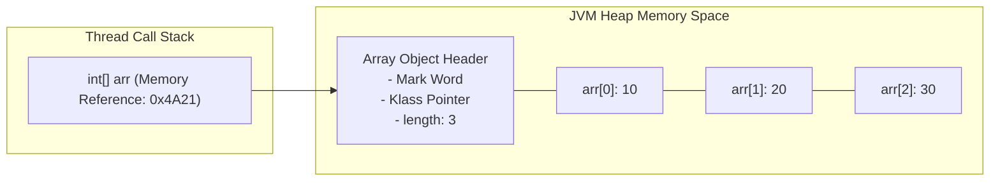

# Arrays: 1D & 2D Arrays, Indexing & Memory Traversal

> **Phase 1: Java Programming Foundations**  
> *Estimated Reading Time: 50 minutes | Total Practice Effort: ~3.5 hours | Tier: Core Essential*

---

## 1. Purpose & Prerequisites

### Why This Matters in Full Stack Development
In any application, you frequently work with grouped sequences of data: a list of student grades, daily temperature readings, pixel buffers in graphics processing, or rows and columns of an analytics dashboard.

An **array** is the most fundamental data structure in computer science. In Java, understanding how arrays allocate contiguous blocks of memory in the **Heap**—and how index lookups achieve instantaneous $O(1)$ performance—is crucial before moving on to higher-level collections like `ArrayList` and `HashMap`.

### Prerequisites
- [Topic 1.6: Methods, Scope & Parameter Passing (Pass-by-Value)](06-methods-scope.md)

---

## 2. Plain-English Mental Model

Think of an array as a row of numbered lockers at a gym:

```
Index:       [0]      [1]      [2]      [3]      [4]
          +--------+--------+--------+--------+--------+
Value:    |   85   |   92   |   78   |   95   |   88   |
          +--------+--------+--------+--------+--------+
Memory:    0x1000   0x1004   0x1008   0x100C   0x1010  (Contiguous 4-byte ints)
```

- **Fixed Capacity:** Once the locker row is built with 5 lockers, you cannot stretch it to 6. If you need more space, you must build a brand new row and move your items over.
- **Instant Access ($O(1)$ Time):** Because every locker is exactly the same size and laid out contiguously, calculating the memory address of locker `[i]` is instantaneous:  
  $$\text{Address} = \text{Base Address} + (i \times \text{Element Size})$$
- **0-Based Indexing:** The first locker is at offset `0` from the start.

---

## 3. Array Declaration, Instantiation & Defaults

In Java, arrays are **objects**. The array reference variable lives on the **Call Stack**, while the array elements live inside the **Heap**.

### 1. Declaration and Allocation with `new`
```java
// Allocates an array of 5 integers. Elements are initialized to default values (0).
int[] scores = new int[5];
```

### 2. Default Values for Array Elements
When an array is allocated with `new`, Java automatically initializes every slot to its type's default value:
- `int`, `byte`, `short`, `long` &rarr; `0`
- `float`, `double` &rarr; `0.0`
- `boolean` &rarr; `false`
- `char` &rarr; `'\u0000'` (null character)
- Any Object (`String`, `User`, etc.) &rarr; `null`

### 3. Array Literals
If you know the elements upfront, you can instantiate and initialize in one line:
```java
String[] supportedCurrencies = {"USD", "EUR", "GBP", "JPY"};
```

---

## 4. 2D Arrays: "Arrays of Arrays"

In Java, multi-dimensional arrays are not true rectangular matrices in memory. Instead, a 2D array is an **array containing references to other 1D arrays**:

```
Stack                     Heap
[ matrix ] ----> [ Row 0 ] ----> [ 10, 20, 30 ]
                 [ Row 1 ] ----> [ 40, 50, 60 ]
                 [ Row 2 ] ----> [ 70, 80, 90 ]
```

Because of this design, Java supports **jagged arrays** (where different rows have different lengths):
```java
int[][] jagged = new int[2][];
jagged[0] = new int[3]; // Row 0 has 3 elements
jagged[1] = new int[5]; // Row 1 has 5 elements
```

---

## 5. Working Code Example: Traversing 1D and 2D Arrays

```java
// File: ArrayPlayground.java
import java.util.Arrays;

public class ArrayPlayground {
    public static void main(String[] args) {
        // 1. 1D Array Processing
        double[] weeklySales = {1250.50, 980.00, 1420.75, 2100.25, 1850.00};

        double totalSales = 0.0;
        double maxSale = weeklySales[0];

        // Standard index-based traversal
        for (int i = 0; i < weeklySales.length; i++) {
            totalSales += weeklySales[i];
            if (weeklySales[i] > maxSale) {
                maxSale = weeklySales[i];
            }
        }
        System.out.println("Total Sales: $" + totalSales);
        System.out.println("Peak Daily Sale: $" + maxSale);

        // 2. java.util.Arrays Utilities
        System.out.println("Array Contents: " + Arrays.toString(weeklySales));
        Arrays.sort(weeklySales); // In-place sorting
        System.out.println("Sorted Sales: " + Arrays.toString(weeklySales));

        // 3. 2D Matrix Traversal (Store x Day Matrix)
        // Rows: Stores (Store 0, Store 1), Columns: Days (Mon, Tue, Wed)
        int[][] storeInventory = {
            {15, 20, 25}, // Store 0
            {30, 40, 35}  // Store 1
        };

        System.out.println("\n--- Store Inventory Matrix ---");
        for (int store = 0; store < storeInventory.length; store++) {
            for (int day = 0; day < storeInventory[store].length; day++) {
                System.out.print(storeInventory[store][day] + "\t");
            }
            System.out.println(); // Newline after each row
        }
    }
}
```

### Exact Output:
```text
Total Sales: $7601.5
Peak Daily Sale: $2100.25
Array Contents: [1250.5, 980.0, 1420.75, 2100.25, 1850.0]
Sorted Sales: [980.0, 1250.5, 1420.75, 1850.0, 2100.25]

--- Store Inventory Matrix ---
15	20	25	
30	40	35	
```

---

## 6. Under the Hood: Heap Layout & Bounds Checking



Every time you access an array slot (e.g. `arr[index]`), the JVM performs an automatic **bounds check**:
- If `index < 0` or `index >= arr.length`, the JVM throws an `ArrayIndexOutOfBoundsException`.
- This runtime check guarantees that Java programs cannot accidentally read or overwrite adjacent memory locations (preventing buffer overflow security vulnerabilities common in C/C++).

---

## 7. Common Rookie Mistakes & Compiler Traps

### Trap 1: Printing an Array Directly
```java
int[] nums = {1, 2, 3};
System.out.println(nums); // Prints: [I@15db9742
```
**Why:** Arrays do not override `toString()`. The default `Object.toString()` prints `[I` (`[` for array, `I` for `int`) followed by `@` and the hexadecimal identity hash code.  
**Fix:** Use `Arrays.toString(nums)` for 1D arrays or `Arrays.deepToString(matrix)` for 2D arrays.

### Trap 2: Using `.length()` instead of `.length`
```java
int size = nums.length(); // COMPILER ERROR: cannot find symbol method length()
```
> [!NOTE]
> On arrays, `length` is a **final instance variable/property** (`arr.length`). On `String` objects, `length()` is a **method** (`str.length()`).

### Trap 3: `NullPointerException` on Arrays of Objects
```java
String[] names = new String[3]; // Allocated with [null, null, null]
System.out.println(names[0].toUpperCase()); // CRASH: NullPointerException!
```
Allocating an array of objects creates an array of `null` references! You must instantiate an object in each slot before calling methods on it.

---

## 8. Guided Hands-On Exercise

### Challenge: Branch Performance & Regional Sales Matrix
Create a program named `RegionalAnalytics.java` that analyzes a 2D sales array:
1. Define a 2D array representing quarterly sales across 3 branch offices:
   ```java
   // Rows: Branch 0 (North), Branch 1 (South), Branch 2 (East)
   // Columns: Q1, Q2, Q3, Q4 sales (in thousands)
   int[][] salesData = {
       {45, 52, 60, 58}, // North
       {38, 42, 40, 48}, // South
       {65, 70, 72, 80}  // East
   };
   ```
2. Calculate and print:
   - The total annual revenue generated by each branch.
   - The overall company total across all branches and quarters.
   - The quarter with the single highest revenue across all branches.

<details>
<summary>💡 Hint 1: Row Summing</summary>

Iterate outer loop for branches (`int r = 0; r < salesData.length; r++`), inner loop for quarters (`int c = 0; c < salesData[r].length; c++`).
</details>

<details>
<summary>💡 Hint 2: Tracking Maximum</summary>

Keep a variable `int maxQuarterSales = salesData[0][0];` and update it whenever a larger value is found.
</details>

<details>
<summary>✅ Solution</summary>

```java
public class RegionalAnalytics {
    public static void main(String[] args) {
        int[][] salesData = {
            {45, 52, 60, 58}, // Branch 0 (North)
            {38, 42, 40, 48}, // Branch 1 (South)
            {65, 70, 72, 80}  // Branch 2 (East)
        };

        String[] branchNames = {"North Branch", "South Branch", "East Branch"};
        int grandTotal = 0;
        int peakQuarterRevenue = salesData[0][0];

        System.out.println("=== Regional Sales Performance Analysis ===");

        for (int branch = 0; branch < salesData.length; branch++) {
            int branchTotal = 0;
            for (int quarter = 0; quarter < salesData[branch].length; quarter++) {
                int rev = salesData[branch][quarter];
                branchTotal += rev;
                grandTotal += rev;

                if (rev > peakQuarterRevenue) {
                    peakQuarterRevenue = rev;
                }
            }
            System.out.println(branchNames[branch] + " Annual Total: $" + branchTotal + "k");
        }

        System.out.println("-------------------------------------------");
        System.out.println("Company Grand Total: $" + grandTotal + "k");
        System.out.println("Peak Single-Quarter Sales: $" + peakQuarterRevenue + "k");
    }
}
```

**Terminal Output:**
```text
=== Regional Sales Performance Analysis ===
North Branch Annual Total: $215k
South Branch Annual Total: $168k
East Branch Annual Total: $287k
-------------------------------------------
Company Grand Total: $670k
Peak Single-Quarter Sales: $80k
```
</details>

---

## 9. Knowledge Check & Interview Defense

### Quick Quiz
1. **What is the default value of an uninitialized element inside a `boolean[]` array?**
   - [ ] A) `true`
   - [x] B) `false`
   - [ ] C) `null`
   - [ ] D) `0`

2. **Why does an array lookup by index like `arr[5]` operate in $O(1)$ constant time?**
   - [x] A) Because array elements are stored in contiguous memory slots, allowing the CPU to compute the exact memory address with simple arithmetic: `base + (index * size)`.
   - [ ] B) Because the JVM caches all array items in high-speed registers.
   - [ ] C) Because Java arrays use binary search internally.
   - [ ] D) Because arrays run on background threads.

3. **How does Java store a 2-dimensional array in memory?**
   - [ ] A) As a single continuous flat block of memory.
   - [x] B) As an array of references, where each reference points to an independent 1D array on the Heap.
   - [ ] C) Directly on the Call Stack.
   - [ ] D) Inside the JVM Metaspace.

---

### Junior Developer Interview Q&A

#### Q: "Can you change the size of a Java array after it has been instantiated?"
> **Model Answer:**  
> "No. In Java, arrays are fixed-length data structures. Once an array object is instantiated in the Heap, its size cannot grow or shrink. The `length` field is immutable.  
> 
> If additional capacity is required, the standard pattern is to instantiate a new, larger array and copy the elements over using `System.arraycopy()` or `Arrays.copyOf()`. This is precisely how dynamic collection classes like `java.util.ArrayList` work under the hood."

---

## 10. Mastery Checklist & Next Step

Before moving on, verify that you can:
- [ ] Declare, instantiate, and populate 1D and 2D arrays.
- [ ] Traverse arrays using both traditional index `for` loops and enhanced `for-each` loops.
- [ ] Print and manipulate arrays using `Arrays.toString()`, `Arrays.sort()`, and `Arrays.copyOf()`.
- [ ] Explain why array access by index runs in $O(1)$ constant time.

👉 **Next Lesson:** **[Topic 1.8: String Basics, Concatenation & Immutability Intro](08-strings-basics.md)**
