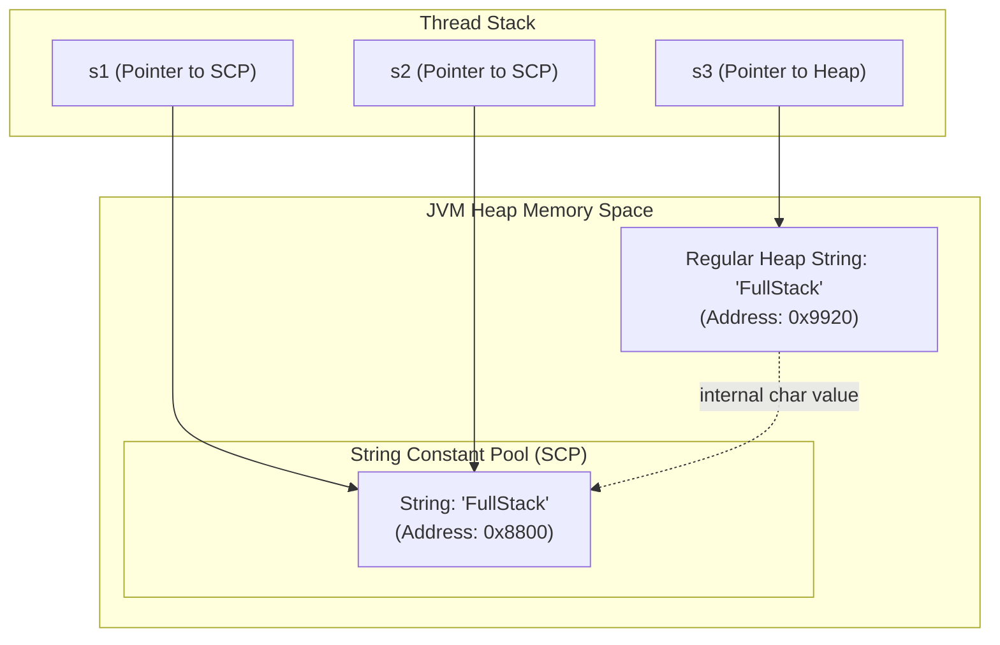

# String Basics, Concatenation & Immutability Intro

> **Phase 1: Java Programming Foundations**  
> *Estimated Reading Time: 40 minutes | Total Practice Effort: ~2.5 hours | Tier: Core Essential*

---

## 1. Purpose & Prerequisites

### Why This Matters in Full Stack Development
In any web or enterprise application, textual data is ubiquitous: user emails, passwords, JSON API payloads, database query strings, and URL parameters.

Unlike languages where strings are simple primitive character arrays, Java treats `String` as a first-class, **immutable reference object**. Failing to understand String immutability and memory pooling can result in severe memory leaks, slow response times, and critical security bugs when comparing tokens or user credentials.

### Prerequisites
- [Topic 1.7: Arrays: 1D & 2D Arrays, Indexing & Memory Traversal](07-arrays.md)

---

## 2. Plain-English Mental Model

Think of a Java `String` as a stone tablet:

```
[ Stone Tablet: "Java" ] 
         |
         | Attempting to uppercase...
         v
[ Brand New Stone Tablet: "JAVA" ]  <--- (Original "Java" tablet is NEVER modified!)
```

- **Immutability:** Once a `String` is carved into memory, its contents **can never be altered**.
- Any method that seems to modify a string (like `toUpperCase()`, `replace()`, or `trim()`) actually creates and returns a **brand-new String object** containing the updated characters.
- **The String Constant Pool (SCP):** The JVM maintains a special cache in the Heap. If you write `"admin"` ten times in your code, Java creates only **one** shared string instance in the pool to save RAM.

---

## 3. Essential String Methods

Here are the most frequently used methods in daily software engineering:

| Method | Return Type | Description | Example |
| :--- | :--- | :--- | :--- |
| `length()` | `int` | Number of characters in the string | `"Code".length()` &rarr; `4` |
| `charAt(int index)` | `char` | Character at the 0-based index | `"API".charAt(0)` &rarr; `'A'` |
| `substring(int start, int end)` | `String` | Extracts slice from `start` up to `end - 1` | `"Backend".substring(0, 4)` &rarr; `"Back"` |
| `contains(CharSequence s)` | `boolean` | Checks if substring exists | `"john@gmail.com".contains("@")` &rarr; `true` |
| `indexOf(String str)` | `int` | First index of substring (or `-1` if absent) | `"hello".indexOf("l")` &rarr; `2` |
| `strip()` / `trim()` | `String` | Removes leading and trailing whitespace | `" admin ".strip()` &rarr; `"admin"` |
| `toUpperCase()` / `toLowerCase()` | `String` | Converts letter case | `"rest".toUpperCase()` &rarr; `"REST"` |
| `equals(Object anObject)` | `boolean` | Checks if textual content is identical | `"jwt".equals(token)` |
| `equalsIgnoreCase(String s)`| `boolean` | Case-insensitive content check | `"yes".equalsIgnoreCase("YES")` &rarr; `true` |
| `split(String regex)` | `String[]` | Splits text into array by delimiter | `"a,b,c".split(",")` &rarr; `["a", "b", "c"]` |
| `isBlank()` | `boolean` | `true` if string is empty or contains only whitespace | `"   ".isBlank()` &rarr; `true` |

---

## 4. Working Code Example: String Operations & The Pool

```java
// File: StringMechanics.java
public class StringMechanics {
    public static void main(String[] args) {
        // 1. String Constant Pool (Literal vs new)
        String s1 = "FullStack";
        String s2 = "FullStack";
        String s3 = new String("FullStack");

        // Reference comparison (== compares memory addresses)
        System.out.println("s1 == s2 (Same pool reference): " + (s1 == s2)); // true
        System.out.println("s1 == s3 (Heap vs Pool): " + (s1 == s3));          // false

        // Content comparison (.equals() compares actual characters)
        System.out.println("s1.equals(s3) (Identical text): " + s1.equals(s3)); // true

        // 2. Immutability in action
        String framework = "Spring";
        framework.toUpperCase(); // Result is ignored because not assigned!
        System.out.println("Unassigned framework: " + framework); // Still "Spring"

        framework = framework.toUpperCase(); // Explicit reassignment
        System.out.println("Reassigned framework: " + framework); // "SPRING"

        // 3. Parsing & Token Extraction
        String rawHeader = "Bearer eyJhbGciOiJIUzI1NiJ9";
        if (rawHeader.startsWith("Bearer ")) {
            String jwtToken = rawHeader.substring(7); // Extract token after "Bearer "
            System.out.println("Extracted JWT Token: " + jwtToken);
        }
    }
}
```

### Exact Output:
```text
s1 == s2 (Same pool reference): true
s1 == s3 (Heap vs Pool): false
s1.equals(s3) (Identical text): true
Unassigned framework: Spring
Reassigned framework: SPRING
Extracted JWT Token: eyJhbGciOiJIUzI1NiJ9
```

---

## 5. Under the Hood: The String Pool & Memory Layout



- When you write a string literal `String s1 = "FullStack";`, the JVM looks inside the **String Constant Pool**. If it exists, it returns the existing reference. `s1` and `s2` point to the exact same memory address (`0x8800`).
- When you use `new String("FullStack")`, you force the JVM to allocate a brand new object on the regular heap (`0x9920`), bypassing pool reuse.
- **Why `==` is dangerous:** `s1 == s3` evaluates memory addresses (`0x8800 == 0x9920`), which is `false`, even though both strings contain identical letters!

---

## 6. Efficient Concatenation: `+` vs `StringBuilder`

In Java, using the `+` operator to concatenate strings inside loops creates massive memory overhead:

```java
// ANTI-PATTERN: Creates 10,000 intermediate garbage String objects in the Heap!
String log = "";
for (int i = 0; i < 10000; i++) {
    log += "Line " + i + "\n"; // O(N^2) complexity, slow garbage collection!
}
```

### The Solution: `StringBuilder`
`StringBuilder` is a **mutable** sequence of characters. It modifies its internal buffer in-place without generating garbage objects:

```java
// CLEAN & FAST: O(N) linear performance
StringBuilder sb = new StringBuilder();
for (int i = 0; i < 10000; i++) {
    sb.append("Line ").append(i).append("\n");
}
String finalLog = sb.toString();
```

---

## 7. Common Rookie Mistakes & Compiler Traps

### Trap 1: Comparing Strings with `==`
```java
// TRAP: Fails when comparing user input from a form or database
String userEntered = readFromScanner(); // e.g., "password123"
if (userEntered == "password123") { // ALWAYS FALSE for dynamically read strings!
    grantAccess();
}
```
> [!IMPORTANT] Production Rule
> Always use `.equals()` or `.equalsIgnoreCase()` to compare strings in Java.

### Trap 2: String Mutation Illusion
```java
String email = "   USER@DOMAIN.COM   ";
email.trim();
email.toLowerCase();
System.out.println(email); // Still prints "   USER@DOMAIN.COM   "!
```
**Why:** Strings are immutable. `trim()` and `toLowerCase()` return new strings. You must assign the result back:
```java
email = email.trim().toLowerCase();
```

### Trap 3: `substring()` Index Range Trap
```java
String s = "Hello";
String sub = s.substring(2, 6); // Index 6 is out of bounds!
```
The second index in `substring(start, end)` is exclusive, but `end` cannot exceed `s.length()`.

---

## 8. Guided Hands-On Exercise

### Challenge: Web Form Input Sanitizer
Create a program named `InputSanitizer.java` that cleans and validates user registration fields submitted from a frontend form:
1. Define the raw input variables:
   - `rawEmail` (`String`): `"   Alex.Developer@GMAIL.COM   "`
   - `rawFullName` (`String`): `"   alexANDER   "`
   - `rawPhone` (`String`): `"+1 (555) 123-4567"`
2. Perform the following sanitization rules:
   - **Email:** Strip all leading/trailing whitespace, convert entirely to lowercase, and check if it ends with `"@gmail.com"`.
   - **Full Name:** Strip whitespace, convert the first letter to uppercase, and the rest to lowercase (e.g. `"Alexander"`).
   - **Phone Number:** Remove all spaces, parentheses, and dashes using `.replace()`, keeping only digits and the leading `+`.
3. Print the sanitized values and validation status.

<details>
<summary>💡 Hint 1: Capitalizing Name</summary>

```java
String cleanName = rawFullName.strip();
String capitalized = cleanName.substring(0, 1).toUpperCase() + cleanName.substring(1).toLowerCase();
```
</details>

<details>
<summary>💡 Hint 2: Cleaning Phone</summary>

Chain `.replace(" ", "").replace("(", "").replace(")", "").replace("-", "")`.
</details>

<details>
<summary>✅ Solution</summary>

```java
public class InputSanitizer {
    public static void main(String[] args) {
        String rawEmail = "   Alex.Developer@GMAIL.COM   ";
        String rawFullName = "   alexANDER   ";
        String rawPhone = "+1 (555) 123-4567";

        // 1. Sanitize Email
        String sanitizedEmail = rawEmail.strip().toLowerCase();
        boolean isGmail = sanitizedEmail.endsWith("@gmail.com");

        // 2. Format Name (Proper Case)
        String trimmedName = rawFullName.strip();
        String formattedName = trimmedName.substring(0, 1).toUpperCase() 
                             + trimmedName.substring(1).toLowerCase();

        // 3. Sanitize Phone
        String sanitizedPhone = rawPhone.replace(" ", "")
                                        .replace("(", "")
                                        .replace(")", "")
                                        .replace("-", "");

        System.out.println("=== Sanitized User Profile ===");
        System.out.println("Full Name: " + formattedName);
        System.out.println("Email: " + sanitizedEmail + " (Gmail Provider: " + isGmail + ")");
        System.out.println("Phone: " + sanitizedPhone);
    }
}
```

**Terminal Output:**
```text
=== Sanitized User Profile ===
Full Name: Alexander
Email: alex.developer@gmail.com (Gmail Provider: true)
Phone: +15551234567
```
</details>

---

## 9. Knowledge Check & Interview Defense

### Quick Quiz
1. **Where does the JVM store String literals like `"Hello"` to optimize memory usage?**
   - [ ] A) The CPU cache
   - [x] B) The String Constant Pool (SCP) in the Heap
   - [ ] C) The Call Stack
   - [ ] D) The Native Method Stack

2. **Why should you use `StringBuilder` instead of repeated `+` concatenation inside loops?**
   - [ ] A) `+` concatenation is deprecated in modern Java.
   - [x] B) Repeated `+` creates a new String object and character array in memory on each iteration, causing $O(N^2)$ memory churn, whereas `StringBuilder` modifies its buffer in-place.
   - [ ] C) `StringBuilder` automatically validates null strings.
   - [ ] D) `+` only works on numbers.

3. **What is the result of `"Java".substring(1, 3)`?**
   - [ ] A) `"Jav"`
   - [x] B) `"av"` (from index 1 inclusive up to index 3 exclusive)
   - [ ] C) `"va"`
   - [ ] D) `"Java"`

---

### Junior Developer Interview Q&A

#### Q: "Why is String immutable in Java? What benefits does immutability provide?"
> **Model Answer:**  
> "Java Strings are immutable for three primary reasons:
> 1. **String Constant Pooling:** If strings were mutable, changing a string through one reference would silently corrupt all other variables pointing to that same shared literal in the pool.
> 2. **Security:** Strings are used extensively to store sensitive data like database connection URLs, file paths, and network ports. If strings were mutable, an untrusted thread could alter a verified connection string after a security check passed (Time-of-Check to Time-of-Use vulnerability).
> 3. **Thread Safety & Caching:** Because their state never changes, Strings are inherently thread-safe without synchronization. Furthermore, the JVM safely caches a String's `hashCode` after its first calculation, making Strings exceptionally fast and reliable as keys in `HashMap` and `HashSet`."

---

## 10. Mastery Checklist & Next Step

Before moving on, verify that you can:
- [ ] Explain how the String Constant Pool works and why `==` fails on heap strings.
- [ ] Manipulate and sanitize text using `.substring()`, `.replace()`, `.strip()`, and `.split()`.
- [ ] Refactor loop string concatenations into efficient `StringBuilder` statements.
- [ ] Defend the security and performance benefits of String immutability in an interview.

👉 **Next Lesson:** **[Topic 1.9: Debugging Code, Compiler Errors & Reading Stack Traces](09-debugging-errors.md)**
