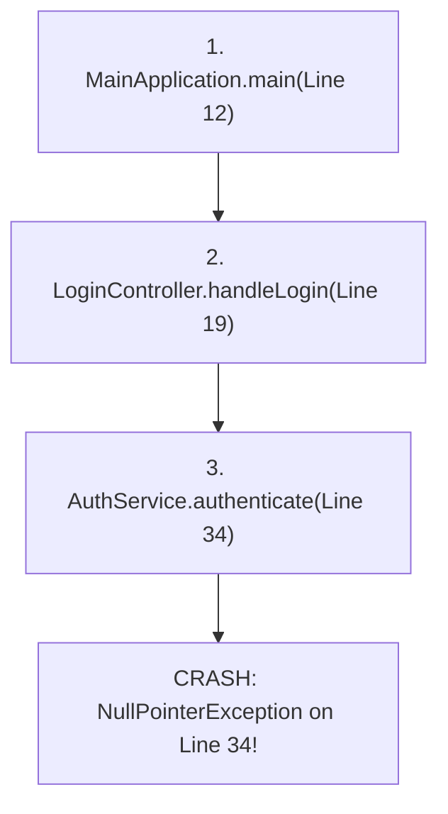

# Debugging Code, Compiler Errors & Reading Stack Traces

> **Phase 1: Java Programming Foundations**  
> *Estimated Reading Time: 40 minutes | Total Practice Effort: ~2.5 hours | Tier: Core Essential*

---

## 1. Purpose & Prerequisites

### Why This Matters in Full Stack Development
In software engineering, writing code is only 30% of the job; the other 70% is diagnosing unexpected behavior, reading stack traces, and fixing bugs.

When an API in production suddenly crashes or returns HTTP 500, a junior developer might panic or blindly scatter `System.out.println` statements across the code. A professional engineer calmly opens the server logs, reads the **stack trace**, pinpoints the exact file and line number where execution failed, and uses interactive debugger breakpoints to reproduce and resolve the issue.

### Prerequisites
- [Topic 1.8: String Basics, Concatenation & Immutability Intro](08-strings-basics.md)

---

## 2. Plain-English Mental Model

Think of a Java stack trace like an airplane's black box flight recorder:

```
[ CRASH OCCURRED: NullPointerException ]
       ^
       | Caused at: UserService.java (Line 42)
       | Called from: UserController.java (Line 18)
       | Called from: SpringFramework Dispatcher (Line 1045)
[ FLIGHT PATH: Stack of active method calls when crash struck ]
```

When an unhandled error strikes, the JVM freezes execution and dumps the entire **Call Stack** of methods that were active at that exact millisecond. By reading from top to bottom, you can retrace the application's exact steps leading up to the failure.

---

## 3. The Three Categories of Software Errors

| Category | When Detected | Who Catches It | Common Examples |
| :--- | :--- | :--- | :--- |
| **1. Compile-Time Errors** | Before execution | The `javac` compiler | Syntax errors, missing semicolons, type mismatches, missing imports |
| **2. Runtime Exceptions** | During execution | The JVM / OS | `NullPointerException`, `ArrayIndexOutOfBoundsException`, `ArithmeticException` |
| **3. Logical Bugs** | Never crashes! | Humans / Unit Tests | Off-by-one loop errors, wrong discount formulas, inverted `if` checks |

---

## 4. Deconstructing a Real Stack Trace

Consider this crash log produced by a Java service:

```text
Exception in thread "main" java.lang.NullPointerException: Cannot invoke "String.toUpperCase()" because "username" is null
    at com.store.auth.AuthService.authenticate(AuthService.java:34)
    at com.store.api.LoginController.handleLogin(LoginController.java:19)
    at com.store.MainApplication.main(MainApplication.java:12)
```



### How to Read It:
1. **The Exception Name:** `java.lang.NullPointerException` &rarr; You attempted to call a method on a reference that was `null`.
2. **The Reason Message:** `Cannot invoke "String.toUpperCase()" because "username" is null` &rarr; Helpful message telling you exactly which variable was `null`.
3. **The Crime Scene (Top of Trace):** Look at the first line inside your own code:  
   `at com.store.auth.AuthService.authenticate(AuthService.java:34)`  
   Open `AuthService.java` directly to **Line 34**. That is the line that triggered the crash.
4. **The Call Chain:** Lines 19 and 12 show the execution path that led to Line 34.

---

## 5. Modern IDE Interactive Debugging

Professional developers rarely rely on `System.out.println`. Instead, they use IDE interactive debuggers (IntelliJ IDEA, VS Code, Eclipse):

```
+-----------------------------------------------------------------------------------+
| Debugger Control Panel                                                            |
+-----------------------------------------------------------------------------------+
| [Resume Program (F9)]   Continue running until next breakpoint                    |
| [Step Over (F8)]        Execute current line and stop on next line                |
| [Step Into (F7)]        Follow execution INSIDE the method on the current line    |
| [Step Out (Shift+F8)]   Finish current method and pause in caller method          |
+-----------------------------------------------------------------------------------+
```

### Essential Debugging Workflow:
1. **Set a Breakpoint:** Click in the margin next to the line number where you suspect trouble. A red dot appears.
2. **Debug Run:** Launch your app in Debug Mode (bug icon).
3. **Inspect Variables:** When the program pauses at the breakpoint, hover your mouse over variables or inspect the **Variables Pane** to see their real-time memory values.
4. **Evaluate Expression:** Test formulas on the fly (e.g. `user != null ? user.getId() : -1`) without modifying or restarting your code.

---

## 6. Common Rookie Mistakes & Debugging Traps

### Trap 1: Swallowing Exceptions with Empty Catch Blocks
```java
// CRITICAL ANTI-PATTERN: Silent failure
try {
    processPayment();
} catch (Exception e) {
    // Empty catch block!
}
```
> [!CAUTION] Production Nightmare
> If `processPayment()` fails, nothing is printed or logged. The program silently continues in a corrupted state, leaving zero clues in production logs.  
> **Always log or rethrow exceptions:**
> ```java
> } catch (Exception e) {
>     logger.error("Payment processing failed", e);
> }
> ```

### Trap 2: Panicking at Long Framework Stack Traces
In Spring Boot or enterprise frameworks, stack traces can be 80 lines long, with 75 lines belonging to internal framework classes (`org.springframework...`).  
> [!TIP] The Filter Rule
> Scroll through the trace to find the **first line that belongs to your package** (e.g., `com.mycompany...`). That is where your bug lives.

---

## 7. Practical Application: Full Stack Crash Investigation

When a React frontend displays an unexpected generic error popup:
```
"HTTP 500: Internal Server Error. Please contact support."
```
As a full-stack engineer:
1. You open the backend terminal or Docker container logs (`docker logs api-gateway`).
2. You locate the stack trace timestamp matching the frontend request.
3. You identify the culprit line in your controller or service.
4. You add a defensive null check or input validation, deploy the fix, and confirm the frontend now receives a clean HTTP 200 or 400 response.

---

## 8. Guided Hands-On Exercise: The Stack Trace Detective

### Challenge: Repair the Crashing Order Pipeline
Examine the following buggy program named `OrderPipeline.java`:

```java
public class OrderPipeline {
    public static void main(String[] args) {
        String[] customerOrders = {"ORD-101", null, "ORD-103"};
        processOrders(customerOrders);
    }

    public static void processOrders(String[] orders) {
        for (int i = 0; i <= orders.length; i++) {
            formatOrder(orders[i]);
        }
    }

    public static void formatOrder(String orderId) {
        String trimmed = orderId.trim();
        System.out.println("Processing: " + trimmed);
    }
}
```

Running this code produces this crash:
```text
Exception in thread "main" java.lang.NullPointerException: Cannot invoke "String.trim()" because "orderId" is null
    at OrderPipeline.formatOrder(OrderPipeline.java:14)
    at OrderPipeline.processOrders(OrderPipeline.java:9)
    at OrderPipeline.main(OrderPipeline.java:4)
```

And if you fix only the `NullPointerException`, a second hidden bug causes:
```text
Exception in thread "main" java.lang.ArrayIndexOutOfBoundsException: Index 3 out of bounds for length 3
    at OrderPipeline.processOrders(OrderPipeline.java:8)
    at OrderPipeline.main(OrderPipeline.java:4)
```

**Your Mission:**
1. Identify both bugs.
2. Refactor `OrderPipeline.java` so that it:
   - Traverses the array safely without exceeding bounds.
   - Gracefully handles `null` orders by printing: `"Skipping empty order entry."`
   - Executes cleanly to completion.

<details>
<summary>💡 Hint 1: Off-by-one Bound</summary>

Change `i <= orders.length` to `i < orders.length`.
</details>

<details>
<summary>💡 Hint 2: Defensive Null Check</summary>

Inside `formatOrder` or before calling it, check:
```java
if (orderId == null) {
    System.out.println("Skipping empty order entry.");
    return;
}
```
</details>

<details>
<summary>✅ Solution</summary>

```java
public class OrderPipeline {
    public static void main(String[] args) {
        String[] customerOrders = {"ORD-101", null, "ORD-103"};
        processOrders(customerOrders);
    }

    public static void processOrders(String[] orders) {
        // Fix 1: Use < instead of <= to avoid ArrayIndexOutOfBoundsException
        for (int i = 0; i < orders.length; i++) {
            formatOrder(orders[i]);
        }
    }

    public static void formatOrder(String orderId) {
        // Fix 2: Defensive guard to avoid NullPointerException
        if (orderId == null) {
            System.out.println("Skipping empty order entry.");
            return;
        }

        String trimmed = orderId.trim();
        System.out.println("Processing: " + trimmed);
    }
}
```

**Terminal Output:**
```text
Processing: ORD-101
Skipping empty order entry.
Processing: ORD-103
```
</details>

---

## 9. Knowledge Check & Interview Defense

### Quick Quiz
1. **When reading a Java stack trace, where is the exact line of code that triggered the unhandled exception located?**
   - [x] A) At the very top of the stack trace list (the most recently called frame).
   - [ ] B) At the very bottom of the stack trace list.
   - [ ] C) In the middle of the stack trace.
   - [ ] D) Inside the JVM garbage collector logs.

2. **What is the difference between "Step Over" and "Step Into" in an IDE debugger?**
   - [ ] A) Step Over runs the program to completion; Step Into pauses it.
   - [x] B) Step Over executes the current line (including any method calls) and pauses on the next line of the current method; Step Into jumps inside the method called on that line to inspect its internals.
   - [ ] C) Step Into is only used for unit tests.
   - [ ] D) Step Over deletes the current variable from memory.

3. **What is the root cause of a `NullPointerException`?**
   - [ ] A) An array exceeded its maximum capacity.
   - [x] B) The program attempted to access a field or invoke a method on a reference variable that points to `null` (no object exists in the Heap).
   - [ ] C) An integer was divided by zero.
   - [ ] D) The computer ran out of physical RAM.

---

### Junior Developer Interview Q&A

#### Q: "How do you systematically diagnose and fix an unexpected error in a production backend service?"
> **Model Answer:**  
> "I follow a four-step systematic approach:
> 1. **Inspect Logs & Stack Trace:** I check the application logs to locate the exception type, error message, and the root cause frame. I filter past third-party framework lines to identify the exact file and line number in our team's code.
> 2. **Reproduce Locally:** Using the input payload or request parameters from the incident, I recreate the failure scenario locally or write a failing unit test to verify the reproduction.
> 3. **Debug with Breakpoints:** I place breakpoints before the failing line to inspect variable state, memory values, and branch conditions to understand why the variable became `null` or invalid.
> 4. **Implement Defensive Fix & Test:** I resolve the defect using appropriate defensive measures (null guards, input validation, or corrected business logic), verify with automated tests, and submit a pull request with regression test coverage."

---

## 10. Phase 1 Mastery Checklist & Next Phase

Congratulations! You have completed **Phase 1: Java Programming Foundations**.

### Phase 1 Mastery Self-Audit:
- [x] Setup & Execution: Compile and run Java programs via the command line.
- [x] Primitive Data Types: Understand bit widths, heap vs stack, and casting rules.
- [x] Operators: Leverage short-circuiting (`&&`, `||`) for null safety.
- [x] Control Flow: Write clean guard clauses and modern Java 14+ switch expressions.
- [x] Iteration: Use `for`, `while`, and `do-while` with break and continue.
- [x] Methods & Memory: Understand stack frames and why Java is strictly pass-by-value.
- [x] Arrays: Manage 1D and 2D arrays with contiguous heap layout.
- [x] Strings: Explain String Constant Pool mechanics and immutability.
- [x] Debugging: Read stack traces and step through code with an interactive debugger.

👉 **Next Phase:** **[Phase 2: OOP & Class Design — Topic 2.1: Classes, Objects & The new Instantiation Lifecycle](../02-oop/01-classes-objects.md)**
