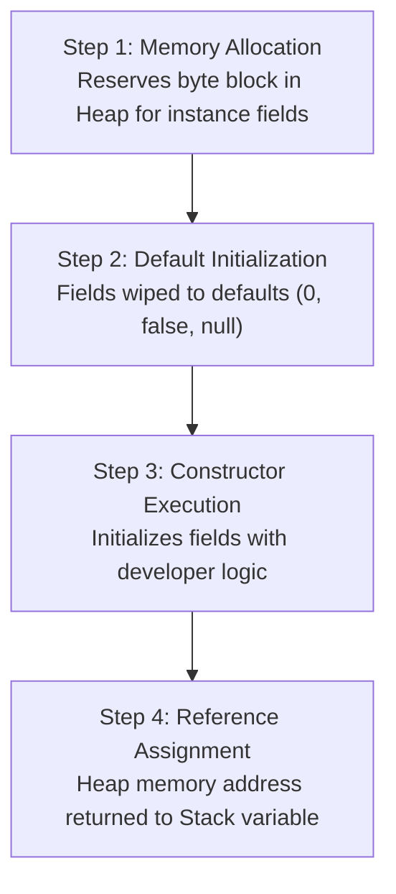
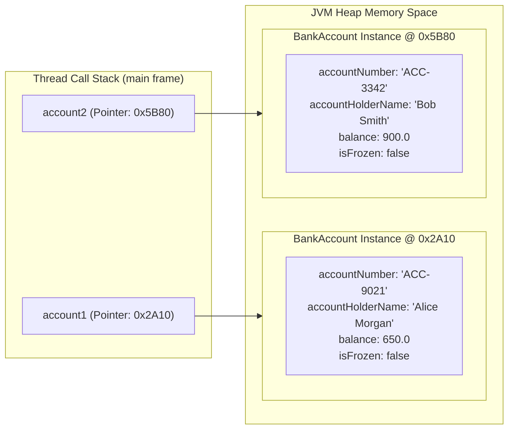

# Classes, Objects & The new Instantiation Lifecycle

> **Phase 2: OOP & Class Design**  
> *Estimated Reading Time: 40 minutes | Total Practice Effort: ~3.0 hours | Tier: Core Essential*

---

## 1. Purpose & Prerequisites

### Why This Matters in Full Stack Development
In procedural programming, you write functions that manipulate loose, disconnected variables. But in enterprise systems—where a user might have an ID, email, hashed password, billing addresses, and a collection of past orders—managing disconnected primitive variables quickly results in unmanageable spaghetti code.

**Object-Oriented Programming (OOP)** binds related data (**state**) and operations (**behavior**) into cohesive units called **Objects**. In a full-stack Java/React architecture, every database entity, HTTP request body, and domain service is modeled as a Java Class.

### Prerequisites
- [Phase 1: Java Programming Foundations](../01-foundations/09-debugging-errors.md)

---

## 2. Plain-English Mental Model

Think of the relationship between a **Class** and an **Object** like an architectural blueprint and actual houses:

```
+---------------------------+
|    Architectural Blueprint|
|       (Class: House)      |
|  - numberOfBedrooms       |
|  - exteriorColor          |
|  - openDoor()             |
+---------------------------+
             |
             | "new House()" builds physical structures in the real world (Heap)
             v
   +--------------------+          +--------------------+
   | House 1 (Object)   |          | House 2 (Object)   |
   | Address: 101 Maple |          | Address: 404 Pine  |
   | Color: Blue        |          | Color: White       |
   | Bedrooms: 3        |          | Bedrooms: 4        |
   +--------------------+          +--------------------+
```

- **Class (`House.java`):** The written blueprint. It defines what properties every house will have, but it doesn't occupy physical real estate.
- **Object / Instance:** A physical house constructed on a plot of land (the JVM **Heap**). You can build hundreds of independent houses from a single blueprint.
- **`new` Keyword:** The construction crew that reserves memory in the Heap and builds the object.

---

## 3. The 4-Step Object Instantiation Lifecycle

When you write `UserAccount user = new UserAccount();`, the JVM performs four discrete operations under the hood:



1. **Heap Allocation:** JVM calculates the size required for the object's instance fields and reserves a memory block in the Heap.
2. **Default Initialization:** Every field is initialized to its type default (`0`, `false`, `null`).
3. **Constructor Execution:** The constructor runs, applying explicit values and initialization logic.
4. **Reference Assignment:** The memory address of the newly constructed Heap object is stored in the reference variable on the Call Stack.

---

## 4. Working Code Example: Modeling a Bank Account

```java
// File: AccountDemo.java

// Blueprint Class
class BankAccount {
    // 1. State (Instance Variables / Fields)
    String accountNumber;
    String accountHolderName;
    double balance;
    boolean isFrozen;

    // 2. Behavior (Instance Methods)
    void deposit(double amount) {
        if (amount <= 0) {
            System.out.println("Error: Deposit amount must be positive.");
            return;
        }
        if (isFrozen) {
            System.out.println("Error: Cannot deposit to a frozen account.");
            return;
        }
        balance += amount;
        System.out.println("Deposited $" + amount + ". New Balance: $" + balance);
    }

    void withdraw(double amount) {
        if (amount > balance) {
            System.out.println("Declined: Insufficient funds in account " + accountNumber);
            return;
        }
        balance -= amount;
        System.out.println("Withdrew $" + amount + ". Remaining Balance: $" + balance);
    }

    void displaySummary() {
        System.out.println("[" + accountNumber + "] " + accountHolderName + " | Balance: $" + balance);
    }
}

// Execution Driver
public class AccountDemo {
    public static void main(String[] args) {
        // Instantiating Object 1
        BankAccount account1 = new BankAccount();
        account1.accountNumber = "ACC-9021";
        account1.accountHolderName = "Alice Morgan";
        account1.balance = 500.0;

        // Instantiating Object 2
        BankAccount account2 = new BankAccount();
        account2.accountNumber = "ACC-3342";
        account2.accountHolderName = "Bob Smith";
        account2.balance = 1200.0;

        // Invoking behaviors independently
        account1.deposit(150.0);
        account2.withdraw(300.0);

        System.out.println("\n--- Current Account States ---");
        account1.displaySummary();
        account2.displaySummary();
    }
}
```

### Exact Output:
```text
Deposited $150.0. New Balance: $650.0
Withdrew $300.0. Remaining Balance: $900.0

--- Current Account States ---
[ACC-9021] Alice Morgan | Balance: $650.0
[ACC-3342] Bob Smith | Balance: $900.0
```

---

## 5. Under the Hood: Stack vs Heap Memory Layout



- Each call to `new BankAccount()` creates an **entirely separate block of instance fields** on the Heap.
- Modifying `account1.balance` does not affect `account2.balance` in any way.
- The variables `account1` and `account2` do not hold the bank accounts themselves; they hold **memory references (pointers)** to where the objects live on the Heap.

---

## 6. Common Rookie Mistakes & Traps

### Trap 1: Forgetting `new` (The Uninstantiated Pointer)
```java
BankAccount acc; // Only declares a reference variable on the Stack!
acc.deposit(100.0); // COMPILER ERROR: variable acc might not have been initialized
```
Or if set to null:
```java
BankAccount acc = null;
acc.deposit(100.0); // RUNTIME ERROR: java.lang.NullPointerException!
```
> [!WARNING]
> Declaring a variable does not create an object. You must invoke `new ClassName()` to allocate memory.

### Trap 2: Pointer Aliasing (Two References, One Object)
```java
BankAccount a = new BankAccount();
a.balance = 100.0;

BankAccount b = a; // Copies the REFERENCE pointer, NOT the object!
b.balance = 500.0;

System.out.println(a.balance); // Prints: 500.0 (Surprise!)
```
`b = a` does not clone the object; both `a` and `b` now point to the exact same memory address. Modifying `b` directly modifies `a`.

---

## 7. Practical Application: Full Stack Domain Entity

In a full-stack Spring Boot + React application, your backend models real-world business domains using classes known as **Entities** or **Data Transfer Objects (DTOs)**:

```java
public class ProductDTO {
    public Long id;
    public String title;
    public double price;
    public int stockQuantity;
}
```
When a React frontend sends an HTTP request:
```json
{ "title": "Wireless Mouse", "price": 29.99, "stockQuantity": 50 }
```
Spring Boot instantiates a `ProductDTO` instance via `new`, populates its instance variables from the JSON body, and passes the object into your business logic methods.

---

## 8. Guided Hands-On Exercise

### Challenge: E-Commerce Shopping Cart Item Model
Create a program named `CartDemo.java` that defines a `CartItem` class:
1. Define the following fields in `CartItem`:
   - `itemId` (`String`)
   - `productName` (`String`)
   - `unitPrice` (`double`)
   - `quantity` (`int`)
2. Add instance methods:
   - `calculateSubtotal()` &rarr; returns `unitPrice * quantity`.
   - `applyDiscountPercent(double percentage)` &rarr; reduces `unitPrice` by the percentage (e.g., passing `10` reduces `$50.00` to `$45.00`).
   - `printItemDetails()` &rarr; prints: `"[itemId] productName - quantity x $unitPrice = $subtotal"`.
3. In `main`:
   - Instantiate two items:
     - Item 1: `"ITEM-101"`, `"Mechanical Keyboard"`, `$80.00`, quantity `2`.
     - Item 2: `"ITEM-202"`, `"Desk Mat"`, `$25.00`, quantity `1`.
   - Apply a 15% discount to Item 1.
   - Print details for both items and calculate the cart's grand total.

<details>
<summary>💡 Hint 1: Discount Formula</summary>

```java
unitPrice = unitPrice - (unitPrice * (percentage / 100.0));
```
</details>

<details>
<summary>💡 Hint 2: Grand Total</summary>

Add `item1.calculateSubtotal() + item2.calculateSubtotal()`.
</details>

<details>
<summary>✅ Solution</summary>

```java
class CartItem {
    String itemId;
    String productName;
    double unitPrice;
    int quantity;

    double calculateSubtotal() {
        return unitPrice * quantity;
    }

    void applyDiscountPercent(double percentage) {
        unitPrice = unitPrice - (unitPrice * (percentage / 100.0));
    }

    void printItemDetails() {
        System.out.println("[" + itemId + "] " + productName + " - " 
                           + quantity + "x $" + unitPrice + " = $" + calculateSubtotal());
    }
}

public class CartDemo {
    public static void main(String[] args) {
        CartItem item1 = new CartItem();
        item1.itemId = "ITEM-101";
        item1.productName = "Mechanical Keyboard";
        item1.unitPrice = 80.00;
        item1.quantity = 2;

        CartItem item2 = new CartItem();
        item2.itemId = "ITEM-202";
        item2.productName = "Desk Mat";
        item2.unitPrice = 25.00;
        item2.quantity = 1;

        // Apply 15% discount to item 1
        item1.applyDiscountPercent(15.0);

        System.out.println("=== Shopping Cart Receipt ===");
        item1.printItemDetails();
        item2.printItemDetails();

        double grandTotal = item1.calculateSubtotal() + item2.calculateSubtotal();
        System.out.println("-----------------------------");
        System.out.println("Cart Total: $" + grandTotal);
    }
}
```

**Terminal Output:**
```text
=== Shopping Cart Receipt ===
[ITEM-101] Mechanical Keyboard - 2x $68.0 = $136.0
[ITEM-202] Desk Mat - 1x $25.0 = $25.0
-----------------------------
Cart Total: $161.0
```
</details>

---

## 9. Knowledge Check & Interview Defense

### Quick Quiz
1. **Where are Java class instances (objects) allocated in computer memory?**
   - [ ] A) On the Call Stack
   - [x] B) Inside the JVM Heap
   - [ ] C) In the CPU Level 1 cache
   - [ ] D) In Metaspace

2. **What is stored inside the reference variable `BankAccount acc = new BankAccount();`?**
   - [ ] A) The actual bytecode of the BankAccount class.
   - [x] B) The memory address (pointer) of the object instance located on the Heap.
   - [ ] C) A copy of all instance methods.
   - [ ] D) The string name of the class.

3. **What is the default value of an unassigned `boolean` instance variable in a newly instantiated object?**
   - [ ] A) `true`
   - [x] B) `false`
   - [ ] C) `null`
   - [ ] D) `-1`

---

### Junior Developer Interview Q&A

#### Q: "What is the difference between a Class and an Object in Java?"
> **Model Answer:**  
> "A **Class** is a static blueprint or template written in source code. It defines the structure (fields/state) and capabilities (methods/behavior) that instances of that type will possess. A class exists as loaded metadata in JVM Metaspace and consumes negligible memory.  
> 
> An **Object** is a concrete, runtime instance created on the JVM Heap via the `new` operator. Each object maintains its own independent copy of instance variables and state. A single class can be instantiated thousands of times into distinct objects throughout the application's lifecycle."

---

## 10. Mastery Checklist & Next Step

Before moving on, verify that you can:
- [ ] Articulate the difference between a Class blueprint and a Heap Object.
- [ ] Diagram how stack references point to heap instances.
- [ ] Understand why copying a reference variable creates an alias rather than a clone.
- [ ] Describe the four steps of the `new` instantiation lifecycle.

👉 **Next Lesson:** **[Topic 2.2: Constructors, Overloading & The this Reference](02-constructors-this.md)**
