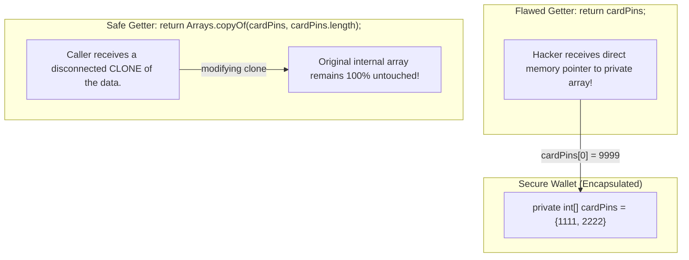

# Access Modifiers & Encapsulation (Getters/Setters)

> **Phase 2: OOP & Class Design**  
> *Estimated Reading Time: 45 minutes | Total Practice Effort: ~3.0 hours | Tier: Core Essential*

---

## 1. Purpose & Prerequisites

### Why This Matters in Full Stack Development
Imagine a banking application where any external code could write:
```java
account.balance = -99999999;
```
If fields are left `public`, any rogue function or buggy frontend request can corrupt an object's internal state, bypassing business logic and security checks.

**Encapsulation** is the foundational pillar of Object-Oriented Programming that shields an object's internal data from unauthorized access and direct mutation. By keeping fields `private` and exposing controlled access through validated getters and setters, you maintain strict **invariants** (rules that must always remain true) across your entire enterprise system.

### Prerequisites
- [Topic 2.2: Constructors, Overloading & The this Reference](02-constructors-this.md)

---

## 2. Plain-English Mental Model

Think of encapsulation like a modern automated vending machine:

```
[ Customer (External Code) ]
            |
            | Cannot reach inside to grab sodas directly! (private fields)
            v
[ Keypad / Coin Slot (public Methods: insertCoin(), selectItem()) ]
            |
            | Validates: Enough money inserted? Item in stock?
            v
[ Dispense Slot (Controlled Getter Output) ]
```

- You cannot reach inside the machine's internal cabinet to grab snacks for free (`private fields`).
- You must interact with the machine exclusively through its public buttons and payment slots (`public methods`).
- The machine's internal computer validates every transaction before dispensing anything.

---

## 3. The 4 Java Access Modifiers

Java provides four levels of visibility to control access to classes, variables, and methods:

| Modifier | Inside Same Class | Inside Same Package | Inside Subclasses (Other Packages) | Everywhere (World) |
| :--- | :---: | :---: | :---: | :---: |
| **`private`** | ✅ Yes | ❌ No | ❌ No | ❌ No |
| **`default`** (package-private) | ✅ Yes | ✅ Yes | ❌ No | ❌ No |
| **`protected`** | ✅ Yes | ✅ Yes | ✅ Yes | ❌ No |
| **`public`** | ✅ Yes | ✅ Yes | ✅ Yes | ✅ Yes |

```
Visibility Spectrum:
[ private ]  --->  [ default ]  --->  [ protected ]  --->  [ public ]
(Most Restrictive)                                    (Least Restrictive)
```

---

## 4. Invariants, Getters & Setters

### 1. What is an Invariant?
An **invariant** is a condition that must always remain true throughout the lifetime of an object.  
*Example:* "An employee's hourly wage must never be less than minimum wage ($15.00)."

### 2. JavaBean Naming Standards
Full-stack Java frameworks (like Spring Boot and Jackson JSON parser) rely on standard naming conventions:
- Getter for standard type: `public String getEmail()`
- Getter for boolean type: `public boolean isActive()` (uses `is` instead of `get`)
- Setter: `public void setEmail(String email)`

### 3. Protecting Invariants inside Setters
```java
public class Employee {
    private double hourlyRate; // Hidden from outside world

    public double getHourlyRate() {
        return this.hourlyRate;
    }

    public void setHourlyRate(double rate) {
        if (rate < 15.00) {
            throw new IllegalArgumentException("Hourly rate cannot be below minimum wage ($15.00). Attempted: " + rate);
        }
        this.hourlyRate = rate;
    }
}
```

---

## 5. Defensive Copying: Preventing Sneaky State Leaks

> [!CAUTION] The Mutable Reference Leak Trap
> Even if a field is `private`, returning a direct reference to a mutable object (like an array, `Date`, or `List`) allows outside code to mutate internal state without using a setter!



---

## 6. Working Code Example: Secure Bank Account with Defensive Copying

```java
// File: EncapsulationDemo.java
import java.util.Arrays;

class SecureBankAccount {
    private String accountNumber;
    private double balance;
    private String[] recentAuditNotes;
    private int noteCount;

    public SecureBankAccount(String accountNumber, double initialDeposit) {
        this.accountNumber = accountNumber;
        this.balance = (initialDeposit >= 0) ? initialDeposit : 0.0;
        this.recentAuditNotes = new String[5];
        this.noteCount = 0;
        addAuditNote("Account opened with $" + this.balance);
    }

    // Read-only getter for Account Number (No setter: Immutable ID)
    public String getAccountNumber() {
        return accountNumber;
    }

    // Controlled getter for balance
    public double getBalance() {
        return balance;
    }

    // Business action: Deposit
    public void deposit(double amount) {
        if (amount <= 0) {
            System.out.println("Validation Error: Deposit must be positive.");
            return;
        }
        balance += amount;
        addAuditNote("Deposit: +$" + amount);
    }

    // DEFENSIVE COPYING: Return a clone of internal array so caller cannot tamper with audit logs
    public String[] getRecentAuditNotes() {
        return Arrays.copyOf(recentAuditNotes, noteCount);
    }

    private void addAuditNote(String note) {
        if (noteCount < recentAuditNotes.length) {
            recentAuditNotes[noteCount++] = note;
        }
    }
}

public class EncapsulationDemo {
    public static void main(String[] args) {
        SecureBankAccount account = new SecureBankAccount("ACCT-8891", 200.0);
        account.deposit(50.0);

        System.out.println("Account Number: " + account.getAccountNumber());
        System.out.println("Current Balance: $" + account.getBalance());

        // Attempting to tamper with private audit notes via returned array
        String[] logs = account.getRecentAuditNotes();
        logs[0] = "HACKED: Stole all funds!"; // Modifying the array returned by getter

        // Verify if internal state was corrupted
        System.out.println("\n--- Real Internal Audit Logs ---");
        for (String log : account.getRecentAuditNotes()) {
            System.out.println(" - " + log);
        }
    }
}
```

### Exact Output:
```text
Account Number: ACCT-8891
Current Balance: $250.0

--- Real Internal Audit Logs ---
 - Account opened with $200.0
 - Deposit: +$50.0
```
*Notice how tampering with `logs[0]` had zero impact on the real internal audit logs because of defensive copying!*

---

## 7. Common Rookie Mistakes & Compiler Traps

### Trap 1: Making All Fields `public` for Convenience
```java
public class User {
    public String role; // DANGEROUS! Any caller can write user.role = "ADMIN";
}
```
> [!WARNING] Production Rule
> Fields should be `private` by default. Only expose methods when necessary. If a field never needs to change after creation, omit its setter entirely (creating a read-only immutable property).

### Trap 2: Boolean Getter Naming Error
```java
// Anti-pattern
public boolean getIsActive() { return isActive; }

// Idiomatic Java / Spring standard
public boolean isActive() { return isActive; }
```
Spring Boot, Jackson, and Hibernate expect `isActive()` or `hasPermission()`, not `getIsActive()`.

---

## 8. Guided Hands-On Exercise

### Challenge: Tamper-Proof Digital Wallet
Create a program named `WalletSecurityDemo.java` with a `DigitalWallet` class:
1. Define private fields:
   - `walletId` (`String`)
   - `ownerEmail` (`String`)
   - `balance` (`double`)
   - `isVerified` (`boolean`)
2. Requirements:
   - Provide a constructor initializing `walletId`, `ownerEmail`, and `balance` (with validation: balance cannot be negative).
   - `walletId`: Getter only (immutable).
   - `ownerEmail`: Getter and setter. The setter must validate that the email contains both `"@"` and `"."`. If invalid, print an error and refuse to update.
   - `balance`: Getter only. Modifiable only through `public boolean transfer(double amount)` and `public void loadFunds(double amount)`.
   - `isVerified`: Getter (`isVerified()`) and setter (`setVerified(boolean verified)`).
3. In `main`:
   - Instantiate a wallet for `"USR-55"` with `$100.0`.
   - Attempt an invalid email update: `"invalid-email"`.
   - Perform a valid email update: `"user@crypto.org"`.
   - Attempt a transfer of `$150.0` (exceeds balance &rarr; declined).
   - Perform a transfer of `$40.0` (successful).
   - Print final wallet status.

<details>
<summary>💡 Hint 1: Email Validation</summary>

```java
if (newEmail != null && newEmail.contains("@") && newEmail.contains(".")) {
    this.ownerEmail = newEmail;
} else {
    System.out.println("Validation Error: Invalid email format.");
}
```
</details>

<details>
<summary>💡 Hint 2: Transfer Method</summary>

Check if `amount > 0 && amount <= balance`. Deduct and return `true`, else return `false`.
</details>

<details>
<summary>✅ Solution</summary>

```java
class DigitalWallet {
    private String walletId;
    private String ownerEmail;
    private double balance;
    private boolean verified;

    public DigitalWallet(String walletId, String ownerEmail, double initialBalance) {
        this.walletId = walletId;
        setOwnerEmail(ownerEmail);
        this.balance = (initialBalance >= 0) ? initialBalance : 0.0;
        this.verified = false;
    }

    public String getWalletId() {
        return walletId;
    }

    public String getOwnerEmail() {
        return ownerEmail;
    }

    public void setOwnerEmail(String ownerEmail) {
        if (ownerEmail != null && ownerEmail.contains("@") && ownerEmail.contains(".")) {
            this.ownerEmail = ownerEmail;
        } else {
            System.out.println("Validation Error: Invalid email format ('" + ownerEmail + "'). Update rejected.");
        }
    }

    public double getBalance() {
        return balance;
    }

    public void loadFunds(double amount) {
        if (amount > 0) {
            balance += amount;
            System.out.println("Loaded $" + amount + ". New Balance: $" + balance);
        }
    }

    public boolean transfer(double amount) {
        if (amount <= 0) {
            System.out.println("Transfer Error: Amount must be positive.");
            return false;
        }
        if (amount > balance) {
            System.out.println("Transfer Declined: Insufficient balance ($" + balance + ") for transfer of $" + amount);
            return false;
        }
        balance -= amount;
        System.out.println("Transfer Successful: Sent $" + amount + ". Remaining Balance: $" + balance);
        return true;
    }

    public boolean isVerified() {
        return verified;
    }

    public void setVerified(boolean verified) {
        this.verified = verified;
    }
}

public class WalletSecurityDemo {
    public static void main(String[] args) {
        DigitalWallet wallet = new DigitalWallet("WLT-992", "initial@wallet.com", 100.0);

        // 1. Test invalid email update
        wallet.setOwnerEmail("invalid-email-format");

        // 2. Test valid email update
        wallet.setOwnerEmail("user@crypto.org");

        // 3. Test overdrawing transfer
        wallet.transfer(150.0);

        // 4. Test valid transfer
        wallet.transfer(40.0);

        // 5. Verification
        wallet.setVerified(true);

        System.out.println("\n=== Final Wallet State ===");
        System.out.println("ID: " + wallet.getWalletId());
        System.out.println("Owner: " + wallet.getOwnerEmail());
        System.out.println("Balance: $" + wallet.getBalance());
        System.out.println("Verified: " + wallet.isVerified());
    }
}
```

**Terminal Output:**
```text
Validation Error: Invalid email format ('invalid-email-format'). Update rejected.
Transfer Declined: Insufficient balance ($100.0) for transfer of $150.0
Transfer Successful: Sent $40.0. Remaining Balance: $60.0

=== Final Wallet State ===
ID: WLT-992
Owner: user@crypto.org
Balance: $60.0
Verified: true
```
</details>

---

## 9. Knowledge Check & Interview Defense

### Quick Quiz
1. **Which access modifier makes a member accessible within its own package and by subclasses located in other packages?**
   - [ ] A) `private`
   - [ ] B) `default` (package-private)
   - [x] C) `protected`
   - [ ] D) `public`

2. **What is defensive copying in the context of getters?**
   - [x] A) Returning a clone or copy of a mutable internal object so external code cannot modify the class's private state.
   - [ ] B) Encrypting fields in memory.
   - [ ] C) Making all variables `final`.
   - [ ] D) Creating backup copies of `.class` files on disk.

3. **What is the standard getter naming convention for a boolean variable `boolean emailConfirmed` in Java?**
   - [ ] A) `getEmailConfirmed()`
   - [x] B) `isEmailConfirmed()`
   - [ ] C) `hasEmailConfirmed()`
   - [ ] D) `booleanEmailConfirmed()`

---

### Junior Developer Interview Q&A

#### Q: "Why should we use getters and setters instead of just declaring class fields public?"
> **Model Answer:**  
> "Using `private` fields with getters and setters provides four essential benefits:
> 1. **Data Validation & Invariant Protection:** Setters allow us to validate inputs (e.g. rejecting negative balances or malformed emails) before state is updated. Public fields allow uncontrolled, arbitrary corruption from anywhere in the codebase.
> 2. **Encapsulation & Flexibility:** We can alter internal representation (e.g. storing currency in minor units/cents instead of dollars) without breaking external consumers who call `getBalance()`.
> 3. **Access Control:** We can create read-only properties by omitting setters, or write-only properties (like password hashing) by omitting getters.
> 4. **Framework Compatibility:** Enterprise frameworks like Spring Boot, Hibernate, and Jackson JSON deserializer require standard JavaBean getters/setters to map HTTP request bodies and SQL tables to Java entities."

---

## 10. Mastery Checklist & Next Step

Before moving on, verify that you can:
- [ ] List all four Java access modifiers and their exact visibility boundaries.
- [ ] Implement robust getters and setters adhering to JavaBean conventions.
- [ ] Enforce class invariants inside setters and constructors.
- [ ] Identify state leakage risks and implement defensive copying for mutable references.

👉 **Next Lesson:** **[Topic 2.4: Developer Tools I: Git Version Control for Multi-File Projects](04-git-github.md)**
