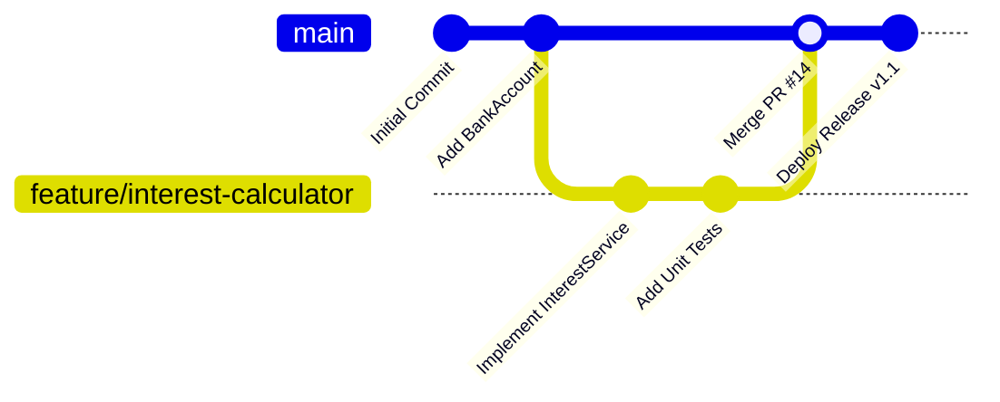
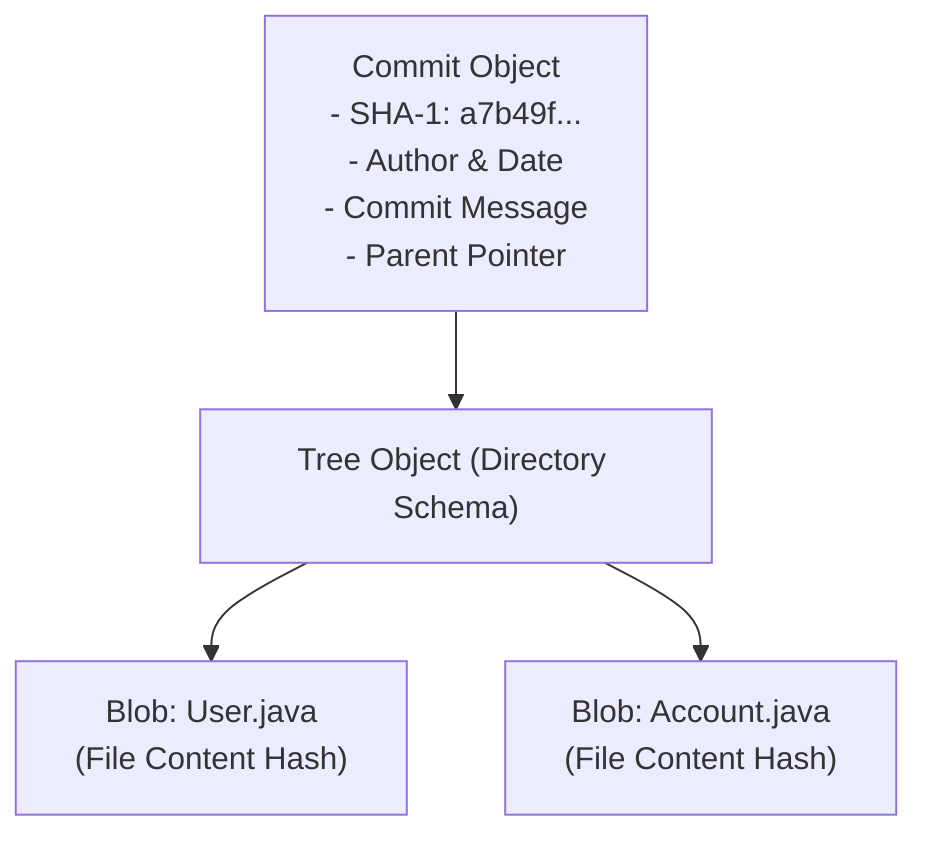

# Developer Tools I: Git Version Control for Multi-File Projects

> **Phase 2: OOP & Class Design**  
> *Estimated Reading Time: 45 minutes | Total Practice Effort: ~3.0 hours | Tier: Core Essential*

---

## 1. Purpose & Prerequisites

### Why This Matters in Full Stack Development
In Phase 1, you wrote single-file Java applications. But now in Phase 2, as you build real Object-Oriented software, your projects will span dozens or hundreds of interconnected files: model classes, utility packages, database connectors, and eventually React frontend components.

How do professional software engineering teams collaborate on the same codebase without overwriting each other's work? How do you restore a previous working version when an experimental feature breaks production?

**Git** is the industry-standard distributed version control system. Every software engineer uses Git every day to track revisions, collaborate across feature branches, and synchronize code with cloud platforms like GitHub or GitLab.

### Prerequisites
- [Topic 2.3: Access Modifiers & Encapsulation (Getters/Setters)](03-encapsulation.md)

---

## 2. Plain-English Mental Model

Think of Git like a time-travel camera for your project:

```
[ Working Directory ]  ---> ( git add )  ---> [ Staging Area ]  ---> ( git commit )  ---> [ Git Repository ]
 (Your desk where       (Box where you group    (Takes a snapshot &
  you write code)        files for a snapshot)   seals it into history)
```

1. **Working Directory:** The sandbox where you edit, save, and test files on your hard drive.
2. **Staging Area (Index):** The preparation zone. You decide *which specific changes* are ready to be included in the next revision snapshot.
3. **Local Repository (`.git`):** The permanent vault of cryptographic snapshots (**commits**) stored directly on your computer.
4. **Remote Repository (GitHub):** The shared cloud backup where teammates push and pull code.

---

## 3. The Essential Git Commands

### 1. Project Initialization & Staging
```bash
# 1. Initialize a new Git repository in the current folder
git init

# 2. Check the status of modified, staged, and untracked files
git status

# 3. Stage a specific file for the next commit
git add src/com/store/User.java

# 4. Stage all modified and new files in the project
git add .

# 5. Commit staged changes with a descriptive message
git commit -m "feat(user): add User entity with encapsulation and validation"
```

### 2. The Critical `.gitignore` File
Compiled `.class` files, build output folders, and IDE configuration caches should **never** be committed to Git. Create a file named `.gitignore` in your project root:

```gitignore
# Java Bytecode
*.class

# Maven & Gradle Build Directories
target/
build/

# IDE Configuration
.idea/
*.iml
.vscode/

# Environment Variables & Secrets
.env
*.secret
```

---

## 4. Branching & Merging (Feature-Driven Development)

In production software teams, **no developer commits directly to the `main` branch**. All work happens on isolated branches:



### Branching Commands:
```bash
# Create and switch to a new feature branch
git switch -c feature/shopping-cart
# (or legacy syntax: git checkout -b feature/shopping-cart)

# Check active branch
git branch

# Switch back to the main branch
git switch main

# Merge the feature branch into main
git merge feature/shopping-cart
```

---

## 5. Under the Hood: Git's Content-Addressable Storage

Unlike older version control systems that stored file diffs (deltas), Git stores **full snapshots** of your project directory tree:



- **Blob (Binary Large Object):** Git hashes your file contents using cryptographic hashing (SHA-1/SHA-256). If the file didn't change between commits, Git simply points to the existing blob without duplicating disk storage.
- **Tree:** Represents directory folders containing blobs and sub-trees.
- **Commit:** Points to the root tree, records the author and timestamp, and points to its parent commit, forming an unbroken historical chain.

---

## 6. Resolving Merge Conflicts

When two developers modify the exact same line in the same file on different branches, Git cannot guess which change is correct. It pauses the merge and marks the conflict:

```java
<<<<<<< HEAD (Current Branch)
double interestRate = 0.05; // Updated by Team Lead
=======
double interestRate = 0.045; // Updated by Finance Feature
>>>>>>> feature/finance-update
```

### 3-Step Conflict Resolution:
1. Open the file in your IDE or text editor.
2. Manually delete the conflict markers (`<<<<<<<`, `=======`, `>>>>>>>`) and keep the correct code.
3. Stage and complete the merge commit:
   ```bash
   git add BankAccount.java
   git commit -m "fix(merge): resolve interest rate conflict between finance and main"
   ```

---

## 7. Common Rookie Mistakes & Traps

### Trap 1: Committing Secrets & `.class` Files
```bash
# MISTAKE: Blindly running git add . without a .gitignore file
git add .
git commit -m "Upload files"
# Accidental push of passwords or target/*.class files to public GitHub!
```
> [!CAUTION] Security Rule
> Always configure your `.gitignore` file **before** running `git add .` for the first time. Once passwords or API keys are committed to Git history, they are permanently recorded in repository hashes even if you delete the file in a subsequent commit.

### Trap 2: The Detached HEAD State
```bash
git checkout a7b49f # Checking out a specific commit hash rather than a branch name
```
If you make commits while in a detached HEAD state, they are not attached to any branch and will eventually be permanently purged by Git's garbage collector (`git prune`).  
**Fix:** Always create a branch before experimenting: `git switch -c new-feature-name`.

---

## 8. Guided Hands-On Exercise

### Challenge: Initializing a Multi-File Java Repository
Simulate initializing and tracking a multi-file Java project from your terminal:
1. Open a terminal and create a practice folder:
   ```bash
   mkdir java-banking-app
   cd java-banking-app
   ```
2. Initialize Git:
   ```bash
   git init
   ```
3. Create a `.gitignore` file containing:
   ```text
   *.class
   target/
   .idea/
   ```
4. Create two Java files:
   - `User.java` (defines a user entity)
   - `Application.java` (defines `public static void main(String[] args)`)
5. Check `git status` to verify `.class` files would be ignored and your 3 files are untracked.
6. Stage and commit:
   ```bash
   git add .
   git commit -m "feat: initialize banking project structure and user entity"
   ```
7. Create a feature branch `feature/account-service`, add a new file `AccountService.java`, commit it, and merge it back into `main`.

<details>
<summary>💡 Hint: Feature Branch Commands</summary>

```bash
git switch -c feature/account-service
# (create AccountService.java)
git add AccountService.java
git commit -m "feat(account): add AccountService business logic"
git switch main
git merge feature/account-service
```
</details>

<details>
<summary>✅ Verification Check</summary>

Running `git log --oneline --graph` should display your linear commit history:
```text
*   Merge branch 'feature/account-service'
|\  
| * feat(account): add AccountService business logic
|/  
* feat: initialize banking project structure and user entity
```
</details>

---

## 9. Knowledge Check & Interview Defense

### Quick Quiz
1. **What is the primary function of the Git Staging Area (Index)?**
   - [ ] A) It pushes code to GitHub automatically.
   - [x] B) It acts as a preparation area where you select and organize specific file changes before sealing them into a permanent commit snapshot.
   - [ ] C) It compiles Java source code into bytecode.
   - [ ] D) It detects syntax errors in Java files.

2. **Why should `*.class` files be excluded in `.gitignore`?**
   - [ ] A) Git cannot read binary files.
   - [x] B) Bytecode is a derived build artifact that can be reproduced by compiling source code; committing it clutters history, inflates repository size, and causes unnecessary merge conflicts across different operating systems.
   - [ ] C) Java runtime deletes class files if Git touches them.
   - [ ] D) GitHub blocks repositories containing bytecode.

3. **What happens during a Git merge conflict?**
   - [x] A) Git pauses the merge and inserts visual conflict markers into the file, allowing the developer to choose the desired code before committing the resolution.
   - [ ] B) Git automatically deletes the incoming branch.
   - [ ] C) The entire repository is reset to the initial commit.
   - [ ] D) The computer shuts down.

---

### Junior Developer Interview Q&A

#### Q: "What is the difference between `git pull` and `git fetch`?"
> **Model Answer:**  
> "`git fetch` contacts the remote repository (e.g. GitHub) and downloads new commits, branches, and tags into your local `.git` directory, updating remote-tracking branches (like `origin/main`). However, it makes **no changes to your working directory or active local branch**. It allows you to safely inspect what teammates have published before integrating.  
> 
> `git pull` is a convenience command that executes two actions in sequence: it performs `git fetch` first, and immediately runs `git merge` to integrate the remote changes into your currently checked-out local branch."

---

## 10. Mastery Checklist & Next Step

Before moving on, verify that you can:
- [ ] Initialize a Git repository with `git init` and check file status with `git status`.
- [ ] Write a production-ready `.gitignore` file for Java projects.
- [ ] Create, switch, and merge feature branches using `git switch` and `git merge`.
- [ ] Explain how Git stores snapshots using SHA hashes rather than file diffs.

👉 **Next Lesson:** **[Topic 2.5: Static Members: Class Variables, Methods & Execution Blocks](05-static-members.md)**
