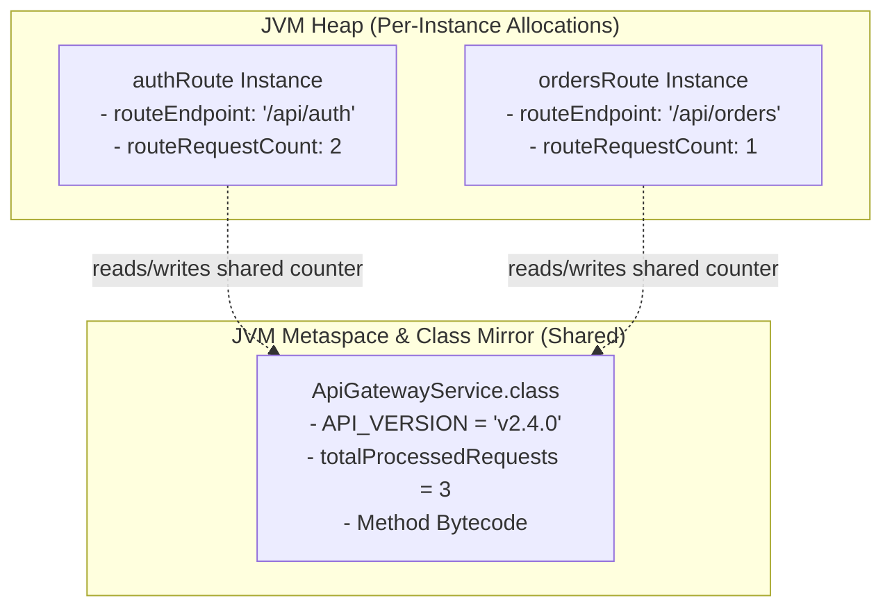

# Static Members: Class Variables, Methods & Execution Blocks

> **Phase 2: OOP & Class Design**  
> *Estimated Reading Time: 40 minutes | Total Practice Effort: ~2.5 hours | Tier: Core Essential*

---

## 1. Purpose & Prerequisites

### Why This Matters in Full Stack Development
In Topic 2.1, you learned that instance variables belong to individual objects on the Heap. If you create 1,000 `User` objects, there will be 1,000 distinct `email` variables in memory.

But what if you need data that is **shared across all instances**?
- A global counter tracking the total number of connected WebSocket clients.
- A shared mathematical constant like `Math.PI`.
- A stateless utility helper method like `PasswordHasher.hash(rawPassword)`.

The **`static`** keyword binds variables, methods, and initialization blocks to the **Class itself**, rather than to any individual object instance.

### Prerequisites
- [Topic 2.3: Access Modifiers & Encapsulation (Getters/Setters)](03-encapsulation.md)

---

## 2. Plain-English Mental Model

Think of the difference between your personal driver's license and the Department of Motor Vehicles (DMV) office building:

```
[ Class: Driver (The Institution) ]
  - static String issuingAgency = "State DMV";   <--- Shared by EVERY driver
  - static int totalLicensedDrivers = 425000;    <--- Shared counter
             |
             +-----------------------+
             |                       |
             v                       v
[ Instance: Driver Alice ]     [ Instance: Driver Bob ]
  - String licenseId = "D101"    - String licenseId = "D102"
  - String fullName = "Alice"    - String fullName = "Bob"
  (Personal Instance Fields)     (Personal Instance Fields)
```

- **Instance Members:** Your unique license number and personal photo. Every person has their own independent copy.
- **Static Members:** The issuing agency name and the statewide total licensed driver count. There is only **one** official record shared by everyone.

---

## 3. The Three Types of Static Members

### 1. Static Variables (Class Variables)
Allocated once when the class is loaded. Every instance of the class shares the exact same memory location:
```java
public class ServerNode {
    public static int activeNodeCount = 0; // Shared across all nodes
    private String nodeId;                 // Unique per node

    public ServerNode(String nodeId) {
        this.nodeId = nodeId;
        activeNodeCount++; // Increments the shared class counter
    }
}
```

### 2. Static Methods (Class Methods)
Invoked directly on the Class name without creating an object (`ClassName.method()`):
```java
// Stateless utility function
public static double celsiusToFahrenheit(double c) {
    return (c * 9.0 / 5.0) + 32;
}

// Calling it:
double f = TemperatureConverter.celsiusToFahrenheit(25.0);
```

> [!CAUTION] The Cardinal Rule of Static Methods
> Static methods **cannot** access instance variables or call instance methods directly, and they cannot use the `this` or `super` keywords. Why? Because a static method can run even when **zero objects exist** in the Heap!

### 3. Static Initialization Blocks (`static { ... }`)
Executes **exactly once** when the JVM ClassLoader loads the class into memory, before any constructor or static method is invoked:
```java
public class AppConfig {
    public static final Map<String, String> SETTINGS = new HashMap<>();

    static {
        System.out.println("Loading global system settings into memory...");
        SETTINGS.put("TIMEOUT_MS", "5000");
        SETTINGS.put("ENVIRONMENT", "PRODUCTION");
    }
}
```

---

## 4. Working Code Example: Global Request Telemetry & Static Math

```java
// File: StaticTelemetryDemo.java

class ApiGatewayService {
    // 1. Static Constants (public static final)
    public static final String API_VERSION = "v2.4.0";
    public static final int MAX_RATE_LIMIT = 1000;

    // 2. Shared Static State
    private static int totalProcessedRequests = 0;

    // 3. Instance State
    private String routeEndpoint;
    private int routeRequestCount;

    // 4. Static Initialization Block
    static {
        System.out.println("[BOOT] Initializing ApiGatewayService (" + API_VERSION + ")... Static block executed.");
    }

    public ApiGatewayService(String routeEndpoint) {
        this.routeEndpoint = routeEndpoint;
        this.routeRequestCount = 0;
    }

    // Instance Method: Has access to BOTH instance and static members
    public void handleRequest() {
        this.routeRequestCount++;        // Updates this instance
        ApiGatewayService.totalProcessedRequests++; // Updates shared class counter
        System.out.println("Routed to " + routeEndpoint + " (Route hits: " 
                           + routeRequestCount + " | Global hits: " + totalProcessedRequests + ")");
    }

    // Static Method: Only has access to static members
    public static int getTotalProcessedRequests() {
        return totalProcessedRequests;
    }
}

public class StaticTelemetryDemo {
    public static void main(String[] args) {
        System.out.println("Gateway Version: " + ApiGatewayService.API_VERSION);

        // Instantiating two independent route services
        ApiGatewayService authRoute = new ApiGatewayService("/api/auth");
        ApiGatewayService ordersRoute = new ApiGatewayService("/api/orders");

        authRoute.handleRequest();
        authRoute.handleRequest();
        ordersRoute.handleRequest();

        System.out.println("\nFinal Global Request Telemetry: " 
                           + ApiGatewayService.getTotalProcessedRequests());
    }
}
```

### Exact Output:
```text
[BOOT] Initializing ApiGatewayService (v2.4.0)... Static block executed.
Gateway Version: v2.4.0
Routed to /api/auth (Route hits: 1 | Global hits: 1)
Routed to /api/auth (Route hits: 2 | Global hits: 2)
Routed to /api/orders (Route hits: 1 | Global hits: 3)

Final Global Request Telemetry: 3
```

---

## 5. Under the Hood: Memory Layout Comparison



- In modern Java (Java 8+), static variables reside in a special mirror `java.lang.Class` object associated with the class metadata.
- When an instance executes `totalProcessedRequests++`, it operates on the single shared class field.
- No matter how many objects you instantiate, there is only **one copy** of `totalProcessedRequests`.

---

## 6. Static vs Instance: Quick Comparison

| Feature | Static Member | Instance Member |
| :--- | :--- | :--- |
| **Associated With** | The Class itself | Individual Object instance |
| **Copies in Memory** | Exactly 1 per ClassLoader | 1 per instantiated Object |
| **Invoked Via** | `ClassName.member` | `instanceReference.member` |
| **Access to `this` / `super`**| ❌ No | ✅ Yes |
| **Can Access Instance Members?**| ❌ No (requires object reference) | ✅ Yes (can access both) |
| **Lifecycle** | Exists as long as Class is loaded | Created with `new`, deleted by Garbage Collector |

---

## 7. Common Rookie Mistakes & Compiler Traps

### Trap 1: Accessing Non-Static Field from Static Context
```java
public class User {
    private String name;

    public static void printName() {
        // COMPILER ERROR: non-static variable name cannot be referenced from a static context
        System.out.println(name); 
    }
}
```
**Why:** `printName()` can be called before any `User` object is instantiated. Which user's `name` would it print?  
**Fix:** Pass the instance as a parameter, or make the method non-static.

### Trap 2: Modifying Static State in Multi-Threaded Web Apps
```java
// PRODUCTION DANGER: Race condition & user data leak!
public class RequestHandler {
    private static String currentUserEmail; // SHARED ACROSS ALL CONCURRENT THREADS!
}
```
> [!CAUTION] Production Warning
> In full-stack web servers (like Spring Boot), multiple user requests execute on concurrent threads. Storing per-user data in `static` fields will result in users seeing each other's private data! Static mutable variables must be strictly guarded or avoided for user-specific state.

---

## 8. Guided Hands-On Exercise

### Challenge: Currency Conversion Registry
Create a program named `CurrencyRegistryDemo.java` with a `CurrencyConverter` class:
1. Define a static constant:
   - `BASE_CURRENCY` (`String`): `"USD"`
2. Define private static members:
   - `usdToEurRate` (`double`)
   - `usdToGbpRate` (`double`)
   - `totalConversionsPerformed` (`int`)
3. Use a `static { ... }` block to initialize:
   - `usdToEurRate = 0.92;`
   - `usdToGbpRate = 0.79;`
   - Print: `"[CurrencyConverter] Exchange rates initialized."`
4. Provide static methods:
   - `convertToEur(double usdAmount)` &rarr; increments `totalConversionsPerformed` and returns `usdAmount * usdToEurRate`.
   - `convertToGbp(double usdAmount)` &rarr; increments `totalConversionsPerformed` and returns `usdAmount * usdToGbpRate`.
   - `getTotalConversions()` &rarr; returns `totalConversionsPerformed`.
5. In `main`:
   - Without creating any instance of `CurrencyConverter`, convert `$100.0` to EUR and `$250.0` to GBP.
   - Print the conversion results and the total conversion counter.

<details>
<summary>💡 Hint 1: Invocation</summary>

Call `CurrencyConverter.convertToEur(100.0)`.
</details>

<details>
<summary>💡 Hint 2: Static Counter</summary>

Increment `totalConversionsPerformed++` inside each conversion method.
</details>

<details>
<summary>✅ Solution</summary>

```java
class CurrencyConverter {
    public static final String BASE_CURRENCY = "USD";

    private static double usdToEurRate;
    private static double usdToGbpRate;
    private static int totalConversionsPerformed = 0;

    // Static Initialization Block
    static {
        System.out.println("[CurrencyConverter] Exchange rates initialized.");
        usdToEurRate = 0.92;
        usdToGbpRate = 0.79;
    }

    public static double convertToEur(double usdAmount) {
        totalConversionsPerformed++;
        return usdAmount * usdToEurRate;
    }

    public static double convertToGbp(double usdAmount) {
        totalConversionsPerformed++;
        return usdAmount * usdToGbpRate;
    }

    public static int getTotalConversions() {
        return totalConversionsPerformed;
    }
}

public class CurrencyRegistryDemo {
    public static void main(String[] args) {
        System.out.println("Base Currency: " + CurrencyConverter.BASE_CURRENCY);

        double eur = CurrencyConverter.convertToEur(100.0);
        double gbp = CurrencyConverter.convertToGbp(250.0);

        System.out.println("$100.0 USD = " + eur + " EUR");
        System.out.println("$250.0 USD = " + gbp + " GBP");
        System.out.println("Total Conversions Tracked: " + CurrencyConverter.getTotalConversions());
    }
}
```

**Terminal Output:**
```text
[CurrencyConverter] Exchange rates initialized.
Base Currency: USD
$100.0 USD = 92.0 EUR
$250.0 USD = 197.5 GBP
Total Conversions Tracked: 2
```
</details>

---

## 9. Knowledge Check & Interview Defense

### Quick Quiz
1. **Can a static method access an instance variable directly without creating an object?**
   - [ ] A) Yes, if the instance variable is public.
   - [x] B) No. Static methods run at the class level and have no access to the `this` reference or instance heap memory.
   - [ ] C) Yes, if called from the same package.
   - [ ] D) Yes, in Java 17+.

2. **When does a static initialization block `static { ... }` execute?**
   - [ ] A) Every time `new ClassName()` is executed.
   - [x] B) Exactly once, when the class is first loaded into memory by the ClassLoader.
   - [ ] C) When the JVM shuts down.
   - [ ] D) Only when a unit test runs.

3. **Why is it dangerous to store mutable per-user data in static variables in a web server?**
   - [x] A) Because all concurrent user requests share the exact same static memory address, causing race conditions and cross-user data leakage.
   - [ ] B) Because static variables are deleted after 5 seconds.
   - [ ] C) Because static variables can only hold integers.
   - [ ] D) Because it disables JSON serialization.

---

### Junior Developer Interview Q&A

#### Q: "Why is the `main` method in Java declared `public static void main(String[] args)`?"
> **Model Answer:**  
> - **`public`:** The JVM execution subsystem is external to the application package. It must be `public` so the JVM ClassLoader can discover and execute it.  
> - **`static`:** When the operating system launches the program, no objects exist yet on the Heap. Declaring `main` as `static` allows the JVM to invoke the entry point directly on the class (`App.main(args)`) without needing to construct an instance of the enclosing class first.  
> - **`void`:** The method does not return a value. Process exit codes are communicated via `System.exit(int)` if required.  
> - **`String[] args`:** Accepts command-line parameters passed from the terminal as an array of strings."

---

## 10. Mastery Checklist & Next Step

Before moving on, verify that you can:
- [ ] Differentiate between per-class static members and per-instance heap variables.
- [ ] Implement stateless utility methods and static constants (`public static final`).
- [ ] Use static initialization blocks to configure startup resources.
- [ ] Explain why static methods cannot use `this` or access instance fields.

👉 **Next Lesson:** **[Topic 2.6: Inheritance, Method Overriding & The super Keyword](06-inheritance.md)**
