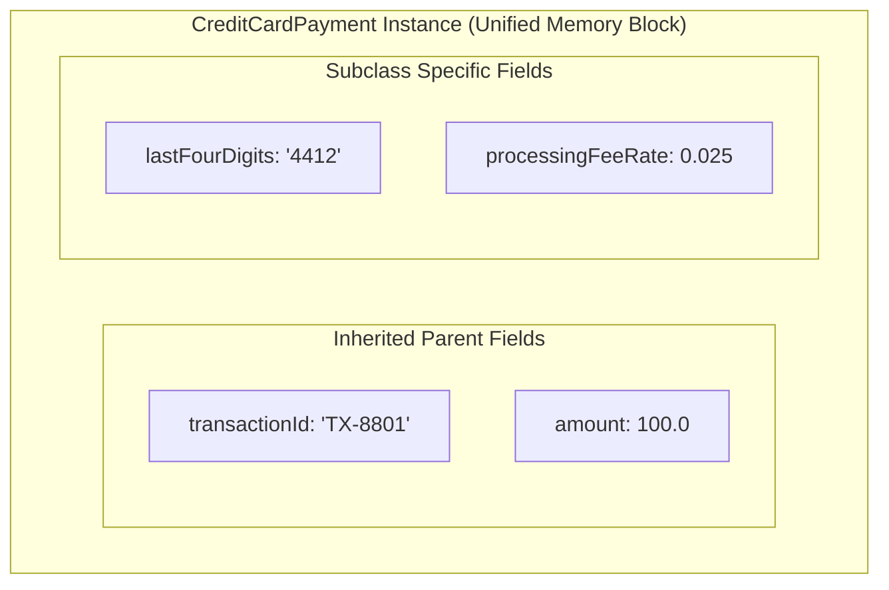

# Inheritance, Method Overriding & The super Keyword

> **Phase 2: OOP & Class Design**  
> *Estimated Reading Time: 50 minutes | Total Practice Effort: ~3.5 hours | Tier: Core Essential*

---

## 1. Purpose & Prerequisites

### Why This Matters in Full Stack Development
In real-world software engineering, many business domain concepts share common attributes:
- A `CreditCardPayment`, a `PayPalPayment`, and a `CryptoPayment` all share transaction IDs, timestamps, and amounts, but execute their processing logic differently.
- A `CustomerUser`, an `AdminUser`, and a `SupportAgent` all possess user credentials, but have distinct permissions.

Without **Inheritance**, you would duplicate identical fields and methods across dozens of separate classes. Inheritance establishes an **IS-A relationship**, enabling specialized subclasses to inherit common state and behavior from a generalized superclass while overriding specific functionality.

### Prerequisites
- [Topic 2.5: Static Members: Class Variables, Methods & Execution Blocks](05-static-members.md)

---

## 2. Plain-English Mental Model

Think of inheritance like biological classification or legal contracts:

```
                  [ Superclass / Parent: Payment ]
                  - String transactionId
                  - double amount
                  - void logReceipt()
                          /              \
            (IS-A)       /                \  (IS-A)
                        v                  v
     [ Subclass: CreditCardPayment ]     [ Subclass: CryptoPayment ]
     - String maskedCardNumber           - String walletHash
     - override: process()               - override: process()
```

- **Superclass (Parent):** Holds the shared DNA (fields and behaviors common to all types).
- **Subclass (Child):** Inherits everything from the parent and adds specialized features or behaviors.
- **`super`:** A child's direct telephone line back to its parent class.

---

## 3. The `extends` Keyword & The `Object` Root

In Java, a class extends a parent using the `extends` keyword:
```java
public class CreditCardPayment extends Payment { ... }
```

> [!IMPORTANT] The Cosmic Superclass
> If a class does not explicitly extend any class, the Java compiler automatically adds `extends java.lang.Object`. Every class in Java—without exception—is a direct or indirect descendant of `Object`, inheriting core methods like `toString()`, `equals()`, and `hashCode()`.

### Why Java Disallows Multiple Class Inheritance
Unlike C++, Java classes can extend **at most one** direct superclass (`class C extends A, B` is illegal). This design avoids the notorious **Diamond Problem**, where ambiguity arises if two parent classes define the same method with conflicting implementations.

---

## 4. The `super` Keyword

The `super` keyword serves two primary functions:

### 1. `super(...)` Constructor Invocation
A subclass constructor **must** invoke its parent constructor to initialize inherited fields. If you do not write an explicit `super(...)` call, the compiler automatically inserts `super();` (the no-arg call) as the first statement.

```java
public class Payment {
    private String transactionId;
    private double amount;

    public Payment(String transactionId, double amount) {
        this.transactionId = transactionId;
        this.amount = amount;
    }
}

public class CreditCardPayment extends Payment {
    private String cardNumber;

    public CreditCardPayment(String transactionId, double amount, String cardNumber) {
        super(transactionId, amount); // MUST BE FIRST STATEMENT!
        this.cardNumber = cardNumber;
    }
}
```

### 2. `super.method()` Parent Invocation
Allows an overridden method to execute the parent's base logic before or after adding custom functionality:
```java
@Override
public void process() {
    super.process(); // Runs general payment validation
    chargeCreditCard(); // Subclass custom logic
}
```

---

## 5. Method Overriding & The `@Override` Annotation

**Method Overriding** occurs when a subclass provides a specific implementation of a method already defined in its superclass.

### Strict Rules of Overriding:
1. **Identical Signature:** The method name, parameter count, and parameter types must match exactly.
2. **Covariant Return Types:** The return type must be identical, or a subtype of the parent's return type.
3. **Cannot Reduce Visibility:** If the parent method is `public`, the child method cannot be `protected` or `private`.
4. **Cannot Throw Broader Checked Exceptions:** The child method can throw fewer or narrower exceptions, but never new broader checked exceptions.

> [!TIP] Always Use the `@Override` Annotation
> `@Override` tells the compiler to verify that you are actually overriding a parent method. If you make a typo in the method name (e.g. `proccess()` instead of `process()`), the compiler will immediately raise an error rather than silently treating it as a new method.

---

## 6. Working Code Example: Enterprise Payment Hierarchy

```java
// File: PaymentHierarchyDemo.java

// Base Superclass
class Payment {
    private String transactionId;
    private double amount;

    public Payment(String transactionId, double amount) {
        this.transactionId = transactionId;
        this.amount = amount;
    }

    public String getTransactionId() { return transactionId; }
    public double getAmount() { return amount; }

    public void processPayment() {
        System.out.println("[BASE] Initializing ledger entry for Tx: " + transactionId 
                           + " | Amount: $" + amount);
    }
}

// Subclass 1: Credit Card
class CreditCardPayment extends Payment {
    private String lastFourDigits;
    private double processingFeeRate = 0.025; // 2.5% fee

    public CreditCardPayment(String transactionId, double amount, String lastFourDigits) {
        super(transactionId, amount); // Invoke parent constructor
        this.lastFourDigits = lastFourDigits;
    }

    @Override
    public void processPayment() {
        super.processPayment(); // Execute base ledger logic
        double fee = getAmount() * processingFeeRate;
        System.out.println(" -> Charging Visa card ending in " + lastFourDigits 
                           + " (Merchant fee: $" + fee + ")");
    }
}

// Subclass 2: Crypto
class CryptoPayment extends Payment {
    private String cryptoCurrency;
    private String networkHash;

    public CryptoPayment(String transactionId, double amount, String cryptoCurrency, String networkHash) {
        super(transactionId, amount);
        this.cryptoCurrency = cryptoCurrency;
        this.networkHash = networkHash;
    }

    @Override
    public void processPayment() {
        super.processPayment();
        System.out.println(" -> Broadcasting " + getAmount() + " USD equivalent to " 
                           + cryptoCurrency + " blockchain network (Hash: " + networkHash + ")");
    }
}

public class PaymentHierarchyDemo {
    public static void main(String[] args) {
        CreditCardPayment cardTx = new CreditCardPayment("TX-8801", 100.0, "4412");
        CryptoPayment cryptoTx = new CryptoPayment("TX-8802", 500.0, "ETH", "0x9f...a1b2");

        System.out.println("=== Processing Card Payment ===");
        cardTx.processPayment();

        System.out.println("\n=== Processing Crypto Payment ===");
        cryptoTx.processPayment();
    }
}
```

### Exact Output:
```text
=== Processing Card Payment ===
[BASE] Initializing ledger entry for Tx: TX-8801 | Amount: $100.0
 -> Charging Visa card ending in 4412 (Merchant fee: $2.5)

=== Processing Crypto Payment ===
[BASE] Initializing ledger entry for Tx: TX-8802 | Amount: $500.0
 -> Broadcasting 500.0 USD equivalent to ETH blockchain network (Hash: 0x9f...a1b2)
```

---

## 7. Under the Hood: Object Memory Layout in the Heap



When you write `new CreditCardPayment(...)`, the JVM allocates **one unified object** on the Heap containing both the parent's fields and the subclass's fields together. The parent constructor initializes the inherited slice, and the child constructor initializes the specialized slice.

---

## 8. Common Rookie Mistakes & Compiler Traps

### Trap 1: Missing Explicit `super(...)` when Parent Lacks No-Arg Constructor
```java
class Parent {
    public Parent(String name) { ... } // Only a parameterized constructor exists!
}

class Child extends Parent {
    public Child() {
        // COMPILER ERROR: Constructor Parent() is undefined!
    }
}
```
**Why:** The compiler automatically inserts `super();`. Because `Parent` only defines `Parent(String)`, the no-arg call fails.  
**Fix:** Explicitly invoke `super("defaultName");` in the child constructor.

### Trap 2: Reducing Visibility During Overriding
```java
class SuperService {
    public void execute() { ... }
}

class SubService extends SuperService {
    @Override
    protected void execute() { ... } // COMPILER ERROR: Cannot reduce the visibility of the inherited method!
}
```

---

## 9. Guided Hands-On Exercise

### Challenge: Cloud Server Telemetry Hierarchy
Create a program named `ServerHierarchyDemo.java` modeling cloud infrastructure:
1. Base Class `Server`:
   - Private fields: `serverId` (`String`), `ipAddress` (`String`), `uptimeSeconds` (`long`).
   - Constructor initializing all 3 fields.
   - Getters for all fields.
   - Method `getHealthReport()` returning:  
     `"Server [" + serverId + " @ " + ipAddress + "] Uptime: " + uptimeSeconds + "s"`
2. Subclass `DatabaseServer extends Server`:
   - Private fields: `activeConnections` (`int`), `cacheHitRatio` (`double`).
   - Constructor chaining to `super(...)` and setting child fields.
   - Overrides `getHealthReport()`: calls `super.getHealthReport()` and appends  
     `" | DB Connections: " + activeConnections + " | Cache Hit: " + (cacheHitRatio * 100) + "%"`
3. In `main`:
   - Instantiate a `DatabaseServer("db-primary-01", "10.0.1.5", 86400, 142, 0.985)`.
   - Print its health report.

<details>
<summary>💡 Hint: Overriding getHealthReport</summary>

```java
@Override
public String getHealthReport() {
    return super.getHealthReport() + " | DB Connections: " + activeConnections ...
}
```
</details>

<details>
<summary>✅ Solution</summary>

```java
class Server {
    private String serverId;
    private String ipAddress;
    private long uptimeSeconds;

    public Server(String serverId, String ipAddress, long uptimeSeconds) {
        this.serverId = serverId;
        this.ipAddress = ipAddress;
        this.uptimeSeconds = uptimeSeconds;
    }

    public String getServerId() { return serverId; }
    public String getIpAddress() { return ipAddress; }
    public long getUptimeSeconds() { return uptimeSeconds; }

    public String getHealthReport() {
        return "Server [" + serverId + " @ " + ipAddress + "] Uptime: " + uptimeSeconds + "s";
    }
}

class DatabaseServer extends Server {
    private int activeConnections;
    private double cacheHitRatio;

    public DatabaseServer(String serverId, String ipAddress, long uptimeSeconds, 
                          int activeConnections, double cacheHitRatio) {
        super(serverId, ipAddress, uptimeSeconds);
        this.activeConnections = activeConnections;
        this.cacheHitRatio = cacheHitRatio;
    }

    @Override
    public String getHealthReport() {
        return super.getHealthReport() 
               + " | DB Connections: " + activeConnections 
               + " | Cache Hit: " + (cacheHitRatio * 100) + "%";
    }
}

public class ServerHierarchyDemo {
    public static void main(String[] args) {
        DatabaseServer dbServer = new DatabaseServer("db-primary-01", "10.0.1.5", 86400, 142, 0.985);
        System.out.println(dbServer.getHealthReport());
    }
}
```

**Terminal Output:**
```text
Server [db-primary-01 @ 10.0.1.5] Uptime: 86400s | DB Connections: 142 | Cache Hit: 98.5%
```
</details>

---

## 10. Knowledge Check & Interview Defense

### Quick Quiz
1. **Why does Java not support multiple class inheritance (`class C extends A, B`)?**
   - [ ] A) It reduces JVM memory usage by half.
   - [x] B) To eliminate ambiguity caused by the Diamond Problem when multiple parent classes define conflicting method implementations.
   - [ ] C) Because microprocessors only have one instruction pointer.
   - [ ] D) Multiple inheritance is only permitted in Java 8+.

2. **What does the `@Override` annotation do?**
   - [ ] A) It forces the method to run in a separate thread.
   - [x] B) It instructs the compiler to verify that the method correctly overrides a method from a superclass or interface, flagging typos or signature mismatches as compile-time errors.
   - [ ] C) It makes private methods public.
   - [ ] D) It prevents subclasses from overriding the method.

3. **Can an overriding method in a subclass reduce the access modifier visibility of the parent method (e.g. from `public` to `protected`)?**
   - [ ] A) Yes, subclasses have full freedom over visibility.
   - [x] B) No. Java rules strictly forbid reducing visibility, as it would violate the Liskov Substitution Principle.
   - [ ] C) Yes, but only if the class is abstract.
   - [ ] D) Yes, but only with a special compiler flag.

---

### Junior Developer Interview Q&A

#### Q: "What is the difference between Method Overloading and Method Overriding?"
> **Model Answer:**  
> "The key differences are:
> 1. **Context:** Method Overloading occurs within the **same class** (or inherited methods), where multiple methods share the same name with different parameter signatures. Method Overriding occurs across a **parent-child inheritance hierarchy**, where a subclass provides a specialized implementation of an existing parent method with the exact same signature.
> 2. **Binding & Resolution:** Overloading is resolved at **compile-time (static binding)** based on reference types. Overriding is resolved at **runtime (dynamic binding)** based on the actual object instance in the Heap.
> 3. **Rules:** Overloaded methods can change return types and access modifiers freely as long as parameter lists differ. Overriding methods must maintain identical parameters, cannot reduce visibility, and can only use covariant return types."

---

## 11. Mastery Checklist & Next Step

Before moving on, verify that you can:
- [ ] Implement inheritance using `extends` and invoke parent constructors using `super(...)`.
- [ ] Correctly override methods using the `@Override` annotation.
- [ ] Explain why Java avoids multiple class inheritance to prevent the Diamond Problem.
- [ ] Describe the memory layout of an inherited object on the JVM Heap.

👉 **Next Lesson:** **[Topic 2.7: Polymorphism: Compile-Time vs Dynamic Method Dispatch](07-polymorphism.md)**
