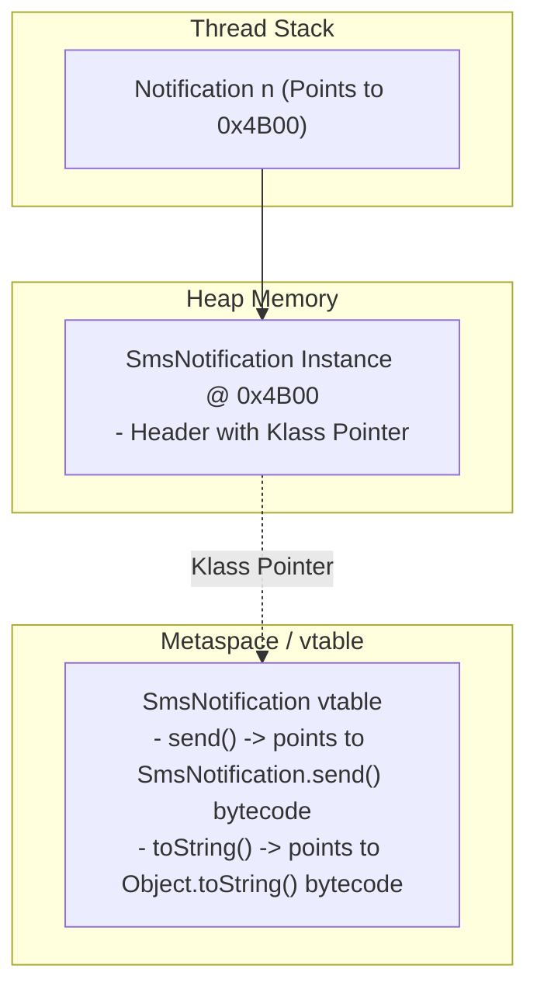

# Polymorphism: Compile-Time vs Dynamic Method Dispatch

> **Phase 2: OOP & Class Design**  
> *Estimated Reading Time: 50 minutes | Total Practice Effort: ~3.5 hours | Tier: Core Essential*

---

## 1. Purpose & Prerequisites

### Why This Matters in Full Stack Development
In an enterprise backend, you rarely want your code tightly coupled to one specific implementation.
Consider an e-commerce checkout system: it shouldn't need separate code for `processCreditCard()`, `processApplePay()`, and `processCrypto()`. Instead, it should simply take a generic `Payment` reference and call `payment.process()`.

**Polymorphism** (from the Greek meaning "many shapes") allows you to treat specialized subclasses through a unified, general interface. At runtime, the JVM automatically determines the actual underlying object in memory and executes the appropriate method. Polymorphism is the engine that powers clean architecture, dependency injection in Spring Boot, and extensible plugin systems.

### Prerequisites
- [Topic 2.6: Inheritance, Method Overriding & The super Keyword](06-inheritance.md)

---

## 2. Plain-English Mental Model

Think of polymorphism like the universal power button on a remote control:

```
[ Remote Control: Power Button (Generic Reference: Device) ]
                       |
                       +-----------------------+
                       |                       |
                       v                       v
               [ Television ]            [ Soundbar ]
               Screen lights up         Volume LEDs ignite
```

- You press the exact same **Power Button** regardless of what device is in front of you.
- You don't need a "TV Power Button" and a separate "Speaker Power Button".
- Each physical device responds to the universal signal in its own specialized way.

---

## 3. Compile-Time vs Runtime Polymorphism

Java supports two distinct forms of polymorphism:

| Property | Compile-Time (Static) Polymorphism | Runtime (Dynamic) Polymorphism |
| :--- | :--- | :--- |
| **Primary Mechanism** | **Method Overloading** | **Method Overriding & Inheritance** |
| **When Resolved** | During `javac` compilation | During runtime execution by the JVM |
| **How It's Decided** | Based on the **reference type** and argument list | Based on the **actual object type in Heap memory** |
| **Bytecode Instruction** | `invokestatic` / `invokespecial` | `invokevirtual` (via the vtable) |

---

## 4. Upcasting, Downcasting & Pattern Matching `instanceof`

### 1. Upcasting (Safe & Automatic)
Assigning a subclass instance to a superclass reference variable:
```java
// Upcasting: A CreditCardPayment IS-A Payment
Payment p = new CreditCardPayment("TX-101", 99.0, "1122");
p.processPayment(); // Automatically invokes CreditCardPayment's processPayment()!
```

### 2. Downcasting (Explicit & Risky)
Converting a superclass reference back to its specialized subclass type:
```java
Payment p = new CreditCardPayment("TX-101", 99.0, "1122");

// Risky downcasting: Requires manual cast
CreditCardPayment card = (CreditCardPayment) p;
System.out.println(card.getLastFourDigits());
```

> [!CAUTION] The `ClassCastException` Trap
> Attempting to downcast an object to the wrong type throws a runtime crash:
> ```java
> Payment p = new CryptoPayment(...);
> CreditCardPayment card = (CreditCardPayment) p; // CRASH: java.lang.ClassCastException!
> ```

### 3. Modern Pattern Matching for `instanceof` (Java 16+)
Traditionally, you had to check with `instanceof` and then explicitly cast. Modern Java allows you to bind the variable directly in the `if` statement:

```java
// Modern Java 16+ Pattern Matching
if (p instanceof CreditCardPayment card) {
    // 'card' is automatically in scope and casted!
    System.out.println("Processing card ending in: " + card.getLastFourDigits());
} else if (p instanceof CryptoPayment crypto) {
    System.out.println("Blockchain hash: " + crypto.getNetworkHash());
}
```

---

## 5. Working Code Example: Polymorphic Notification Engine

```java
// File: NotificationSystem.java

// Superclass
abstract class Notification {
    private String recipient;

    public Notification(String recipient) {
        this.recipient = recipient;
    }

    public String getRecipient() { return recipient; }

    public abstract void send(String message);
}

// Subclass 1: Email
class EmailNotification extends Notification {
    public EmailNotification(String email) { super(email); }

    @Override
    public void send(String message) {
        System.out.println("[EMAIL] Dispatching SMTP message to <" + getRecipient() + ">: " + message);
    }
}

// Subclass 2: SMS
class SmsNotification extends Notification {
    public SmsNotification(String phoneNumber) { super(phoneNumber); }

    @Override
    public void send(String message) {
        System.out.println("[SMS] Sending cellular text to [" + getRecipient() + "]: " + message);
    }
}

// Subclass 3: Mobile Push Notification
class PushNotification extends Notification {
    private String deviceToken;

    public PushNotification(String userHandle, String deviceToken) {
        super(userHandle);
        this.deviceToken = deviceToken;
    }

    @Override
    public void send(String message) {
        System.out.println("[PUSH] Sending APNS push to @" + getRecipient() + " (Device: " + deviceToken + "): " + message);
    }
}

public class NotificationSystem {
    public static void main(String[] args) {
        // Polymorphic Array: One array storing diverse subclass objects!
        Notification[] notificationQueue = {
            new EmailNotification("sarah@developer.io"),
            new SmsNotification("+1-555-0192"),
            new PushNotification("alex_dev", "token-99af-bc42")
        };

        String alertMessage = "Your security code is 849201.";

        System.out.println("=== Broadcasting Alert Polymorphically ===");
        // The caller doesn't care whether an item is SMS, Email, or Push!
        for (Notification notification : notificationQueue) {
            notification.send(alertMessage); // Dynamic Method Dispatch resolves target at runtime!
        }
    }
}
```

### Exact Output:
```text
=== Broadcasting Alert Polymorphically ===
[EMAIL] Dispatching SMTP message to <sarah@developer.io>: Your security code is 849201.
[SMS] Sending cellular text to [+1-555-0192]: Your security code is 849201.
[PUSH] Sending APNS push to @alex_dev (Device: token-99af-bc42): Your security code is 849201.
```

---

## 6. Under the Hood: The Virtual Method Table (vtable)

How does the JVM know which method to run when you call `notification.send()`?



1. **`invokevirtual` Bytecode:** When the compiler compiles `notification.send()`, it generates the `invokevirtual` instruction.
2. **Klass Pointer:** Every object in the Heap has an object header containing a pointer to its class metadata.
3. **The vtable (Virtual Method Table):** Each class maintains an array of pointers to its executable methods. When `send()` is invoked, the JVM looks up slot index for `send()` in `SmsNotification`'s vtable and jumps directly to that address.

---

## 7. Crucial Trap: Variables Are NOT Polymorphic!

> [!WARNING] Production Trap: Field Shadowing
> In Java, **only methods are polymorphic**. Instance variables are resolved at compile-time based on the **reference type**, not the runtime object!

```java
class Parent {
    String role = "PARENT";
}

class Child extends Parent {
    String role = "CHILD"; // Field shadowing (NOT overriding!)
}

// Test:
Parent p = new Child();
System.out.println(p.role); // PRINTS: "PARENT" (NOT "CHILD"!)
```
Because variables are not polymorphic, **always encapsulate fields as `private`** and expose them via overridden getter methods.

---

## 8. Guided Hands-On Exercise

### Challenge: Smart Highway Toll Plaza Simulator
Create a program named `TollPlazaDemo.java` that calculates tolls polymorphically:
1. Abstract Base Class `Vehicle`:
   - Private field: `licensePlate` (`String`).
   - Constructor initializing `licensePlate`.
   - Getter for `licensePlate`.
   - Abstract method: `public abstract double calculateToll()`.
2. Subclasses:
   - `Car extends Vehicle`: Flat toll of `$5.00`.
   - `CommercialTruck extends Vehicle`: Has `axleCount` (`int`). Toll is `$5.00` per axle.
   - `ElectricVehicle extends Vehicle`: Receives a 50% clean energy discount on a base toll of `$5.00` (toll is `$2.50`).
3. In `main`:
   - Create an array of `Vehicle[]` containing:
     - `Car("ABC-123")`
     - `CommercialTruck("TRK-900", 5)`
     - `ElectricVehicle("EV-441")`
   - Iterate over the array, print each vehicle's plate and calculated toll, and compute the total revenue collected by the toll booth.

<details>
<summary>💡 Hint: Truck Formula</summary>

```java
return axleCount * 5.00;
```
</details>

<details>
<summary>✅ Solution</summary>

```java
abstract class Vehicle {
    private String licensePlate;

    public Vehicle(String licensePlate) {
        this.licensePlate = licensePlate;
    }

    public String getLicensePlate() { return licensePlate; }

    public abstract double calculateToll();
}

class Car extends Vehicle {
    public Car(String licensePlate) { super(licensePlate); }

    @Override
    public double calculateToll() {
        return 5.00;
    }
}

class CommercialTruck extends Vehicle {
    private int axleCount;

    public CommercialTruck(String licensePlate, int axleCount) {
        super(licensePlate);
        this.axleCount = axleCount;
    }

    @Override
    public double calculateToll() {
        return axleCount * 5.00;
    }
}

class ElectricVehicle extends Vehicle {
    public ElectricVehicle(String licensePlate) { super(licensePlate); }

    @Override
    public double calculateToll() {
        return 2.50; // 50% discount
    }
}

public class TollPlazaDemo {
    public static void main(String[] args) {
        Vehicle[] vehicles = {
            new Car("ABC-123"),
            new CommercialTruck("TRK-900", 5),
            new ElectricVehicle("EV-441")
        };

        double totalRevenue = 0.0;

        System.out.println("=== Highway Toll Booth Telemetry ===");
        for (Vehicle v : vehicles) {
            double toll = v.calculateToll(); // Polymorphic invocation!
            totalRevenue += toll;
            System.out.println("Vehicle [" + v.getLicensePlate() + "] (" 
                               + v.getClass().getSimpleName() + ") Toll: $" + toll);
        }

        System.out.println("------------------------------------");
        System.out.println("Total Toll Revenue Collected: $" + totalRevenue);
    }
}
```

**Terminal Output:**
```text
=== Highway Toll Booth Telemetry ===
Vehicle [ABC-123] (Car) Toll: $5.0
Vehicle [TRK-900] (CommercialTruck) Toll: $25.0
Vehicle [EV-441] (ElectricVehicle) Toll: $2.5
------------------------------------
Total Toll Revenue Collected: $32.5
```
</details>

---

## 9. Knowledge Check & Interview Defense

### Quick Quiz
1. **Which bytecode instruction is generated by the Java compiler for polymorphic instance method calls?**
   - [ ] A) `invokestatic`
   - [x] B) `invokevirtual`
   - [ ] C) `invokespecial`
   - [ ] D) `invokeinterface_static`

2. **Given `Parent p = new Child();`, what happens if both classes define a field `public int x = 10;` and `public int x = 20;` when accessing `p.x`?**
   - [x] A) It prints `10` because variables in Java are bound at compile-time by reference type, NOT polymorphically dispatched.
   - [ ] B) It prints `20`.
   - [ ] C) A compile-time error occurs.
   - [ ] D) A `ClassCastException` is thrown.

3. **What happens if you attempt to downcast an object to an incompatible subclass type at runtime without checking `instanceof`?**
   - [ ] A) The cast silently evaluates to `null`.
   - [x] B) The JVM throws `java.lang.ClassCastException` and crashes execution.
   - [ ] C) The object's memory is erased.
   - [ ] D) The compiler fixes the types automatically.

---

### Junior Developer Interview Q&A

#### Q: "How does the JVM implement dynamic method dispatch under the hood?"
> **Model Answer:**  
> "The JVM uses a data structure called the **vtable (Virtual Method Table)**.  
> 
> When classes are loaded into memory, each class is assigned a vtable that maps method signatures to their concrete executable bytecode addresses in memory. Subclasses inherit the parent's vtable entries, but if a subclass overrides a method, its entry in the vtable is overwritten with the pointer to the subclass's implementation.  
> 
> When an `invokevirtual` call occurs (e.g. `vehicle.calculateToll()`), the JVM inspects the object header of the target instance in the Heap, follows its **Klass pointer** to the runtime class's vtable, and retrieves the method address from the predefined offset. This ensures $O(1)$ constant-time dynamic lookup without needing expensive conditional branching or reflection."

---

## 10. Mastery Checklist & Next Step

Before moving on, verify that you can:
- [ ] Differentiate between compile-time (overloading) and runtime (overriding) polymorphism.
- [ ] Perform safe upcasting and guarded downcasting using Java 16+ pattern matching `instanceof`.
- [ ] Explain why instance variables are NOT polymorphic in Java.
- [ ] Describe how the JVM uses `invokevirtual` and the vtable to resolve method calls at runtime.

👉 **Next Lesson:** **[Topic 2.8: Abstract Classes vs Interfaces & Multiple Inheritance of Type](08-abstraction-interfaces.md)**
