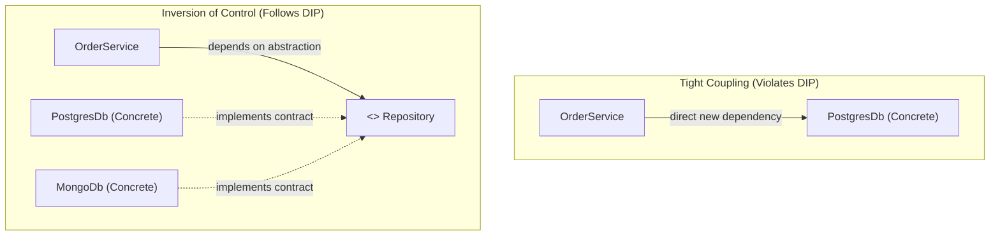

# Composition (HAS-A) vs Inheritance (IS-A) & Practical SOLID

> **Phase 2: OOP & Class Design**  
> *Estimated Reading Time: 55 minutes | Total Practice Effort: ~3.0 hours | Tier: Core Essential*

---

## 1. Purpose & Prerequisites

### Why This Matters in Full Stack Development
When beginners first discover inheritance, they often overuse it—creating 6-level deep class hierarchies like:
`Object` &rarr; `LivingEntity` &rarr; `Person` &rarr; `Employee` &rarr; `Manager` &rarr; `RegionalDirector`.

In production, deep inheritance hierarchies become a maintenance nightmare known as the **Fragile Base Class problem**: modifying a single line in `Person` can break 50 downstream subclasses!

The Gang of Four's most famous architectural guideline is: **"Favor object composition over class inheritance."** Pairing composition with the **SOLID principles** provides the architectural blueprint for every modern full-stack backend, microservice, and Spring Boot framework.

### Prerequisites
- [Topic 2.8: Abstract Classes vs Interfaces & Multiple Inheritance of Type](08-abstraction-interfaces.md)

---

## 2. Plain-English Mental Model

Think of Composition vs Inheritance like a Swiss Army Knife versus genetic evolution:

```
[ Inheritance (IS-A) ]                     [ Composition (HAS-A) ]
"A Smartphone IS-A Telephone"               "A Smartphone HAS-A Camera, HAS-A Battery"
- Rigid, fixed at birth (compile-time)       - Modular, swappable components
- Stuck with parent's flaws                 - Upgrade the Camera without rebuilding the Phone!
```

- **Inheritance (IS-A):** Tight coupling. The child class is forever bound to the parent's implementation.
- **Composition (HAS-A):** Loose coupling. A class contains references to other independent objects as fields and delegates work to them. You can swap out a component at runtime without touching the host class.

---

## 3. The SOLID Principles Explained Simply

| Letter | Principle Name | Plain-English Meaning | Production Smells to Avoid |
| :---: | :--- | :--- | :--- |
| **S** | **Single Responsibility (SRP)** | A class should have **one, and only one, reason to change**. | "God Classes" that mix database SQL, email dispatching, and math logic in one file. |
| **O** | **Open/Closed (OCP)** | Software entities should be **open for extension, but closed for modification**. | Having to edit existing tested classes with huge `switch` statements every time a new feature is added. |
| **L** | **Liskov Substitution (LSP)** | Subclasses must be **substitutable for their base types** without altering correctness. | Subclasses overriding a parent method only to throw `UnsupportedOperationException`. |
| **I** | **Interface Segregation (ISP)** | Clients should not be forced to depend upon interfaces that they do not use. | Giant "fat" interfaces with 40 methods when a client only needs 2. |
| **D** | **Dependency Inversion (DIP)** | High-level modules should **depend on abstractions (interfaces)**, not concrete details. | Instantiating concrete dependencies inside constructors via `new DatabaseService()`. |

---

## 4. The Dependency Inversion Principle (DIP) in Practice

DIP is the foundational principle behind **Dependency Injection** in frameworks like Spring Boot:



Instead of `OrderService` tightly creating a `new PostgresDb()`, it accepts any object that implements the `Repository` interface via its constructor. You can swap PostgreSQL for MongoDB or a test Mock with zero changes to `OrderService`!

---

## 5. Working Code Example: Refactoring a God Class to SOLID

### The Anti-Pattern: Tightly Coupled God Class
```java
// ANTI-PATTERN: Violates SRP, OCP, and DIP
public class OrderProcessor {
    public void processOrder(double amount, String userEmail, String paymentMethod) {
        // 1. Payment processing logic directly coupled
        if (paymentMethod.equals("CREDIT_CARD")) {
            System.out.println("Charging card...");
        } else if (paymentMethod.equals("PAYPAL")) {
            System.out.println("Redirecting PayPal...");
        }

        // 2. Email formatting coupled
        System.out.println("Sending SMTP email to " + userEmail);

        // 3. Database SQL logic coupled
        System.out.println("INSERT INTO orders VALUES (" + amount + ")");
    }
}
```

### The Clean Architecture Solution (Composition + SOLID)
```java
// File: CleanOrderArchitecture.java

// 1. Interfaces (DIP & ISP)
interface PaymentGateway {
    void charge(double amount);
}

interface NotificationService {
    void notifyUser(String recipient, String message);
}

// 2. Swappable Strategy Implementations (OCP: Open for extension!)
class StripePaymentGateway implements PaymentGateway {
    @Override
    public void charge(double amount) {
        System.out.println("[Stripe] Charged credit card: $" + amount);
    }
}

class PayPalGateway implements PaymentGateway {
    @Override
    public void charge(double amount) {
        System.out.println("[PayPal] Processed digital wallet transfer: $" + amount);
    }
}

class EmailNotificationService implements NotificationService {
    @Override
    public void notifyUser(String recipient, String message) {
        System.out.println("[Email Service] Dispatched email to <" + recipient + ">: " + message);
    }
}

// 3. High-Level Coordinator (SRP: Only coordinates orders; delegates details via Composition)
class OrderCheckoutService {
    private final PaymentGateway paymentGateway;
    private final NotificationService notificationService;

    // Dependency Injection via Constructor (DIP: Injected abstractions!)
    public OrderCheckoutService(PaymentGateway paymentGateway, NotificationService notificationService) {
        this.paymentGateway = paymentGateway;
        this.notificationService = notificationService;
    }

    public void checkout(String orderId, double amount, String customerEmail) {
        System.out.println("=== Initiating Checkout: " + orderId + " ===");
        paymentGateway.charge(amount);
        notificationService.notifyUser(customerEmail, "Your order " + orderId + " was confirmed for $" + amount);
        System.out.println("=== Checkout Complete ===\n");
    }
}

public class CleanOrderArchitecture {
    public static void main(String[] args) {
        // Assemble system components dynamically via Composition
        PaymentGateway stripe = new StripePaymentGateway();
        NotificationService email = new EmailNotificationService();

        // Inject dependencies into high-level service
        OrderCheckoutService checkoutService = new OrderCheckoutService(stripe, email);
        checkoutService.checkout("ORD-9901", 149.99, "customer@domain.com");

        // Need PayPal tomorrow? Simply swap the injected instance with ZERO changes to OrderCheckoutService!
        PaymentGateway paypal = new PayPalGateway();
        OrderCheckoutService paypalCheckout = new OrderCheckoutService(paypal, email);
        paypalCheckout.checkout("ORD-9902", 45.00, "shopper@domain.com");
    }
}
```

### Exact Output:
```text
=== Initiating Checkout: ORD-9901 ===
[Stripe] Charged credit card: $149.99
[Email Service] Dispatched email to <customer@domain.com>: Your order ORD-9901 was confirmed for $149.99
=== Checkout Complete ===

=== Initiating Checkout: ORD-9902 ===
[PayPal] Processed digital wallet transfer: $45.0
[Email Service] Dispatched email to <shopper@domain.com>: Your order ORD-9902 was confirmed for $45.0
=== Checkout Complete ===
```

---

## 6. The Liskov Substitution Principle (LSP) Classic Trap

The most famous LSP violation is the **Square extends Rectangle** problem:

```java
// FLAWED HIERARCHY
class Rectangle {
    protected int width;
    protected int height;

    public void setWidth(int w) { this.width = w; }
    public void setHeight(int h) { this.height = h; }
    public int getArea() { return width * height; }
}

class Square extends Rectangle {
    @Override
    public void setWidth(int w) {
        this.width = w;
        this.height = w; // Mutates height to maintain squareness!
    }
    @Override
    public void setHeight(int h) {
        this.width = h;
        this.height = h;
    }
}
```

### Why This Violates LSP:
```java
void verifyArea(Rectangle r) {
    r.setWidth(5);
    r.setHeight(4);
    // For any true Rectangle, 5 * 4 MUST be 20.
    // But if 'r' is a Square, r.setHeight(4) set both width and height to 4!
    // Area becomes 16! Test fails, program correctness is shattered!
}
```
> [!CAUTION]
> Just because something is true in everyday language (*"A square is a rectangle"*) does **not** mean it is a valid inheritance relationship in software engineering. If a subclass cannot fulfill the behavioral contracts and assumptions of the parent type, **do not use inheritance**.

---

## 7. Guided Hands-On Exercise

### Challenge: Tax Engine & Invoice Generator Refactoring
Create a program named `SolidTaxDemo.java`:
1. Define a `TaxStrategy` interface:
   - Method: `double calculateTax(double subtotal)`
2. Concrete implementations:
   - `UsSalesTax`: Applies an 8.5% flat tax.
   - `EuVatTax`: Applies a 20% VAT tax.
   - `ZeroTax`: Returns `$0.00` (for exempt items).
3. Create an `InvoiceService` class that uses **Composition**:
   - Holds a `TaxStrategy` reference injected via constructor.
   - Has method `void generateInvoice(String invoiceId, double subtotal)`.
   - Computes tax, calculates final amount (`subtotal + tax`), and prints the receipt.
4. In `main`:
   - Instantiate an `InvoiceService` configured with `UsSalesTax` and generate an invoice for `$100.0`.
   - Reconfigure with `EuVatTax` and generate an invoice for `$100.0`.

<details>
<summary>💡 Hint: Constructor Injection</summary>

```java
public InvoiceService(TaxStrategy taxStrategy) {
    this.taxStrategy = taxStrategy;
}
```
</details>

<details>
<summary>✅ Solution</summary>

```java
interface TaxStrategy {
    double calculateTax(double subtotal);
}

class UsSalesTax implements TaxStrategy {
    @Override
    public double calculateTax(double subtotal) {
        return subtotal * 0.085; // 8.5%
    }
}

class EuVatTax implements TaxStrategy {
    @Override
    public double calculateTax(double subtotal) {
        return subtotal * 0.20; // 20%
    }
}

class InvoiceService {
    private final TaxStrategy taxStrategy;

    public InvoiceService(TaxStrategy taxStrategy) {
        this.taxStrategy = taxStrategy;
    }

    public void generateInvoice(String invoiceId, double subtotal) {
        double tax = taxStrategy.calculateTax(subtotal);
        double total = subtotal + tax;

        System.out.println("Invoice: " + invoiceId);
        System.out.println("Subtotal: $" + subtotal);
        System.out.println("Tax: $" + tax);
        System.out.println("Total Due: $" + total);
        System.out.println("-------------------------");
    }
}

public class SolidTaxDemo {
    public static void main(String[] args) {
        System.out.println("=== US Market Invoice ===");
        InvoiceService usInvoice = new InvoiceService(new UsSalesTax());
        usInvoice.generateInvoice("INV-US-001", 100.0);

        System.out.println("=== EU Market Invoice ===");
        InvoiceService euInvoice = new InvoiceService(new EuVatTax());
        euInvoice.generateInvoice("INV-EU-002", 100.0);
    }
}
```

**Terminal Output:**
```text
=== US Market Invoice ===
Invoice: INV-US-001
Subtotal: $100.0
Tax: $8.5
Total Due: $108.5
-------------------------
=== EU Market Invoice ===
Invoice: INV-EU-002
Subtotal: $100.0
Tax: $20.0
Total Due: $120.0
-------------------------
```
</details>

---

## 8. Knowledge Check & Interview Defense

### Quick Quiz
1. **What does the Single Responsibility Principle (SRP) dictate?**
   - [ ] A) A class can only have one method.
   - [x] B) A class should have only one reason to change, meaning it focuses on a single cohesive responsibility or actor.
   - [ ] C) Only one developer should edit a file at a time.
   - [ ] D) A project must only have one package.

2. **Why is Composition favored over Inheritance according to modern design practices?**
   - [x] A) Composition avoids fragile class hierarchies, allows dynamic swapping of dependencies at runtime, and results in loose coupling.
   - [ ] B) Composition runs 100x faster than inheritance.
   - [ ] C) Java is deprecating the `extends` keyword.
   - [ ] D) Inheritance does not support private fields.

3. **What is the Dependency Inversion Principle (DIP)?**
   - [ ] A) High-level modules should directly instantiate low-level utility classes.
   - [x] B) High-level modules and low-level modules should both depend on abstractions (interfaces) rather than concrete implementations.
   - [ ] C) All classes must be inverted alphabetically.
   - [ ] D) Inheritance arrows in UML must point downwards.

---

### Junior Developer Interview Q&A

#### Q: "Explain the Open/Closed Principle (OCP) and how polymorphism helps achieve it."
> **Model Answer:**  
> "The Open/Closed Principle states that software entities (classes, modules, functions) should be **open for extension**, but **closed for modification**.  
> 
> In traditional imperative code, adding a new payment method or notification channel requires opening an existing service and adding a new `else if` branch to a sprawling conditional statement. This risks introducing regression bugs into already tested and deployed code.  
> 
> By programming to an interface (e.g. `PaymentGateway`), we can introduce a new payment method simply by creating a new class (e.g. `CryptoPaymentGateway`) that implements the interface. The existing `CheckoutService` does not need a single line of code modified or retested; it automatically accepts the new implementation via polymorphism and constructor injection."

---

## 9. Phase 2 Mastery Checklist & Next Phase

Congratulations! You have completed **Phase 2: OOP & Class Design**.

### Phase 2 Mastery Self-Audit:
- [x] Classes & Objects: Deconstruct heap allocations and object references.
- [x] Constructors & `this`: Eliminate half-baked state and chain constructors via `this(...)`.
- [x] Encapsulation: Protect invariants and prevent mutable leaks via defensive copying.
- [x] Developer Tools I: Initialize Git, write `.gitignore`, and manage feature branches.
- [x] Static Members: Differentiate class variables and static blocks from instance state.
- [x] Inheritance & `super`: Extend base classes safely and override methods with `@Override`.
- [x] Polymorphism: Harness dynamic method dispatch and modern pattern-matching `instanceof`.
- [x] Abstraction & Interfaces: Design flexible contracts with Java 8+ `default` methods.
- [x] Composition & SOLID: Replace fragile inheritance with composition and dependency inversion.

👉 **Next Phase:** **[Phase 3: Core Java, Testing Foundations & Modern Java 8+ — Topic 3.1: Exception Handling Architecture & Defensive Coding](../03-core/01-exceptions.md)**
