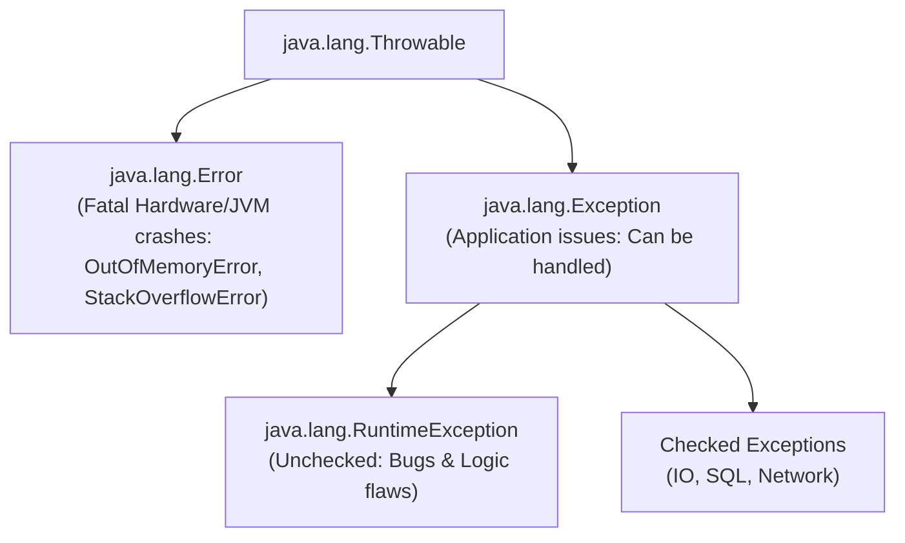

# Exception Architecture: try, catch, finally & throw/throws

> **Phase 3: Core Java, Testing Foundations & Modern Java 8+**  
> *Estimated Reading Time: 45 minutes | Total Practice Effort: ~3.0 hours | Tier: Core Essential*

---

## 1. Purpose & Prerequisites

### Why This Matters in Full Stack Development
In the real world, software doesn't run in a vacuum. Disks fill up, database servers crash, internet connections drop, and users type text into numeric input fields.

If an application cannot gracefully handle runtime failures, an entire enterprise API server can crash, taking down thousands of active user sessions. **Exception Handling** is Java's built-in mechanism for intercepting, reporting, and recovering from exceptional runtime events, ensuring your applications remain resilient and secure.

### Prerequisites
- [Phase 2: OOP & Class Design](../02-oop/09-solid-principles.md)

---

## 2. Plain-English Mental Model

Think of exception handling like an emergency response protocol in a corporate office building:

```
[ Normal Business Operation: try { ... } ]
                   |
     (Fire Alarm Rings! Exception Thrown!)
                   |
                   v
[ Emergency Protocol: catch (FireException e) { ... } ]
- Calmly evacuate the building
- Notify security and log incident details
                   |
                   v
[ Mandatory Clean-Up: finally { ... } ]
- Turn off gas mains and lock the building doors (ALWAYS runs, fire or no fire!)
```

- **`try` Block:** The normal operation area where things might go wrong.
- **`catch` Block:** The emergency handler that activates only if a matching problem occurs.
- **`finally` Block:** The guaranteed cleanup crew that executes regardless of whether an exception occurred, was caught, or was rethrown.
- **`throw`:** Triggering an alarm manually (`throw new PaymentFailedException()`).
- **`throws`:** The warning label on a method signature indicating that calling this method might trigger an alarm.

---

## 3. The `Throwable` Class Hierarchy

Every exception in Java is an object that inherits from `java.lang.Throwable`:



1. **`Error`:** Catastrophic system failures (e.g., `OutOfMemoryError`, `StackOverflowError`). You should **never catch** an `Error`; the JVM is dying.
2. **`Exception` (Checked):** Recoverable external conditions (e.g., `IOException`, `SQLException`). The compiler forces you to handle or declare them.
3. **`RuntimeException` (Unchecked):** Programmatic bugs and logic errors (e.g., `NullPointerException`, `IllegalArgumentException`, `IndexOutOfBoundsException`).

---

## 4. Syntax & Control Flow: try, catch, finally, multi-catch

```java
try {
    // Risky code (e.g. parsing numbers or accessing network)
    int divisor = Integer.parseInt(args[0]);
    int result = 100 / divisor;
} catch (NumberFormatException | ArithmeticException e) {
    // Multi-Catch: Handles multiple exception types in one concise block
    System.out.println("Handled input or math error: " + e.getMessage());
} catch (Exception e) {
    // Generalized fallback catch (must be placed AFTER specific catches!)
    System.out.println("Unexpected failure: " + e.getMessage());
} finally {
    // Cleanup block: ALWAYS executes, even if 'return' was encountered in try or catch!
    System.out.println("Cleanup completed.");
}
```

---

## 5. Modern Try-With-Resources (`AutoCloseable`)

Historically, developers closed database connections and file streams in `finally` blocks, resulting in messy nested try-catches.  
Java 7+ introduced **Try-with-Resources**, which automatically closes any resource that implements `java.lang.AutoCloseable`:

```java
// Automatic cleanup: BufferedReader and FileReader are closed automatically!
try (BufferedReader reader = new BufferedReader(new FileReader("config.json"))) {
    String line = reader.readLine();
    System.out.println("Config: " + line);
} catch (IOException e) {
    System.err.println("Failed to read file: " + e.getMessage());
} // No finally block needed!
```

---

## 6. Working Code Example: Resilient File & Ledger Reader

```java
// File: LedgerReaderDemo.java
import java.io.BufferedReader;
import java.io.StringReader;
import java.io.IOException;

public class LedgerReaderDemo {
    public static void main(String[] args) {
        String mockCsv = "TX101,150.00\nTX102,INVALID_NUMBER\nTX103,450.50";

        // Try-with-resources handles closing StringReader automatically
        try (BufferedReader reader = new BufferedReader(new StringReader(mockCsv))) {
            String line;
            int lineNumber = 0;

            while ((line = reader.readLine()) != null) {
                lineNumber++;
                try {
                    processLedgerRow(line);
                } catch (NumberFormatException e) {
                    // Recover locally so one bad record doesn't abort the entire batch!
                    System.err.println("Line " + lineNumber + " skipped due to bad data: '" 
                                       + line + "' (" + e.getMessage() + ")");
                }
            }
        } catch (IOException e) {
            System.err.println("Fatal I/O Error: " + e.getMessage());
        } finally {
            System.out.println("Ledger processing audit cycle concluded.");
        }
    }

    public static void processLedgerRow(String row) {
        String[] parts = row.split(",");
        String txId = parts[0];
        double amount = Double.parseDouble(parts[1]); // Can throw NumberFormatException!
        System.out.println("Successfully recorded Transaction [" + txId + "]: $" + amount);
    }
}
```

### Exact Output:
```text
Successfully recorded Transaction [TX101]: $150.0
Line 2 skipped due to bad data: 'TX102,INVALID_NUMBER' (For input string: "INVALID_NUMBER")
Successfully recorded Transaction [TX103]: $450.5
Ledger processing audit cycle concluded.
```

---

## 7. Common Rookie Mistakes & Compiler Traps

### Trap 1: Catching Subclass After Superclass (Unreachable Catch)
```java
try { ... }
catch (Exception e) { ... } // Catches EVERYTHING!
catch (ArithmeticException e) { ... } // COMPILER ERROR: Already been caught!
```
> [!WARNING]
> Always arrange `catch` blocks from **most specific** to **most general** (subclasses before superclasses).

### Trap 2: Silently Swallowing Exceptions
```java
try {
    database.save(user);
} catch (Exception e) {
    // EMPTY! Nothing is printed or logged.
}
```
If saving fails, the application continues as if nothing happened, causing silent data loss. Always log the error: `logger.error("Database save failed", e);`.

---

## 8. Guided Hands-On Exercise

### Challenge: Banking Transaction Validator with Propagation
Create a program named `TransactionValidatorDemo.java`:
1. Method `parseTransaction(String txId, String amountStr)`:
   - Validates that `txId` starts with `"TX-"`. If not, throws `new IllegalArgumentException("Invalid transaction ID format: " + txId)`.
   - Parses `amountStr` to `double`. If amount is `<= 0`, throws `new IllegalArgumentException("Transaction amount must be positive: " + amountStr)`.
   - Returns parsed `amount`.
2. In `main`:
   - Test 3 transactions:
     - `("TX-101", "250.75")` &rarr; Valid.
     - `("BAD-999", "100.00")` &rarr; Bad ID.
     - `("TX-102", "-50.00")` &rarr; Negative amount.
   - Use a `try-catch` block inside the loop so errors are reported without crashing subsequent transactions.

<details>
<summary>💡 Hint: Parsing logic</summary>

```java
if (!txId.startsWith("TX-")) {
    throw new IllegalArgumentException("Invalid transaction ID format: " + txId);
}
double amount = Double.parseDouble(amountStr);
if (amount <= 0) {
    throw new IllegalArgumentException("Transaction amount must be positive: " + amountStr);
}
```
</details>

<details>
<summary>✅ Solution</summary>

```java
public class TransactionValidatorDemo {
    public static void main(String[] args) {
        String[][] testCases = {
            {"TX-101", "250.75"},
            {"BAD-999", "100.00"},
            {"TX-102", "-50.00"}
        };

        for (String[] test : testCases) {
            String id = test[0];
            String rawAmount = test[1];

            try {
                double validAmount = parseTransaction(id, rawAmount);
                System.out.println("APPROVED: " + id + " for $" + validAmount);
            } catch (IllegalArgumentException e) {
                System.err.println("REJECTED: " + e.getMessage());
            }
        }
    }

    public static double parseTransaction(String txId, String amountStr) {
        if (!txId.startsWith("TX-")) {
            throw new IllegalArgumentException("Invalid transaction ID format: " + txId);
        }
        double amount = Double.parseDouble(amountStr);
        if (amount <= 0) {
            throw new IllegalArgumentException("Transaction amount must be positive: " + amountStr);
        }
        return amount;
    }
}
```

**Terminal Output:**
```text
APPROVED: TX-101 for $250.75
REJECTED: Invalid transaction ID format: BAD-999
REJECTED: Transaction amount must be positive: -50.00
```
</details>

---

## 9. Knowledge Check & Interview Defense

### Quick Quiz
1. **Does a `finally` block execute if a `return` statement is encountered inside the `try` block?**
   - [x] A) Yes. The JVM executes the `finally` block right before returning control to the caller.
   - [ ] B) No. `return` immediately halts method execution.
   - [ ] C) Only if an error occurs.
   - [ ] D) Only in Java 21+.

2. **What interface must a class implement to be used inside a Try-with-Resources statement?**
   - [ ] A) `java.io.Serializable`
   - [x] B) `java.lang.AutoCloseable` (or `java.io.Closeable`)
   - [ ] C) `java.lang.Cloneable`
   - [ ] D) `java.lang.Runnable`

3. **What is the difference between `throw` and `throws`?**
   - [x] A) `throw` is used to explicitly trigger an exception instance inside code; `throws` is declared on a method signature to declare that the method may propagate specified exceptions.
   - [ ] B) `throws` triggers exceptions; `throw` declares them.
   - [ ] C) They are interchangeable synonyms.
   - [ ] D) `throw` is only for checked exceptions.

---

### Junior Developer Interview Q&A

#### Q: "Under what rare circumstance will a `finally` block NOT execute in Java?"
> **Model Answer:**  
> "A `finally` block is guaranteed to execute in virtually all normal execution paths—even if `return` is invoked in `try` or `catch`.  
> 
> The only rare circumstances where `finally` will not execute are:
> 1. If `System.exit(int status)` is explicitly called, terminating the JVM process immediately.
> 2. If a fatal JVM crash occurs (such as an OS kill signal `SIGKILL -9` or internal JVM segfault).
> 3. If an unrecoverable infinite loop or thread deadlock occurs before reaching `finally`."

---

## 10. Mastery Checklist & Next Step

Before moving on, verify that you can:
- [ ] Understand the `Throwable`, `Exception`, `RuntimeException`, and `Error` hierarchy.
- [ ] Implement `try-catch-finally` with multi-catch blocks.
- [ ] Use modern Try-with-Resources to safely auto-close `AutoCloseable` streams.
- [ ] Propagate exceptions cleanly using `throw` and `throws`.

👉 **Next Lesson:** **[Topic 3.2: Checked vs Unchecked Exceptions & Custom Domain Exceptions](02-custom-exceptions.md)**
