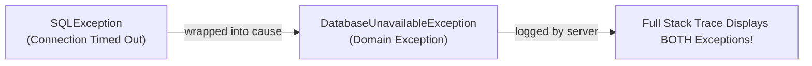

# Checked vs Unchecked Exceptions & Custom Domain Exceptions

> **Phase 3: Core Java, Testing Foundations & Modern Java 8+**  
> *Estimated Reading Time: 40 minutes | Total Practice Effort: ~2.5 hours | Tier: Core Essential*

---

## 1. Purpose & Prerequisites

### Why This Matters in Full Stack Development
In enterprise applications, standard Java exceptions like `NullPointerException` or `SQLException` are too generic or too low-level. If a user tries to withdraw $500 from an account with only $100, throwing a generic `Exception` doesn't explain the business context.

Creating **Custom Domain Exceptions** (such as `InsufficientBalanceException` or `UserNotFoundException`) allows your backend to:
1. Express clear business failure modes in domain language.
2. Attach domain metadata (such as account IDs, attempted amounts, and error codes).
3. Translate internal failures into clean HTTP responses (e.g. HTTP 404 Not Found or HTTP 422 Unprocessable Entity) for frontend clients.

### Prerequisites
- [Topic 3.1: Exception Architecture: try, catch, finally & throw/throws](01-exceptions.md)

---

## 2. Plain-English Mental Model

Think of Checked vs Unchecked Exceptions like crossing an international border versus tripping on the sidewalk:

```
[ Checked Exception (extends Exception) ]       [ Unchecked Exception (extends RuntimeException) ]
"Going through airport customs"                 "Tripping on an uneven sidewalk"
- Mandatory check! Airport agents REQUIRE       - Sudden mishap. The law doesn't force you
  you to show passport (try-catch or throws).     to carry band-aids before you take a walk.
- Anticipated external hurdle (Network, File).  - Logic flaw / programmatic bug in the code.
```

---

## 3. Checked vs Unchecked: Architectural Comparison

| Dimension | Checked Exceptions (`extends Exception`) | Unchecked Exceptions (`extends RuntimeException`) |
| :--- | :--- | :--- |
| **Compiler Enforcement**| Checked at compile-time: **Must** handle or declare with `throws` | Not enforced by compiler: Free to propagate |
| **Primary Intent** | External, recoverable conditions outside code control | Programming bugs, validation violations, illegal arguments |
| **Classic Examples** | `IOException`, `SQLException`, `ParseException` | `NullPointerException`, `IllegalArgumentException` |
| **Modern Framework Consensus** | Largely avoided in modern enterprise architectures | **Overwhelmingly preferred** by Spring Boot, Hibernate, and modern Java |

> [!IMPORTANT] Why Modern Frameworks Favor Unchecked Exceptions
> In the 1990s, checked exceptions were thought to make software safer. In practice, forcing developers to declare `throws SQLException` across 10 layers of architecture (from database to controller) caused massive code clutter and led developers to lazily write `catch (Exception e) {}`. Modern frameworks wrap low-level errors into unchecked domain exceptions that propagate cleanly to centralized global exception handlers.

---

## 4. Exception Chaining & Preserving Root Causes

When translating a low-level database error into a business exception, **never lose the original stack trace**! Pass the root exception as the `cause` parameter:



```java
try {
    rawDatabaseDriver.connect();
} catch (SQLException e) {
    // GOOD: Chained with cause! Preserves original line number & stack trace!
    throw new DatabaseUnavailableException("Unable to contact customer ledger", e);
}
```

---

## 5. Working Code Example: Custom Domain Exception Hierarchy

```java
// File: DomainExceptionDemo.java

// 1. Base Domain Runtime Exception
class BusinessException extends RuntimeException {
    private final String errorCode;

    public BusinessException(String message, String errorCode) {
        super(message);
        this.errorCode = errorCode;
    }

    public BusinessException(String message, String errorCode, Throwable cause) {
        super(message, cause);
        this.errorCode = errorCode;
    }

    public String getErrorCode() { return errorCode; }
}

// 2. Specific Domain Exception: Insufficient Funds
class InsufficientFundsException extends BusinessException {
    private final double attemptedAmount;
    private final double currentBalance;

    public InsufficientFundsException(double attemptedAmount, double currentBalance) {
        super("Withdrawal of $" + attemptedAmount + " failed. Available balance is $" + currentBalance, 
              "ERR_INSUFFICIENT_FUNDS");
        this.attemptedAmount = attemptedAmount;
        this.currentBalance = currentBalance;
    }

    public double getAttemptedAmount() { return attemptedAmount; }
    public double getCurrentBalance() { return currentBalance; }
}

// 3. Specific Domain Exception: Account Not Found
class AccountNotFoundException extends BusinessException {
    public AccountNotFoundException(String accountId) {
        super("Account with ID '" + accountId + "' does not exist.", "ERR_ACCOUNT_NOT_FOUND");
    }
}

// 4. Domain Service
class AccountService {
    private double balance = 150.0;

    public void withdraw(String accountId, double amount) {
        if (!"ACC-101".equals(accountId)) {
            throw new AccountNotFoundException(accountId);
        }
        if (amount > balance) {
            throw new InsufficientFundsException(amount, balance);
        }
        balance -= amount;
        System.out.println("Successfully withdrew $" + amount + ". New balance: $" + balance);
    }
}

public class DomainExceptionDemo {
    public static void main(String[] args) {
        AccountService service = new AccountService();

        // Test 1: Insufficient Funds
        try {
            System.out.println("=== Test 1: Overdraw ===");
            service.withdraw("ACC-101", 300.0);
        } catch (InsufficientFundsException e) {
            System.err.println("[" + e.getErrorCode() + "] " + e.getMessage());
            System.err.println("  -> Shortfall: $" + (e.getAttemptedAmount() - e.getCurrentBalance()));
        }

        // Test 2: Account Not Found
        try {
            System.out.println("\n=== Test 2: Invalid Account ===");
            service.withdraw("ACC-999", 50.0);
        } catch (AccountNotFoundException e) {
            System.err.println("[" + e.getErrorCode() + "] " + e.getMessage());
        }
    }
}
```

### Exact Output:
```text
=== Test 1: Overdraw ===
[ERR_INSUFFICIENT_FUNDS] Withdrawal of $300.0 failed. Available balance is $150.0
  -> Shortfall: $150.0

=== Test 2: Invalid Account ===
[ERR_ACCOUNT_NOT_FOUND] Account with ID 'ACC-999' does not exist.
```

---

## 6. Practical Application: Full Stack Error Response Mapping

In a Spring Boot REST API, custom domain exceptions are intercepted by a `@RestControllerAdvice` global handler to produce structured JSON responses for frontend React clients:

```
[ React Client ] 
       ^
       | HTTP 422 Unprocessable Entity
       | { "errorCode": "ERR_INSUFFICIENT_FUNDS", "message": "Withdrawal failed..." }
[ Global Controller Advice ]
       ^
       | Intercepts InsufficientFundsException
[ AccountService.withdraw() ]
```

---

## 7. Common Rookie Mistakes & Traps

### Trap: Swallowing the Root Cause During Translation
```java
try {
    database.query();
} catch (SQLException e) {
    // DISASTROUS: e is dropped! The original database SQL error is wiped from memory!
    throw new BusinessException("Database error: " + e.getMessage()); 
}
```
**Fix:** Always pass `e` into the constructor: `new BusinessException("Database error", e);`.

---

## 8. Guided Hands-On Exercise

### Challenge: Order Inventory Stock Exception Engine
Create a program named `InventoryExceptionDemo.java`:
1. Custom Unchecked Exception `OutOfStockException extends RuntimeException`:
   - Fields: `itemSku` (`String`), `requestedQuantity` (`int`), `availableStock` (`int`).
   - Constructor initializing fields and passing a clean message to `super(...)`.
   - Getters for all 3 fields.
2. Class `InventoryWarehouse`:
   - Field: `int currentStock = 5;`
   - Method `public void fulfillOrder(String itemSku, int quantity)`:
     - If `quantity > currentStock`, throw `OutOfStockException`.
     - Otherwise, reduce `currentStock` and print confirmation.
3. In `main`:
   - Attempt to fulfill an order for 2 items (success).
   - Attempt to fulfill an order for 10 items (catch `OutOfStockException` and print deficit).

<details>
<summary>💡 Hint: Deficit Calculation</summary>

Deficit is `e.getRequestedQuantity() - e.getAvailableStock()`.
</details>

<details>
<summary>✅ Solution</summary>

```java
class OutOfStockException extends RuntimeException {
    private final String itemSku;
    private final int requestedQuantity;
    private final int availableStock;

    public OutOfStockException(String itemSku, int requestedQuantity, int availableStock) {
        super("SKU [" + itemSku + "] is out of stock. Requested: " 
              + requestedQuantity + ", Available: " + availableStock);
        this.itemSku = itemSku;
        this.requestedQuantity = requestedQuantity;
        this.availableStock = availableStock;
    }

    public String getItemSku() { return itemSku; }
    public int getRequestedQuantity() { return requestedQuantity; }
    public int getAvailableStock() { return availableStock; }
}

class InventoryWarehouse {
    private int currentStock = 5;

    public void fulfillOrder(String itemSku, int quantity) {
        if (quantity > currentStock) {
            throw new OutOfStockException(itemSku, quantity, currentStock);
        }
        currentStock -= quantity;
        System.out.println("Fulfilled " + quantity + " units of " + itemSku + ". Remaining stock: " + currentStock);
    }
}

public class InventoryExceptionDemo {
    public static void main(String[] args) {
        InventoryWarehouse warehouse = new InventoryWarehouse();

        try {
            warehouse.fulfillOrder("SKU-KEYBOARD-RGB", 2);
            warehouse.fulfillOrder("SKU-KEYBOARD-RGB", 10); // Will throw
        } catch (OutOfStockException e) {
            System.err.println("ORDER FAILED: " + e.getMessage());
            int shortfall = e.getRequestedQuantity() - e.getAvailableStock();
            System.err.println("  -> Warehouse needs " + shortfall + " additional units to satisfy request.");
        }
    }
}
```

**Terminal Output:**
```text
Fulfilled 2 units of SKU-KEYBOARD-RGB. Remaining stock: 3
ORDER FAILED: SKU [SKU-KEYBOARD-RGB] is out of stock. Requested: 10, Available: 3
  -> Warehouse needs 7 additional units to satisfy request.
```
</details>

---

## 9. Knowledge Check & Interview Defense

### Quick Quiz
1. **Which class should your custom exception inherit from if you want it to be an unchecked exception?**
   - [ ] A) `java.lang.Throwable`
   - [ ] B) `java.lang.Exception`
   - [x] C) `java.lang.RuntimeException`
   - [ ] D) `java.lang.Error`

2. **Why should you pass the caught exception `e` into the constructor of your custom exception (`new MyException("msg", e)`)?**
   - [x] A) To chain the root cause, ensuring the original exception and stack trace are preserved in production logs.
   - [ ] B) To avoid garbage collection.
   - [ ] C) Because the compiler requires it.
   - [ ] D) To make the exception checked.

3. **Why do modern frameworks like Spring Boot prefer unchecked exceptions over checked exceptions?**
   - [x] A) Because checked exceptions clutter method signatures across multiple architecture layers and encourage anti-patterns like empty catch blocks, whereas unchecked exceptions propagate cleanly to centralized global error handlers.
   - [ ] B) Because unchecked exceptions execute 50% faster.
   - [ ] C) Because checked exceptions are deprecated in Java 21.
   - [ ] D) Unchecked exceptions use less RAM.

---

### Junior Developer Interview Q&A

#### Q: "What is Exception Translation / Wrapping, and why is it useful?"
> **Model Answer:**  
> "Exception translation is the architectural practice of catching low-level, technical, or vendor-specific exceptions (such as `SQLException` or `IOException`) at an architectural boundary and rethrowing a high-level, domain-specific exception (such as `OrderPersistenceException`).  
> 
> It provides two key benefits:
> 1. **Encapsulation & Abstraction:** Higher layers of the system (such as web controllers) shouldn't know whether the persistence layer failed due to an SQL constraint or a network timeout; they only need to know that the domain operation failed.
> 2. **Root Cause Preservation:** By passing the original exception to `super(message, cause)`, the entire historical stack trace is preserved for engineers reading the production logs."

---

## 10. Mastery Checklist & Next Step

Before moving on, verify that you can:
- [ ] Differentiate between Checked and Unchecked exceptions and explain modern architectural trade-offs.
- [ ] Author custom domain exception hierarchies inheriting from `RuntimeException`.
- [ ] Preserve root causes through exception chaining (`super(message, cause)`).
- [ ] Attach business metadata (error codes, entity IDs) to custom exceptions.

👉 **Next Lesson:** **[Topic 3.3: Developer Tools II: Maven Build Lifecycle & pom.xml Dependencies](03-maven.md)**
