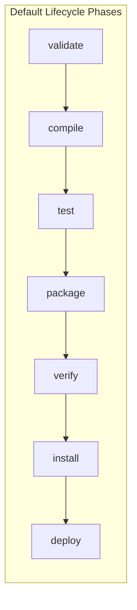

# Developer Tools II: Maven Build Lifecycle & pom.xml Dependencies

> **Phase 3: Core Java, Testing Foundations & Modern Java 8+**  
> *Estimated Reading Time: 45 minutes | Total Practice Effort: ~3.0 hours | Tier: Core Essential*

---

## 1. Purpose & Prerequisites

### Why This Matters in Full Stack Development
In Phase 1 and 2, you compiled small programs using raw `javac` and `java` terminal commands. But real-world enterprise applications depend on hundreds of third-party libraries: JSON parsers (Jackson), testing suites (JUnit 5), database drivers (PostgreSQL), and web frameworks (Spring Boot).

Decades ago, developers manually downloaded dozens of `.jar` files, committed them to Git, and struggled with "JAR Hell" when library A required version 1 of a helper while library B required version 2.

**Apache Maven** is the standard build automation and dependency management tool in the Java ecosystem. It automates compilation, runs tests, manages external libraries, and packages code into production-ready JAR/WAR archives.

### Prerequisites
- [Topic 2.4: Developer Tools I: Git Version Control for Multi-File Projects](../02-oop/04-git-github.md)

---

## 2. Plain-English Mental Model

Think of Maven like an automated industrial factory for software:

```
[ Your Source Code (src/main/java) ] + [ Recipe Blueprint (pom.xml) ]
                           |
                           v
              ( Maven Central Cloud Warehouse )
      Automatically downloads all required dependencies & JARs
                           |
                           v
         [ Automated Assembly Line: The Lifecycle ]
      Validate -> Compile -> Run Unit Tests -> Package
                           |
                           v
        [ Finished Deployable Product: app.jar (in target/) ]
```

- **`pom.xml` (Project Object Model):** The master manifest listing project coordinates, external dependencies, and build plugins.
- **Maven Central:** The massive cloud repository hosting millions of open-source Java libraries.
- **Local Repository (`~/.m2/repository`):** Your computer's local cache so dependencies are downloaded only once.

---

## 3. The Standard Maven Directory Layout

Maven enforces **Convention over Configuration**. If you place files in its standard directory structure, Maven compiles and tests them with zero configuration:

```text
my-fullstack-app/
├── pom.xml                     # The master project configuration file
├── src/
│   ├── main/
│   │   ├── java/               # Production Java source code (.java files)
│   │   │   └── com/store/app/
│   │   └── resources/          # Configuration files (application.properties, SQL scripts)
│   └── test/
│       ├── java/               # Automated Unit & Integration Tests (JUnit 5)
│       │   └── com/store/app/
│       └── resources/          # Test-specific mock data
└── target/                     # Generated build output, compiled .class files & JARs
```

---

## 4. Anatomy of `pom.xml` & Coordinates (GAV)

Every Maven artifact is identified by three coordinates known as **GAV** (**G**roupId, **A**rtifactId, **V**ersion):

```xml
<project xmlns="http://maven.apache.org/POM/4.0.0"
         xmlns:xsi="http://www.w3.org/2001/XMLSchema-instance"
         xsi:schemaLocation="http://maven.apache.org/POM/4.0.0 
         https://maven.apache.org/xsd/maven-4.0.0.xsd">
    <modelVersion>4.0.0</modelVersion>

    <!-- 1. Unique Project Coordinates (GAV) -->
    <groupId>com.careerlearning.store</groupId>
    <artifactId>payment-service</artifactId>
    <version>1.0.0-SNAPSHOT</version>
    <packaging>jar</packaging>

    <!-- 2. Java Compiler Properties -->
    <properties>
        <maven.compiler.source>17</maven.compiler.source>
        <maven.compiler.target>17</maven.compiler.target>
        <project.build.sourceEncoding>UTF-8</project.build.sourceEncoding>
    </properties>

    <!-- 3. External Dependencies -->
    <dependencies>
        <!-- JSON Processing Library (Jackson) -->
        <dependency>
            <groupId>com.fasterxml.jackson.core</groupId>
            <artifactId>jackson-databind</artifactId>
            <version>2.15.2</version>
            <scope>compile</scope> <!-- Default scope: available everywhere -->
        </dependency>

        <!-- Unit Testing Suite (JUnit 5) -->
        <dependency>
            <groupId>org.junit.jupiter</groupId>
            <artifactId>junit-jupiter</artifactId>
            <version>5.10.0</version>
            <scope>test</scope> <!-- Available ONLY during test compilation & execution -->
        </dependency>
    </dependencies>
</project>
```

---

## 5. Dependency Scopes Explained

The `<scope>` tag controls when a library is placed on the classpath:

| Scope | In `src/main` (Code) | In `src/test` (Tests) | Packaged into final JAR | Example Library |
| :--- | :---: | :---: | :---: | :--- |
| **`compile`** (default) | ✅ Yes | ✅ Yes | ✅ Yes | `jackson-databind`, `commons-lang3` |
| **`test`** | ❌ No | ✅ Yes | ❌ No | `junit-jupiter`, `mockito-core` |
| **`provided`** | ✅ Yes | ✅ Yes | ❌ No (provided by runtime container) | `servlet-api`, `lombok` |
| **`runtime`** | ❌ No (compiled against interface) | ✅ Yes | ✅ Yes (needed at runtime) | `postgresql` JDBC driver |

---

## 6. The 3 Maven Lifecycles & Essential Commands

Maven has three built-in lifecycles: **`clean`**, **`default` (build)**, and **`site`**.



> [!IMPORTANT] Phase Cascade Rule
> Executing any phase automatically executes all preceding phases in that lifecycle! For example, running `mvn package` automatically runs `validate`, `compile`, and `test` first.

### The 4 Most Frequently Used Maven Commands:
```bash
# 1. Clean previous build artifacts (deletes the /target directory)
mvn clean

# 2. Compile production Java classes (output goes to target/classes)
mvn compile

# 3. Execute automated unit test suites
mvn test

# 4. Compile, run tests, and bundle into a distributable JAR file
mvn clean package

# 5. Inspect the full tree of direct and transitive dependencies
mvn dependency:tree
```

---

## 7. Common Rookie Mistakes & Build Traps

### Trap 1: Forgetting that `mvn package` Runs Tests
If a unit test fails, `mvn package` **aborts immediately** and refuses to build the JAR.  
> [!TIP]
> Never bypass failing tests with `-DskipTests` in production! Fix the failing test so your build guarantees code quality.

### Trap 2: Leaking Test Libraries into Production Classpath
```xml
<dependency>
    <groupId>org.junit.jupiter</groupId>
    <artifactId>junit-jupiter</artifactId>
    <!-- MISTAKE: Omitting <scope>test</scope> packages JUnit into production JAR! -->
</dependency>
```
Always specify `<scope>test</scope>` for test frameworks to keep production JAR archives lean.

---

## 8. Guided Hands-On Exercise

### Challenge: Creating and Validating a Maven pom.xml
Construct a production `pom.xml` for a fictional order service:
1. Define coordinates:
   - `groupId`: `com.ecommerce.orders`
   - `artifactId`: `order-fulfillment`
   - `version`: `1.0.0`
2. Configure Java 17 source/target compilation properties.
3. Add two dependencies:
   - `org.slf4j:slf4j-api:2.0.7` with scope `compile`
   - `org.junit.jupiter:junit-jupiter:5.10.0` with scope `test`
4. Verify directory structure by drafting the required folder tree for `Order.java` and `OrderTest.java`.

<details>
<summary>💡 Hint: Directory Tree</summary>

- `src/main/java/com/ecommerce/orders/Order.java`
- `src/test/java/com/ecommerce/orders/OrderTest.java`
</details>

<details>
<summary>✅ Solution</summary>

```xml
<project xmlns="http://maven.apache.org/POM/4.0.0"
         xmlns:xsi="http://www.w3.org/2001/XMLSchema-instance"
         xsi:schemaLocation="http://maven.apache.org/POM/4.0.0 https://maven.apache.org/xsd/maven-4.0.0.xsd">
    <modelVersion>4.0.0</modelVersion>

    <groupId>com.ecommerce.orders</groupId>
    <artifactId>order-fulfillment</artifactId>
    <version>1.0.0</version>
    <packaging>jar</packaging>

    <properties>
        <maven.compiler.source>17</maven.compiler.source>
        <maven.compiler.target>17</maven.compiler.target>
        <project.build.sourceEncoding>UTF-8</project.build.sourceEncoding>
    </properties>

    <dependencies>
        <dependency>
            <groupId>org.slf4j</groupId>
            <artifactId>slf4j-api</artifactId>
            <version>2.0.7</version>
            <scope>compile</scope>
        </dependency>
        <dependency>
            <groupId>org.junit.jupiter</groupId>
            <artifactId>junit-jupiter</artifactId>
            <version>5.10.0</version>
            <scope>test</scope>
        </dependency>
    </dependencies>
</project>
```
</details>

---

## 9. Knowledge Check & Interview Defense

### Quick Quiz
1. **What does the GAV acronym represent in Maven?**
   - [ ] A) Git, Action, Version
   - [x] B) GroupId, ArtifactId, Version
   - [ ] C) General Assembly Value
   - [ ] D) Garbage Allocation Variable

2. **If you execute `mvn package`, which of the following phases will run automatically?**
   - [ ] A) Only package
   - [x] B) compile, test, and package (along with earlier phases)
   - [ ] C) deploy
   - [ ] D) site

3. **Which dependency scope should be applied to unit testing libraries like JUnit 5 or Mockito?**
   - [ ] A) `compile`
   - [x] B) `test`
   - [ ] C) `provided`
   - [ ] D) `runtime`

---

### Junior Developer Interview Q&A

#### Q: "What is a Transitive Dependency in Maven, and how can you diagnose dependency conflicts?"
> **Model Answer:**  
> "A **transitive dependency** occurs when your application depends on Library A, and Library A itself depends on Library B. Maven automatically discovers and downloads Library B into your project without requiring you to declare it explicitly in `pom.xml`.  
> 
> However, transitive dependencies can lead to **version conflicts** (e.g. Library A wants version 1.2, but Library C wants version 2.0). To diagnose these conflicts, developers run `mvn dependency:tree` in the terminal. Maven prints a complete ASCII tree of all direct and indirect dependencies, highlighting which version was selected via Maven's 'nearest-wins' mediation rule and allowing developers to use `<exclusions>` if necessary."

---

## 10. Mastery Checklist & Next Step

Before moving on, verify that you can:
- [ ] Understand Maven's standard directory structure (`src/main/java`, `src/test/java`).
- [ ] Define coordinates using `groupId`, `artifactId`, and `version`.
- [ ] Configure dependency scopes (`compile`, `test`, `provided`, `runtime`).
- [ ] Execute standard build lifecycle commands (`mvn clean compile`, `mvn test`, `mvn package`).

👉 **Next Lesson:** **[Topic 3.4: Developer Tools III: Unit Testing Foundations with JUnit 5](04-junit5.md)**
