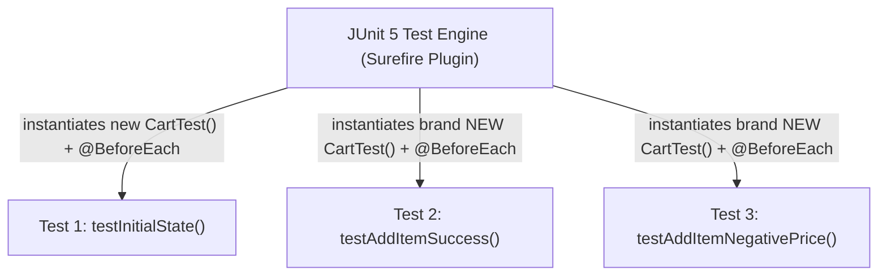

# Developer Tools III: Unit Testing Foundations with JUnit 5

> **Phase 3: Core Java, Testing Foundations & Modern Java 8+**  
> *Estimated Reading Time: 45 minutes | Total Practice Effort: ~3.0 hours | Tier: Core Essential*

---

## 1. Purpose & Prerequisites

### Why This Matters in Full Stack Development
How do you know your code works?
As a beginner, you might write code inside a `main()` method, run the program, and visually inspect console output. But what happens when your project grows to 100 classes and 5,000 lines of code? Re-running manual print checks after every code change is impossible. Worse, modifying an existing class might quietly break a feature you wrote two weeks ago!

**Automated Unit Testing** is the safety net of professional software engineering. A **Unit Test** is a small, fast automated test that verifies a specific method produces expected outputs for given inputs. By writing a suite of tests with **JUnit 5**, you can run hundreds of checks in milliseconds, enabling confident refactoring and zero-regression deployments.

### Prerequisites
- [Topic 3.3: Developer Tools II: Maven Build Lifecycle & pom.xml Dependencies](03-maven.md)

---

## 2. Plain-English Mental Model

Think of a unit test like a quality assurance test bench at an electronics factory:

```
[ Arrange ] ---> Place component on test bench & connect 5V power supply
[ Act ]     ---> Flip the power switch
[ Assert ]  ---> Measure voltage: Is it EXACTLY 5.0V? (Pass / Fail)
```

The universal structure for any unit test is the **AAA Pattern**:
1. **Arrange:** Set up test data, configure objects, and prepare prerequisites.
2. **Act:** Call the specific method under test.
3. **Assert:** Compare actual result against expected outcome. If they match, the test passes with a green checkmark; if not, the test fails with a red flag.

---

## 3. Core JUnit 5 (Jupiter) Annotations

JUnit 5 provides declarative annotations to structure test classes:

| Annotation | Execution Timing | Purpose |
| :--- | :--- | :--- |
| **`@Test`** | Per test method | Marks a method as an automated test case. |
| **`@BeforeEach`** | Before **every** `@Test` | Initializes fresh test objects, preventing state leakage between tests. |
| **`@AfterEach`** | After **every** `@Test` | Cleans up temporary files or resets mocks. |
| **`@BeforeAll`** | Once before **all** tests (`static`) | Expensive setup (e.g. starting a test database container). |
| **`@DisplayName("...")`**| Metadata | Provides a human-readable description for test reports. |
| **`@Disabled`** | Skipped | Temporarily disables a test without deleting code. |

---

## 4. Key Assertions (`org.junit.jupiter.api.Assertions`)

```java
import static org.junit.jupiter.api.Assertions.*;

// 1. Equality check (Note: expected FIRST, actual SECOND!)
assertEquals(50.0, account.getBalance());

// 2. Boolean verification
assertTrue(account.isActive());
assertFalse(account.isFrozen());

// 3. Null checks
assertNotNull(user.getId());
assertNull(user.getDeletedAt());

// 4. Verifying Thrown Exceptions
assertThrows(IllegalArgumentException.class, () -> {
    account.withdraw(-50.0); // Must throw IllegalArgumentException to pass!
});
```

---

## 5. Working Code Example: Testing a Shopping Cart

### The Class Under Test
```java
// File: src/main/java/com/store/Cart.java
package com.store;

public class Cart {
    private double subtotal = 0.0;
    private int itemCount = 0;

    public void addItem(double price, int quantity) {
        if (price <= 0 || quantity <= 0) {
            throw new IllegalArgumentException("Price and quantity must be positive.");
        }
        this.subtotal += (price * quantity);
        this.itemCount += quantity;
    }

    public void applyVipDiscount() {
        if (subtotal >= 100.0) {
            subtotal = subtotal * 0.90; // 10% discount
        }
    }

    public double getSubtotal() { return subtotal; }
    public int getItemCount() { return itemCount; }
}
```

### The Automated JUnit 5 Test Suite
```java
// File: src/test/java/com/store/CartTest.java
package com.store;

import org.junit.jupiter.api.BeforeEach;
import org.junit.jupiter.api.DisplayName;
import org.junit.jupiter.api.Test;

import static org.junit.jupiter.api.Assertions.*;

public class CartTest {
    private Cart cart;

    // Runs before EVERY test to ensure a fresh, empty cart fixture
    @BeforeEach
    void setUp() {
        cart = new Cart();
    }

    @Test
    @DisplayName("Should initialize cart with zero items and zero balance")
    void testInitialState() {
        assertEquals(0.0, cart.getSubtotal(), "Initial subtotal must be zero");
        assertEquals(0, cart.getItemCount(), "Initial item count must be zero");
    }

    @Test
    @DisplayName("Should correctly accumulate subtotal and count when items are added")
    void testAddItemSuccess() {
        // Arrange is handled by @BeforeEach
        // Act
        cart.addItem(25.00, 2); // 25 * 2 = 50.0
        cart.addItem(10.00, 1); // 50 + 10 = 60.0

        // Assert
        assertEquals(60.00, cart.getSubtotal());
        assertEquals(3, cart.getItemCount());
    }

    @Test
    @DisplayName("Should throw IllegalArgumentException when adding item with invalid price")
    void testAddItemNegativePriceThrowsException() {
        // Assert that the lambda execution throws IllegalArgumentException
        IllegalArgumentException ex = assertThrows(IllegalArgumentException.class, () -> {
            cart.addItem(-15.00, 1);
        });

        assertEquals("Price and quantity must be positive.", ex.getMessage());
    }

    @Test
    @DisplayName("Should apply 10% VIP discount when subtotal is at least $100")
    void testApplyVipDiscountQualifies() {
        cart.addItem(50.00, 2); // Subtotal = $100.00
        cart.applyVipDiscount(); // 10% off $100 = $90.00

        assertEquals(90.00, cart.getSubtotal(), 0.001); // 3rd parameter is delta for double comparison
    }
}
```

---

## 6. Under the Hood: Test Isolation & Test Runners



> [!IMPORTANT] Per-Method Test Isolation
> By default, JUnit creates a **brand-new instance of the test class** for every single `@Test` method!  
> This design guarantees that tests are isolated and cannot accidentally share mutable instance variables. Test B will never inherit modifications made by Test A.

---

## 7. Common Rookie Mistakes & Testing Traps

### Trap 1: Inverted `assertEquals` Arguments
```java
assertEquals(cart.getSubtotal(), 50.0); // WRONG ORDER!
```
The signature is `assertEquals(expected, actual)`.  
If you invert them, failure reports will confusingly state:  
`Expected: 100.0, but was: 50.0` (swapped backwards!). Always put the hardcoded **expected** value first.

### Trap 2: Testing Floating-Point Doubles without Delta
```java
assertEquals(0.3, 0.1 + 0.2); // Fails! (0.30000000000000004 != 0.3)
```
**Fix:** Provide an allowable tolerance delta for doubles:
```java
assertEquals(0.3, 0.1 + 0.2, 0.0001); // Passes!
```

---

## 8. Guided Hands-On Exercise

### Challenge: Writing Unit Tests for a Bank Account
Write a complete JUnit 5 test class named `BankAccountTest` for a `BankAccount` class:
1. Requirements for `BankAccount`:
   - `deposit(double amount)`: Throws `IllegalArgumentException` if `amount <= 0`.
   - `withdraw(double amount)`: Throws `IllegalStateException` if `amount > balance`.
2. Implement 3 test cases in `BankAccountTest`:
   - `testDepositSuccess`: Deposits `$100.0` into a `$50.0` account, asserts balance is `$150.0`.
   - `testDepositNegativeThrows`: Asserts depositing `-$10.0` throws `IllegalArgumentException`.
   - `testWithdrawOverdraftThrows`: Asserts withdrawing `$200.0` from a `$50.0` account throws `IllegalStateException`.

<details>
<summary>💡 Hint: assertThrows structure</summary>

```java
assertThrows(IllegalStateException.class, () -> account.withdraw(200.0));
```
</details>

<details>
<summary>✅ Solution</summary>

```java
package com.store;

import org.junit.jupiter.api.BeforeEach;
import org.junit.jupiter.api.DisplayName;
import org.junit.jupiter.api.Test;

import static org.junit.jupiter.api.Assertions.*;

public class BankAccountTest {
    private BankAccount account;

    @BeforeEach
    void setUp() {
        account = new BankAccount(50.0); // Initial balance $50.0
    }

    @Test
    @DisplayName("Should increase balance when valid deposit is made")
    void testDepositSuccess() {
        account.deposit(100.0);
        assertEquals(150.0, account.getBalance(), 0.001);
    }

    @Test
    @DisplayName("Should throw IllegalArgumentException on non-positive deposit")
    void testDepositNegativeThrows() {
        assertThrows(IllegalArgumentException.class, () -> {
            account.deposit(-10.0);
        });
    }

    @Test
    @DisplayName("Should throw IllegalStateException when withdrawal exceeds balance")
    void testWithdrawOverdraftThrows() {
        assertThrows(IllegalStateException.class, () -> {
            account.withdraw(200.0);
        });
    }
}
```
</details>

---

## 9. Knowledge Check & Interview Defense

### Quick Quiz
1. **What is the purpose of the `@BeforeEach` annotation in JUnit 5?**
   - [ ] A) It runs once when the computer starts.
   - [x] B) It executes before each `@Test` method to configure fresh test fixtures and isolate test state.
   - [ ] C) It disables failing tests.
   - [ ] D) It generates HTML reports.

2. **How do you verify in JUnit 5 that a method properly throws an expected exception?**
   - [ ] A) `assertException(MyException.class)`
   - [x] B) `assertThrows(MyException.class, () -> methodCall())`
   - [ ] C) `try { methodCall(); } catch(Exception e) {}`
   - [ ] D) `@Test(expected = MyException.class)` (JUnit 4 legacy syntax)

3. **In `assertEquals(expected, actual)`, which parameter should hold the anticipated correct result?**
   - [x] A) The first parameter (`expected`)
   - [ ] B) The second parameter (`actual`)
   - [ ] C) It does not matter.
   - [ ] D) Expected is always passed as a string.

---

### Junior Developer Interview Q&A

#### Q: "Why should unit tests be completely isolated and independent of one another?"
> **Model Answer:**  
> "Unit tests must be isolated so that the outcome of Test B never depends on whether Test A ran before it, failed, or was skipped.  
> 
> If tests share mutable state (such as static variables or a shared database row), changes made by one test can cause intermittent, order-dependent 'flaky' test failures in other tests. By initializing fresh objects in `@BeforeEach`, each test runs in a clean, predictable sandbox. This allows test runners to execute tests in random order or in parallel across multi-core processors safely."

---

## 10. Mastery Checklist & Next Step

Before moving on, verify that you can:
- [ ] Structure automated tests using the Arrange-Act-Assert (AAA) pattern.
- [ ] Annotate test fixtures using `@Test`, `@BeforeEach`, and `@DisplayName`.
- [ ] Assert values using `assertEquals`, `assertTrue`, and tolerance deltas.
- [ ] Test negative/exceptional paths cleanly using `assertThrows`.

👉 **Next Lesson:** **[Topic 3.5: String Constant Pool, Memory Internals & StringBuilder](05-string-immutability.md)**
