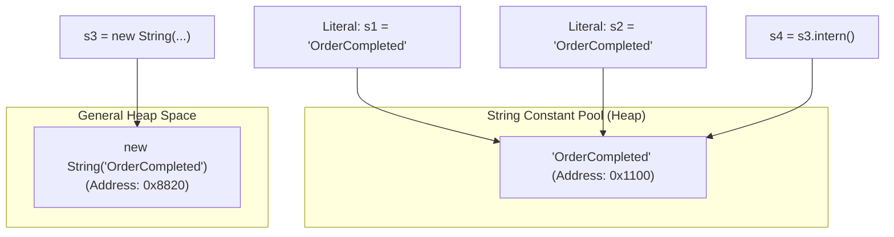

# String Constant Pool, Memory Internals & StringBuilder

> **Phase 3: Core Java, Testing Foundations & Modern Java 8+**  
> *Estimated Reading Time: 45 minutes | Total Practice Effort: ~3.0 hours | Tier: Core Essential*

---

## 1. Purpose & Prerequisites

### Why This Matters in Full Stack Development
In Topic 1.8, we introduced basic String methods. Now that you understand Heap memory, garbage collection, and OOP architecture, we take an advanced deep dive into **how the JVM handles strings under the hood**.

In typical enterprise Java backends, **25% to 40% of all heap memory is consumed by Strings**. Misunderstanding how the String Constant Pool works, or failing to choose between `String`, `StringBuilder`, and `StringBuffer`, can degrade backend throughput and trigger heavy garbage collection pauses during high-traffic API loads.

### Prerequisites
- [Topic 1.8: String Basics, Concatenation & Immutability Intro](../01-foundations/08-strings-basics.md)
- [Topic 2.1: Classes, Objects & The new Instantiation Lifecycle](../02-oop/01-classes-objects.md)

---

## 2. Plain-English Mental Model

Think of computer memory like a printing press and a whiteboard:

```
[ String: Carved Stone Tablet (Immutable) ]
- Once engraved, it cannot be changed.
- If you edit a word, you must carve a brand new tablet and discard the old one.

[ StringBuilder: The Eraseable Whiteboard (Mutable & Fast) ]
- Write, erase, append, and reformat directly on the board in-place.
- No garbage tablets created!
```

---

## 3. String Internals: Compact Strings & The Cached Hash Code

In Java 9+, OpenJDK introduced **Compact Strings** (JEP 254).  
Previously, Java stored strings as `char[]`, consuming 2 bytes (16 bits) for every character. Because most Western characters fit into Latin-1 (8 bits), modern Java stores characters internally as:
```java
public final class String {
    private final byte[] value; // 1 byte per char for Latin-1, 2 bytes for UTF-16
    private final byte coder;   // Flag: LATIN1 (0) or UTF16 (1)
    private int hash;           // Cached hash code (defaults to 0)
}
```

### Why Hash Code Caching Matters:
Because a `String` is immutable, its content never changes. The JVM calculates its `hashCode()` **only once** on the first call and stores it in the `hash` field. Subsequent lookups in a `HashMap` or `HashSet` reuse the cached integer instantly ($O(1)$), making `String` the ultimate dictionary key in Java.

---

## 4. The String Constant Pool & `intern()`

The **String Constant Pool (SCP)** is a dedicated memory space within the JVM Heap:



### The `intern()` Method:
When invoked on any String object (`s3.intern()`), Java searches the SCP:
- If an identical string already exists in the pool, it returns the pooled reference.
- If not, it adds `s3` to the pool and returns the new reference.

```java
String s1 = "PaymentApproved";
String s2 = new String("PaymentApproved");
String s3 = s2.intern(); // Returns the reference from the pool!

System.out.println(s1 == s2); // false (Heap vs Pool)
System.out.println(s1 == s3); // true (Both point to the pooled instance!)
```

---

## 5. Architectural Comparison: String vs StringBuilder vs StringBuffer

| Dimension | `String` | `StringBuilder` | `StringBuffer` |
| :--- | :--- | :--- | :--- |
| **Mutability** | **Immutable** | **Mutable** | **Mutable** |
| **Thread Safety** | ✅ Inherently thread-safe | ❌ Not thread-safe | ✅ Thread-safe (synchronized methods) |
| **Performance** | Slow for concatenation ($O(N^2)$) | **Fastest** (No lock overhead) | Slower (Synchronization lock overhead) |
| **Introduced In** | Java 1.0 | Java 5 | Java 1.0 |
| **Standard Use Case** | Keys, constants, domain fields | Single-threaded string assembly (JSON, SQL) | Legacy multi-threaded shared buffers |

> [!TIP] Modern Rule
> Use `StringBuilder` 99% of the time when assembling strings dynamically in loops or methods. `StringBuffer` is rarely needed in modern architectures because string assembly is almost always confined to a single method stack frame.

---

## 6. Working Code Example: Measuring String Concatenation Performance

```java
// File: StringPerformanceDemo.java
public class StringPerformanceDemo {
    public static void main(String[] args) {
        int iterations = 50_000;

        // 1. Slow: String concatenation with + (Creates 50,000 garbage objects)
        long startPlus = System.currentTimeMillis();
        String str = "";
        for (int i = 0; i < iterations; i++) {
            str += "a";
        }
        long durationPlus = System.currentTimeMillis() - startPlus;
        System.out.println("String (+) Duration: " + durationPlus + " ms");

        // 2. Fast: StringBuilder in-place buffer modification
        long startSb = System.currentTimeMillis();
        StringBuilder sb = new StringBuilder(iterations); // Pre-sized capacity!
        for (int i = 0; i < iterations; i++) {
            sb.append("a");
        }
        String result = sb.toString();
        long durationSb = System.currentTimeMillis() - startSb;
        System.out.println("StringBuilder Duration: " + durationSb + " ms");
    }
}
```

### Exact Output (Representative Benchmark):
```text
String (+) Duration: 1240 ms
StringBuilder Duration: 2 ms
```
*`StringBuilder` is over 600x faster because it mutates its internal buffer directly without triggering thousands of heap allocations and garbage collection cycles!*

---

## 7. Common Rookie Mistakes & Traps

### Trap: Calling `.intern()` on Arbitrary User Input
Calling `userInput.intern()` on millions of untrusted strings received via an HTTP API can bloat the String Constant Pool, consuming non-compactable heap space and leading to `OutOfMemoryError`.  
> [!CAUTION]
> Avoid calling `intern()` on dynamic or untrusted external inputs.

---

## 8. Guided Hands-On Exercise

### Challenge: High-Throughput Audit Log Builder
Create a program named `AuditLogBuilderDemo.java`:
1. Class `AuditLogBuilder`:
   - Contains a private `StringBuilder logBuffer = new StringBuilder();`
   - Method `public void logEvent(String timestamp, String userId, String action)`:
     - Formats and appends: `"[timestamp] (USER: userId) -> action\n"`
   - Method `public String exportLog()`:
     - Returns `logBuffer.toString()`.
2. In `main`:
   - Add 3 audit events.
   - Print the final exported multi-line log.

<details>
<summary>💡 Hint: Chaining appends</summary>

```java
logBuffer.append("[").append(timestamp).append("] (USER: ") ...
```
</details>

<details>
<summary>✅ Solution</summary>

```java
class AuditLogBuilder {
    private final StringBuilder logBuffer = new StringBuilder();

    public void logEvent(String timestamp, String userId, String action) {
        logBuffer.append("[")
                 .append(timestamp)
                 .append("] (USER: ")
                 .append(userId)
                 .append(") -> ")
                 .append(action)
                 .append("\n");
    }

    public String exportLog() {
        return logBuffer.toString();
    }
}

public class AuditLogBuilderDemo {
    public static void main(String[] args) {
        AuditLogBuilder builder = new AuditLogBuilder();

        builder.logEvent("10:00:15", "USR-101", "LOGIN_SUCCESS");
        builder.logEvent("10:02:45", "USR-101", "ACCESSED_BILLING");
        builder.logEvent("10:05:00", "USR-101", "LOGOUT");

        System.out.println("=== Full System Audit Log ===");
        System.out.print(builder.exportLog());
    }
}
```

**Terminal Output:**
```text
=== Full System Audit Log ===
[10:00:15] (USER: USR-101) -> LOGIN_SUCCESS
[10:02:45] (USER: USR-101) -> ACCESSED_BILLING
[10:05:00] (USER: USR-101) -> LOGOUT
```
</details>

---

## 9. Knowledge Check & Interview Defense

### Quick Quiz
1. **Why does Java cache the `hashCode()` of a String object?**
   - [x] A) Because Strings are immutable; their content never changes, so calculating hash code once and caching it provides instant $O(1)$ HashMap lookups.
   - [ ] B) Because the JVM runs out of CPU registers.
   - [ ] C) To prevent string decryption.
   - [ ] D) Only for strings stored in the String Constant Pool.

2. **What is the difference between `StringBuilder` and `StringBuffer`?**
   - [ ] A) `StringBuilder` is thread-safe; `StringBuffer` is not.
   - [x] B) `StringBuffer` has synchronized methods for thread safety, whereas `StringBuilder` is unsynchronized and faster for single-threaded usage.
   - [ ] C) `StringBuffer` is immutable.
   - [ ] D) `StringBuilder` was deprecated in Java 17.

3. **What does the `s.intern()` method do?**
   - [ ] A) Translates the string to Spanish.
   - [x] B) Returns the canonical reference from the String Constant Pool, adding the string to the pool if it wasn't already present.
   - [ ] C) Clears the string's characters from memory.
   - [ ] D) Converts the string to a primitive byte array.

---

### Junior Developer Interview Q&A

#### Q: "Why was Compact Strings introduced in Java 9, and how does it save memory?"
> **Model Answer:**  
> "Before Java 9, the `String` class stored characters in a `char[]` array, allocating 2 bytes (16 bits) for every character using UTF-16 encoding.  
> 
> Telemetry showed that over 50% of heap memory in typical enterprise apps was occupied by strings, and the vast majority of those strings contained only ASCII / Latin-1 characters which require only 1 byte (8 bits) of storage.  
> 
> Java 9 introduced **Compact Strings (JEP 254)**, replacing `char[]` with a `byte[]` and a 1-byte encoding flag (`coder`). If a string contains only Latin-1 characters, the JVM stores it using 1 byte per character, reducing String heap memory consumption by nearly 50% across enterprise applications without requiring any changes to user source code."

---

## 10. Mastery Checklist & Next Step

Before moving on, verify that you can:
- [ ] Diagram the interaction between the Call Stack, Regular Heap, and String Constant Pool.
- [ ] Explain Compact Strings and hash code caching in technical interviews.
- [ ] Use `StringBuilder` with initial capacity for high-throughput string construction.
- [ ] Differentiate between `String`, `StringBuilder`, and `StringBuffer`.

👉 **Next Lesson:** **[Topic 3.6: Wrapper Classes, Autoboxing Pitfalls & Enums](06-wrappers-enums.md)**
