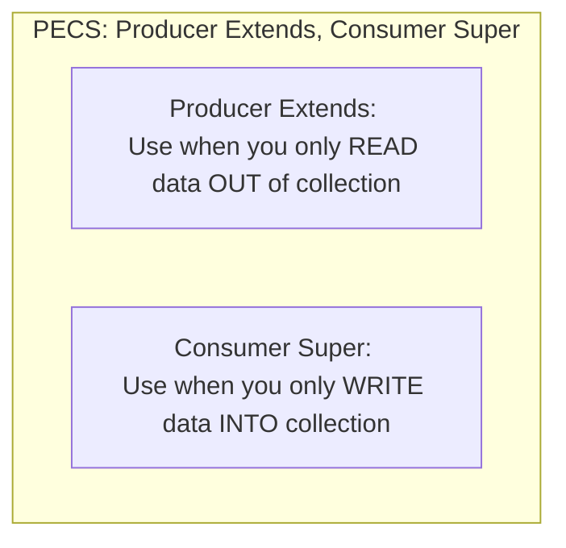

# Generics: Type Parameters, Generic Classes & Type Erasure

> **Phase 3: Core Java, Testing Foundations & Modern Java 8+**  
> *Estimated Reading Time: 45 minutes | Total Practice Effort: ~3.0 hours | Tier: Core Essential*

---

## 1. Purpose & Prerequisites

### Why This Matters in Full Stack Development
Before Java 5, data collections like `ArrayList` held raw `Object` references. You could add a `String`, an `Integer`, and a `BankAccount` into the exact same list. But when reading items out, you had to manually downcast:
```java
String s = (String) list.get(0); // If someone inserted an Integer, CRASH! ClassCastException!
```
**Generics** revolutionized Java by introducing **compile-time type parameters**. Generics allow you to write reusable algorithms, repositories, and API envelope wrappers (`ApiResponse<T>`) that work across diverse data types while guaranteeing complete compile-time type safety.

### Prerequisites
- [Topic 2.8: Abstract Classes vs Interfaces & Multiple Inheritance of Type](../02-oop/08-abstraction-interfaces.md)
- [Topic 3.6: Wrapper Classes, Autoboxing Pitfalls & Enums](06-wrappers-enums.md)

---

## 2. Plain-English Mental Model

Think of Generics like a custom-molded shipping crate:

```
[ Non-Generic Raw Box ]              [ Generic Molded Crate: Box<Laptop> ]
Can throw anything inside:            Molded specifically for Laptops.
Rocks, fruit, explosives.             - Attempting to put an Apple inside? (Compiler blocks it!)
Open it: You don't know what          - Unloading it? Guaranteed 100% to be a Laptop without
you're reaching for!                  inspecting or guessing!
```

---

## 3. Generic Classes & Modern Full Stack `ApiResponse<T>`

In modern full-stack development, backend REST APIs wrap JSON responses in a standard generic envelope:

```java
// Generic Class with Type Parameter <T>
public class ApiResponse<T> {
    private boolean success;
    private String message;
    private T data; // Payload can be UserDTO, List<Order>, or String!

    public ApiResponse(boolean success, String message, T data) {
        this.success = success;
        this.message = message;
        this.data = data;
    }

    public boolean isSuccess() { return success; }
    public String getMessage() { return message; }
    public T getData() { return data; }
}
```

```java
// Usage: Clean, typesafe, zero manual casting required!
ApiResponse<UserDTO> userResponse = new ApiResponse<>(true, "User fetched", new UserDTO("Alice"));
UserDTO user = userResponse.getData(); // Direct type inference!
```

---

## 4. Wildcards & The PECS Principle

When working with collections of inherited types, generic types are **invariant**:  
Even though `Integer` is a subtype of `Number`, `List<Integer>` is **NOT** a subtype of `List<Number>`!

To write flexible methods that accept families of types, Java uses **Wildcards (`?`)**:



### 1. `<? extends T>` (Upper Bounded Wildcard)
Use when reading items out. You can read elements safely as type `T`, but you **cannot write/add** any item (except `null`):
```java
// Reads numbers and calculates sum
public static double sumOfList(List<? extends Number> list) {
    double sum = 0.0;
    for (Number n : list) {
        sum += n.doubleValue(); // Safe to read as Number!
    }
    // list.add(10); // COMPILER ERROR: Cannot write into ? extends!
    return sum;
}
```

### 2. `<? super T>` (Lower Bounded Wildcard)
Use when inserting items in. You can safely add items of type `T`:
```java
// Consumes and adds integers
public static void addNumbers(List<? super Integer> list) {
    list.add(1); // Safe to write Integer!
    list.add(2);
}
```

---

## 5. Under the Hood: Type Erasure

How does the JVM execute generics without breaking backward compatibility with older Java versions?  
The answer is **Type Erasure**:

```mermaid
flowchart LR
    A["Source Code:<br/>List<String> list = new ArrayList<>()<br/>String s = list.get(0)"] 
    -->|"javac Compilation (Type Erasure)"| 
    B["Compiled Bytecode:<br/>List list = new ArrayList()<br/>String s = (String) list.get(0)"]
```

1. **Erasure of Type Parameters:** The compiler strips away all `<T>` syntax and replaces type parameters with `Object` (or the bounding class like `Number` if `<T extends Number>`).
2. **Synthetic Casts:** The compiler automatically inserts byte-level checkcasts whenever data is extracted.
3. **Runtime Ignorance:** At runtime, the JVM has **no idea** what `<String>` was! A `List<String>` and a `List<Integer>` are the exact same `java.util.ArrayList` class in Heap memory.

### Consequences of Type Erasure:
- You **cannot** instantiate generic types directly: `new T()` is illegal!
- You **cannot** create generic arrays: `new T[10]` is illegal!
- You **cannot** check types with `instanceof`: `obj instanceof List<String>` is illegal!

---

## 6. Working Code Example: Generic Cache Repository with PECS

```java
// File: GenericRepositoryDemo.java
import java.util.ArrayList;
import java.util.List;

// Generic Key-Value Repository
class InMemoryCache<K, V> {
    private final List<K> keys = new ArrayList<>();
    private final List<V> values = new ArrayList<>();

    public void put(K key, V value) {
        keys.add(key);
        values.add(value);
    }

    public V get(K key) {
        int index = keys.indexOf(key);
        return (index != -1) ? values.get(index) : null;
    }

    public int size() { return keys.size(); }
}

public class GenericRepositoryDemo {
    public static void main(String[] args) {
        // 1. Generic Key-Value storage
        InMemoryCache<String, Double> exchangeRates = new InMemoryCache<>();
        exchangeRates.put("USD_EUR", 0.92);
        exchangeRates.put("USD_GBP", 0.79);

        Double eurRate = exchangeRates.get("USD_EUR");
        System.out.println("Cached Rate USD_EUR: " + eurRate);

        // 2. Demonstrating PECS: Producer Extends
        List<Integer> intList = List.of(10, 20, 30);
        List<Double> doubleList = List.of(1.5, 2.5, 3.5);

        System.out.println("Sum of Integers: " + calculateTotal(intList));
        System.out.println("Sum of Doubles:  " + calculateTotal(doubleList));
    }

    // PECS: list produces Numbers
    public static double calculateTotal(List<? extends Number> list) {
        double total = 0.0;
        for (Number n : list) {
            total += n.doubleValue();
        }
        return total;
    }
}
```

### Exact Output:
```text
Cached Rate USD_EUR: 0.92
Sum of Integers: 60.0
Sum of Doubles:  7.5
```

---

## 7. Common Rookie Mistakes & Compiler Traps

### Trap 1: Using Raw Types
```java
List rawList = new ArrayList(); // WARNING: Raw type! Bypasses compiler type checking!
rawList.add("Hello");
rawList.add(100); // Compiles without error, but crashes downstream!
```
Always specify type parameters: `List<String> list = new ArrayList<>();`.

### Trap 2: Believing `List<Object>` Accepts `List<String>`
```java
List<String> strings = new ArrayList<>();
List<Object> objects = strings; // COMPILER ERROR: Incompatible types!
```
If this were allowed, you could do `objects.add(12345);`, corrupting the `strings` list with an integer! Generics are strictly invariant to protect type safety.

---

## 8. Guided Hands-On Exercise

### Challenge: Generic Filter & Data Extractor
Create a program named `GenericExtractorDemo.java`:
1. Generic Method: `public static <T> List<T> filterItems(List<T> items, java.util.function.Predicate<T> condition)`
   - Iterates through `items` and returns a new `List<T>` containing only elements where `condition.test(item)` is `true`.
2. In `main`:
   - Test with a `List<String>` of usernames: filter names longer than 5 characters.
   - Test with a `List<Integer>` of transaction amounts: filter amounts greater than 100.
   - Print both filtered results.

<details>
<summary>💡 Hint: Method Signature</summary>

```java
public static <T> List<T> filterItems(List<T> items, Predicate<T> condition) {
    List<T> result = new ArrayList<>();
    for (T item : items) {
        if (condition.test(item)) result.add(item);
    }
    return result;
}
```
</details>

<details>
<summary>✅ Solution</summary>

```java
import java.util.ArrayList;
import java.util.List;
import java.util.function.Predicate;

public class GenericExtractorDemo {
    public static void main(String[] args) {
        // 1. Filter Strings
        List<String> users = List.of("alex", "charlotte", "bob", "alexander");
        List<String> longNames = filterItems(users, name -> name.length() > 5);
        System.out.println("Long Usernames: " + longNames);

        // 2. Filter Integers
        List<Integer> amounts = List.of(25, 140, 50, 320, 85);
        List<Integer> highTransactions = filterItems(amounts, a -> a > 100);
        System.out.println("High Transactions: " + highTransactions);
    }

    public static <T> List<T> filterItems(List<T> items, Predicate<T> condition) {
        List<T> filtered = new ArrayList<>();
        for (T item : items) {
            if (condition.test(item)) {
                filtered.add(item);
            }
        }
        return filtered;
    }
}
```

**Terminal Output:**
```text
Long Usernames: [charlotte, alexander]
High Transactions: [140, 320]
```
</details>

---

## 9. Knowledge Check & Interview Defense

### Quick Quiz
1. **What is Type Erasure in Java?**
   - [x] A) The compiler process where type parameters are removed and replaced with raw types (`Object` or bounds) with synthetic casts added, ensuring backward compatibility with older JVMs.
   - [ ] B) Deleting unused variables from the Heap.
   - [ ] C) Converting code to C++.
   - [ ] D) Garbage collection of unreferenced classes.

2. **According to the PECS principle, when should you use `<? extends T>`?**
   - [x] A) When the collection acts as a Producer (you are reading data out of it).
   - [ ] B) When the collection acts as a Consumer (you are writing data into it).
   - [ ] C) Only when extending abstract classes.
   - [ ] D) Only when writing JUnit tests.

3. **Why is `new T()` illegal inside a generic class `MyClass<T>`?**
   - [ ] A) Because constructors must always be public.
   - [x] B) Because due to Type Erasure, type `T` is erased at runtime, so the JVM does not know what concrete class to instantiate.
   - [ ] C) Because generics do not support the `new` keyword.
   - [ ] D) Because it exceeds stack memory limits.

---

### Junior Developer Interview Q&A

#### Q: "Why can't you use primitive types as type arguments in Java generics (e.g. `List<int>`)?"
> **Model Answer:**  
> "Java Generics rely on **Type Erasure**, which replaces type parameters with `java.lang.Object` (or an upper bound) in compiled bytecode.  
> 
> In Java, primitive types like `int`, `double`, and `boolean` do not inherit from `Object` and have different byte sizes (e.g. 4 bytes for `int` vs 8-byte reference pointers on 64-bit JVMs). Because the JVM bytecode instructions like `aload` and `checkcast` operate exclusively on reference types that inherit from `Object`, primitives cannot be stored directly in generic containers without being boxed into their corresponding wrapper classes (e.g. `List<Integer>`)."

---

## 10. Mastery Checklist & Next Step

Before moving on, verify that you can:
- [ ] Author generic classes, interfaces, and methods using type parameters `<T>`.
- [ ] Explain why generics are invariant (`List<String>` is not `List<Object>`).
- [ ] Apply the PECS rule (`Producer Extends`, `Consumer Super`) for wildcard collections.
- [ ] Articulate Type Erasure mechanics and its architectural constraints in an interview.

👉 **Next Lesson:** **[Topic 3.8: The Object Contract: equals(), hashCode() & Identity vs Equality](08-equals-hashcode.md)**
