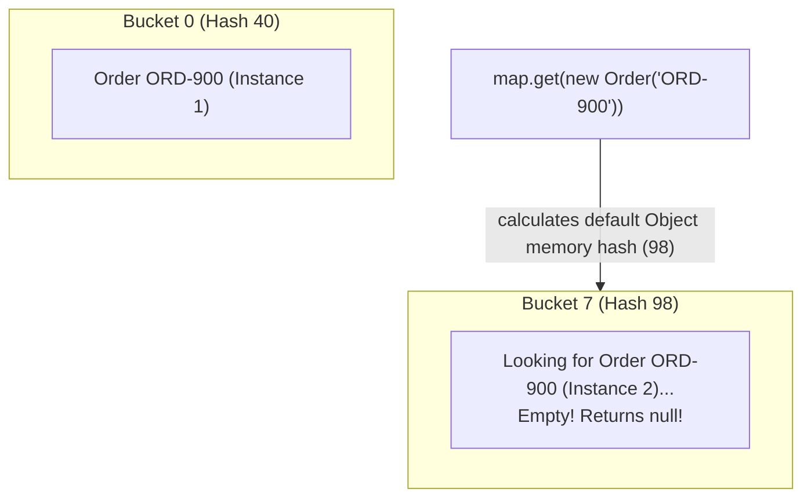

# The Object Contract: equals(), hashCode() & Identity vs Equality

> **Phase 3: Core Java, Testing Foundations & Modern Java 8+**  
> *Estimated Reading Time: 50 minutes | Total Practice Effort: ~3.5 hours | Tier: Core Essential*

---

## 1. Purpose & Prerequisites

### Why This Matters in Full Stack Development
Consider an e-commerce order management system:
```java
Order order1 = new Order("ORD-900", 150.0);
Order order2 = new Order("ORD-900", 150.0);
```
Are `order1` and `order2` equal?  
To a business person, **yes**: they represent the same order number and value.  
To Java's default `Object.equals()` method, **no**: they are two distinct objects located at different memory addresses in the Heap!

Failing to properly override `equals()` and `hashCode()` is one of the most frequent sources of critical bugs in enterprise backends. It causes `HashSet` to store duplicate records, prevents `HashMap` from retrieving stored values, and breaks Hibernate entity comparisons.

### Prerequisites
- [Topic 2.6: Inheritance, Method Overriding & The super Keyword](../02-oop/06-inheritance.md)
- [Topic 3.5: String Constant Pool, Memory Internals & StringBuilder](05-string-immutability.md)

---

## 2. Plain-English Mental Model

Think of `equals()` and `hashCode()` like an address directory at a massive post office:

```
[ Step 1: hashCode() - The Postal Zip Code ]
"Find the neighborhood / shelf bucket where the letter should live"
- Fast computation: Instantly narrows millions of items down to 1 bucket!

[ Step 2: equals() - The Fingerprint Scanner ]
"Inspect the specific letters in that bucket to find the exact match"
- Thorough examination: Compares actual fields to confirm identity.
```

- If two objects are equal according to `equals()`, they **MUST produce the exact same `hashCode`** (they must live in the same postal zip code).
- If they produce different hash codes, the post office looks in the wrong bucket and claims the item doesn't exist!

---

## 3. The Object Contract Defined

When overriding `equals()`, you must satisfy five mathematical properties defined in the Java specification:

1. **Reflexive:** For any non-null `x`, `x.equals(x)` must return `true`.
2. **Symmetric:** For any non-null `x` and `y`, `x.equals(y)` must return `true` if and only if `y.equals(x)` returns `true`.
3. **Transitive:** If `x.equals(y)` is `true` and `y.equals(z)` is `true`, then `x.equals(z)` must return `true`.
4. **Consistent:** Repeated invocations must return the same boolean, provided fields used in comparison remain unchanged.
5. **Non-Nullity:** For any non-null `x`, `x.equals(null)` must return `false`.

---

## 4. The Golden Rule of Hash Collections

> [!IMPORTANT] The Golden Invariant
> **If `a.equals(b) == true`, then `a.hashCode() == b.hashCode()` MUST be true.**  
> *(The reverse is not necessarily true: Two unequal objects CAN produce the same hash code—this is called a **Hash Collision**.)*

### How a `HashMap` or `HashSet` Breaks when `hashCode()` is Omitted:



If you override `equals()` to compare order IDs, but **forget** to override `hashCode()`:
- `order1` is inserted into **Bucket 0** based on its raw memory address hash.
- Later, you call `map.get(new Order("ORD-900"))`. Because it is a new instance, its default memory hash points to **Bucket 7**.
- The map searches Bucket 7, finds nothing, and returns `null`—even though an identical order is sitting right inside Bucket 0!

---

## 5. Standard Implementation Pattern

Modern Java provides `java.util.Objects` to make implementing the contract concise and null-safe:

```java
import java.util.Objects;

public class UserAccount {
    private String username;
    private String email;

    public UserAccount(String username, String email) {
        this.username = username;
        this.email = email;
    }

    // 1. Overriding equals (MUST accept Object, NOT UserAccount!)
    @Override
    public boolean equals(Object o) {
        // Step A: Reference check (Identity)
        if (this == o) return true;

        // Step B: Null check and exact class check
        if (o == null || getClass() != o.getClass()) return false;

        // Step C: Cast and compare significant fields
        UserAccount that = (UserAccount) o;
        return Objects.equals(this.username, that.username) &&
               Objects.equals(this.email, that.email);
    }

    // 2. Overriding hashCode
    @Override
    public int hashCode() {
        return Objects.hash(username, email);
    }
}
```

---

## 6. Working Code Example: Proving HashSet Deduplication

```java
// File: EqualsHashDemo.java
import java.util.HashSet;
import java.util.Objects;
import java.util.Set;

class ProductSku {
    private String skuCode;
    private double price;

    public ProductSku(String skuCode, double price) {
        this.skuCode = skuCode;
        this.price = price;
    }

    @Override
    public boolean equals(Object o) {
        if (this == o) return true;
        if (o == null || getClass() != o.getClass()) return false;
        ProductSku that = (ProductSku) o;
        return Objects.equals(skuCode, that.skuCode); // Business equality based on SKU
    }

    @Override
    public int hashCode() {
        return Objects.hash(skuCode);
    }

    @Override
    public String toString() {
        return "ProductSku[" + skuCode + " @ $" + price + "]";
    }
}

public class EqualsHashDemo {
    public static void main(String[] args) {
        ProductSku item1 = new ProductSku("KB-RGB-01", 99.99);
        ProductSku item2 = new ProductSku("KB-RGB-01", 99.99); // Separate instance, identical SKU

        System.out.println("item1 == item2 (Memory Identity): " + (item1 == item2)); // false
        System.out.println("item1.equals(item2) (Logical Equality): " + item1.equals(item2)); // true

        // Testing in a HashSet (which relies on equals and hashCode for deduplication)
        Set<ProductSku> catalog = new HashSet<>();
        catalog.add(item1);
        catalog.add(item2); // Deduplication should reject this duplicate!

        System.out.println("\nCatalog Size (Must be 1): " + catalog.size());
        System.out.println("Contains KB-RGB-01? " + catalog.contains(new ProductSku("KB-RGB-01", 0.0)));
    }
}
```

### Exact Output:
```text
item1 == item2 (Memory Identity): false
item1.equals(item2) (Logical Equality): true

Catalog Size (Must be 1): 1
Contains KB-RGB-01? true
```

---

## 7. Common Rookie Mistakes & Traps

### Trap 1: Overloading Instead of Overriding `equals()`
```java
// CRITICAL MISTAKE: Parameter is 'ProductSku', NOT 'Object'!
public boolean equals(ProductSku other) { ... }
```
> [!CAUTION] The Overloading Trap
> This does **not** override `Object.equals(Object)`. It creates an overloaded method!  
> When a `HashSet` or `ArrayList.contains()` invokes `equals()`, it calls `equals(Object)` polymorphically, completely ignoring your custom method! Always use `@Override` so the compiler protects you.

### Trap 2: Mutating Keys Inside Hash Collections
If you store an object inside a `HashSet` and later mutate a field that affects its `hashCode()`, its hash code changes. The next time you search for it, Java looks in the new bucket and cannot find it. The object becomes an **unreachable memory leak** inside the set!  
> [!TIP]
> Always use immutable fields (or `final` variables) for fields that participate in `hashCode()`.

---

## 8. Guided Hands-On Exercise

### Challenge: Employee Payroll Deduplication
Create a program named `EmployeeContractDemo.java`:
1. Class `Employee`:
   - Fields: `employeeId` (`String`), `department` (`String`), `salary` (`double`).
   - Implement `equals()` and `hashCode()` based **strictly on `employeeId`** (two employees with the same ID are considered the exact same person regardless of department or salary changes).
   - Override `toString()` returning `"[ID: " + employeeId + ", Dept: " + department + "]"`.
2. In `main`:
   - Create 3 employee instances:
     - `e1`: `"EMP-101"`, `"Engineering"`, `$95000`
     - `e2`: `"EMP-101"`, `"Architecture"`, `$110000` (Same person, promoted!)
     - `e3`: `"EMP-202"`, `"Marketing"`, `$70000`
   - Insert all 3 into a `HashSet<Employee>`.
   - Assert and print that the set size is 2 (e1 and e2 deduplicated).

<details>
<summary>💡 Hint: equals implementation</summary>

```java
@Override
public boolean equals(Object o) {
    if (this == o) return true;
    if (o == null || getClass() != o.getClass()) return false;
    Employee employee = (Employee) o;
    return Objects.equals(employeeId, employee.employeeId);
}
```
</details>

<details>
<summary>✅ Solution</summary>

```java
import java.util.HashSet;
import java.util.Objects;
import java.util.Set;

class Employee {
    private final String employeeId;
    private String department;
    private double salary;

    public Employee(String employeeId, String department, double salary) {
        this.employeeId = employeeId;
        this.department = department;
        this.salary = salary;
    }

    @Override
    public boolean equals(Object o) {
        if (this == o) return true;
        if (o == null || getClass() != o.getClass()) return false;
        Employee employee = (Employee) o;
        return Objects.equals(employeeId, employee.employeeId);
    }

    @Override
    public int hashCode() {
        return Objects.hash(employeeId);
    }

    @Override
    public String toString() {
        return "[ID: " + employeeId + ", Dept: " + department + "]";
    }
}

public class EmployeeContractDemo {
    public static void main(String[] args) {
        Employee e1 = new Employee("EMP-101", "Engineering", 95000);
        Employee e2 = new Employee("EMP-101", "Architecture", 110000);
        Employee e3 = new Employee("EMP-202", "Marketing", 70000);

        Set<Employee> staff = new HashSet<>();
        staff.add(e1);
        staff.add(e2); // Deduplicated based on ID
        staff.add(e3);

        System.out.println("Total Distinct Employees: " + staff.size());
        for (Employee e : staff) {
            System.out.println(" - " + e);
        }
    }
}
```

**Terminal Output:**
```text
Total Distinct Employees: 2
 - [ID: EMP-101, Dept: Engineering]
 - [ID: EMP-202, Dept: Marketing]
```
</details>

---

## 9. Knowledge Check & Interview Defense

### Quick Quiz
1. **If two objects are equal according to `a.equals(b)`, what must be true about their hash codes?**
   - [x] A) `a.hashCode()` must be equal to `b.hashCode()`.
   - [ ] B) Their hash codes must be different.
   - [ ] C) `hashCode()` is ignored if `equals()` is true.
   - [ ] D) Both hash codes must be 0.

2. **What happens if you override `equals()` but do NOT override `hashCode()`, and store objects in a `HashMap`?**
   - [ ] A) The code fails compilation.
   - [x] B) Equal objects may hash into different buckets, causing `map.get()` to fail to find existing keys.
   - [ ] C) The JVM throws `IllegalStateException`.
   - [ ] D) The HashMap switches to a binary search tree.

3. **What is the correct parameter type for the overridden `equals` method in Java?**
   - [ ] A) The enclosing class type (e.g. `equals(Employee e)`)
   - [x] B) `java.lang.Object` (e.g. `equals(Object o)`)
   - [ ] C) `java.lang.Comparable`
   - [ ] D) Generics `<T>`

---

### Junior Developer Interview Q&A

#### Q: "Can two unequal objects have the exact same hashCode in Java?"
> **Model Answer:**  
> "Yes. This scenario is called a **Hash Collision**.  
> 
> Because `hashCode()` returns a 32-bit signed integer (`int`), there are approximately $4.29 \times 10^9$ possible hash values. Since the number of possible distinct objects (strings, entities, states) is infinite, the Pigeonhole Principle dictates that different objects will occasionally map to the same integer hash code.  
> 
> When a hash collision occurs inside a `HashMap` or `HashSet`, both objects are stored inside the same bucket (historically organized as a linked list, or a balanced red-black tree in Java 8+ when buckets exceed 8 items). When retrieving data, the map uses `hashCode()` to find the correct bucket, and then uses `equals()` to find the exact target object among the collided entries."

---

## 10. Mastery Checklist & Next Step

Before moving on, verify that you can:
- [ ] Differentiate between reference identity (`==`) and logical state equality (`.equals()`).
- [ ] Satisfy the 5 mathematical axioms of the `equals()` contract.
- [ ] Implement robust `equals()` and `hashCode()` using `java.util.Objects`.
- [ ] Explain why overriding `equals()` without `hashCode()` breaks hash-based collections.

👉 **Next Lesson:** **[Topic 3.9: Modern Java 8: Functional Interfaces & Lambda Syntax](09-lambdas.md)**
