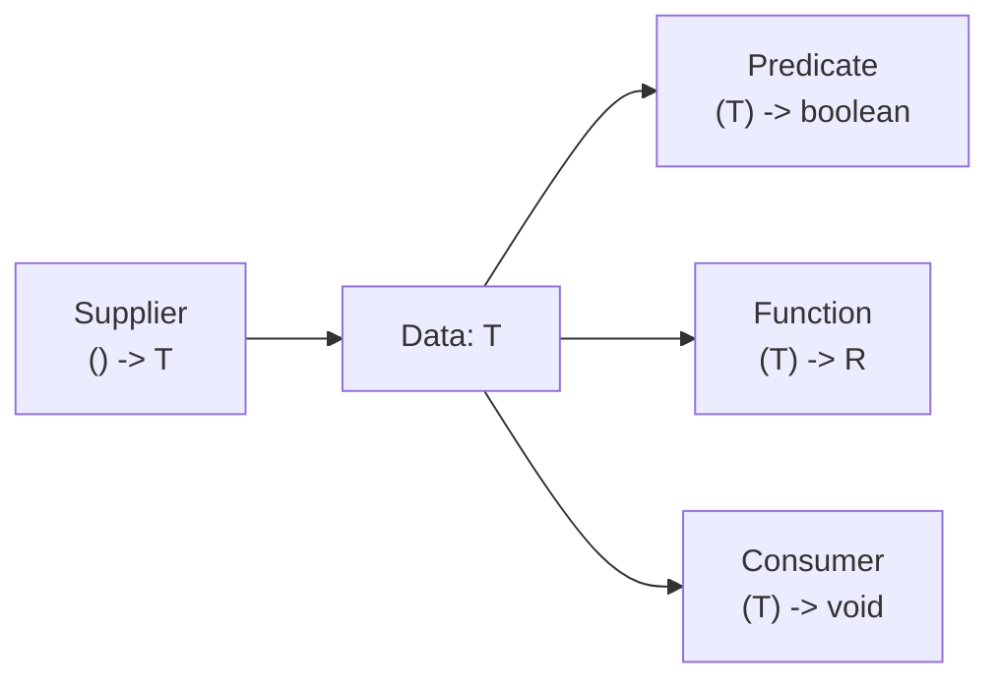

# Modern Java 8: Functional Interfaces & Lambda Syntax

> **Phase 3: Core Java, Testing Foundations & Modern Java 8+**  
> *Estimated Reading Time: 50 minutes | Total Practice Effort: ~3.5 hours | Tier: Core Essential*

---

## 1. Purpose & Prerequisites

### Why This Matters in Full Stack Development
Before Java 8, Java was strictly object-oriented and notoriously verbose. If you wanted to pass a simple piece of logic—like filtering active users or sorting products by price—you had to write 6 lines of boilerplate code using an **Anonymous Inner Class**:

```java
// Verbose Pre-Java 8 Way:
Collections.sort(products, new Comparator<Product>() {
    @Override
    public int compare(Product p1, Product p2) {
        return Double.compare(p1.getPrice(), p2.getPrice());
    }
});
```

Java 8 transformed the language by introducing **Lambda Expressions** and **Functional Interfaces**. With modern syntax, that same sort is expressed in one readable line:
```java
// Clean Modern Java 8 Way:
products.sort(Comparator.comparingDouble(Product::getPrice));
```
Embracing functional paradigms allows you to write declarative, concise, and expressive backend business logic.

### Prerequisites
- [Topic 2.8: Abstract Classes vs Interfaces & Multiple Inheritance of Type](../02-oop/08-abstraction-interfaces.md)
- [Topic 3.7: Generics: Type Parameters, Generic Classes & Type Erasure](07-generics.md)

---

## 2. Plain-English Mental Model

Think of a Lambda Expression like passing a culinary recipe on a sticky note instead of hiring a full-time chef:

```
[ Anonymous Inner Class (The Heavy Chef) ]
"Build a full kitchen, hire a chef, write contract just to chop one onion"
(Generates extra .class bytecode files on disk!)

[ Lambda Expression (The Sticky Note Recipe) ]
"Pass pure behavior: (onion) -> chop(onion)"
(Lightweight, zero boilerplate, evaluated on the fly via invokedynamic!)
```

A **Lambda Expression** is simply an anonymous function: a block of code with inputs and a body that can be passed around and executed on demand.

---

## 3. What is a Functional Interface?

A **Functional Interface** is any interface that defines **exactly one abstract method** (SAM - Single Abstract Method). It can have multiple `default` or `static` methods, but only one unimplemented abstract method.

```java
@FunctionalInterface
public interface DiscountPolicy {
    double applyDiscount(double subtotal); // The single abstract method!
}
```

The `@FunctionalInterface` annotation is optional but recommended; it instructs the compiler to verify that the interface has exactly one abstract method.

---

## 4. The 4 Core Built-In Functional Interfaces (`java.util.function`)

Rather than creating custom interfaces for every task, Java 8 provides a standard functional library:

| Interface | Method Signature | Purpose | Real-World Example |
| :--- | :--- | :--- | :--- |
| **`Predicate<T>`** | `boolean test(T t)` | Evaluates a condition (**returns boolean**) | Filtering active users: `user -> user.isActive()` |
| **`Function<T, R>`**| `R apply(T t)` | Transforms input `T` into output `R` | Extracting email: `user -> user.getEmail()` |
| **`Consumer<T>`** | `void accept(T t)` | Consumes data, performs action (**returns void**)| Printing, database save: `order -> sendInvoice(order)` |
| **`Supplier<T>`** | `T get()` | Generates/supplies data (**takes no inputs**) | Factory, random ID generator: `() -> UUID.randomUUID()` |



---

## 5. Method References (`::`)

A **Method Reference** is an even more concise shorthand for a lambda that simply delegates directly to an existing method:

| Category | Lambda Syntax | Method Reference Syntax |
| :--- | :--- | :--- |
| **Static Method** | `s -> Integer.parseInt(s)` | `Integer::parseInt` |
| **Instance Method on Instance** | `s -> System.out.println(s)` | `System.out::println` |
| **Instance Method on Parameter**| `str -> str.toUpperCase()` | `String::toUpperCase` |
| **Constructor Reference** | `() -> new ArrayList<>()` | `ArrayList::new` |

---

## 6. Working Code Example: Functional Pipeline in Action

```java
// File: ModernFunctionalDemo.java
import java.util.ArrayList;
import java.util.List;
import java.util.function.Consumer;
import java.util.function.Function;
import java.util.function.Predicate;

class Customer {
    private final String name;
    private final int loyaltyPoints;
    private final boolean isVip;

    public Customer(String name, int loyaltyPoints, boolean isVip) {
        this.name = name;
        this.loyaltyPoints = loyaltyPoints;
        this.isVip = isVip;
    }

    public String getName() { return name; }
    public int getLoyaltyPoints() { return loyaltyPoints; }
    public boolean isVip() { return isVip; }
}

public class ModernFunctionalDemo {
    public static void main(String[] args) {
        List<Customer> customers = List.of(
            new Customer("Alice", 120, true),
            new Customer("Bob", 45, false),
            new Customer("Charlie", 250, true)
        );

        // 1. Predicate: Filter VIP customers
        Predicate<Customer> isVipCustomer = Customer::isVip; // Method reference

        // 2. Function: Transform Customer into uppercase greeting String
        Function<Customer, String> greetingBuilder = c -> 
            "WELCOME " + c.getName().toUpperCase() + " (Points: " + c.getLoyaltyPoints() + ")";

        // 3. Consumer: Print output to terminal
        Consumer<String> alertDispatcher = System.out::println; // Method reference

        System.out.println("=== VIP Welcome Broadcast ===");
        for (Customer c : customers) {
            if (isVipCustomer.test(c)) {
                String banner = greetingBuilder.apply(c);
                alertDispatcher.accept(banner);
            }
        }
    }
}
```

### Exact Output:
```text
=== VIP Welcome Broadcast ===
WELCOME ALICE (Points: 120)
WELCOME CHARLIE (Points: 250)
```

---

## 7. The "Effectively Final" Rule

When a lambda expression accesses a local variable declared outside its body, that variable must be **final or effectively final** (meaning its value is never modified after assignment):

```java
int taxRate = 10; // Effectively final because never reassigned
Consumer<Integer> calculate = amount -> System.out.println(amount * taxRate); // LEGAL

int counter = 0;
// COMPILER ERROR: Local variable counter defined in an enclosing scope must be final or effectively final
Consumer<Integer> bad = amount -> counter++; 
```
**Why:** Local variables live on the Call Stack. Lambdas may be executed asynchronously on background threads long after that stack frame has been popped! Java makes a copy of the variable; to prevent desynchronization between copies, the variable must be immutable.

---

## 8. Guided Hands-On Exercise

### Challenge: Order Discount Calculator Pipeline
Create a program named `DiscountEngineDemo.java`:
1. Functional Interface: `@FunctionalInterface interface DiscountRule { double compute(double subtotal); }`
2. Implement 3 policies using lambda expressions:
   - `blackFriday`: 30% off (`subtotal * 0.70`).
   - `clearance`: Flat `$50.0` off, but total cannot go below `$0.0` (`Math.max(0.0, subtotal - 50.0)`).
   - `noDiscount`: Returns subtotal unchanged.
3. Method `public static void printInvoice(String label, double subtotal, DiscountRule rule)`:
   - Evaluates the rule and prints the discounted price formatted to 2 decimals.
4. In `main`, test an order of `$120.0` against all 3 policies.

<details>
<summary>💡 Hint: Lambdas</summary>

```java
DiscountRule blackFriday = amount -> amount * 0.70;
DiscountRule clearance = amount -> Math.max(0.0, amount - 50.0);
DiscountRule noDiscount = amount -> amount;
```
</details>

<details>
<summary>✅ Solution</summary>

```java
@FunctionalInterface
interface DiscountRule {
    double compute(double subtotal);
}

public class DiscountEngineDemo {
    public static void main(String[] args) {
        double orderSubtotal = 120.00;

        DiscountRule blackFriday = subtotal -> subtotal * 0.70;
        DiscountRule clearance = subtotal -> Math.max(0.0, subtotal - 50.0);
        DiscountRule noDiscount = subtotal -> subtotal;

        System.out.println("Original Subtotal: $" + orderSubtotal);
        printInvoice("Black Friday (30% off)", orderSubtotal, blackFriday);
        printInvoice("Clearance ($50 off)", orderSubtotal, clearance);
        printInvoice("Standard (No discount)", orderSubtotal, noDiscount);
    }

    public static void printInvoice(String label, double subtotal, DiscountRule rule) {
        double finalPrice = rule.compute(subtotal);
        System.out.printf(" - %-25s : $%.2f%n", label, finalPrice);
    }
}
```

**Terminal Output:**
```text
Original Subtotal: $120.0
 - Black Friday (30% off)    : $84.00
 - Clearance ($50 off)       : $70.00
 - Standard (No discount)    : $120.00
```
</details>

---

## 9. Knowledge Check & Interview Defense

### Quick Quiz
1. **What is a Functional Interface in Java?**
   - [ ] A) An interface with only static methods.
   - [x] B) An interface containing exactly one abstract method (Single Abstract Method).
   - [ ] C) An interface that cannot have default methods.
   - [ ] D) Any interface in the `java.lang` package.

2. **Which built-in functional interface takes one argument and returns a boolean?**
   - [ ] A) `Consumer<T>`
   - [ ] B) `Function<T, R>`
   - [x] C) `Predicate<T>`
   - [ ] D) `Supplier<T>`

3. **What is the equivalent method reference for the lambda expression `user -> user.getName()`?**
   - [ ] A) `User.getName()`
   - [x] B) `User::getName`
   - [ ] C) `user->getName`
   - [ ] D) `new User::getName`

---

### Junior Developer Interview Q&A

#### Q: "How do Java 8 lambdas differ from Anonymous Inner Classes under the hood?"
> **Model Answer:**  
> "The differences are significant:
> 1. **Bytecode Generation:** Every Anonymous Inner Class produces a separate physical `.class` file on disk (e.g. `Main$1.class`), increasing JAR size and ClassLoader memory footprint. Lambdas do not create extra class files; they compile into private synthetic methods inside the enclosing class.
> 2. **Execution via `invokedynamic`:** Lambdas leverage the `invokedynamic` bytecode instruction (introduced in Java 7). The JVM uses `LambdaMetafactory` to generate call sites dynamically at runtime. This allows the JVM to optimize, inline, and potentially allocate zero heap objects if the lambda does not capture state.
> 3. **The `this` Pointer:** In an Anonymous Inner Class, `this` refers to the inner class instance. In a Lambda expression, `this` refers to the enclosing outer class instance (lexical scoping)."

---

## 10. Mastery Checklist & Next Step

Before moving on, verify that you can:
- [ ] Define custom functional interfaces using `@FunctionalInterface`.
- [ ] Utilize `Predicate`, `Function`, `Consumer`, and `Supplier` appropriately.
- [ ] Convert verbose lambda expressions into clean Method References (`::`).
- [ ] Explain why local variables captured by lambdas must be effectively final.

👉 **Next Lesson:** **[Topic 3.10: Modern Java 8: Stream Pipelines (filter, map, collect) & Optional](10-stream-optional.md)**
