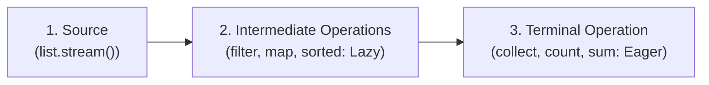
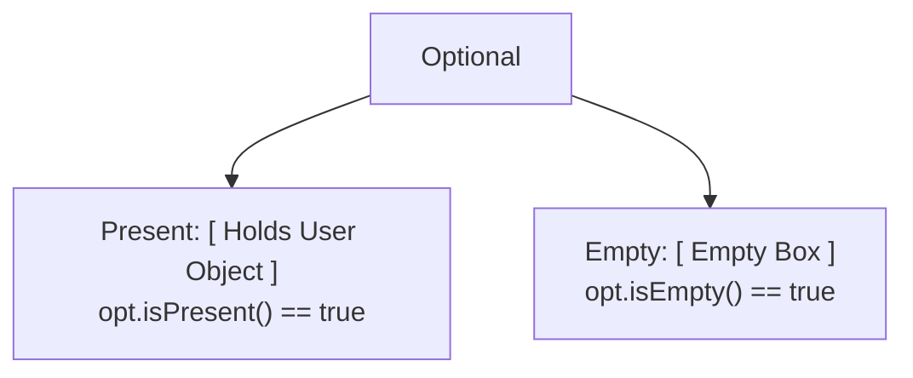

# Modern Java 8: Stream Pipelines (filter, map, collect) & Optional

> **Phase 3: Core Java, Testing Foundations & Modern Java 8+**  
> *Estimated Reading Time: 55 minutes | Total Practice Effort: ~4.0 hours | Tier: Core Essential*

---

## 1. Purpose & Prerequisites

### Why This Matters in Full Stack Development
Before Java 8, if you needed to take a list of orders, filter only those marked as `PAID`, extract their total dollar amounts, and compute the total revenue, you had to write nested imperative `for` loops with temporary mutable accumulator variables:

```java
// Imperative Pre-Java 8 Way: Clunky, error-prone, hard to read
double total = 0.0;
for (Order o : orders) {
    if (o.getStatus() == OrderStatus.PAID) {
        total += o.getAmount();
    }
}
```

With the **Stream API**, you express **what** you want to achieve rather than micro-managing **how** the CPU iterates:

```java
// Declarative Modern Java 8 Way:
double total = orders.stream()
                     .filter(o -> o.getStatus() == OrderStatus.PAID)
                     .mapToDouble(Order::getAmount)
                     .sum();
```

Furthermore, Tony Hoare (inventor of the null reference) famously called `null` his "Billion-Dollar Mistake". Java 8 introduced **`Optional<T>`** to provide a typesafe container representing the possible absence of a value, eliminating unexpected `NullPointerExceptions` across your service APIs.

### Prerequisites
- [Topic 3.9: Modern Java 8: Functional Interfaces & Lambda Syntax](09-lambdas.md)

---

## 2. Plain-English Mental Model

Think of a Stream Pipeline like an automated conveyor belt in an e-commerce fulfillment warehouse:

```
[ Warehouse Shelves (Source List) ]
                 |
                 v  ( .stream() puts items on the conveyor belt )
================== Conveyor Belt ==================
 [Item 1] ---> [ filter(isPaid) ] ---> (Unpaid items dropped off belt)
                 |
 [Item 2] ---> [ map(getAmount) ] ---> (Boxes opened, price tags extracted)
                 |
 [Item 3] ---> [ collect(toList) ] --> Final boxed collection ready for shipping!
===================================================
```

- **Not a Data Structure:** A Stream does **not store elements** in memory; it conveys elements from a source (like a `List`) through a pipeline of computational steps.
- **Source Unchanged:** A Stream **never modifies the underlying source data**.
- **Lazy Evaluation:** Nothing moves on the conveyor belt until a **Terminal Operation** turns the power switch on!

---

## 3. Anatomy of a Stream Pipeline

A Stream pipeline consists of three discrete stages:



### 1. Intermediate Operations (Lazy)
Transform one stream into another. They perform zero work until a terminal operation is called:
- `filter(Predicate)`: Retains elements that match a boolean condition.
- `map(Function)`: Transforms each element into another value or type.
- `flatMap(Function)`: Flattens nested streams (e.g. converting a list of orders into a flat stream of order items).
- `distinct()`: Removes duplicate elements based on `equals()`.
- `sorted(Comparator)`: Orders elements.
- `limit(n)` / `skip(n)`: Truncates or skips elements.

### 2. Terminal Operations (Eager)
Triggers execution of the pipeline and produces a final non-stream result:
- `collect(Collectors...)`: Gathers elements into a `List`, `Set`, `Map`, or custom summary.
- `toList()`: Convenient immutable list collector (Java 16+).
- `count()`: Returns the number of elements.
- `forEach(Consumer)`: Executes an action on each element.
- `anyMatch(Predicate)` / `allMatch(Predicate)`: Returns a boolean.
- `findFirst()` / `findAny()`: Returns an `Optional<T>`.
- `reduce(...)`: Combines elements into a single accumulated result.

---

## 4. Powerful Collectors (`Collectors.groupingBy`)

The `java.util.stream.Collectors` utility provides enterprise-grade data aggregation:

```java
// Grouping orders by Status into a Map<OrderStatus, List<Order>>
Map<OrderStatus, List<Order>> ordersByStatus = orders.stream()
    .collect(Collectors.groupingBy(Order::getStatus));

// Joining list of strings with delimiters
String csv = users.stream()
                  .map(User::getUsername)
                  .collect(Collectors.joining(", "));
```

---

## 5. `Optional<T>`: Banishing NullPointerExceptions

`Optional<T>` is a single-element container that either contains a non-null reference of type `T`, or is **empty**:



### Idiomatic `Optional` Methods:
```java
Optional<User> optUser = userRepository.findById("USR-101");

// 1. Safe extraction with default fallback:
User user = optUser.orElse(new User("Guest"));

// 2. Safe lazy calculation if missing:
User user = optUser.orElseGet(() -> computeFallbackUser());

// 3. Throw custom domain exception if missing (Standard Spring Boot pattern!):
User user = optUser.orElseThrow(() -> new UserNotFoundException("USR-101"));

// 4. Transform value if present:
String email = optUser.map(User::getEmail).orElse("no-email@store.com");
```

> [!CAUTION] The Anti-Pattern: `.get()` without checking
> Calling `optUser.get()` on an empty Optional throws `NoSuchElementException`, defeating the entire purpose of `Optional`! Always use `.orElse()`, `.orElseThrow()`, or `.ifPresent()`.

---

## 6. Java 8 Date and Time API (`java.time`)

Java 8 completely replaced the buggy, mutable legacy `java.util.Date` and `Calendar` classes with the immutable, thread-safe `java.time` package:

- **`LocalDate`**: Date without time (e.g. `2026-10-20`).
- **`LocalTime`**: Time without date (e.g. `14:30:00`).
- **`LocalDateTime`**: Date and time without timezone.
- **`Instant`**: Instantaneous timestamp on the UTC timeline (ideal for database audit logs).
- **`Duration` / `Period`**: Elapsed time amounts (e.g. `Duration.ofMinutes(15)`).

```java
LocalDate today = LocalDate.now();
LocalDate nextWeek = today.plusDays(7);
Instant serverTimestamp = Instant.now(); // Universal UTC timestamp
```

---

## 7. Working Code Example: E-Commerce Analytics Pipeline

```java
// File: StreamAnalyticsDemo.java
import java.time.LocalDate;
import java.util.*;
import java.util.stream.Collectors;

class OrderItem {
    private final String sku;
    private final String category;
    private final double price;

    public OrderItem(String sku, String category, double price) {
        this.sku = sku;
        this.category = category;
        this.price = price;
    }

    public String getSku() { return sku; }
    public String getCategory() { return category; }
    public double getPrice() { return price; }
}

public class StreamAnalyticsDemo {
    public static void main(String[] args) {
        List<OrderItem> items = List.of(
            new OrderItem("KB-100", "ELECTRONICS", 120.00),
            new OrderItem("MOU-20", "ELECTRONICS", 45.00),
            new OrderItem("BOOK-A", "BOOKS", 18.50),
            new OrderItem("BOOK-B", "BOOKS", 24.00),
            new OrderItem("MON-400", "ELECTRONICS", 350.00)
        );

        // 1. Filter, Map & Collect: Find SKUs of all electronics over $50
        List<String> premiumElectronics = items.stream()
            .filter(item -> "ELECTRONICS".equals(item.getCategory()))
            .filter(item -> item.getPrice() > 50.0)
            .map(OrderItem::getSku)
            .collect(Collectors.toList());

        System.out.println("Premium Electronics SKUs: " + premiumElectronics);

        // 2. Aggregate: Total revenue of all electronics
        double electronicsRevenue = items.stream()
            .filter(item -> "ELECTRONICS".equals(item.getCategory()))
            .mapToDouble(OrderItem::getPrice)
            .sum();

        System.out.println("Total Electronics Revenue: $" + electronicsRevenue);

        // 3. Grouping: Group items by Category into Map<String, List<OrderItem>>
        Map<String, List<OrderItem>> categorized = items.stream()
            .collect(Collectors.groupingBy(OrderItem::getCategory));

        System.out.println("\n--- Catalog by Category ---");
        categorized.forEach((category, itemList) -> {
            System.out.println(category + " (" + itemList.size() + " items)");
        });

        // 4. Optional Safe Lookup
        Optional<OrderItem> expensiveItem = items.stream()
            .filter(item -> item.getPrice() > 500.0)
            .findFirst();

        String expensiveSku = expensiveItem
            .map(OrderItem::getSku)
            .orElse("No items found above $500.00");

        System.out.println("\nExpensive Item Search: " + expensiveSku);
    }
}
```

### Exact Output:
```text
Premium Electronics SKUs: [KB-100, MON-400]
Total Electronics Revenue: $515.0

--- Catalog by Category ---
BOOKS (2 items)
ELECTRONICS (3 items)

Expensive Item Search: No items found above $500.00
```

---

## 8. Common Rookie Mistakes & Compiler Traps

### Trap 1: Reusing a Consumed Stream
```java
Stream<String> stream = List.of("A", "B", "C").stream();
stream.forEach(System.out::println); // Terminal operation completes!

// CRASH: IllegalStateException: stream has already been operated upon or closed!
stream.forEach(System.out::println); 
```
> [!WARNING]
> Streams are **one-time-use pipelines**. Once a terminal operation executes, the stream is consumed and closed. To process items again, create a fresh stream via `.stream()`.

### Trap 2: Using `Optional` as a Field or Parameter
```java
public class User {
    private Optional<String> middleName; // ANTI-PATTERN!
}
```
`Optional` is not `Serializable` and was designed strictly as a **method return type** to indicate the potential absence of a return value.

---

## 9. Guided Hands-On Exercise

### Challenge: Customer Transaction Analytics Engine
Create a program named `TransactionAnalyticsDemo.java`:
1. Class `Transaction`:
   - Fields: `txId` (`String`), `city` (`String`), `amount` (`double`), `isFlagged` (`boolean`).
2. Provide a sample list:
   - `("TX-1", "New York", 400.0, false)`
   - `("TX-2", "London", 1200.0, true)`
   - `("TX-3", "New York", 850.0, false)`
   - `("TX-4", "Tokyo", 60.0, false)`
   - `("TX-5", "London", 300.0, false)`
3. Write Stream pipelines to:
   - Calculate total dollar amount of all **unflagged** transactions.
   - Group unflagged transactions by `city` into a `Map<String, List<Transaction>>`.
   - Find the single highest value transaction using `.max(Comparator.comparingDouble(...))` and return it as an `Optional<Transaction>`.

<details>
<summary>💡 Hint: max Comparator</summary>

```java
Optional<Transaction> maxTx = list.stream()
    .filter(t -> !t.isFlagged())
    .max(Comparator.comparingDouble(Transaction::getAmount));
```
</details>

<details>
<summary>✅ Solution</summary>

```java
import java.util.*;
import java.util.stream.Collectors;

class Transaction {
    private final String txId;
    private final String city;
    private final double amount;
    private final boolean flagged;

    public Transaction(String txId, String city, double amount, boolean flagged) {
        this.txId = txId;
        this.city = city;
        this.amount = amount;
        this.flagged = flagged;
    }

    public String getTxId() { return txId; }
    public String getCity() { return city; }
    public double getAmount() { return amount; }
    public boolean isFlagged() { return flagged; }

    @Override
    public String toString() {
        return txId + " ($" + amount + ")";
    }
}

public class TransactionAnalyticsDemo {
    public static void main(String[] args) {
        List<Transaction> transactions = List.of(
            new Transaction("TX-1", "New York", 400.0, false),
            new Transaction("TX-2", "London", 1200.0, true),
            new Transaction("TX-3", "New York", 850.0, false),
            new Transaction("TX-4", "Tokyo", 60.0, false),
            new Transaction("TX-5", "London", 300.0, false)
        );

        // 1. Total Unflagged Revenue
        double unflaggedTotal = transactions.stream()
            .filter(t -> !t.isFlagged())
            .mapToDouble(Transaction::getAmount)
            .sum();

        System.out.println("Total Unflagged Volume: $" + unflaggedTotal);

        // 2. Group by City
        Map<String, List<Transaction>> cityGroups = transactions.stream()
            .filter(t -> !t.isFlagged())
            .collect(Collectors.groupingBy(Transaction::getCity));

        System.out.println("\n--- Legitimate Transactions by City ---");
        cityGroups.forEach((city, txList) -> {
            System.out.println(city + ": " + txList);
        });

        // 3. Peak Transaction via Optional
        Optional<Transaction> peakTx = transactions.stream()
            .filter(t -> !t.isFlagged())
            .max(Comparator.comparingDouble(Transaction::getAmount));

        peakTx.ifPresent(tx -> System.out.println("\nPeak Legitimate Tx: " + tx));
    }
}
```

**Terminal Output:**
```text
Total Unflagged Volume: $1610.0

--- Legitimate Transactions by City ---
New York: [TX-1 ($400.0), TX-3 ($850.0)]
London: [TX-5 ($300.0)]
Tokyo: [TX-4 ($60.0)]

Peak Legitimate Tx: TX-3 ($850.0)
```
</details>

---

## 9. Knowledge Check & Interview Defense

### Quick Quiz
1. **What is the difference between an intermediate operation and a terminal operation in a Stream?**
   - [x] A) Intermediate operations are lazy and return a new Stream without executing; terminal operations trigger execution and produce a non-stream result.
   - [ ] B) Intermediate operations can only run on integers.
   - [ ] C) Terminal operations run in parallel automatically.
   - [ ] D) Intermediate operations modify the source list.

2. **Can a Stream be reused after a terminal operation has already executed on it?**
   - [ ] A) Yes, streams automatically reset.
   - [x] B) No. Attempting to operate on a consumed stream throws `java.lang.IllegalStateException`.
   - [ ] C) Yes, but only in Java 21+.
   - [ ] D) Only if `.collect()` was used.

3. **What is the recommended way to retrieve a value from an `Optional<T>` in enterprise Java?**
   - [ ] A) Always call `.get()` unconditionally.
   - [x] B) Use `.orElse()`, `.orElseGet()`, or `.orElseThrow()` to safely supply defaults or raise domain exceptions when empty.
   - [ ] C) Cast it to `(T)`.
   - [ ] D) Convert it to an array.

---

### Junior Developer Interview Q&A

#### Q: "What is Lazy Evaluation in the context of Java Streams, and what performance advantage does it provide?"
> **Model Answer:**  
> "In Java Streams, **Lazy Evaluation** means that intermediate operations (such as `filter()`, `map()`, and `sorted()`) do not execute when they are declared. Computation only begins when a **terminal operation** (such as `collect()`, `findFirst()`, or `count()`) is invoked.  
> 
> This provides significant performance optimizations:
> 1. **Loop Fusion:** Instead of passing the entire collection through `filter()`, creating an intermediate list, and then passing that list through `map()`, the JVM fuses the operations into a single pass through memory.
> 2. **Short-Circuiting:** If a terminal operation like `findFirst()` or `anyMatch()` is called, the stream stops processing elements the exact moment a match is found, avoiding processing millions of remaining elements in a large dataset."

---

## 10. Phase 3 Mastery Checklist & Next Phase

Congratulations! You have completed **Phase 3: Core Java, Testing Foundations & Modern Java 8+**.

### Phase 3 Mastery Self-Audit:
- [x] Exceptions: Master try-catch-finally, multi-catch, and Try-with-Resources.
- [x] Custom Domain Exceptions: Build unchecked domain exception hierarchies preserving root causes.
- [x] Developer Tools II (Maven): Manage POM dependencies, scopes, and the default build lifecycle.
- [x] Developer Tools III (JUnit 5): Write automated unit tests using the AAA pattern and `assertThrows`.
- [x] String Memory Internals: Leverage Compact Strings, the String Pool, and `StringBuilder`.
- [x] Wrappers & Enums: Guard against unboxing NPEs and model states typesafely.
- [x] Generics & PECS: Eliminate runtime casts and apply Producer Extends / Consumer Super.
- [x] Object Contract: Implement bulletproof `equals()` and `hashCode()` to protect hash collections.
- [x] Lambdas & Method References: Write declarative functional pipelines using standard SAMs.
- [x] Streams & Optional: Aggregate data using `filter-map-collect` and eliminate nulls with `Optional`.

👉 **Next Phase:** **[Phase 4: Data Structures & Java Collections Framework — Topic 4.1: Collections Overview, Hierarchy & Big-O Complexity Primer](../04-collections/01-overview-big-o.md)**
