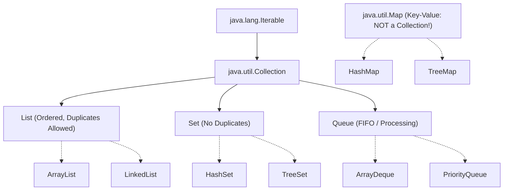

# Collections Overview, Hierarchy & Big-O Complexity Primer

> **Phase 4: Data Structures & Java Collections Framework**  
> *Estimated Reading Time: 45 minutes | Total Practice Effort: ~3.0 hours | Tier: Core Essential*

---

## 1. Purpose & Prerequisites

### Why This Matters in Full Stack Development
In Phase 1, you learned that raw Java arrays are fixed in size and cannot grow or shrink dynamically. In real-world enterprise applications, you almost never use raw arrays to hold business data.  
- An e-commerce cart needs to add and remove items dynamically.
- A user authentication cache needs fast key-value lookups by session ID.
- An asynchronous order processing pipeline needs a First-In-First-Out (FIFO) queue.

The **Java Collections Framework (JCF)** is an architecture of interfaces and ready-to-use data structures that handle dynamic data storage. Understanding the JCF hierarchy and **Big-O time complexity** ensures you choose the optimal collection for your throughput, memory, and latency requirements.

### Prerequisites
- [Topic 3.7: Generics: Type Parameters, Generic Classes & Type Erasure](../03-core/07-generics.md)
- [Topic 3.8: The Object Contract: equals(), hashCode() & Identity vs Equality](../03-core/08-equals-hashcode.md)

---

## 2. Plain-English Mental Model

Think of the Java Collections Framework like specialized storage systems in an office:

```
[ List: Lined Notebook Page ]       [ Set: Secure VIP Club Badge List ]   [ Map: Corporate Phone Directory ]
- Items kept in exact entry order   - Guarantees NO DUPLICATES!           - Key-Value pairs!
- Access by line number (index: 0)  - "Is user on the guest list?"        - "Give me phone number for 'Alice'"
```

---

## 3. The Java Collections Hierarchy

The framework is organized into two distinct interface roots:



> [!NOTE] Map is Not a Collection!
> Notice that `java.util.Map` does **not** inherit from `java.util.Collection` or `Iterable`. A Map deals with Key-Value pairs (`Map.Entry<K, V>`), whereas a Collection deals with individual elements. However, Map provides collection views via `.keySet()`, `.values()`, and `.entrySet()`.

---

## 4. Big-O Complexity Primer for Junior Engineers

In software engineering, **Big-O notation** measures how an algorithm's execution time or memory space scales as the input size ($N$) grows:

| Complexity | Name | Plain-English Meaning | Real-World Example |
| :--- | :--- | :--- | :--- |
| **$O(1)$** | **Constant Time** | Executes instantaneously regardless of whether list has 10 or 10,000,000 items! | Looking up an element in `ArrayList` by index: `list.get(500)`. |
| **$O(\log N)$** | **Logarithmic Time** | Cuts the problem size in half each step. Extremely fast. | Binary search, looking up a key in a `TreeMap` / `TreeSet`. |
| **$O(N)$** | **Linear Time** | Execution time grows proportionally with data size. | Searching for an item in an unsorted list by value: `list.contains("needle")`. |
| **$O(N^2)$** | **Quadratic Time** | Slow! Nested loops over the same dataset. | Naive nested loops comparing every item to every other item. |

```
Time Complexity Growth:
O(1) [Instant]  <  O(log N) [Fast]  <  O(N) [Fair]  <  O(N log N) [Sorting]  <  O(N^2) [Danger]
```

---

## 5. Cheat Sheet: Core Collection Time Complexities

| Data Structure | Lookup by Index | Search by Value | Insert at End | Insert in Middle | Memory Overhead |
| :--- | :---: | :---: | :---: | :---: | :--- |
| **`ArrayList`** | **$O(1)$** | $O(N)$ | **$O(1)$ amortized** | $O(N)$ (shifts elements) | Low (Contiguous array) |
| **`LinkedList`** | $O(N)$ | $O(N)$ | $O(1)$ | $O(1)$ (once node found) | High (3 node pointers/item) |
| **`HashSet`** | N/A | **$O(1)$** | **$O(1)$** | N/A | Medium (Hash buckets) |
| **`TreeSet`** | N/A | **$O(\log N)$** | **$O(\log N)$** | N/A | Medium-High (Red-black tree) |
| **`HashMap`** | N/A (Key Lookup: **$O(1)$**) | $O(N)$ by value | **$O(1)$** | N/A | Medium (Hash table + nodes) |

---

## 6. Working Code Example: Choosing the Right Data Structure

```java
// File: CollectionShowcaseDemo.java
import java.util.*;

public class CollectionShowcaseDemo {
    public static void main(String[] args) {
        // 1. List: When order and duplicate tracking matter
        List<String> userSessionHistory = new ArrayList<>();
        userSessionHistory.add("/home");
        userSessionHistory.add("/products");
        userSessionHistory.add("/home"); // Duplicates permitted
        System.out.println("User Clickstream (List): " + userSessionHistory);

        // 2. Set: When uniqueness is mandatory (instant membership check)
        Set<String> uniqueVisitorIps = new HashSet<>();
        uniqueVisitorIps.add("192.168.1.1");
        uniqueVisitorIps.add("10.0.0.5");
        uniqueVisitorIps.add("192.168.1.1"); // Ignored automatically!
        System.out.println("Unique IP Addresses (Set): " + uniqueVisitorIps);

        // 3. Map: Fast key-value lookups by identifier (O(1) lookup!)
        Map<String, String> userRoleDirectory = new HashMap<>();
        userRoleDirectory.put("USR-101", "ADMIN");
        userRoleDirectory.put("USR-102", "CUSTOMER");

        String role = userRoleDirectory.get("USR-101"); // Instant O(1) retrieval
        System.out.println("Role for USR-101 (Map): " + role);

        // 4. Queue: FIFO message processing
        Queue<String> emailDispatchQueue = new ArrayDeque<>();
        emailDispatchQueue.offer("Welcome Email: userA");
        emailDispatchQueue.offer("Password Reset: userB");

        System.out.println("Next Email to Dispatch (FIFO): " + emailDispatchQueue.poll());
    }
}
```

### Exact Output:
```text
User Clickstream (List): [/home, /products, /home]
Unique IP Addresses (Set): [192.168.1.1, 10.0.0.5]
Role for USR-101 (Map): ADMIN
Next Email to Dispatch (FIFO): Welcome Email: userA
```

---

## 7. Common Rookie Mistakes & Traps

### Trap: Programming to Concrete Implementations Instead of Interfaces
```java
// BAD: Tightly coupled to concrete implementation
ArrayList<User> users = new ArrayList<>();

// GOOD: Program to Interface (Liskov Substitution Principle!)
List<User> users = new ArrayList<>();
```
> [!TIP] Production Rule
> Always declare variables, method parameters, and return types using the **Interface** (`List`, `Set`, `Map`), not the concrete implementation (`ArrayList`, `HashSet`, `HashMap`). This allows you to swap implementations later without rewriting client code.

---

## 8. Guided Hands-On Exercise

### Challenge: Architectural Collection Selection
For each scenario below, choose the optimal Java Collection and write a short code snippet:
1. **Scenario A:** A user shopping cart where items must remain in the order they were added, and the customer can buy multiple units of the same item.
2. **Scenario B:** A blacklist of banned IP addresses where the server needs to check if an incoming request's IP is banned in $O(1)$ instant time.
3. **Scenario C:** A high-speed cache of user profiles indexed by their numeric `userId`.

<details>
<summary>💡 Hint: Solutions</summary>

- Scenario A: `List<Item> cart = new ArrayList<>();`
- Scenario B: `Set<String> blacklist = new HashSet<>();`
- Scenario C: `Map<Long, UserProfile> userCache = new HashMap<>();`
</details>

---

## 9. Knowledge Check & Interview Defense

### Quick Quiz
1. **Why does `Map` not inherit from `Collection` in Java?**
   - [x] A) Because `Collection` deals with individual elements, while `Map` deals with Key-Value pairs with fundamentally different operations.
   - [ ] B) Because `Map` was created by a different company.
   - [ ] C) Because `Map` only works with integers.
   - [ ] D) It does inherit from Collection in Java 21+.

2. **What is the Big-O time complexity of accessing an element by index in an `ArrayList`?**
   - [x] A) $O(1)$ constant time
   - [ ] B) $O(N)$ linear time
   - [ ] C) $O(\log N)$ logarithmic time
   - [ ] D) $O(N^2)$ quadratic time

3. **Which collection should you use if you need to guarantee that no duplicate elements are stored?**
   - [ ] A) `ArrayList`
   - [ ] B) `LinkedList`
   - [x] C) `Set` (e.g. `HashSet`)
   - [ ] D) `Queue`

---

### Junior Developer Interview Q&A

#### Q: "Why should we declare variables as `List<String> list = new ArrayList<>()` instead of `ArrayList<String> list = new ArrayList<>()`?"
> **Model Answer:**  
> "This adheres to the design principle **'Program to an Interface, not an Implementation'** and aligns with the Liskov Substitution Principle (LSP).  
> 
> By typing the variable as `List<String>`, our code is decoupled from `ArrayList`'s specific internal mechanics. If performance benchmarks later reveal that our application requires a `LinkedList` (or an unmodifiable list via `List.of()`), we can change the instantiation line without altering any downstream methods that interact with the list."

---

## 10. Mastery Checklist & Next Step

Before moving on, verify that you can:
- [ ] Diagram the core interfaces of the Java Collections Framework.
- [ ] Understand Big-O notations ($O(1)$, $O(\log N)$, $O(N)$) and evaluate collection performance.
- [ ] Select between `List`, `Set`, `Queue`, and `Map` based on business requirements.
- [ ] Always program to interfaces rather than concrete implementations.

👉 **Next Lesson:** **[Topic 4.2: List Interface: ArrayList (Dynamic Arrays & Resizing)](02-arraylist.md)**
