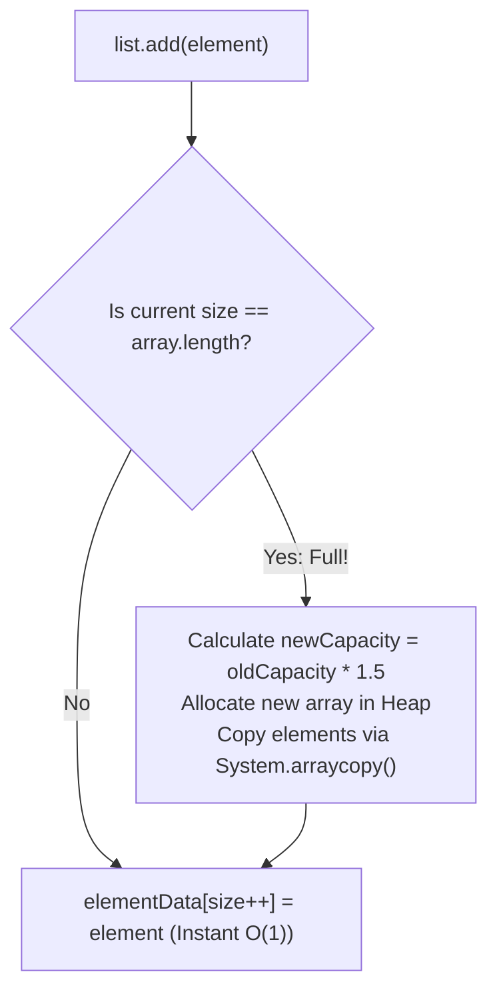
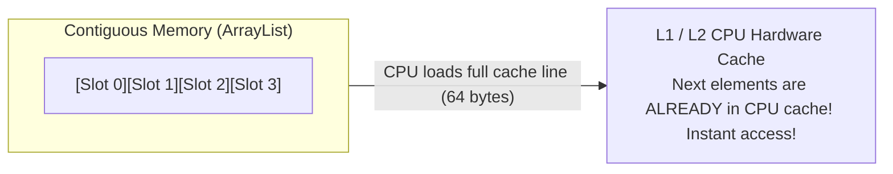

# List Interface: ArrayList (Dynamic Arrays & Resizing)

> **Phase 4: Data Structures & Java Collections Framework**  
> *Estimated Reading Time: 45 minutes | Total Practice Effort: ~3.0 hours | Tier: Core Essential*

---

## 1. Purpose & Prerequisites

### Why This Matters in Full Stack Development
In Java enterprise applications, **`ArrayList` is used more frequently than all other collection classes combined**. Whether retrieving a list of products from a database, parsing incoming JSON arrays from a React client, or sorting search results, `ArrayList` is the standard workhorse.

While `ArrayList` presents a simple list interface to developers, understanding how it manages its internal array, how it dynamically resizes by **1.5x**, and why contiguous memory makes it hardware-cache friendly is crucial for writing performant backend code.

### Prerequisites
- [Topic 1.7: Arrays: 1D & 2D Arrays, Indexing & Memory Traversal](../01-foundations/07-arrays.md)
- [Topic 4.1: Collections Overview, Hierarchy & Big-O Complexity Primer](01-overview-big-o.md)

---

## 2. Plain-English Mental Model

Think of `ArrayList` like an expandable stadium seating section:

```
Initial Capacity (10 Seats):
[ 1 ][ 2 ][ 3 ][ 4 ][ 5 ][ 6 ][ 7 ][ 8 ][ 9 ][ 10 ]  (Full!)
                                |
                   ( 11th Fan Arrives! Resize! )
                                v
Brand New Expanded Section (15 Seats: 1.5x Growth):
[ 1 ][ 2 ][ 3 ][ 4 ][ 5 ][ 6 ][ 7 ][ 8 ][ 9 ][ 10 ][ 11 ][  ][  ][  ][  ]
```

1. You start with a fixed internal array (default capacity of 10).
2. When the 11th item is added, `ArrayList` automatically constructs a **new, larger array (1.5x the size)**.
3. It copies all existing elements over to the new array using high-speed native memory copying (`System.arraycopy`).
4. The old array is discarded and reclaimed by the Garbage Collector.

---

## 3. Under the Hood: The 1.5x Resizing Formula

In the OpenJDK source code, the growth formula is implemented via a bitwise right-shift operator:

```java
// OpenJDK ArrayList.java
int newCapacity = oldCapacity + (oldCapacity >> 1); // oldCapacity + (oldCapacity / 2) = 1.5x
```



### Why is Appending Amortized $O(1)$?
Even though the occasional resize step takes $O(N)$ time to copy elements, resizing happens less and less frequently as the list grows ($10 \rightarrow 15 \rightarrow 22 \rightarrow 33 \rightarrow 49 \rightarrow 73 \dots$). When averaged across thousands of additions, the cost per append is mathematically bounded to **$O(1)$ constant time**.

---

## 4. Hardware Efficiency: CPU Cache Locality

Why is `ArrayList` almost always faster than node-based structures like `LinkedList`?



Because `ArrayList` elements live side-by-side in contiguous memory:
- When the CPU reads `list.get(0)`, hardware prefetchers load the entire adjacent 64-byte block into ultra-fast **L1/L2 CPU cache**.
- When you iterate to `list.get(1)` and `list.get(2)`, the CPU reads the data directly from local hardware cache rather than waiting for main RAM!

---

## 5. Working Code Example: Core Operations & Safe Removal

```java
// File: ArrayListDeepDiveDemo.java
import java.util.ArrayList;
import java.util.Iterator;
import java.util.List;

public class ArrayListDeepDiveDemo {
    public static void main(String[] args) {
        // PERFORMANCE TIP: If you know the list will hold 5,000 items, pre-size the capacity!
        // This avoids 15 expensive resizing and array-copy operations!
        List<String> activeOrders = new ArrayList<>(5000);

        // 1. Basic Operations
        activeOrders.add("ORD-101");
        activeOrders.add("ORD-102");
        activeOrders.add("ORD-103");
        activeOrders.add("ORD-CANCELLED");

        System.out.println("Total Orders: " + activeOrders.size());
        System.out.println("First Order (Index 0): " + activeOrders.get(0)); // O(1) instant lookup

        // 2. The Safe Removal Pattern (Java 8 Predicate)
        // Eliminates items matching condition without ConcurrentModificationException!
        activeOrders.removeIf(orderId -> orderId.contains("CANCELLED"));
        System.out.println("After removeIf: " + activeOrders);

        // 3. Traditional Safe Removal using Iterator
        Iterator<String> it = activeOrders.iterator();
        while (it.hasNext()) {
            String id = it.next();
            if (id.equals("ORD-102")) {
                it.remove(); // Safe removal during iteration!
            }
        }
        System.out.println("After Iterator.remove(): " + activeOrders);
    }
}
```

### Exact Output:
```text
Total Orders: 4
First Order (Index 0): ORD-101
After removeIf: [ORD-101, ORD-102, ORD-103]
After Iterator.remove(): [ORD-101, ORD-103]
```

---

## 6. The Deadly Trap: `ConcurrentModificationException`

> [!CAUTION] The ModCount Trap
> Never call `list.remove()` inside an enhanced `for-each` loop!

```java
List<String> list = new ArrayList<>(List.of("A", "B", "C"));

for (String s : list) {
    if (s.equals("B")) {
        list.remove(s); // CRASH! java.util.ConcurrentModificationException!
    }
}
```

### Why This Crashes:
`ArrayList` maintains an internal counter called `modCount` (modification count). When you start a `for-each` loop, an `Iterator` is created that checks `expectedModCount == modCount`. When you invoke `list.remove()` directly, `modCount` increments, but the iterator's `expectedModCount` does not. On the next loop step, the mismatch is detected and the JVM throws `ConcurrentModificationException`.

**Solutions:**
1. Use `list.removeIf(predicate)` (modern, clean, idiomatic).
2. Use `iterator.remove()`.

---

## 7. Guided Hands-On Exercise

### Challenge: Order Batch Sanitizer
Create a program named `OrderBatchSanitizer.java`:
1. Initialize an `ArrayList<String>` pre-sized with capacity `10`:
   - Add: `"TX-101"`, `"TX-INVALID"`, `"TX-102"`, `"TX-CORRUPT"`, `"TX-103"`.
2. Use `.removeIf(...)` to remove all entries containing `"INVALID"` or `"CORRUPT"`.
3. Update the first order `"TX-101"` to `"TX-101-PROCESSED"` using `.set(index, value)`.
4. Print the final cleaned list and its size.

<details>
<summary>💡 Hint: removeIf condition</summary>

```java
orders.removeIf(id -> id.contains("INVALID") || id.contains("CORRUPT"));
```
</details>

<details>
<summary>✅ Solution</summary>

```java
import java.util.ArrayList;
import java.util.List;

public class OrderBatchSanitizer {
    public static void main(String[] args) {
        List<String> orders = new ArrayList<>(10);
        orders.add("TX-101");
        orders.add("TX-INVALID");
        orders.add("TX-102");
        orders.add("TX-CORRUPT");
        orders.add("TX-103");

        System.out.println("Raw Batch: " + orders);

        // 1. Safe Predicate Removal
        orders.removeIf(id -> id.contains("INVALID") || id.contains("CORRUPT"));

        // 2. In-place Update
        orders.set(0, "TX-101-PROCESSED");

        System.out.println("Sanitized Batch (" + orders.size() + " items): " + orders);
    }
}
```

**Terminal Output:**
```text
Raw Batch: [TX-101, TX-INVALID, TX-102, TX-CORRUPT, TX-103]
Sanitized Batch (3 items): [TX-101-PROCESSED, TX-102, TX-103]
```
</details>

---

## 8. Knowledge Check & Interview Defense

### Quick Quiz
1. **By what factor does an `ArrayList` expand its internal capacity when full?**
   - [ ] A) 2.0x (doubles)
   - [x] B) 1.5x (increases by 50% via `oldCapacity + (oldCapacity >> 1)`)
   - [ ] C) Flat +10 elements
   - [ ] D) 3.0x

2. **Why does calling `list.remove(item)` inside an enhanced `for-each` loop throw `ConcurrentModificationException`?**
   - [x] A) Because the underlying `modCount` changes without the loop's iterator being updated, violating fail-fast consistency.
   - [ ] B) Because the array becomes negative.
   - [ ] C) Because `ArrayList` is immutable.
   - [ ] D) Only when running on multiple threads.

3. **What is the primary hardware reason `ArrayList` outperforms `LinkedList` in practical iteration benchmarks?**
   - [x] A) CPU Cache Locality: ArrayList's contiguous memory allows CPU prefetchers to cache adjacent elements in high-speed hardware cache lines.
   - [ ] B) ArrayList is compiled to assembly directly.
   - [ ] C) LinkedList cannot hold strings.
   - [ ] D) ArrayList uses GPU acceleration.

---

### Junior Developer Interview Q&A

#### Q: "Why is it beneficial to specify an initial capacity when constructing an ArrayList (e.g. `new ArrayList<>(10000)`)?"
> **Model Answer:**  
> "If you instantiate an `ArrayList` with the default no-arg constructor, its initial capacity is 10. If you subsequently insert 10,000 items, the list will trigger approximately 17 resizing cycles ($10 \rightarrow 15 \rightarrow 22 \dots \rightarrow 10000$).  
> 
> Each resize allocates a brand-new array on the Heap, copies all existing items via `System.arraycopy`, and creates garbage arrays that trigger GC overhead.  
> 
> By pre-sizing the `ArrayList` with `new ArrayList<>(10000)`, the JVM allocates a single 10,000-element array upfront. Zero resizing or array copying occurs during ingestion, drastically reducing memory churn and improving throughput."

---

## 9. Mastery Checklist & Next Step

Before moving on, verify that you can:
- [ ] Explain the 1.5x growth algorithm and amortized $O(1)$ append complexity.
- [ ] Avoid `ConcurrentModificationException` using `removeIf` or `Iterator.remove()`.
- [ ] Pre-size `ArrayList` constructors for high-volume data ingestion.
- [ ] Explain CPU cache line locality benefits over pointer-based lists.

👉 **Next Lesson:** **[Topic 4.3: LinkedList vs ArrayList: Memory Overheads & Big-O Realities](03-linkedlist.md)**
