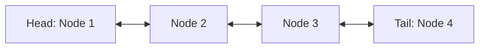
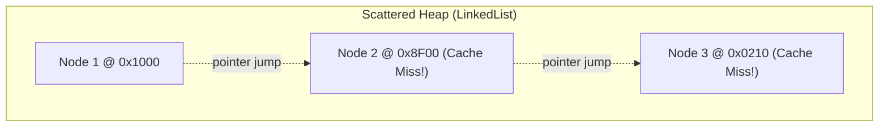

# LinkedList vs ArrayList: Memory Overheads & Big-O Realities

> **Phase 4: Data Structures & Java Collections Framework**  
> *Estimated Reading Time: 45 minutes | Total Practice Effort: ~3.0 hours | Tier: Core Essential*

---

## 1. Purpose & Prerequisites

### Why This Matters in Full Stack Development
In introductory computer science textbooks, you often read:  
*"Use `ArrayList` when reading data; use `LinkedList` when inserting or deleting data."*

In production enterprise software engineering, this textbook advice is almost entirely wrong. In 99% of real-world scenarios, **`ArrayList` vastly outperforms `LinkedList`**, even for insertions and deletions! In fact, Java's own language architect, Brian Goetz, famously quipped that almost no one should ever use `LinkedList`.

Understanding the trade-offs between contiguous memory buffers and doubly-linked pointer nodes—including memory footprints, pointer chasing, and CPU cache misses—is an essential rite of passage for every backend software engineer.

### Prerequisites
- [Topic 4.2: List Interface: ArrayList (Dynamic Arrays & Resizing)](02-arraylist.md)

---

## 2. Plain-English Mental Model

```
[ ArrayList: A Long Bench ]                  [ LinkedList: A Scavenger Hunt ]
All seats are adjacent.                      Person A holds note with Person B's address.
To find seat #5: Walk directly to slot 5.    Person B holds note with Person C's address.
Instant access!                              To find Person 5: Must start at Person 1 and
                                             visit every house in between!
```

- **`ArrayList`:** A contiguous array of memory pointers. Finding an index is instantaneous pointer arithmetic.
- **`LinkedList`:** A scattered chain of independent `Node` objects dispersed across the Heap. Finding an index requires "pointer chasing" from node to node.

---

## 3. Node Internals & Memory Bloat

In Java's `java.util.LinkedList`, every single element is wrapped in a private static `Node<E>` object:

```java
// OpenJDK LinkedList.java
private static class Node<E> {
    E item;         // Reference to payload (8 bytes on 64-bit JVM)
    Node<E> next;   // Pointer to forward node (8 bytes)
    Node<E> prev;   // Pointer to backward node (8 bytes)
}
```



### Memory Footprint Breakdown (Per 1 Million Elements):
- **`ArrayList<Integer>`:** Holds an internal `Integer[]` array. Total overhead per element $\approx$ **4 to 8 bytes** (just the reference pointer).
- **`LinkedList<Integer>`:** Allocates a separate `Node` object for **every single item**.  
  - Object Header: 12–16 bytes
  - `next` pointer: 8 bytes
  - `prev` pointer: 8 bytes
  - `item` reference: 8 bytes
  - Padding: 4 bytes  
  - **Total overhead per element $\approx$ 40 to 48 bytes!** (Up to 6x more memory bloat and massive Garbage Collection churn!)

---

## 4. The Theory vs. Reality Paradox

| Operation | Textbook Theory | Production Reality | Why Reality Wins |
| :--- | :---: | :---: | :--- |
| **Get by Index (`get(i)`)** | `ArrayList`: $O(1)$<br/>`LinkedList`: $O(N)$ | `ArrayList` wins by **1,000x** | Instant math vs sequential pointer traversal. |
| **Insert at Middle** | `LinkedList`: $O(1)$<br/>`ArrayList`: $O(N)$ | **`ArrayList` still wins!** | To insert in `LinkedList`, you must first **traverse** to the index ($O(N)$ traversal with cache misses!). `ArrayList` shifts contiguous memory using single microcode assembly instructions (`memmove`). |
| **Insert at Beginning**| `LinkedList`: $O(1)$<br/>`ArrayList`: $O(N)$ | `LinkedList` wins | True $O(1)$ head insertion without shifting. (However, `ArrayDeque` is even faster!). |

---

## 5. The Hardware Reality: Pointer Chasing & Cache Misses



Every time you follow a `.next` pointer in a `LinkedList`, that node lives in a random, unpredictable location in Heap memory. The CPU's hardware prefetcher cannot predict where the next node is, resulting in **continuous CPU Cache Misses**. The CPU spends hundreds of idle clock cycles waiting for RAM to deliver each node.

---

## 6. Working Code Example: LinkedList as a Queue / Deque

The one legitimate use case for `LinkedList` is when you need a First-In-First-Out (FIFO) queue or Double-Ended Queue (`Deque`), because it implements both interfaces:

```java
// File: LinkedListDequeDemo.java
import java.util.Deque;
import java.util.LinkedList;

public class LinkedListDequeDemo {
    public static void main(String[] args) {
        // Using LinkedList as a double-ended queue (Deque)
        Deque<String> printJobs = new LinkedList<>();

        // 1. Enqueue operations (Add to tail)
        printJobs.offerLast("Job #1: Tax Receipt");
        printJobs.offerLast("Job #2: Annual Report");

        // 2. High-priority insertion (Add to head)
        printJobs.offerFirst("Job #0: EMERGENCY SHUTDOWN LOG");

        System.out.println("Current Queue: " + printJobs);

        // 3. Dequeue operations (Process from head)
        while (!printJobs.isEmpty()) {
            String job = printJobs.pollFirst(); // O(1) removal from head!
            System.out.println("Processing: " + job);
        }
    }
}
```

### Exact Output:
```text
Current Queue: [Job #0: EMERGENCY SHUTDOWN LOG, Job #1: Tax Receipt, Job #2: Annual Report]
Processing: Job #0: EMERGENCY SHUTDOWN LOG
Processing: Job #1: Tax Receipt
Processing: Job #2: Annual Report
```

> [!TIP] The Production Alternative: `ArrayDeque`
> If you need a fast Queue or Deque, **use `ArrayDeque` instead of `LinkedList`**. `ArrayDeque` uses a circular array buffer: it requires zero Node object allocations, uses less memory, and is significantly faster than `LinkedList`.

---

## 7. The Performance Disaster: Index Traversal Trap

```java
// DISASTER: O(N^2) quadratic performance on LinkedList!
LinkedList<String> list = getMillionElements();

for (int i = 0; i < list.size(); i++) {
    String item = list.get(i); // CRASHES PERFORMANCE!
}
```
**Why:** For every iteration `i`, `list.get(i)` starts from the head of the list and walks `i` pointers from scratch! Traversing a 100,000-item `LinkedList` this way performs 5 billion pointer dereferences! Always use an enhanced `for-each` loop or `Iterator`.

---

## 8. Guided Hands-On Exercise

### Challenge: Browser Navigation Stack
Implement a browser back-forward navigation engine using `Deque` methods on `LinkedList`:
1. Class `BrowserHistory`:
   - Contains a `Deque<String> history = new LinkedList<>();`
   - `visit(String url)`: Adds URL to the top of the history stack.
   - `back()`: Pops the most recent URL and returns the previous URL.
   - `current()`: Peeks at the active URL.
2. In `main`:
   - Visit `"google.com"`, `"github.com"`, `"stackoverflow.com"`.
   - Print current URL.
   - Click "Back" twice and print resulting active page.

<details>
<summary>💡 Hint: Deque methods</summary>

- `push()` adds to head.
- `pop()` removes from head.
- `peek()` inspects head without removing.
</details>

<details>
<summary>✅ Solution</summary>

```java
import java.util.Deque;
import java.util.LinkedList;

class BrowserHistory {
    private final Deque<String> stack = new LinkedList<>();

    public void visit(String url) {
        stack.push(url);
        System.out.println("Visited: " + url);
    }

    public String back() {
        if (stack.size() > 1) {
            stack.pop(); // Remove current
            return stack.peek(); // Return previous
        }
        return stack.peek();
    }

    public String current() {
        return stack.peek();
    }
}

public class BrowserDemo {
    public static void main(String[] args) {
        BrowserHistory browser = new BrowserHistory();
        browser.visit("https://google.com");
        browser.visit("https://github.com");
        browser.visit("https://stackoverflow.com");

        System.out.println("Active Tab: " + browser.current());

        System.out.println("Clicked Back -> Now on: " + browser.back());
        System.out.println("Clicked Back -> Now on: " + browser.back());
    }
}
```

**Terminal Output:**
```text
Visited: https://google.com
Visited: https://github.com
Visited: https://stackoverflow.com
Active Tab: https://stackoverflow.com
Clicked Back -> Now on: https://github.com
Clicked Back -> Now on: https://google.com
```
</details>

---

## 9. Knowledge Check & Interview Defense

### Quick Quiz
1. **Why does `LinkedList` consume significantly more heap memory than `ArrayList` for the same dataset?**
   - [x] A) Because LinkedList wraps every single item in a `Node` object containing object headers, next pointers, and previous pointers (~40 bytes overhead per element).
   - [ ] B) Because LinkedList stores elements in strings.
   - [ ] C) Because LinkedList duplicates data automatically.
   - [ ] D) Only when running on 32-bit operating systems.

2. **What is the time complexity of `list.get(index)` on a `LinkedList`?**
   - [ ] A) $O(1)$
   - [x] B) $O(N)$ (requires sequential pointer traversal from head or tail)
   - [ ] C) $O(\log N)$
   - [ ] D) $O(N^2)$

3. **Which collection is recommended over `LinkedList` when building a high-performance FIFO queue or stack?**
   - [ ] A) `Vector`
   - [x] B) `ArrayDeque`
   - [ ] C) `Stack`
   - [ ] D) `TreeSet`

---

### Junior Developer Interview Q&A

#### Q: "Why is `ArrayList` almost always preferred over `LinkedList` in real-world Java applications?"
> **Model Answer:**  
> "There are three primary reasons:
> 1. **Memory Efficiency:** `ArrayList` stores references in a single contiguous array with minimal overhead. `LinkedList` allocates a separate `Node` object for every element, consuming 5x to 8x more memory and creating intense garbage collection pressure.
> 2. **Hardware Cache Locality:** `ArrayList`'s contiguous elements are loaded directly into high-speed CPU L1/L2 cache lines by hardware prefetchers. `LinkedList` nodes are scattered randomly across the Heap, causing constant CPU cache misses.
> 3. **The Insertion Myth:** While `LinkedList` has $O(1)$ pointer rewiring, finding the insertion position still requires an $O(N)$ pointer traversal. Meanwhile, `ArrayList`'s $O(N)$ shift operation is optimized at the silicon level via native CPU block copy instructions (`memmove`). Consequently, `ArrayList` is faster in nearly all practical scenarios."

---

## 10. Mastery Checklist & Next Step

Before moving on, verify that you can:
- [ ] Diagram the internal memory overhead of a doubly-linked `Node` object.
- [ ] Explain why pointer chasing destroys CPU cache locality.
- [ ] Avoid $O(N^2)$ indexed loop traps on `LinkedList`.
- [ ] Use `ArrayDeque` as the preferred implementation for queues and stacks.

👉 **Next Lesson:** **[Topic 4.4: Set Interface: HashSet, LinkedHashSet & Uniqueness Guarantees](04-hashset.md)**
