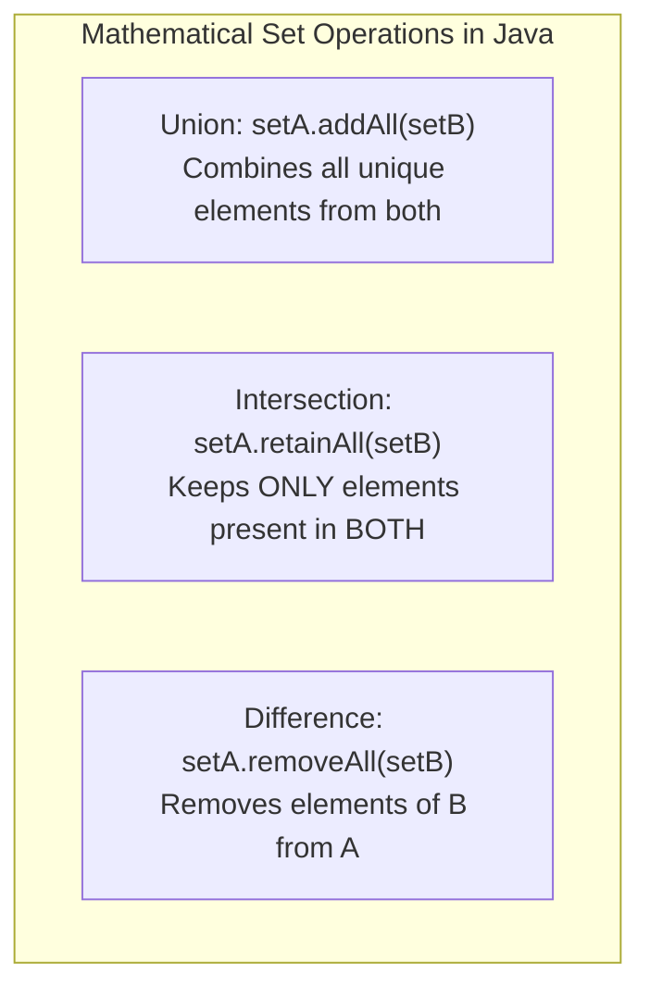

# Set Interface: HashSet, LinkedHashSet & Uniqueness Guarantees

> **Phase 4: Data Structures & Java Collections Framework**  
> *Estimated Reading Time: 40 minutes | Total Practice Effort: ~2.5 hours | Tier: Core Essential*

---

## 1. Purpose & Prerequisites

### Why This Matters in Full Stack Development
In many enterprise application domains, duplicate records are unacceptable:
- A user cannot follow the same account twice.
- A role-based security system cannot assign duplicate permission strings (`ROLE_ADMIN`, `ROLE_ADMIN`) to the same token.
- An analytics pipeline needs to count distinct visitors by IP address.

The **`Set`** interface models mathematical set theory: a collection that guarantees **no duplicate elements**. Understanding the trade-offs between `HashSet`, `LinkedHashSet`, and `TreeSet` allows you to enforce uniqueness, maintain ordering, or sort data efficiently.

### Prerequisites
- [Topic 3.8: The Object Contract: equals(), hashCode() & Identity vs Equality](../03-core/08-equals-hashcode.md)
- [Topic 4.1: Collections Overview, Hierarchy & Big-O Complexity Primer](01-overview-big-o.md)

---

## 2. Plain-English Mental Model

```
[ HashSet ]                           [ LinkedHashSet ]                     [ TreeSet ]
"Items thrown into a grab bag"         "Items organized with a ribbon"       "Items sorted alphabetically"
- Fastest: O(1) instant lookup         - Predictable: Maintains exact         - Sorted: Red-Black tree
- Order is completely random!            INSERTION ORDER!                    - O(log N) lookup
```

---

## 3. The 3 Major Set Implementations

| Feature | `HashSet` | `LinkedHashSet` | `TreeSet` |
| :--- | :--- | :--- | :--- |
| **Ordering** | ❌ None (Unpredictable) | ✅ **Insertion Order** | ✅ **Sorted Natural Order** |
| **Internal Mechanism** | Backed by `HashMap` | `HashMap` + Doubly-linked list | Backed by Red-Black Tree (`TreeMap`) |
| **Time Complexity (Add/Find)**| **$O(1)$** | **$O(1)$** | **$O(\log N)$** |
| **Allows `null`?** | ✅ Yes (at most 1 `null`) | ✅ Yes (at most 1 `null`) | ❌ No (`NullPointerException` on comparison) |
| **Requires** | `equals()` & `hashCode()` | `equals()` & `hashCode()` | `Comparable` or `Comparator` |

---

## 4. Under the Hood: The `HashSet` Secret

How does `HashSet` implement set uniqueness? It doesn't write its own hash algorithm!  
In the OpenJDK source code, **`HashSet` is simply an internal wrapper around a `HashMap`**:

```java
// OpenJDK HashSet.java
public class HashSet<E> implements Set<E> {
    private transient HashMap<E, Object> map;

    // Dummy value paired with every key in the backing Map
    private static final Object PRESENT = new Object();

    public boolean add(E e) {
        return map.put(e, PRESENT) == null; // Relies on Map's key uniqueness!
    }

    public boolean contains(Object o) {
        return map.containsKey(o);
    }
}
```
Every time you call `set.add(email)`, Java inserts your element as the **key** in a `HashMap`, paired with a dummy placeholder object (`PRESENT`). Because a `HashMap` cannot have duplicate keys, uniqueness is guaranteed!

---

## 5. Mathematical Set Operations (Union, Intersection, Difference)

Java's `Set` interface includes bulk methods that mirror mathematical set theory:



---

## 6. Working Code Example: Social Network Mutual Friends

```java
// File: SetOperationsDemo.java
import java.util.*;

public class SetOperationsDemo {
    public static void main(String[] args) {
        // 1. HashSet vs LinkedHashSet vs TreeSet
        Set<String> hashSet = new HashSet<>(List.of("Zebra", "Apple", "Mango"));
        Set<String> linkedHashSet = new LinkedHashSet<>(List.of("Zebra", "Apple", "Mango"));
        Set<String> treeSet = new TreeSet<>(List.of("Zebra", "Apple", "Mango"));

        System.out.println("HashSet (Unordered):       " + hashSet);
        System.out.println("LinkedHashSet (Insertion): " + linkedHashSet);
        System.out.println("TreeSet (Natural Sort):    " + treeSet);

        // 2. Mathematical Set Operations: Finding Mutual Friends
        Set<String> aliceFriends = new HashSet<>(Set.of("Bob", "Charlie", "David", "Emma"));
        Set<String> johnFriends = new HashSet<>(Set.of("Charlie", "David", "Frank", "Grace"));

        // Intersection (retainAll): Mutual Friends
        Set<String> mutualFriends = new HashSet<>(aliceFriends);
        mutualFriends.retainAll(johnFriends);
        System.out.println("\nMutual Friends between Alice and John: " + mutualFriends);

        // Difference (removeAll): Friends Alice has that John doesn't
        Set<String> exclusiveToAlice = new HashSet<>(aliceFriends);
        exclusiveToAlice.removeAll(johnFriends);
        System.out.println("Exclusive to Alice: " + exclusiveToAlice);
    }
}
```

### Exact Output:
```text
HashSet (Unordered):       [Apple, Mango, Zebra]
LinkedHashSet (Insertion): [Zebra, Apple, Mango]
TreeSet (Natural Sort):    [Apple, Mango, Zebra]

Mutual Friends between Alice and John: [Charlie, David]
Exclusive to Alice: [Bob, Emma]
```

---

## 7. Common Rookie Mistakes & Compiler Traps

### Trap 1: Storing Non-Comparable Elements in a `TreeSet`
```java
class Customer { String name; }

Set<Customer> set = new TreeSet<>();
set.add(new Customer()); // CRASH: ClassCastException: Customer cannot be cast to Comparable!
```
**Fix:** `Customer` must implement `Comparable<Customer>` or you must provide a `Comparator` in the constructor: `new TreeSet<>(Comparator.comparing(c -> c.name))`.

### Trap 2: Mutating Objects Stored in a `HashSet`
If you modify an object's fields after adding it to a `HashSet`, its `hashCode` shifts. The object is now stuck in the wrong bucket, becoming impossible to remove or find! Always use immutable fields for hash set elements.

---

## 8. Guided Hands-On Exercise

### Challenge: Security Role Deduplication & Access Auditing
Create a program named `RoleSecurityAudit.java`:
1. Define two sets of permissions:
   - `adminPermissions`: `{"READ", "WRITE", "DELETE", "AUDIT"}`
   - `staffPermissions`: `{"READ", "WRITE", "SUPPORT"}`
2. Compute and print:
   - Total distinct permissions across both roles (Union via `addAll`).
   - Shared permissions common to both roles (Intersection via `retainAll`).
   - Unique administrative capabilities that staff cannot perform (Difference via `removeAll`).

<details>
<summary>💡 Hint: Cloning before mutating</summary>

Bulk methods like `retainAll` mutate the set in-place. Always clone first:
```java
Set<String> union = new LinkedHashSet<>(adminPermissions);
union.addAll(staffPermissions);
```
</details>

<details>
<summary>✅ Solution</summary>

```java
import java.util.LinkedHashSet;
import java.util.Set;

public class RoleSecurityAudit {
    public static void main(String[] args) {
        Set<String> adminPerms = Set.of("READ", "WRITE", "DELETE", "AUDIT");
        Set<String> staffPerms = Set.of("READ", "WRITE", "SUPPORT");

        // 1. Union: Total Distinct Capabilities
        Set<String> allDistinct = new LinkedHashSet<>(adminPerms);
        allDistinct.addAll(staffPerms);
        System.out.println("Union (All Distinct Permissions): " + allDistinct);

        // 2. Intersection: Common Permissions
        Set<String> common = new LinkedHashSet<>(adminPerms);
        common.retainAll(staffPerms);
        System.out.println("Intersection (Shared Permissions): " + common);

        // 3. Difference: Admin-Only Privileges
        Set<String> adminOnly = new LinkedHashSet<>(adminPerms);
        adminOnly.removeAll(staffPerms);
        System.out.println("Difference (Admin-Only Privileges): " + adminOnly);
    }
}
```

**Terminal Output:**
```text
Union (All Distinct Permissions): [READ, WRITE, DELETE, AUDIT, SUPPORT]
Intersection (Shared Permissions): [READ, WRITE]
Difference (Admin-Only Privileges): [DELETE, AUDIT]
```
</details>

---

## 9. Knowledge Check & Interview Defense

### Quick Quiz
1. **How does `HashSet` ensure uniqueness under the hood?**
   - [ ] A) It iterates through an internal array every time `add()` is called.
   - [x] B) It delegates to an internal `HashMap`, storing the element as the key and a dummy object as the value.
   - [ ] C) It uses a sorted binary tree.
   - [ ] D) By checking CPU thread IDs.

2. **Which Set implementation maintains elements in the exact order they were inserted?**
   - [ ] A) `HashSet`
   - [x] B) `LinkedHashSet`
   - [ ] C) `TreeSet`
   - [ ] D) `ConcurrentSkipListSet`

3. **What happens if you insert `null` into a `TreeSet` that relies on natural ordering?**
   - [ ] A) It is placed at index 0.
   - [ ] B) It is ignored silently.
   - [x] C) A runtime `NullPointerException` is thrown because `TreeSet` must call `compareTo()` to determine position.
   - [ ] D) The set is erased.

---

### Junior Developer Interview Q&A

#### Q: "What is the difference between HashSet, LinkedHashSet, and TreeSet, and when should you choose each?"
> **Model Answer:**  
> - **`HashSet`:** Best general-purpose choice. Backed by a hash table, it delivers $O(1)$ constant-time adds, removals, and lookups. However, iteration order is undefined and unpredictable.  
> - **`LinkedHashSet`:** Delivers $O(1)$ performance while maintaining a doubly-linked list across its hash buckets. It guarantees elements are returned in **exact insertion order**, making it ideal for predictable serialization or caches.  
> - **`TreeSet`:** Backed by a Red-Black balanced binary search tree. Operations run in $O(\log N)$ logarithmic time. It keeps elements **sorted** by natural ordering or a custom `Comparator`, making it ideal for range queries (e.g. `subSet`, `headSet`, `tailSet`)."

---

## 10. Mastery Checklist & Next Step

Before moving on, verify that you can:
- [ ] Explain how `HashSet` wraps an internal `HashMap`.
- [ ] Choose between `HashSet` (fastest), `LinkedHashSet` (insertion-ordered), and `TreeSet` (sorted).
- [ ] Perform mathematical set operations (`addAll`, `retainAll`, `removeAll`).
- [ ] Ensure objects placed in `TreeSet` implement `Comparable`.

👉 **Next Lesson:** **[Topic 4.5: Map Interface: HashMap Fundamentals & Key-Value Usage](05-hashmap-basics.md)**
