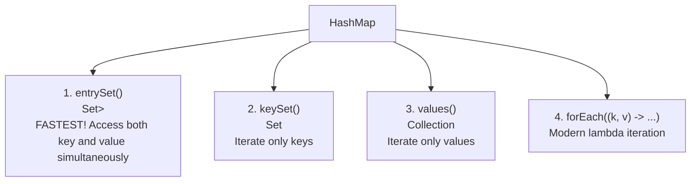

# Map Interface: HashMap Fundamentals & Key-Value Usage

> **Phase 4: Data Structures & Java Collections Framework**  
> *Estimated Reading Time: 45 minutes | Total Practice Effort: ~3.0 hours | Tier: Core Essential*

---

## 1. Purpose & Prerequisites

### Why This Matters in Full Stack Development
In modern web applications, data is almost always structured as Key-Value associations:
- An HTTP session mapping a `sessionId` (String) to an authenticated `UserProfile` object.
- A REST API JSON payload `{ "id": 101, "email": "alex@store.com", "tier": "GOLD" }`.
- An in-memory cache indexing database entities by their primary key.

`java.util.HashMap` is the premier dictionary data structure in Java. It allows applications to store, look up, and update values in **instant $O(1)$ constant time** using an identifier key.

### Prerequisites
- [Topic 3.8: The Object Contract: equals(), hashCode() & Identity vs Equality](../03-core/08-equals-hashcode.md)
- [Topic 4.1: Collections Overview, Hierarchy & Big-O Complexity Primer](01-overview-big-o.md)

---

## 2. Plain-English Mental Model

Think of a `HashMap` like a wall of personal post office mailboxes:

```
[ Key: Apartment Number "A-102" ]  ---> ( Mailbox Slot ) ---> [ Value: Letter for Alice ]
[ Key: Apartment Number "B-304" ]  ---> ( Mailbox Slot ) ---> [ Value: Package for Bob ]
```

- **Keys must be unique:** There is only one mailbox slot labeled `"A-102"`. If you drop a new package into `"A-102"`, it replaces whatever was previously inside!
- **Values can be duplicate:** Both Alice and Bob could receive identical holiday greeting cards.
- **Instant Retrieval ($O(1)$):** The mail carrier doesn't search through thousands of letters; they walk directly to box `"A-102"` and pull out the contents.

---

## 3. Core Map Operations

```java
Map<String, Double> productPrices = new HashMap<>();

// 1. Insertion (put): Returns previous value if key already existed, or null if new
productPrices.put("LAPTOP-01", 1299.99);
productPrices.put("MOUSE-02", 29.99);

// 2. Retrieval (get): Returns null if key is not found
Double mousePrice = productPrices.get("MOUSE-02"); // 29.99

// 3. Safe Retrieval with Fallback (getOrDefault)
Double keyboardPrice = productPrices.getOrDefault("KEYBOARD-99", 0.0); // Returns 0.0!

// 4. Checking existence: Fast O(1) checks
boolean hasLaptop = productPrices.containsKey("LAPTOP-01"); // true

// 5. Conditional Insertion (putIfAbsent)
productPrices.putIfAbsent("MOUSE-02", 49.99); // Ignored because MOUSE-02 already exists!
```

---

## 4. Modern Functional Map Methods: `computeIfAbsent`

In real-world backend services, building maps with nested lists (e.g. `Map<String, List<Order>>`) used to require clumsy null checks:

```java
// Pre-Java 8 Way: Clunky
List<Order> list = customerOrders.get(customerId);
if (list == null) {
    list = new ArrayList<>();
    customerOrders.put(customerId, list);
}
list.add(newOrder);

// Modern Java 8 Way: Single expressive atomic line!
customerOrders.computeIfAbsent(customerId, k -> new ArrayList<>()).add(newOrder);
```
`computeIfAbsent` checks if the key exists: if absent, it runs the mapping lambda, puts the resulting list into the map, and returns it immediately for chaining!

---

## 5. How to Iterate Over a Map: The 4 Patterns



### Pattern 1: `entrySet()` (Industry Best Practice)
```java
for (Map.Entry<String, Double> entry : productPrices.entrySet()) {
    System.out.println("SKU: " + entry.getKey() + " -> Price: $" + entry.getValue());
}
```

### Pattern 2: Java 8 `forEach`
```java
productPrices.forEach((sku, price) -> {
    System.out.println("SKU: " + sku + " costs $" + price);
});
```

---

## 6. Working Code Example: User Session Registry

```java
// File: UserSessionRegistryDemo.java
import java.util.HashMap;
import java.util.Map;

class UserSession {
    private final String userId;
    private final String role;
    private long lastActiveEpochMs;

    public UserSession(String userId, String role) {
        this.userId = userId;
        this.role = role;
        this.lastActiveEpochMs = System.currentTimeMillis();
    }

    public String getUserId() { return userId; }
    public String getRole() { return role; }
    public void touch() { this.lastActiveEpochMs = System.currentTimeMillis(); }

    @Override
    public String toString() {
        return "Session[" + userId + " (" + role + ")]";
    }
}

public class UserSessionRegistryDemo {
    public static void main(String[] args) {
        // Map associating Session Tokens to UserSession objects
        Map<String, UserSession> sessionRegistry = new HashMap<>();

        // 1. User Logins
        sessionRegistry.put("token-alpha-101", new UserSession("USR-1", "ADMIN"));
        sessionRegistry.put("token-beta-202", new UserSession("USR-2", "CUSTOMER"));

        // 2. Authenticating incoming API Request
        String incomingToken = "token-alpha-101";
        if (sessionRegistry.containsKey(incomingToken)) {
            UserSession session = sessionRegistry.get(incomingToken);
            session.touch();
            System.out.println("Authentication Success! Active User: " + session);
        } else {
            System.out.println("HTTP 401 Unauthorized: Invalid session token.");
        }

        // 3. Iterating Active Sessions via entrySet()
        System.out.println("\n--- Current Active System Sessions ---");
        for (Map.Entry<String, UserSession> entry : sessionRegistry.entrySet()) {
            System.out.println("Token: " + entry.getKey() + " => " + entry.getValue());
        }
    }
}
```

### Exact Output:
```text
Authentication Success! Active User: Session[USR-1 (ADMIN)]

--- Current Active System Sessions ---
Token: token-beta-202 => Session[USR-2 (CUSTOMER)]
Token: token-alpha-101 => Session[USR-1 (ADMIN)]
```

---

## 7. Common Rookie Mistakes & Traps

### Trap 1: The "Double Lookup" Anti-Pattern
```java
// ANTI-PATTERN: Slow double lookup!
for (String key : map.keySet()) {
    Double value = map.get(key); // Performs a second redundant hash lookup on every iteration!
}
```
> [!TIP]
> Always use `map.entrySet()`. It yields both key and value in a single traversal pass with zero redundant hashing.

### Trap 2: Unboxing a `null` Value
```java
Map<String, Integer> scores = new HashMap<>();
// Key "Bob" does not exist -> map.get("Bob") returns null!
int score = scores.get("Bob"); // CRASH: java.lang.NullPointerException!
```
**Fix:** Use `scores.getOrDefault("Bob", 0)` to guarantee a non-null primitive.

---

## 8. Guided Hands-On Exercise

### Challenge: API Endpoint Telemetry Counter
Create a program named `ApiHitCounterDemo.java`:
1. Initialize a `Map<String, Integer> endpointHits = new HashMap<>();`
2. Simulate a stream of incoming web requests:
   `{"/api/v1/users", "/api/v1/orders", "/api/v1/users", "/api/v1/login", "/api/v1/users"}`
3. For each route, update its request count using `getOrDefault(route, 0) + 1` or `merge(route, 1, Integer::sum)`.
4. Print the final frequency table.

<details>
<summary>💡 Hint: getOrDefault counter</summary>

```java
endpointHits.put(route, endpointHits.getOrDefault(route, 0) + 1);
```
</details>

<details>
<summary>✅ Solution</summary>

```java
import java.util.HashMap;
import java.util.Map;

public class ApiHitCounterDemo {
    public static void main(String[] args) {
        String[] incomingRequests = {
            "/api/v1/users",
            "/api/v1/orders",
            "/api/v1/users",
            "/api/v1/login",
            "/api/v1/users"
        };

        Map<String, Integer> hitCounter = new HashMap<>();

        for (String route : incomingRequests) {
            hitCounter.put(route, hitCounter.getOrDefault(route, 0) + 1);
        }

        System.out.println("=== API Gateway Traffic Telemetry ===");
        hitCounter.forEach((route, hits) -> {
            System.out.printf("%-20s : %d hits%n", route, hits);
        });
    }
}
```

**Terminal Output:**
```text
=== API Gateway Traffic Telemetry ===
/api/v1/orders       : 1 hits
/api/v1/login        : 1 hits
/api/v1/users        : 3 hits
```
</details>

---

## 9. Knowledge Check & Interview Defense

### Quick Quiz
1. **What does `map.put(key, value)` return if the key already existed in the HashMap?**
   - [ ] A) `null`
   - [x] B) The previous value associated with the key.
   - [ ] C) `true`
   - [ ] D) The new value.

2. **Why is `map.entrySet()` preferred over `map.keySet()` when iterating over both keys and values?**
   - [x] A) `entrySet()` provides direct access to both key and value in each entry, eliminating expensive redundant `map.get(key)` hash lookups.
   - [ ] B) `keySet()` is deprecated in Java 17.
   - [ ] C) `entrySet()` runs in a separate thread.
   - [ ] D) `keySet()` creates an array.

3. **Does `HashMap` permit `null` keys in Java?**
   - [x] A) Yes, `HashMap` permits exactly one `null` key, which is always stored in bucket 0.
   - [ ] B) No, any `null` key throws `NullPointerException`.
   - [ ] C) Yes, unlimited `null` keys are allowed.
   - [ ] D) Only if configured in the constructor.

---

### Junior Developer Interview Q&A

#### Q: "What is the difference between `putIfAbsent()` and `computeIfAbsent()` in Java HashMap?"
> **Model Answer:**  
> "Both methods ensure a value is inserted only if the key is not currently mapped:  
> - **`putIfAbsent(K key, V value)`:** The value object must be instantiated **eagerly**, even if the key already exists and the value is ultimately discarded. (e.g. `map.putIfAbsent(key, new ExpensiveService())` always instantiates `ExpensiveService`).  
> - **`computeIfAbsent(K key, Function mappingFunction)`:** The mapping function is evaluated **lazily**. The lambda only executes if the key is truly absent. This prevents unnecessary memory allocation and expensive computations when mapping keys to new lists or database entities."

---

## 10. Mastery Checklist & Next Step

Before moving on, verify that you can:
- [ ] Use `put`, `get`, `getOrDefault`, and `containsKey` effectively.
- [ ] Iterate maps without performance penalties using `entrySet()`.
- [ ] Group nested collections cleanly using `computeIfAbsent()`.
- [ ] Explain how `null` keys are handled by `HashMap`.

👉 **Next Lesson:** **[Topic 4.6: HashMap Deep Dive: Buckets, Collisions & Treeification [ADVANCED]](06-hashmap-internals.md)**
