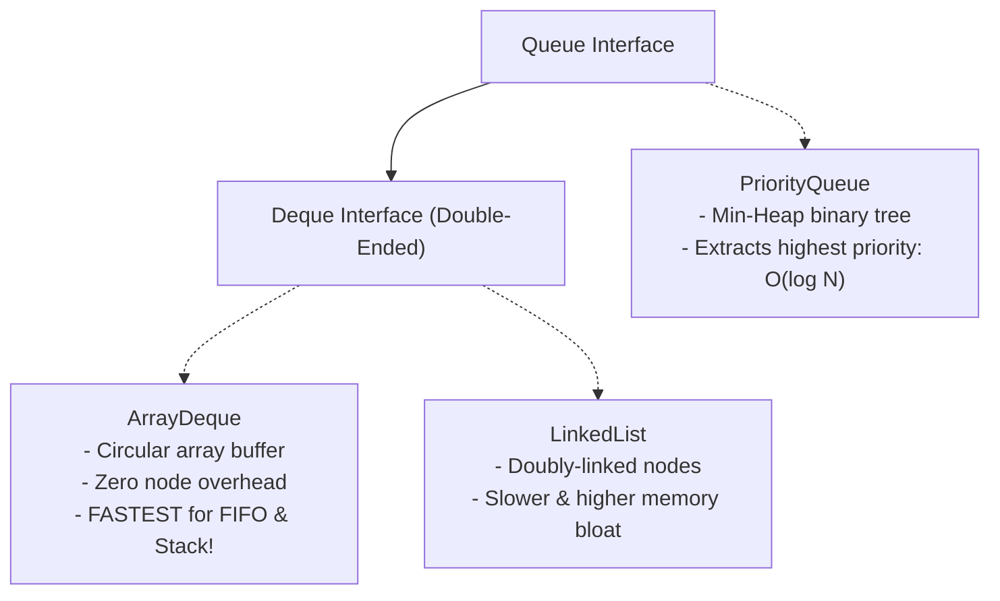

# Queue & Deque: FIFO Processing, ArrayDeque & PriorityQueue

> **Phase 4: Data Structures & Java Collections Framework**  
> *Estimated Reading Time: 45 minutes | Total Practice Effort: ~3.5 hours | Tier: Core Essential*

---

## 1. Purpose & Prerequisites

### Why This Matters in Full Stack Development
In real-world backend architectures, asynchronous workloads are everywhere:
- A web server queuing incoming image upload jobs for background workers.
- RabbitMQ or Kafka message consumers buffering order events before database insertion.
- An urgent notification dispatcher processing high-priority security alerts before standard marketing emails.

The **`Queue`** and **`Deque`** interfaces model sequential data pipelines. Understanding how to use **`ArrayDeque`** for high-throughput First-In-First-Out (FIFO) pipelines—and **`PriorityQueue`** for heap-ordered priority scheduling—is essential for building responsive, scalable backends.

### Prerequisites
- [Topic 4.1: Collections Overview, Hierarchy & Big-O Complexity Primer](01-overview-big-o.md)
- [Topic 4.3: LinkedList vs ArrayList: Memory Overheads & Big-O Realities](03-linkedlist.md)

---

## 2. Plain-English Mental Model

```
[ Queue: Coffee Shop Line (FIFO) ]                  [ PriorityQueue: Hospital ER Triage ]
First person in line is served first!                Critically ill patients are treated first,
- Add to Tail: offer()                               regardless of when they arrived!
- Remove from Head: poll()                           - Backed by a Min-Heap (O(log N))
```

- **`Queue` (FIFO):** First-In, First-Out. Items exit in the exact chronological order they entered.
- **`Deque` (Double-Ended Queue):** Can add or remove elements from **both ends** (Head or Tail). Acts as both a FIFO queue and a LIFO stack.
- **`PriorityQueue`:** Items exit based on **priority** (natural sorting or custom `Comparator`), not arrival time.

---

## 3. The Two Sets of Queue Methods

When a queue operation cannot be performed immediately (e.g. reading from an empty queue), `Queue` provides two distinct sets of methods:

| Action | Throws Exception on Failure | Returns Special Value (`false` / `null`) |
| :--- | :--- | :--- |
| **Insert (Tail)** | `add(e)` &rarr; throws `IllegalStateException` | **`offer(e)` &rarr; returns `false` (Recommended!)** |
| **Remove (Head)** | `remove()` &rarr; throws `NoSuchElementException` | **`poll()` &rarr; returns `null` (Recommended!)** |
| **Examine (Head)** | `element()` &rarr; throws `NoSuchElementException`| **`peek()` &rarr; returns `null` (Recommended!)** |

> [!TIP] Production Rule
> In real-world software, **always prefer `offer()`, `poll()`, and `peek()`**. They allow your code to handle empty queues gracefully without crashing or catching exceptions.

---

## 4. The 3 Queue Implementations



### 1. `ArrayDeque` (The Modern Gold Standard)
An expandable circular array buffer. It does not allocate intermediate Node objects, making it **the fastest general-purpose Queue and LIFO Stack in the Java ecosystem**.  
*(Note: `ArrayDeque` is the official modern replacement for the obsolete legacy `java.util.Stack` class!)*

### 2. `PriorityQueue` (Heap-Ordered Triage)
Backed by an array-based **Min-Heap**:
- Finding and removing the highest priority item takes **$O(\log N)$**.
- Inspecting the top item (`peek()`) is **instant $O(1)$**.
- Elements must implement `Comparable` or you must provide a `Comparator`.

---

## 5. Working Code Example: FIFO Buffer & Priority Triage

```java
// File: QueueShowcaseDemo.java
import java.util.*;

// Priority Entity
class SupportTicket implements Comparable<SupportTicket> {
    private final String ticketId;
    private final int urgencyLevel; // 1 = Critical, 2 = Medium, 3 = Low

    public SupportTicket(String ticketId, int urgencyLevel) {
        this.ticketId = ticketId;
        this.urgencyLevel = urgencyLevel;
    }

    public int getUrgencyLevel() { return urgencyLevel; }

    @Override
    public int compareTo(SupportTicket other) {
        // Lower urgency number = Higher priority!
        return Integer.compare(this.urgencyLevel, other.urgencyLevel);
    }

    @Override
    public String toString() {
        return "[" + ticketId + " (Urgency: " + urgencyLevel + ")]";
    }
}

public class QueueShowcaseDemo {
    public static void main(String[] args) {
        // 1. ArrayDeque: High-Speed FIFO Job Processing
        Queue<String> backgroundJobs = new ArrayDeque<>();
        backgroundJobs.offer("JOB-101: Generate Invoice PDF");
        backgroundJobs.offer("JOB-102: Resize Avatar Image");
        backgroundJobs.offer("JOB-103: Dispatch Welcome SMS");

        System.out.println("=== 1. FIFO Background Worker (ArrayDeque) ===");
        while (!backgroundJobs.isEmpty()) {
            System.out.println("Processing: " + backgroundJobs.poll());
        }

        // 2. PriorityQueue: Hospital/Support Ticket Triage
        Queue<SupportTicket> triageQueue = new PriorityQueue<>();
        triageQueue.offer(new SupportTicket("TICK-LOW-1", 3));
        triageQueue.offer(new SupportTicket("TICK-CRITICAL-2", 1)); // Arrived second!
        triageQueue.offer(new SupportTicket("TICK-MEDIUM-3", 2));

        System.out.println("\n=== 2. Emergency Triage (PriorityQueue) ===");
        // Even though TICK-CRITICAL-2 arrived second, it is polled FIRST!
        while (!triageQueue.isEmpty()) {
            System.out.println("Assigned Engineer to: " + triageQueue.poll());
        }
    }
}
```

### Exact Output:
```text
=== 1. FIFO Background Worker (ArrayDeque) ===
Processing: JOB-101: Generate Invoice PDF
Processing: JOB-102: Resize Avatar Image
Processing: JOB-103: Dispatch Welcome SMS

=== 2. Emergency Triage (PriorityQueue) ===
Assigned Engineer to: [TICK-CRITICAL-2 (Urgency: 1)]
Assigned Engineer to: [TICK-MEDIUM-3 (Urgency: 2)]
Assigned Engineer to: [TICK-LOW-1 (Urgency: 3)]
```

---

## 6. Common Rookie Mistakes & Traps

### Trap 1: Using the Obsolete `java.util.Stack` Class
```java
Stack<String> stack = new Stack<>(); // ANTI-PATTERN!
```
> [!WARNING] Legacy Warning
> `java.util.Stack` was created in Java 1.0. It extends `Vector` and synchronizes every single operation, creating heavy lock overhead.  
> **Always use `Deque<String> stack = new ArrayDeque<>()` instead.** It implements `push()`, `pop()`, and `peek()` with superior performance and zero lock contention.

### Trap 2: Believing `PriorityQueue.toString()` is Sorted
```java
PriorityQueue<Integer> pq = new PriorityQueue<>(List.of(50, 10, 30, 5));
System.out.println(pq); // Prints internal heap array layout: [5, 10, 30, 50] (NOT necessarily sorted!)
```
A heap guarantees that the **root** element (`pq.peek()`) is the minimum, but its internal array is not fully sorted. Only sequential calls to `.poll()` yield elements in true priority order.

---

## 7. Guided Hands-On Exercise

### Challenge: VIP Banking Queue Simulator
Create a program named `BankQueueSimulator.java`:
1. Class `BankCustomer`:
   - Fields: `name` (`String`), `isVip` (`boolean`), `arrivalTimeEpoch` (`long`).
2. Construct a `PriorityQueue<BankCustomer>` with a custom `Comparator`:
   - VIP customers must be serviced before non-VIP customers.
   - If two customers have the same VIP status, the customer who arrived earlier (`arrivalTimeEpoch`) is serviced first.
3. In `main`:
   - Add 3 customers:
     - Alice (Non-VIP, arrived at 100)
     - Bob (Non-VIP, arrived at 105)
     - Charlie (VIP, arrived at 110 - arrived last!)
   - Poll and print all customers to verify Charlie is serviced first, followed by Alice, then Bob.

<details>
<summary>💡 Hint: Comparator logic</summary>

```java
Comparator<BankCustomer> comp = Comparator
    .comparing(BankCustomer::isVip).reversed()
    .thenComparingLong(BankCustomer::getArrivalTimeEpoch);
```
</details>

<details>
<summary>✅ Solution</summary>

```java
import java.util.Comparator;
import java.util.PriorityQueue;
import java.util.Queue;

class BankCustomer {
    private final String name;
    private final boolean vip;
    private final long arrivalTime;

    public BankCustomer(String name, boolean vip, long arrivalTime) {
        this.name = name;
        this.vip = vip;
        this.arrivalTime = arrivalTime;
    }

    public String getName() { return name; }
    public boolean isVip() { return vip; }
    public long getArrivalTime() { return arrivalTime; }

    @Override
    public String toString() {
        return name + " (VIP: " + vip + ", Arrival: " + arrivalTime + ")";
    }
}

public class BankQueueSimulator {
    public static void main(String[] args) {
        // Custom Comparator: VIPs first (reversed boolean), then earlier arrival time
        Comparator<BankCustomer> priorityOrder = Comparator
            .comparing(BankCustomer::isVip).reversed()
            .thenComparingLong(BankCustomer::getArrivalTime);

        Queue<BankCustomer> tellerLine = new PriorityQueue<>(priorityOrder);

        tellerLine.offer(new BankCustomer("Alice", false, 100));
        tellerLine.offer(new BankCustomer("Bob", false, 105));
        tellerLine.offer(new BankCustomer("Charlie", true, 110)); // Arrived last, but VIP!

        System.out.println("=== Bank Teller Service Order ===");
        int position = 1;
        while (!tellerLine.isEmpty()) {
            System.out.println("Serving #" + (position++) + ": " + tellerLine.poll());
        }
    }
}
```

**Terminal Output:**
```text
=== Bank Teller Service Order ===
Serving #1: Charlie (VIP: true, Arrival: 110)
Serving #2: Alice (VIP: false, Arrival: 100)
Serving #3: Bob (VIP: false, Arrival: 105)
```
</details>

---

## 8. Knowledge Check & Interview Defense

### Quick Quiz
1. **What is the difference between `queue.poll()` and `queue.remove()` when the queue is empty?**
   - [ ] A) `poll()` throws an exception; `remove()` returns null.
   - [x] B) `poll()` returns `null` safely; `remove()` throws `NoSuchElementException`.
   - [ ] C) There is no difference.
   - [ ] D) `poll()` pauses execution.

2. **Why is `ArrayDeque` preferred over `java.util.Stack` when implementing a LIFO stack in Java?**
   - [x] A) `ArrayDeque` is unsynchronized and faster, avoids the memory overhead of Vector inheritance, and conforms to the modern `Deque` interface.
   - [ ] B) `Stack` only holds integers.
   - [ ] C) `ArrayDeque` is saved to disk automatically.
   - [ ] D) `Stack` is deprecated in Java 21.

3. **What underlying data structure powers `java.util.PriorityQueue`?**
   - [ ] A) A sorted linked list
   - [x] B) A binary Min-Heap implemented in an array
   - [ ] C) A red-black tree
   - [ ] D) A hash table

---

### Junior Developer Interview Q&A

#### Q: "What is an ArrayDeque, and why is it generally superior to LinkedList for queue and stack implementations?"
> **Model Answer:**  
> "An **`ArrayDeque`** (Array Double-Ended Queue) is a resizable, circular array buffer implementation of the `Deque` interface.  
> 
> It is superior to `LinkedList` for three main reasons:
> 1. **Zero Node Overhead:** `ArrayDeque` stores references directly inside an internal array. `LinkedList` allocates a separate `Node` object with next/previous pointers for every element, wasting memory.
> 2. **Hardware Cache Locality:** Because elements live in contiguous memory, CPU hardware prefetchers load queue elements into CPU L1/L2 caches, resulting in significantly faster throughput.
> 3. **Garbage Collection:** Removing elements from `ArrayDeque` simply increments an array head/tail pointer without generating discarded `Node` objects for the garbage collector to reclaim."

---

## 9. Mastery Checklist & Next Step

Before moving on, verify that you can:
- [ ] Use `offer()`, `poll()`, and `peek()` for graceful, exception-free queue handling.
- [ ] Implement FIFO queues and LIFO stacks using `ArrayDeque`.
- [ ] Configure `PriorityQueue` with natural ordering (`Comparable`) or custom `Comparator`s.
- [ ] Explain why `java.util.Stack` and `LinkedList` are legacy or sub-optimal choices.

👉 **Next Lesson:** **[Topic 4.8: Sorting Objects: Comparable vs Custom Comparator](08-sorting.md)**
