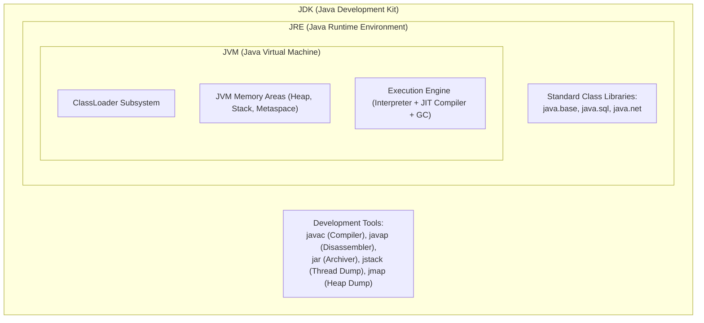
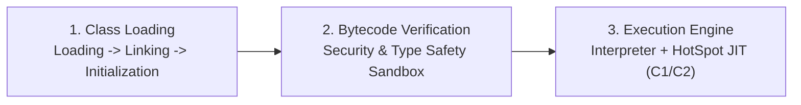

# JDK vs JRE vs JVM & The Bytecode Execution Lifecycle

> **Phase 5: Under the Hood: JVM Architecture & Memory Mechanics**  
> *Estimated Reading Time: 35 minutes | Total Practice Effort: ~2.0 hours | Tier: Core Essential*

---

## 1. Purpose & Prerequisites

### Why This Matters in Full Stack Development
Any programmer can write code that the compiler accepts. But when a production cloud microservice slows down under load, consumes 8GB of RAM, or stalls during garbage collection, surface-level syntax knowledge is useless.

To diagnose performance bottlenecks, optimize startup latency, and configure cloud container memory limits, you must understand the **Java Virtual Machine (JVM)**. In this phase, we look under the hood to see how human-readable Java code becomes binary bytecode, how the **HotSpot JIT compiler** transforms hot loops into native CPU machine code, and how memory is allocated across threads.

### Prerequisites
- [Phase 1: Java Programming Foundations](../01-foundations/01-setup-anatomy.md)
- [Phase 2: OOP & Class Design](../02-oop/01-classes-objects.md)

---

## 2. Plain-English Mental Model

Think of the Java platform like an international cinema production:

```
[ JDK: The Complete Movie Studio ]
- Cameras, editing software, directors, lighting (javac, jdb, jstack, jmap)
- Contains everything needed to BUILD the film!
                 |
                 v
[ JRE: The Movie Theater Facility ]
- Projector room, concession stand, seating, power grid (Class Libraries + JVM)
- Contains everything needed to SHOW the film to customers!
                 |
                 v
[ JVM: The High-Definition Digital Projector Engine ]
- Takes the universal film reel (Bytecode .class) and translates it
  into real-time photons projected on screen (Host Native CPU instructions)!
```

---

## 3. The 3-Tier Java Architecture



1. **JVM (Java Virtual Machine):** The abstract computer that executes compiled bytecode on physical hardware. The JVM is OS-specific (there is a Windows JVM, a Linux JVM, and a macOS JVM).
2. **JRE (Java Runtime Environment):** Bundles the JVM with the core Java runtime libraries (`java.lang`, `java.util`). It is sufficient to *run* existing applications. (Note: Since Java 11, separate JRE downloads were deprecated in favor of modular runtime images via `jlink`).
3. **JDK (Java Development Kit):** The complete software development bundle containing the JRE, JVM, plus compilers (`javac`), debuggers, profilers, and bytecode tools.

---

## 4. The 3-Stage Bytecode Execution Lifecycle

When you launch `java Application`, the JVM boots through three discrete stages:



### Stage 1: Class Loading Subsystem
- **Loading:** Finds the binary `.class` file on disk or network via ClassLoaders (Bootstrap &rarr; Platform &rarr; Application).
- **Linking:**
  - *Verification:* Asserts bytecode follows JVM specifications and cannot corrupt the host OS memory.
  - *Preparation:* Allocates memory for static fields and initializes them to type defaults (`0`, `null`).
  - *Resolution:* Replaces symbolic references in the constant pool with direct memory addresses.
- **Initialization:** Executes static initialization blocks (`static { ... }`) and assigns real values to static fields.

### Stage 2: The Bytecode Verifier (Security Sandbox)
Guarantees that untrusted bytecode cannot:
- Cause operand stack overflows or underflows.
- Forge pointers or violate type safety (e.g. treating an integer as a memory address pointer).
- Bypass access modifiers (`private` fields).

### Stage 3: The Execution Engine & HotSpot JIT Compiler
The JVM uses a **hybrid execution strategy**:
1. **Interpreter:** Executes bytecode immediately line-by-line upon startup. Starts instantly with zero compilation delay.
2. **Tiered JIT (Just-In-Time) Compiler:** While the interpreter runs, the JVM monitors code execution using invocation counters. When a method or loop is called frequently (a **"HotSpot"**), the JIT compiler compiles that bytecode directly into **native CPU assembly language**:
   - **C1 (Client) Compiler:** Quickly compiles bytecode with lightweight optimizations.
   - **C2 (Server) Compiler:** Aggressively optimizes hot loops (inlining methods, loop unrolling, dead code elimination, escape analysis) to achieve execution speeds rivaling pure C++!

---

## 5. Reading Bytecode with `javap -c`

To see the universal assembly language generated by `javac`, use the JDK disassembler tool `javap`:

### Sample Java Method:
```java
public int calculateTotal(int price, int tax) {
    int total = price + tax;
    return total;
}
```

### Disassembled Bytecode (`javap -c`):
```text
Code:
   0: iload_1        // Push local variable 1 (price) onto the operand stack
   1: iload_2        // Push local variable 2 (tax) onto the operand stack
   2: iadd           // Pop both integers, add them, push sum back onto stack
   3: istore_3       // Pop sum from stack and store into local variable 3 (total)
   4: iload_3        // Push local variable 3 (total) onto stack
   5: ireturn        // Return integer at top of stack to caller
```

---

## 6. Working Code Example: Observing HotSpot Optimization

```java
// File: HotSpotBenchmarkDemo.java
public class HotSpotBenchmarkDemo {
    public static void main(String[] args) {
        System.out.println("=== HotSpot JIT Tiered Compilation Demonstration ===");

        // Warmup phase: Running method repeatedly to trigger C2 compilation
        for (int i = 0; i < 5; i++) {
            long start = System.nanoTime();
            long sum = computeHeavyLoop(10_000_000);
            long elapsedUs = (System.nanoTime() - start) / 1000;
            System.out.println("Batch #" + (i + 1) + " Execution: " + elapsedUs + " microseconds (Sum: " + sum + ")");
        }
    }

    public static long computeHeavyLoop(int iterations) {
        long total = 0;
        for (int i = 0; i < iterations; i++) {
            total += (i % 2 == 0) ? i : -i;
        }
        return total;
    }
}
```

### Exact Output (Representative):
```text
=== HotSpot JIT Tiered Compilation Demonstration ===
Batch #1 Execution: 18450 microseconds (Sum: 0)
Batch #2 Execution: 9210 microseconds (Sum: 0)
Batch #3 Execution: 3840 microseconds (Sum: 0)  <-- HotSpot C1 kicks in!
Batch #4 Execution: 1120 microseconds (Sum: 0)  <-- HotSpot C2 compiles to native assembly!
Batch #5 Execution: 1105 microseconds (Sum: 0)
```
*Notice how the execution time drops by over 16x as the HotSpot JIT compiles the hot loop into optimized CPU native code!*

---

## 7. Common Rookie Mistakes & Misconceptions

### Misconception: "Java is an Interpreted Language"
Java is **neither purely compiled nor purely interpreted**. It is a **hybrid system**:
- Source code is statically compiled into bytecode by `javac`.
- Bytecode is interpreted upon JVM boot.
- Hot code is dynamically compiled into native machine code by the HotSpot JIT compiler at runtime.

---

## 8. Guided Hands-On Exercise

### Challenge: Operand Stack Bytecode Tracer
Trace how the JVM operand stack changes during this sequence of bytecode instructions:
```text
0: bipush 10
2: bipush 20
4: iadd
5: bipush 2
7: imul
8: ireturn
```
1. Draw the step-by-step operand stack changes.
2. Determine the final returned integer value.

<details>
<summary>💡 Hint: Stack Operations</summary>

- `bipush 10`: Stack contains `[10]`
- `bipush 20`: Stack contains `[20, 10]`
- `iadd`: Pops 20 and 10, computes `10 + 20 = 30`, pushes `[30]`
- `bipush 2`: Stack contains `[2, 30]`
- `imul`: Pops 2 and 30, computes `30 * 2 = 60`, pushes `[60]`
- `ireturn`: Returns `60`
</details>

---

## 9. Knowledge Check & Interview Defense

### Quick Quiz
1. **What is the role of the HotSpot JIT (Just-In-Time) compiler in the JVM?**
   - [ ] A) It checks syntax errors in `.java` files.
   - [x] B) It identifies frequently executed bytecode loops ('hotspots') and compiles them into optimized native host machine code at runtime.
   - [ ] C) It deletes unused classes from disk.
   - [ ] D) It formats JSON files.

2. **Which component of the ClassLoader subsystem verifies that bytecode adheres to JVM safety and stack constraints?**
   - [ ] A) The Interpreter
   - [ ] B) The JRE
   - [x] C) The Bytecode Verifier
   - [ ] D) The Garbage Collector

3. **Can compiled Java bytecode (.class) compiled on Windows run on a Linux server without modification?**
   - [x] A) Yes. Java bytecode is architecture-neutral; the Linux JVM translates that bytecode into Linux-specific CPU machine instructions.
   - [ ] B) No, code must be recompiled with Linux flags.
   - [ ] C) Only if the Linux machine has Visual Studio installed.
   - [ ] D) Only in Java 21+.

---

### Junior Developer Interview Q&A

#### Q: "What is Tiered Compilation in the Java HotSpot JVM?"
> **Model Answer:**  
> "Tiered Compilation (enabled by default since Java 8) combines the benefits of fast startup time with peak long-term execution throughput.  
> 
> It organizes execution across tiers:
> 1. **Tier 0 (Interpreter):** Code executes immediately with zero compilation pause.
> 2. **Tiers 1–3 (C1 Client Compiler):** As methods are called frequently, the C1 compiler compiles bytecode into simple native code with minimal profiling, optimizing execution speed quickly.
> 3. **Tier 4 (C2 Server Compiler):** For methods that run continuously (hot loops), the C2 compiler collects runtime profiling data (such as branch probabilities and type profiles) and generates heavily optimized, vector-accelerated native machine code.  
> 
> This provides the best of both worlds: fast application boot time paired with maximal steady-state performance for long-running enterprise servers."

---

## 10. Mastery Checklist & Next Step

Before moving on, verify that you can:
- [ ] Differentiate between the JDK development suite, JRE runtime, and JVM execution engine.
- [ ] Trace the ClassLoader lifecycle (Loading, Linking, Initialization).
- [ ] Understand how the HotSpot JIT compiler optimizes hot loops via Tiered Compilation (C1/C2).
- [ ] Inspect disassembled bytecode instructions using `javap -c`.

👉 **Next Lesson:** **[Topic 5.2: JVM Memory Architecture: Stack Frames, Heap & Metaspace](02-memory-model.md)**
