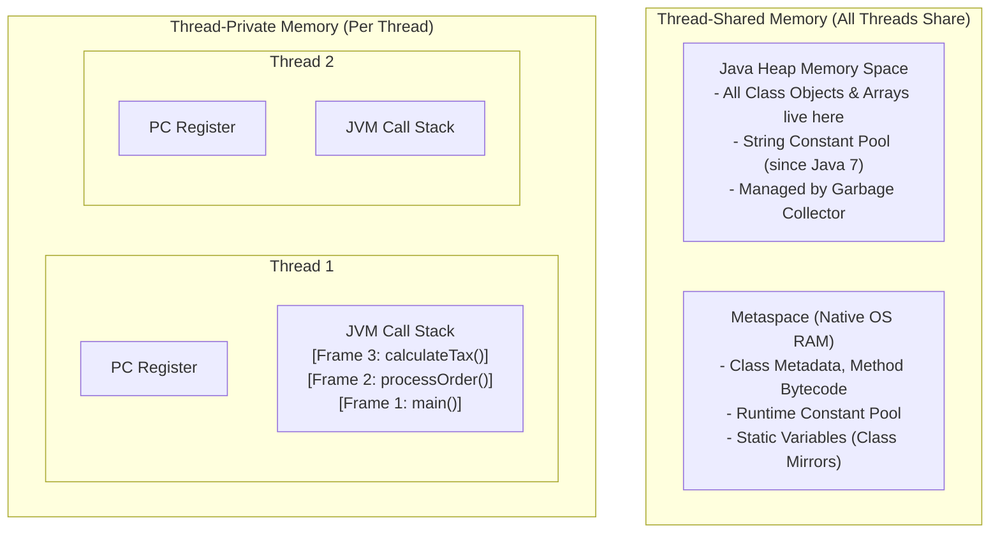

# JVM Memory Architecture: Stack Frames, Heap & Metaspace

> **Phase 5: Under the Hood: JVM Architecture & Memory Mechanics**  
> *Estimated Reading Time: 50 minutes | Total Practice Effort: ~3.5 hours | Tier: Core Essential*

---

## 1. Purpose & Prerequisites

### Why This Matters in Full Stack Development
When your Java backend application boots up inside a cloud Docker container, how does the JVM partition physical RAM?  
- *Why is accessing a local variable on the stack faster than following an object pointer on the heap?*
- *What is the difference between `StackOverflowError` and `OutOfMemoryError: Java heap space`?*
- *Where did PermGen go, and what is native Metaspace?*

Understanding the JVM's Runtime Data Areas allows you to tune cloud container resource limits (`-Xmx`, `-Xms`, `-Xss`), prevent fatal memory exhaustion crashes, and write memory-efficient backend microservices.

### Prerequisites
- [Topic 2.1: Classes, Objects & The new Instantiation Lifecycle](../02-oop/01-classes-objects.md)
- [Topic 5.1: JDK vs JRE vs JVM & The Bytecode Execution Lifecycle](01-jdk-jre-jvm.md)

---

## 2. Plain-English Mental Model

Think of JVM memory like a busy corporate office building:

```
[ Thread-Private Workspaces (One per Employee / Thread) ]
- Personal Desk Notepad (The Call Stack): Holds temporary math scratchpad
  and private local notes for the active task. Nobody else can see it.

[ The Shared Corporate Warehouse (The Java Heap) ]
- Massive shared storage floor where all physical furniture, file boxes,
  and manufactured products (Objects & Arrays) are stored.

[ The Building Blueprint Archive (Metaspace in Native RAM) ]
- Architectural drawings, employment manuals, and class structural definitions.
```

---

## 3. The JVM Runtime Data Areas



---

## 4. Deep Dive: Anatomy of a Stack Frame

Every time a thread invokes a method, the JVM pushes a **Stack Frame** onto that thread's Call Stack. When the method completes, the frame is popped and discarded.

A Stack Frame contains three internal zones:

```
+---------------------------------------------------------------+
| STACK FRAME (e.g. for method: calculateTax(double subtotal))   |
+---------------------------------------------------------------+
| 1. Local Variable Table (LVT)                                 |
|    Slot 0: this (reference to calling object)                 |
|    Slot 1: subtotal (double parameter)                        |
|    Slot 2: taxRate (local variable)                           |
+---------------------------------------------------------------+
| 2. Operand Stack (LIFO calculation workbench)                |
|    Pushes numbers, executes bytecode ops (iadd, dmul), pops   |
+---------------------------------------------------------------+
| 3. Frame Data & Dynamic Linking                               |
|    Reference to Runtime Constant Pool, method return address, |
|    and exception dispatch table                               |
+---------------------------------------------------------------+
```

---

## 5. Architectural Comparison: Stack vs Heap vs Metaspace

| Dimension | JVM Call Stack | Java Heap | Metaspace |
| :--- | :--- | :--- | :--- |
| **Shared Across Threads?**| ❌ No (Thread-Private) | ✅ Yes (Thread-Shared) | ✅ Yes (Thread-Shared) |
| **What Lives Here?** | Primitive local variables, reference pointers, stack frames | All instantiated **Objects**, arrays, and their instance fields | Class structures, method bytecode, annotations |
| **Memory Allocation** | Continuous contiguous push/pop | Dynamic dynamic heap blocks | Native OS memory (off-heap) |
| **Access Speed** | **Fastest** (CPU stack pointer) | Fast (via reference pointers) | Moderate |
| **Thread Safety** | ✅ Inherently thread-safe | ❌ Requires synchronization | ✅ Managed by ClassLoader |
| **Crash Error** | **`StackOverflowError`** | **`OutOfMemoryError: Java heap space`** | **`OutOfMemoryError: Metaspace`** |
| **Tuning Flag** | `-Xss` (e.g. `-Xss1m`) | `-Xms` (min) / `-Xmx` (max) | `-XX:MaxMetaspaceSize` |

---

## 6. Crucial Trap: Where do Primitive Fields of an Object Live?

> [!WARNING] The Great Primitive Location Trap
> - A primitive declared **inside a method** (e.g. `int localAge = 25;`) lives on the **Call Stack** inside that method's stack frame.
> - A primitive declared as an **instance variable of a Class** (e.g. `public class User { int age = 25; }`) lives on the **HEAP inside the User object**!  
> 
> *The rule is simple:* **All contents of an object live on the Heap.**

---

## 7. Working Code Example: Triggering StackOverflow vs Heap OOM

```java
// File: MemoryCrashDemo.java
import java.util.ArrayList;
import java.util.List;

public class MemoryCrashDemo {
    public static void main(String[] args) {
        if (args.length == 0) {
            System.out.println("Pass argument 'stack' or 'heap' to trigger specific error.");
            return;
        }

        if ("stack".equalsIgnoreCase(args[0])) {
            triggerStackOverflow(1);
        } else if ("heap".equalsIgnoreCase(args[0])) {
            triggerHeapOOM();
        }
    }

    // 1. Trigger StackOverflowError: Unbounded recursive method frames blow the stack
    public static void triggerStackOverflow(int depth) {
        triggerStackOverflow(depth + 1); // No base case! Pushes frames until -Xss limit is hit!
    }

    // 2. Trigger OutOfMemoryError: Unbounded heap object allocation
    public static void triggerHeapOOM() {
        List<byte[]> memoryLeaker = new ArrayList<>();
        while (true) {
            // Continuously allocate 10MB byte arrays on the Heap
            memoryLeaker.add(new byte[10 * 1024 * 1024]);
        }
    }
}
```

### Exact Output When Executed:
```text
# With: java MemoryCrashDemo stack
Exception in thread "main" java.lang.StackOverflowError
    at MemoryCrashDemo.triggerStackOverflow(MemoryCrashDemo.java:19)
    at MemoryCrashDemo.triggerStackOverflow(MemoryCrashDemo.java:19)
    ...

# With: java -Xmx50m MemoryCrashDemo heap
Exception in thread "main" java.lang.OutOfMemoryError: Java heap space
    at MemoryCrashDemo.triggerHeapOOM(MemoryCrashDemo.java:26)
    at MemoryCrashDemo.main(MemoryCrashDemo.java:13)
```

---

## 8. Guided Hands-On Exercise: Memory Area Mapping

Given the following code snippet, identify the exact memory area (Stack, Heap, or Metaspace) for every marked item:

```java
public class CustomerService {
    public static int defaultTaxPercent = 10;           // Item A
    private String serviceId = "SRV-90";                // Item B

    public void processInvoice(double subtotal) {       // Item C
        int localMultiplier = 2;                        // Item D
        Order order = new Order("ORD-1", subtotal);     // Item E & F
    }
}
```

<details>
<summary>💡 Hint: Solutions</summary>

- **Item A (`defaultTaxPercent`):** Metaspace (Class mirror object holding static variable).
- **Item B (`serviceId` field):** Heap (Inside the `CustomerService` instance).
- **Item C (`subtotal` parameter):** Stack (Inside `processInvoice`'s Local Variable Table).
- **Item D (`localMultiplier`):** Stack (Inside `processInvoice`'s Local Variable Table).
- **Item E (`order` reference variable):** Stack (Pointer stored in local stack frame).
- **Item F (`new Order(...)` object):** Heap (The actual instantiated object payload).
</details>

---

## 9. Knowledge Check & Interview Defense

### Quick Quiz
1. **Where are local variables and method parameters stored in the JVM?**
   - [x] A) Inside the Local Variable Table (LVT) of the active method's Stack Frame on the thread's Call Stack.
   - [ ] B) In the shared Java Heap.
   - [ ] C) In native Metaspace.
   - [ ] D) In CPU ROM.

2. **What replaced the legacy PermGen (Permanent Generation) in Java 8, and where does it reside?**
   - [ ] A) Eden Space; in the Heap.
   - [x] B) Metaspace; in native operating system memory (off-heap).
   - [ ] C) The L1 Cache.
   - [ ] D) Virtual Memory Swap.

3. **What JVM flag is used to configure the maximum allowable Heap memory for an application?**
   - [ ] A) `-Xss`
   - [x] B) `-Xmx` (e.g. `-Xmx4g`)
   - [ ] C) `-Xms`
   - [ ] D) `-XX:ThreadLimit`

---

### Junior Developer Interview Q&A

#### Q: "What is the difference between a StackOverflowError and an OutOfMemoryError in Java?"
> **Model Answer:**  
> - **`StackOverflowError`:** Occurs on a **thread-private Call Stack** when the call tree depth exceeds the thread's allocated stack memory size (configured via `-Xss`, typically 1MB). This is almost always caused by uncontrolled or infinite recursion where new method frames are pushed continuously without returning.  
> - **`OutOfMemoryError (Java heap space)`:** Occurs on the **shared Java Heap** when the application attempts to allocate a new object or array, but the Heap has insufficient space and the Garbage Collector cannot reclaim enough memory to satisfy the allocation (configured via `-Xmx`). This is typically caused by memory leaks, retaining unused static collections, or loading massive database result sets into memory all at once."

---

## 10. Mastery Checklist & Next Step

Before moving on, verify that you can:
- [ ] Differentiate between thread-private (Stack, PC) and thread-shared (Heap, Metaspace) areas.
- [ ] Dissect a Stack Frame into its Local Variable Table, Operand Stack, and Frame Data.
- [ ] Correctly identify whether primitive variables reside on the Stack or Heap.
- [ ] Configure standard JVM memory flags (`-Xms`, `-Xmx`, `-Xss`, `-XX:MaxMetaspaceSize`).

👉 **Next Lesson:** **[Topic 5.3: Garbage Collection Basics: How the JVM Frees Memory](03-gc-basics.md)**
