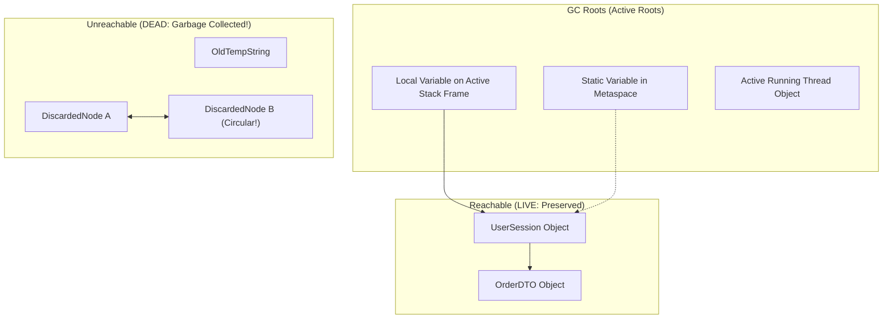
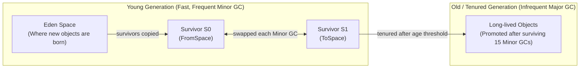

# Garbage Collection Basics: How the JVM Frees Memory

> **Phase 5: Under the Hood: JVM Architecture & Memory Mechanics**  
> *Estimated Reading Time: 45 minutes | Total Practice Effort: ~3.0 hours | Tier: Core Essential*

---

## 1. Purpose & Prerequisites

### Why This Matters in Full Stack Development
In languages like C and C++, developers must manually allocate (`malloc()`) and deallocate (`free()`) heap memory. Forgetting to free memory creates **memory leaks**; freeing memory too early causes **dangling pointers** and fatal application crashes.

Java eliminates manual memory management through the **Garbage Collector (GC)**—an automated daemon thread that tracks heap objects, identifies unused memory, and reclaims it for future allocations. Understanding how the GC distinguishes live data from garbage prevents unexpected latency spikes in production web APIs.

### Prerequisites
- [Topic 2.1: Classes, Objects & The new Instantiation Lifecycle](../02-oop/01-classes-objects.md)
- [Topic 5.2: JVM Memory Architecture: Stack Frames, Heap & Metaspace](02-memory-model.md)

---

## 2. Plain-English Mental Model

Think of the JVM Garbage Collector like an automated municipal recycling truck:

```
[ Active House with Inhabitants (Reachable Object via GC Root) ]
- The truck drives past. "This house is occupied. Do not touch!"

[ Abandoned House with Cut Power Lines (Unreachable Object) ]
- The truck inspects utility wires. Nobody is connected to it!
- Demolish the building and clear the land for new construction (Memory Reclaimed)!
```

An object is not considered "garbage" when you are done with it; it is garbage **when it is no longer reachable by any living thread in the JVM**.

---

## 3. How the JVM Identifies Garbage: GC Roots & Reachability

Historically, naive systems used **Reference Counting** (counting how many pointers point to an object). But reference counting fails catastrophically when Object A points to Object B, and Object B points back to Object A (a circular reference leak!).

Modern Java uses **Reachability Analysis via GC Roots**:



### What Qualifies as a GC Root?
1. **Local Variables on the Call Stack:** Variables and method arguments in active stack frames.
2. **Static Variables:** References held by loaded classes in Metaspace.
3. **Active Java Threads:** Running thread instances.
4. **JNI References:** Native C/C++ pointers in the native method stack.

If an object cannot be reached by following a chain of references starting from any GC Root, it is marked as garbage.

---

## 4. The Weak Generational Hypothesis

Decades of enterprise software profiling revealed an empirical truth: **The vast majority of objects die shortly after birth.**
- Temporary strings created during concatenation.
- DTOs and JSON buffers deserialized for a single HTTP request and immediately discarded.
- Loop index iterators.

Objects that *do* survive their initial seconds (like database connection pools or Spring singleton beans) tend to stay alive for the entire lifespan of the application.

---

## 5. The Generational Heap Layout

Based on the Generational Hypothesis, the JVM splits the Heap into two generations:



### The Life Cycle of an Object:
1. **Birth in Eden:** New objects are allocated in **Eden Space**.
2. **Minor GC:** When Eden fills up, a lightweight **Minor GC** pauses application threads briefly, cleans dead objects, and copies surviving objects into **Survivor Space (S0)** with an age counter of `1`.
3. **Survivor Ping-Pong:** On subsequent Minor GCs, surviving objects are copied back and forth between `S0` and `S1`, incrementing their age counter each time.
4. **Tenuring / Promotion:** When an object survives a designated number of collection cycles (default **15** in HotSpot, configured via `-XX:MaxTenuringThreshold`), it is promoted to the **Old (Tenured) Generation**.
5. **Major GC (Full GC):** Cleans the Old Generation. Because Old Gen is much larger, Full GCs take longer and can cause visible application pauses.

---

## 6. The 3 Foundational GC Algorithms

| Algorithm | How It Works | Strengths | Weaknesses |
| :--- | :--- | :--- | :--- |
| **Mark-and-Sweep** | 1. Traverses GC Roots and marks live objects.<br/>2. Sweeps away un-marked dead memory slots. | Simple, leaves live objects in place. | **Memory Fragmentation:** Leaves "holes" of free memory, causing future large allocations to fail. |
| **Mark-Sweep-Compact** | 1. Marks live objects.<br/>2. Sweeps dead memory.<br/>3. **Compacts** all surviving objects to one end of the heap. | Eliminates fragmentation completely. | Slower (updating pointers of moved objects takes CPU time). |
| **Copying** | Splits memory into two halves. Copies live objects to clean half, wiping the old half in one atomic sweep. | **Extremely fast**, zero fragmentation. Used in Eden & Survivor spaces. | Wastes 50% of available memory partition. |

---

## 7. Working Code Example: Simulating Object Dereferencing

```java
// File: GarbageCollectionLifecycleDemo.java

class TemporaryApiBuffer {
    private final String bufferId;
    private final byte[] memoryPayload;

    public TemporaryApiBuffer(String bufferId) {
        this.bufferId = bufferId;
        this.memoryPayload = new byte[1024 * 1024]; // 1MB payload
    }

    public String getBufferId() { return bufferId; }
}

public class GarbageCollectionLifecycleDemo {
    public static void main(String[] args) {
        System.out.println("=== Garbage Collection Object Lifecycle Demo ===");

        // 1. Object is reachable via local stack reference 'activeBuffer'
        TemporaryApiBuffer activeBuffer = new TemporaryApiBuffer("BUF-01");
        System.out.println("Allocated: " + activeBuffer.getBufferId() + " (Reachable via Stack GC Root)");

        // 2. Dereferencing: Setting pointer to null breaks the chain to the GC Root!
        activeBuffer = null; 
        System.out.println("Reference set to null. BUF-01 is now UNREACHABLE and eligible for GC.");

        // 3. Allocating new objects in Eden
        for (int i = 0; i < 5; i++) {
            TemporaryApiBuffer temp = new TemporaryApiBuffer("TEMP-" + i);
            // 'temp' becomes unreachable at the end of each loop iteration!
        }

        System.out.println("Batch allocations completed. Minor GC will reclaim dead Eden objects automatically.");
    }
}
```

### Exact Output:
```text
=== Garbage Collection Object Lifecycle Demo ===
Allocated: BUF-01 (Reachable via Stack GC Root)
Reference set to null. BUF-01 is now UNREACHABLE and eligible for GC.
Batch allocations completed. Minor GC will reclaim dead Eden objects automatically.
```

---

## 8. Common Rookie Mistakes & Traps

### Trap 1: Explicitly Calling `System.gc()`
```java
// ANTI-PATTERN: Never do this in production!
System.gc();
```
> [!CAUTION] Production Disaster
> Calling `System.gc()` is merely a hint to the JVM, but HotSpot often interprets it as a trigger for a **Full Stop-The-World Garbage Collection**. This freezes all request processing threads across your server for hundreds of milliseconds! Modern production deployments pass `-XX:+DisableExplicitGC` to ignore manual calls.

### Trap 2: Relying on `finalize()`
The `finalize()` method was deprecated in Java 9 and permanently removed in modern versions. It causes unpredictable resurrecting bugs and delays memory reclamation. Always use `AutoCloseable` with Try-with-Resources instead.

---

## 9. Guided Hands-On Exercise

### Challenge: Object Reachability Trace
Analyze the code below and determine which objects are eligible for Garbage Collection at Line 12:

```java
public class ReachabilityAudit {
    public static void main(String[] args) {
        Order o1 = new Order("A"); // Object 1
        Order o2 = new Order("B"); // Object 2
        Order o3 = new Order("C"); // Object 3

        o1.setLinkedOrder(o2);     // Object 1 points to Object 2
        o2.setLinkedOrder(o1);     // Object 2 points back to Object 1 (Circular!)

        o1 = null;                 // Line 10
        o2 = null;                 // Line 11
        // LINE 12: AUDIT POINT
        System.out.println("Audit concluded: " + o3.getId());
    }
}
```

<details>
<summary>💡 Hint: Reachability analysis</summary>

- `o3` is reachable via stack reference `o3`. Object 3 is **LIVE**.
- `o1` and `o2` point to each other in a circular reference, but **neither has any path connecting them to a GC Root** on the stack!
- Therefore, **both Object 1 and Object 2 are eligible for Garbage Collection** at Line 12!
</details>

---

## 10. Knowledge Check & Interview Defense

### Quick Quiz
1. **What is a GC Root in the JVM?**
   - [ ] A) The root directory on the Linux filesystem.
   - [x] B) An active reference from outside the heap (such as thread call stack local variables or static class fields) from which the GC traces live objects.
   - [ ] C) The first object instantiated when the JVM boots.
   - [ ] D) The garbage collector configuration file.

2. **Why does Java split the Heap into Young and Old generations?**
   - [x] A) The Weak Generational Hypothesis demonstrates that most objects die quickly; separating young objects allows fast, localized Minor GCs without scanning the entire heap.
   - [ ] B) Because 64-bit processors cannot address contiguous RAM.
   - [ ] C) To separate strings from integers.
   - [ ] D) Young generation is stored on disk.

3. **What happens to objects that survive multiple Minor GC cycles in the Young Generation?**
   - [ ] A) They are written to a swap file.
   - [x] B) They are promoted (tenured) to the Old Generation once their age counter reaches the tenuring threshold.
   - [ ] C) They are deleted automatically.
   - [ ] D) They are converted into static variables.

---

### Junior Developer Interview Q&A

#### Q: "Why did modern garbage collection algorithms abandon reference counting in favor of reachability analysis?"
> **Model Answer:**  
> "Reference counting maintains an internal counter on every object incremented when a reference points to it and decremented when a reference is removed. When the count drops to zero, the object is freed.  
> 
> The fatal flaw of reference counting is its inability to handle **circular references**. If Object A references Object B, and Object B references Object A, both retain a reference count of at least 1, even if the entire graph is completely isolated and inaccessible from the application. This causes severe memory leaks.  
> 
> Reachability analysis solves this by tracing live references strictly downward from known **GC Roots** (thread stack frames, static fields). Any isolated cluster—even one with complex internal circular references—is identified as unreachable and cleanly collected."

---

## 11. Mastery Checklist & Next Step

Before moving on, verify that you can:
- [ ] Explain how reachability analysis from GC Roots resolves circular reference leaks.
- [ ] Diagram the generational heap flow (Eden &rarr; S0/S1 &rarr; Old Generation).
- [ ] Compare Mark-Sweep, Mark-Compact, and Copying collection algorithms.
- [ ] Understand why manual `System.gc()` calls must be avoided in production.

👉 **Next Lesson:** **[Topic 5.4: GC Collectors (G1, ZGC) & Stop-The-World Minimization [ADVANCED]](04-gc-tuning.md)**
