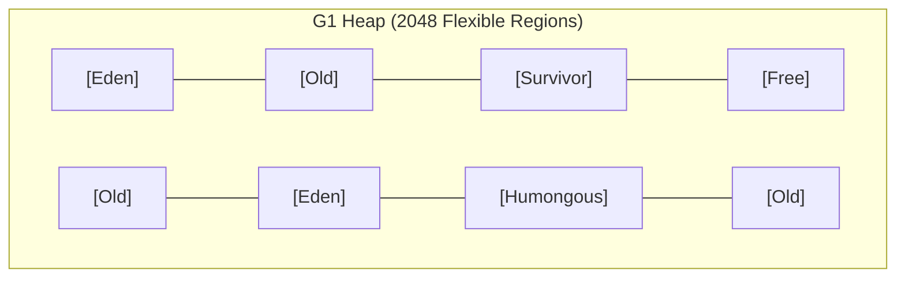

# GC Collectors (G1, ZGC) & Stop-The-World Minimization [ADVANCED]

> **Phase 5: Under the Hood: JVM Architecture & Memory Mechanics**  
> *Estimated Reading Time: 55 minutes | Total Practice Effort: ~3.5 hours | Tier: Advanced Deep Dive*

---

## 1. Purpose & Prerequisites

### Why This Matters in Full Stack Development
Imagine a high-traffic e-commerce checkout API. A user clicks "Confirm Order", but their HTTP request hangs for 1.8 seconds. Why?  
Because behind the scenes, the JVM initiated a **Stop-The-World (STW) Garbage Collection pause**. All application threads were frozen while the collector reorganized memory.

In modern cloud services and microservices, **latency predictability** is just as critical as raw throughput. Choosing the right production garbage collector—such as the default **G1 GC** or ultra-low latency **ZGC**—and tuning pause targets can reduce latency spikes from seconds to sub-milliseconds.

### Prerequisites
- [Topic 5.2: JVM Memory Architecture: Stack Frames, Heap & Metaspace](02-memory-model.md)
- [Topic 5.3: Garbage Collection Basics: How the JVM Frees Memory](03-gc-basics.md)

---

## 2. Plain-English Mental Model

```
[ Parallel GC: The Massive Factory Shutdown ]
- Once a week, stop the ENTIRE factory for 2 hours.
- Maximum total output (Throughput), but customers must wait during shutdowns!

[ G1 GC: The Continuous Regional Cleaners (Default since Java 9) ]
- Clean small rooms one at a time. Target: Never pause work for more than 200ms!

[ ZGC: The Invisible Ghost Cleaner (Ultra-Low Latency) ]
- Cleans and moves furniture in parallel WHILE employees are working at their desks!
- Pause times are under 1 millisecond (< 1ms), even on 16 Terabyte heaps!
```

---

## 3. The 4 Modern HotSpot Garbage Collectors

| Collector | JVM Flag | Target Workload | Pause Time (Typical) | Default In |
| :--- | :--- | :--- | :--- | :--- |
| **Serial GC** | `-XX:+UseSerialGC` | Single-core CPUs, small CLI utilities | High (Seconds) | Embedded / Tiny VMs |
| **Parallel GC** | `-XX:+UseParallelGC` | Offline batch jobs (payroll, big data) | Moderate-High (100ms–2s) | Java 8 Default |
| **G1 GC (Garbage-First)**| `-XX:+UseG1GC` | **Web APIs, Microservices, General Servers** | **Tunable (100–200ms)** | **Java 9+ Default** |
| **ZGC** | `-XX:+UseZGC` | **Ultra-low latency APIs, financial trading** | **Sub-millisecond (< 1ms)**| Optional in Java 15+, Generational in Java 21+ |

---

## 4. G1 GC Architecture: Regional Heap Partitioning

Unlike traditional collectors that partitioned the heap into giant contiguous Young and Old blocks, **G1 (Garbage-First)** splits the entire Heap into approximately **2,048 equal-sized independent Regions** (ranging from 1MB to 32MB):



### Why G1 is Named "Garbage-First":
- G1 continuously tracks how much garbage lives inside every single region.
- When a collection cycle begins, G1 selects the regions containing the **highest percentage of garbage** (the "Garbage-First" principle).
- It evacuates live objects into empty regions and reclaims the dirtiest regions first, maximizing reclaimed memory within the allocated pause window.

### The Key G1 Tuning Flag:
```bash
# Instructs G1 to try to keep STW pauses under 200 milliseconds (soft goal)
-XX:MaxGCPauseMillis=200
```

---

## 5. ZGC: The Sub-Millisecond Revolution

Available as a production collector in modern Java, **ZGC (Z Garbage Collector)** executes virtually all heavy collection tasks **concurrently (in parallel)** while your application threads continue handling HTTP requests!

### How ZGC Achieves < 1ms Pauses:
1. **Colored Pointers:** ZGC stores metadata bits directly inside the unused high-order bits of 64-bit memory reference pointers.
2. **Load Barriers:** When an application thread reads an object pointer, a lightweight hardware check (load barrier) verifies if the object is being relocated. If so, it updates the pointer on the fly without stopping other threads!
3. **Scalability:** ZGC pause times **do not increase as heap size grows**. A 16 Terabyte ZGC heap has the same sub-millisecond pause time as an 8GB heap!

---

## 6. How to Read Unified GC Logs (`-Xlog:gc*`)

In modern Java (Java 9+), JVM logging uses the unified `-Xlog` framework:

```bash
# Enable comprehensive GC logging with timestamps to file
java -Xlog:gc*,gc+phases=debug:file=gc.log:time,uptime,pid:filecount=5,filesize=100M -jar app.jar
```

### Sample G1 GC Log Line:
```text
[2026-10-20T10:15:30.124+0000][0.842s][info][gc] GC(3) Pause Young (Normal) (G1 Evacuation Pause) 124M->42M(512M) 8.412ms
```

### Deconstructing the Log:
1. `GC(3)`: The 3rd garbage collection cycle since boot.
2. `Pause Young (Normal)`: A standard Minor GC of Young generation regions.
3. `124M->42M(512M)`: Heap memory was **124MB before GC**, reduced to **42MB after GC**, within a total heap allocation of **512MB**.
4. `8.412ms`: The entire Stop-The-World pause duration was only **8.4 milliseconds**!

---

## 7. Working Code Example: Programmatic GC Telemetry

```java
// File: GcTelemetryDemo.java
import java.lang.management.GarbageCollectorMXBean;
import java.lang.management.ManagementFactory;
import java.util.List;

public class GcTelemetryDemo {
    public static void main(String[] args) {
        System.out.println("=== Active JVM Garbage Collectors ===");

        List<GarbageCollectorMXBean> gcBeans = ManagementFactory.getGarbageCollectorMXBeans();

        for (GarbageCollectorMXBean bean : gcBeans) {
            System.out.println("Collector Name: " + bean.getName());
            System.out.println(" - Total Collections: " + bean.getCollectionCount());
            System.out.println(" - Total Accumulated Pause Time: " + bean.getCollectionTime() + " ms");
            System.out.println(" - Memory Pool Names: " + String.join(", ", bean.getMemoryPoolNames()));
            System.out.println();
        }

        System.out.println("Default Garbage Collector initialized successfully.");
    }
}
```

### Exact Output (Running on Java 17/21 HotSpot):
```text
=== Active JVM Garbage Collectors ===
Collector Name: G1 Young Generation
 - Total Collections: 0
 - Total Accumulated Pause Time: 0 ms
 - Memory Pool Names: G1 Eden Space, G1 Survivor Space

Collector Name: G1 Old Generation
 - Total Collections: 0
 - Total Accumulated Pause Time: 0 ms
 - Memory Pool Names: G1 Eden Space, G1 Survivor Space, G1 Old Gen

Default Garbage Collector initialized successfully.
```

---

## 8. Common Rookie Mistakes & Production Tuning Traps

### Trap 1: Setting `-Xms` and `-Xmx` to Different Values
```bash
# BAD: Dynamic heap resizing causes memory thrashing during load spikes!
java -Xms512m -Xmx4g -jar app.jar

# PRODUCTION BEST PRACTICE: Set initial heap equal to max heap!
java -Xms4g -Xmx4g -XX:+UseG1GC -jar app.jar
```
Setting `-Xms` equal to `-Xmx` pre-allocates the entire heap memory upon container startup, eliminating expensive OS virtual memory expansion pauses.

### Trap 2: Unrealistically Low `-XX:MaxGCPauseMillis`
Setting `-XX:MaxGCPauseMillis=5` on G1 forces the collector to panic. G1 cannot collect enough regions in 5ms, causing Young Generation to shrink, which leads to early object tenuring and eventual disastrous Full GCs. Default 200ms is a healthy baseline.

---

## 9. Guided Hands-On Exercise

### Challenge: Production GC Log Analysis
Examine the two production GC log events below:

```text
Event A:
[2026-10-20T14:00:01.100][12.45s][info][gc] GC(42) Pause Young (Normal) (G1 Evacuation Pause) 450M->120M(2048M) 12.3ms

Event B:
[2026-10-20T14:05:22.500][332.1s][info][gc] GC(89) Pause Full (Allocation Failure) 1980M->1850M(2048M) 2450.8ms
```

**Analyze both events:**
1. What was the STW pause time in Event A versus Event B?
2. Which event caused a severe latency spike for end users?
3. What is happening in Event B (why did memory only drop from 1980M to 1850M)?

<details>
<summary>💡 Hint: Analysis</summary>

1. Event A took **12.3 ms**; Event B took **2,450.8 ms (2.45 seconds!)**.
2. Event B caused a critical latency freeze for users.
3. Event B is an `Allocation Failure Full GC`. The heap is 90% full even *after* a full GC (1850M out of 2048M). This indicates a **critical memory leak**; the heap is exhausted and the application will soon crash with `OutOfMemoryError`!
</details>

---

## 10. Knowledge Check & Interview Defense

### Quick Quiz
1. **What is the default Garbage Collector in modern Java (Java 9 through 21)?**
   - [ ] A) Parallel GC
   - [ ] B) Serial GC
   - [x] C) G1 GC (Garbage-First)
   - [ ] D) CMS

2. **How does G1 GC organize the Java Heap?**
   - [x] A) Into ~2,048 independent, equal-sized rectangular memory regions dynamically assigned as Eden, Survivor, or Old.
   - [ ] B) Into one giant continuous array.
   - [ ] C) In disk files.
   - [ ] D) On the GPU.

3. **What makes ZGC capable of sub-millisecond pause times even on massive multi-terabyte heaps?**
   - [ ] A) It disables garbage collection entirely.
   - [x] B) It performs almost all marking and relocation concurrently using Colored Pointers and Load Barriers while application threads continue running.
   - [ ] C) It deletes all objects older than 5 seconds.
   - [ ] D) It requires specialized CPU hardware.

---

### Junior Developer Interview Q&A

#### Q: "Why should we set `-Xms` and `-Xmx` to the same value in cloud Docker containers?"
> **Model Answer:**  
> "Setting `-Xms` (initial heap) equal to `-Xmx` (maximum heap) provides two key production benefits:
> 1. **Eliminating Heap Resizing Pauses:** If `-Xms` is smaller than `-Xmx`, the JVM starts small and repeatedly requests more memory pages from the operating system kernel as traffic increases. Each resize triggers Full GC cycles and OS page faults, degrading response times during traffic spikes.
> 2. **Predictable Cloud Container Sizing:** In Kubernetes or Docker environments, if a JVM dynamically expands its heap beyond the container's memory limit, the Linux kernel's Out-Of-Memory (OOM) killer will immediately issue a `SIGKILL (-9)` and terminate the container without warning. Pre-allocating heap guarantees predictable, bounded memory usage from boot."

---

## 11. Mastery Checklist & Next Step

Before moving on, verify that you can:
- [ ] Contrast throughput-oriented (Parallel) vs pause-time-oriented (G1, ZGC) collectors.
- [ ] Understand G1's regional layout and `-XX:MaxGCPauseMillis` tuning.
- [ ] Explain how ZGC achieves sub-millisecond pauses using colored pointers.
- [ ] Read and interpret unified GC log output (`-Xlog:gc*`).

👉 **Next Lesson:** **[Topic 5.5: Memory Leak Diagnostics, OutOfMemoryError & Heap Dumps [ADVANCED]](05-memory-leaks.md)**
