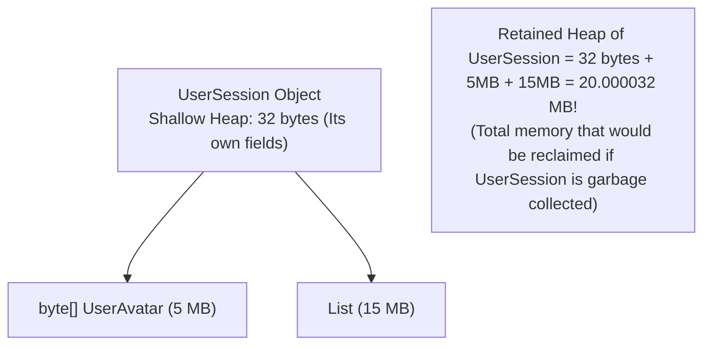

# Memory Leak Diagnostics, OutOfMemoryError & Heap Dumps [ADVANCED]

> **Phase 5: Under the Hood: JVM Architecture & Memory Mechanics**  
> *Estimated Reading Time: 50 minutes | Total Practice Effort: ~3.0 hours | Tier: Advanced Deep Dive*

---

## 1. Purpose & Prerequisites

### Why This Matters in Full Stack Development
A common misconception among beginner developers is:  
*"Because Java has an automated Garbage Collector, memory leaks are impossible."*

In reality, **memory leaks are among the most dangerous bugs in enterprise software**. A memory leak doesn't crash a server immediately; instead, memory usage steadily climbs over days or weeks until the service runs out of memory (`java.lang.OutOfMemoryError: Java heap space`) at 2:00 AM on a Friday, taking down production during peak traffic.

Diagnosing memory retention, capturing **Heap Dumps (`.hprof`)**, and analyzing **Dominator Trees** in profiling tools like Eclipse MAT or VisualVM are essential skills for any professional backend engineer.

### Prerequisites
- [Topic 5.2: JVM Memory Architecture: Stack Frames, Heap & Metaspace](02-memory-model.md)
- [Topic 5.3: Garbage Collection Basics: How the JVM Frees Memory](03-gc-basics.md)

---

## 2. Plain-English Mental Model

```
[ Traditional C/C++ Memory Leak ]
"You bought a book, forgot you owned it, and left it in a public park."
(Memory address lost forever in physical RAM; OS cannot reclaim it)

[ Java Garbage-Collected Memory Leak (Unintentional Retention) ]
"You bought a broken bicycle 10 years ago and threw it in your garage.
You never ride it, but you refuse to throw it away (It's still chained to your house!)."
(The Garbage Collector refuses to touch it because an active reference still points to it!)
```

In Java, a **Memory Leak** is an **unintentional object retention**: an object is no longer needed by business logic, but a forgotten reference from an active **GC Root** prevents the Garbage Collector from freeing its memory.

---

## 3. The 4 Classic Java Memory Leak Culprits

### 1. Static Collection Bloat
Because `static` fields are attached to class metadata in Metaspace, they live forever until the JVM terminates. Appending objects to an unbounded static list creates an ever-growing memory sink:
```java
public class Cache {
    // DISASTER: This list will grow until heap is 100% full!
    public static final List<UserEvent> EVENT_LOG = new ArrayList<>();
}
```

### 2. The `ThreadLocal` Leak in Application Servers
In modern web servers (Spring Boot, Tomcat), worker threads are **reused** across millions of requests via a thread pool.  
If you store data in a `ThreadLocal` during a request and forget to call `.remove()`:
- The data remains permanently attached to that worker thread on the thread pool!
- Every subsequent request handled by that worker thread leaks more memory until an OutOfMemoryError strikes.

### 3. Forgotten Listeners & Callbacks
Registering an object as a listener in a long-lived publisher without unregistering it leaves a reference to the listener inside the publisher's internal list, preventing the listener from ever being collected.

### 4. Broken `equals()` / `hashCode()` in Sets and Maps
As demonstrated in Topic 3.8 and 4.6, mutating keys or creating mismatched hash codes results in orphaned objects that can never be looked up or removed from hash tables.

---

## 4. The 4 Flavors of `OutOfMemoryError`

| Error Message | Root Cause | Production Fix |
| :--- | :--- | :--- |
| **`OutOfMemoryError: Java heap space`** | The Heap is full and GC cannot reclaim enough memory. | Analyze heap dump, fix memory leaks, or increase `-Xmx`. |
| **`OutOfMemoryError: Metaspace`** | Too many loaded classes, dynamic proxies, or ClassLoader leaks. | Increase `-XX:MaxMetaspaceSize`, fix classloader leaks. |
| **`OutOfMemoryError: GC overhead limit exceeded`** | JVM spends **98%+ of its time** in GC and reclaims **less than 2%** of the heap. | Server is thrashing. Urgent heap expansion or memory leak fix required. |
| **`OutOfMemoryError: Unable to create new native thread`** | OS thread limit hit or process exhausted native virtual memory. | Reduce thread count, use thread pools or Java 21 Virtual Threads. |

---

## 5. Production Heap Dump Automation

Never let a production service crash without capturing forensic evidence! Configure your JVM with automatic heap dump flags:

```bash
# MANDATORY PRODUCTION FLAGS:
java -XX:+HeapDumpOnOutOfMemoryError \
     -XX:HeapDumpPath=/var/log/dumps/app-crash.hprof \
     -jar service.jar
```

When an OOM crash occurs, HotSpot automatically freezes the JVM and writes the entire binary memory graph to `app-crash.hprof` before terminating.

### On-Demand Heap Dumps using `jcmd`:
You don't have to wait for a crash. Capture a snapshot of a running service at any time:
```bash
# 1. Find process ID
jcmd

# 2. Trigger instant live heap dump
jcmd <PID> GC.heap_dump /tmp/live-snapshot.hprof
```

---

## 6. Reading a Heap Dump: Shallow vs Retained Heap

When opening a `.hprof` dump in tools like **Eclipse MAT (Memory Analyzer Tool)**, **VisualVM**, or **IntelliJ Profiler**, you will encounter two metrics:



- **Shallow Heap:** The memory consumed by the object itself (its header and primitive field slots). Typically tiny (16–64 bytes).
- **Retained Heap:** The sum of shallow sizes of **all objects that would be garbage collected** if this specific object were deleted!
- **Dominator Tree:** MAT identifies the "Dominator": the single object or collection responsible for holding 80% to 90% of the entire application's memory.

---

## 7. Working Code Example: Fixing a ThreadLocal Memory Leak

```java
// File: ThreadLocalLeakDemo.java
import java.util.UUID;

class UserContext {
    private final String requestId;
    private final byte[] securityToken;

    public UserContext(String requestId) {
        this.requestId = requestId;
        this.securityToken = new byte[1024 * 512]; // 512 KB payload
    }

    public String getRequestId() { return requestId; }
}

public class ThreadLocalLeakDemo {
    // ThreadLocal variable holding request context
    private static final ThreadLocal<UserContext> contextHolder = new ThreadLocal<>();

    public static void main(String[] args) {
        System.out.println("=== Safe ThreadLocal Processing Pattern ===");

        // Simulating handling an incoming HTTP request
        try {
            // 1. Bind context to current thread
            contextHolder.set(new UserContext("REQ-" + UUID.randomUUID()));
            processBusinessLogic();
        } finally {
            // 2. CRITICAL PRODUCTION RULE: Always clean up ThreadLocal in a finally block!
            contextHolder.remove();
            System.out.println("ThreadLocal cleaned via .remove(). Zero memory leaked on pooled thread!");
        }
    }

    public static void processBusinessLogic() {
        UserContext ctx = contextHolder.get();
        System.out.println("Processing business logic for: " + ctx.getRequestId());
    }
}
```

### Exact Output:
```text
=== Safe ThreadLocal Processing Pattern ===
Processing business logic for: REQ-81fc49a2-921d-4001-a1e4-f3c5eb78430e
ThreadLocal cleaned via .remove(). Zero memory leaked on pooled thread!
```

---

## 8. Guided Hands-On Exercise

### Challenge: Identify and Fix the Unbounded Memory Leak
Analyze the following leaky notification queue:

```java
// LEAKY CODE
public class NotificationManager {
    private static final List<String> sentHistory = new ArrayList<>();

    public void dispatchAlert(String alertMessage) {
        System.out.println("Sending: " + alertMessage);
        sentHistory.add(alertMessage); // Leaks memory indefinitely!
    }
}
```

**Your Mission:**
Refactor `NotificationManager` so that it retains **at most the 1,000 most recent alerts** using an eviction strategy, or uses a bounded circular queue (`ArrayDeque`), preventing unbounded heap growth.

<details>
<summary>💡 Hint: Bounded eviction</summary>

```java
if (sentHistory.size() >= 1000) {
    sentHistory.pollFirst(); // or remove(0)
}
```
</details>

<details>
<summary>✅ Solution</summary>

```java
import java.util.ArrayDeque;
import java.util.Deque;

public class BoundedNotificationManager {
    private static final int MAX_HISTORY = 1000;
    // Bounded ArrayDeque prevents unbounded heap expansion
    private final Deque<String> sentHistory = new ArrayDeque<>(MAX_HISTORY);

    public synchronized void dispatchAlert(String alertMessage) {
        if (sentHistory.size() >= MAX_HISTORY) {
            sentHistory.pollFirst(); // Evict oldest entry!
        }
        sentHistory.offerLast(alertMessage);
        System.out.println("Dispatched: " + alertMessage + " (History size bounded: " + sentHistory.size() + ")");
    }
}
```
</details>

---

## 9. Knowledge Check & Interview Defense

### Quick Quiz
1. **How can a memory leak happen in a garbage-collected language like Java?**
   - [x] A) When objects that are no longer needed by application logic remain reachable from active GC Roots (such as static collections or un-removed ThreadLocals).
   - [ ] B) When the operating system crashes.
   - [ ] C) When integers exceed their 32-bit limit.
   - [ ] D) Only when using native C libraries.

2. **What is the difference between Shallow Heap and Retained Heap in heap dump analysis?**
   - [ ] A) Shallow heap is in RAM; retained heap is on disk.
   - [x] B) Shallow heap is the memory consumed by the object itself; Retained heap is the total memory that would be freed if that object and its exclusively owned references are garbage collected.
   - [ ] C) Retained heap is only used for Strings.
   - [ ] D) There is no difference.

3. **Which JVM flag automatically dumps heap memory to a file when an application crashes with OutOfMemoryError?**
   - [ ] A) `-XX:+DumpNow`
   - [x] B) `-XX:+HeapDumpOnOutOfMemoryError`
   - [ ] C) `-Xlog:crash`
   - [ ] D) `-Xmx:dump`

---

### Junior Developer Interview Q&A

#### Q: "Why is failing to call `ThreadLocal.remove()` in a Spring Boot or Tomcat application particularly dangerous?"
> **Model Answer:**  
> "In web application servers like Tomcat or Spring Boot, HTTP requests are handled by a **Thread Pool** (such as 200 reusable worker threads). When a request completes, the thread is not destroyed; it is returned to the pool to handle future requests.  
> 
> The internal `ThreadLocalMap` is an instance field of the `Thread` object itself. If a request handler places an object into a `ThreadLocal` and forgets to call `.remove()` in a `finally` block:
> 1. **Data Leakage:** The next HTTP request assigned to that thread can accidentally read sensitive data from the previous user!
> 2. **Memory Leak:** Because the worker thread lives for the entire lifespan of the application, all retained objects in its `ThreadLocalMap` remain reachable from that thread's GC Root, permanently leaking heap memory until an `OutOfMemoryError` occurs."

---

## 10. Phase 5 Mastery Checklist & Next Phase

Congratulations! You have completed **Phase 5: Under the Hood: JVM Architecture & Memory Mechanics**.

### Phase 5 Mastery Self-Audit:
- [x] JVM Execution: Understand the ClassLoader, Bytecode Verifier, and HotSpot JIT (C1/C2) execution tiers.
- [x] Memory Model: Dissect Stack Frames (LVT, Operand Stack), Heap generations, and native Metaspace.
- [x] GC Fundamentals: Trace GC Roots, apply the Weak Generational Hypothesis, and compare collection algorithms.
- [x] Advanced Collectors: Contrast G1 regional allocation with ZGC sub-millisecond concurrent colored pointers.
- [x] Leak Diagnostics: Automate Heap Dumps (`-XX:+HeapDumpOnOutOfMemoryError`) and analyze Dominator Trees.

👉 **Next Phase:** **[Phase 6: Multithreading & Concurrent Programming — Topic 6.1: Threads, The Thread Class & Runnable Lifecycle](../06-concurrency/01-thread-basics.md)**
