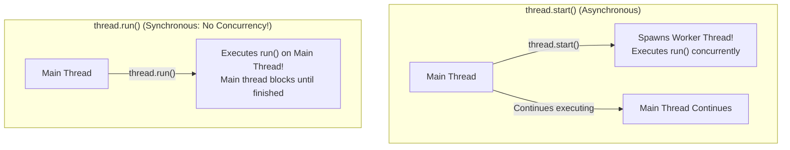
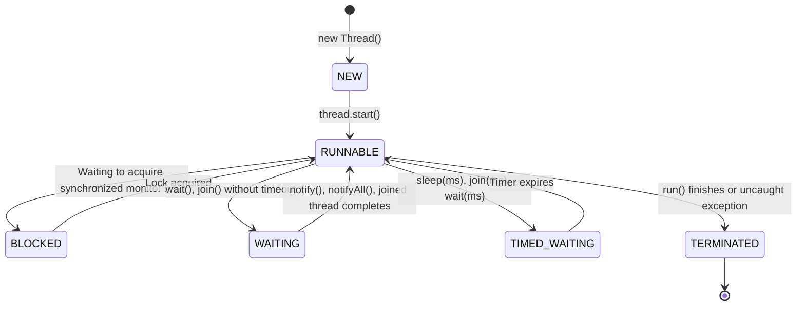

# Threads, The Thread Class & Runnable Lifecycle

> **Phase 6: Multithreading & Concurrent Programming**  
> *Estimated Reading Time: 40 minutes | Total Practice Effort: ~3.0 hours | Tier: Core Essential*

---

## 1. Purpose & Prerequisites

### Why This Matters in Full Stack Development
Modern computers possess 8, 16, or 64 CPU cores. If your backend application runs strictly on a single thread, it leaves 90%+ of hardware capacity completely idle.

Furthermore, web servers (such as Tomcat inside Spring Boot) are concurrent systems by design: when 100 users hit your `/api/products` and `/api/checkout` endpoints simultaneously, the server assigns each incoming HTTP request to an independent worker thread. Understanding how threads are spawned, how their lifecycle transitions across states, and how to coordinate them without race conditions is essential for building scalable backend architectures.

### Prerequisites
- [Topic 2.8: Abstract Classes vs Interfaces & Multiple Inheritance of Type](../02-oop/08-abstraction-interfaces.md)
- [Topic 5.2: JVM Memory Architecture: Stack Frames, Heap & Metaspace](../05-jvm/02-memory-model.md)

---

## 2. Plain-English Mental Model

Think of a **Process** versus a **Thread** like a corporate office building:

```
[ Operating System Process (The Corporate Office Building) ]
- Has its own private street address and dedicated land (Private Virtual Memory Address Space).
- Other buildings cannot reach in and touch its files.
                      |
                      +-----------------------------+
                      |                             |
                      v                             v
           [ Thread 1: Employee Alice ]   [ Thread 2: Employee Bob ]
           - Own notepad (Call Stack)     - Own notepad (Call Stack)
           - SHARED water cooler & filing cabinet (The Java Heap!)
```

- **Process:** An isolated running instance of a program (e.g. your running Java application process). It owns dedicated memory.
- **Thread:** A lightweight path of execution *within* a process. Multiple threads share the exact same Heap memory space, but each thread has its own private Call Stack and Program Counter (PC).

---

## 3. Creating Threads: `Thread` Class vs `Runnable`

Java provides two primary mechanisms to create threads:

### Approach 1: Extending `Thread` (Not Recommended)
```java
class ReportWorker extends Thread {
    @Override
    public void run() {
        System.out.println("Generating report on: " + Thread.currentThread().getName());
    }
}

// Running it:
new ReportWorker().start();
```
*Why this is discouraged:* Java does not support multiple class inheritance. If your class extends `Thread`, it cannot extend any other domain class.

### Approach 2: Implementing `Runnable` (Industry Standard)
The `Runnable` interface represents a task to be executed. It adheres to Single Responsibility by separating the **task logic** from the **thread execution mechanism**:

```java
// Runnable is a Functional Interface!
Runnable task = () -> {
    System.out.println("Processing async task on: " + Thread.currentThread().getName());
};

Thread thread = new Thread(task, "Worker-Thread-1");
thread.start();
```

---

## 4. The Golden Rule: `start()` vs `run()`

> [!CAUTION] The Most Common Beginner Mistake
> - **`thread.start()`**: Requests the operating system to allocate a brand-new OS thread and invokes `run()` asynchronously on that new thread.
> - **`thread.run()`**: Simply calls `run()` as a normal synchronous method on the **current caller thread**! No new thread is created!



---

## 5. The 6 Thread Lifecycle States (`Thread.State`)

A Java thread transitions through six distinct states in its lifecycle:



1. **`NEW`:** Thread created via `new Thread()`, but `start()` has not been called.
2. **`RUNNABLE`:** Executing or ready to execute on a CPU core.
3. **`BLOCKED`:** Paused waiting to acquire an intrinsic monitor lock held by another thread.
4. **`WAITING`:** Paused indefinitely waiting for another thread to perform a specific action (`wait()`, `join()`).
5. **`TIMED_WAITING`:** Paused for a specified duration (`Thread.sleep(1000)`).
6. **`TERMINATED`:** The method `run()` has completed execution or crashed with an unhandled exception. Once terminated, a thread **can never be restarted**.

---

## 6. Thread Coordination: `join()` and `interrupt()`

### 1. Waiting for Completion via `thread.join()`
If the main thread needs to wait until a background worker finishes calculating data before proceeding:
```java
Thread worker = new Thread(task);
worker.start();

worker.join(); // Main thread pauses until 'worker' reaches TERMINATED state!
System.out.println("Worker has completed. Resuming main thread.");
```

### 2. Cooperative Cancellation via `interrupt()`
You cannot forcefully kill a thread in Java (`thread.stop()` was deprecated and removed because it corrupted shared memory). Threads must be cancelled cooperatively:
```java
Thread worker = new Thread(() -> {
    while (!Thread.currentThread().isInterrupted()) {
        // Perform batch chunk
    }
    System.out.println("Clean cancellation detected. Exiting gracefully.");
});

worker.start();
worker.interrupt(); // Sets the thread's interrupt flag to true
```

---

## 7. Working Code Example: Parallel Data Processing with `join()`

```java
// File: ParallelReportDemo.java

public class ParallelReportDemo {
    public static void main(String[] args) throws InterruptedException {
        System.out.println("Main Application started on: " + Thread.currentThread().getName());

        long startTime = System.currentTimeMillis();

        // Spawning two independent worker threads
        Thread salesWorker = new Thread(() -> generateReport("Sales Data", 800), "Sales-Thread");
        Thread inventoryWorker = new Thread(() -> generateReport("Inventory Data", 600), "Inventory-Thread");

        salesWorker.start();
        inventoryWorker.start();

        System.out.println("Workers dispatched. Main thread waiting for completion...");

        // Wait for both workers to conclude execution
        salesWorker.join();
        inventoryWorker.join();

        long totalTime = System.currentTimeMillis() - startTime;
        System.out.println("All reports compiled successfully in: " + totalTime + " ms!");
    }

    public static void generateReport(String reportName, int simulatedDelayMs) {
        try {
            System.out.println(" -> Starting " + reportName + " on " + Thread.currentThread().getName());
            Thread.sleep(simulatedDelayMs); // Simulates network or database work
            System.out.println(" -> Completed " + reportName + " on " + Thread.currentThread().getName());
        } catch (InterruptedException e) {
            System.err.println("Worker interrupted: " + e.getMessage());
            Thread.currentThread().interrupt();
        }
    }
}
```

### Exact Output:
```text
Main Application started on: main
Workers dispatched. Main thread waiting for completion...
 -> Starting Sales Data on Sales-Thread
 -> Starting Inventory Data on Inventory-Thread
 -> Completed Inventory Data on Inventory-Thread
 -> Completed Sales Data on Sales-Thread
All reports compiled successfully in: 815 ms!
```
*Notice that both reports ran in parallel: rather than taking $800 + 600 = 1400$ ms sequentially, both completed together in ~815 ms!*

---

## 8. Common Rookie Mistakes & Traps

### Trap 1: Restarting a Terminated Thread
```java
Thread t = new Thread(task);
t.start();
t.join();

t.start(); // CRASH: java.lang.IllegalThreadStateException!
```
A thread cannot be restarted once it reaches the `TERMINATED` state. You must instantiate a new `Thread` instance.

### Trap 2: User Threads Preventing JVM Shutdown
By default, threads are **User Threads**. The JVM will refuse to shut down as long as **at least one user thread is alive** (even if `main()` finishes!).  
If you want a background thread that should not block JVM termination (e.g. a heartbeat logger), mark it as a **Daemon Thread**:
```java
Thread daemon = new Thread(heartbeatTask);
daemon.setDaemon(true); // Must be called BEFORE .start()!
daemon.start();
```

---

## 9. Guided Hands-On Exercise

### Challenge: Concurrent Image Downloader Simulator
Create a program named `AsyncDownloaderDemo.java`:
1. Create 3 `Thread` instances using `Runnable` lambdas to download 3 files:
   - `"profile.png"` (simulates 300ms download)
   - `"banner.jpg"` (simulates 500ms download)
   - `"stylesheet.css"` (simulates 200ms download)
2. Inside each worker, print `"Downloading [file] on [threadName]..."`, sleep for the specified duration, and print `"Finished [file]!"`.
3. In `main`, start all 3 threads simultaneously, call `join()` on all 3, and print `"All assets downloaded! Webpage ready to render."`.

<details>
<summary>💡 Hint: Joining all threads</summary>

```java
t1.start(); t2.start(); t3.start();
t1.join(); t2.join(); t3.join();
```
</details>

<details>
<summary>✅ Solution</summary>

```java
public class AsyncDownloaderDemo {
    public static void main(String[] args) throws InterruptedException {
        Thread t1 = new Thread(() -> downloadAsset("profile.png", 300), "Asset-Worker-1");
        Thread t2 = new Thread(() -> downloadAsset("banner.jpg", 500), "Asset-Worker-2");
        Thread t3 = new Thread(() -> downloadAsset("stylesheet.css", 200), "Asset-Worker-3");

        t1.start();
        t2.start();
        t3.start();

        t1.join();
        t2.join();
        t3.join();

        System.out.println("All assets downloaded! Webpage ready to render.");
    }

    public static void downloadAsset(String filename, int delayMs) {
        try {
            System.out.println("Downloading " + filename + " on " + Thread.currentThread().getName() + "...");
            Thread.sleep(delayMs);
            System.out.println("Finished " + filename + "!");
        } catch (InterruptedException e) {
            Thread.currentThread().interrupt();
        }
    }
}
```

**Terminal Output:**
```text
Downloading profile.png on Asset-Worker-1...
Downloading banner.jpg on Asset-Worker-2...
Downloading stylesheet.css on Asset-Worker-3...
Finished stylesheet.css!
Finished profile.png!
Finished banner.jpg!
All assets downloaded! Webpage ready to render.
```
</details>

---

## 10. Knowledge Check & Interview Defense

### Quick Quiz
1. **What is the difference between `thread.start()` and `thread.run()`?**
   - [x] A) `start()` requests the OS to spawn a new execution thread and calls `run()` asynchronously; `run()` executes synchronously on the calling thread without concurrency.
   - [ ] B) `run()` creates a daemon thread; `start()` creates a user thread.
   - [ ] C) `start()` is deprecated in Java 17.
   - [ ] D) There is no difference.

2. **Which thread state indicates that a thread is paused waiting to acquire an intrinsic monitor lock held by another thread?**
   - [ ] A) `WAITING`
   - [x] B) `BLOCKED`
   - [ ] C) `TIMED_WAITING`
   - [ ] D) `TERMINATED`

3. **What happens to the JVM when all User Threads finish executing, but Daemon Threads are still running?**
   - [x] A) The JVM terminates immediately, abandoning all running daemon threads.
   - [ ] B) The JVM hangs forever.
   - [ ] C) The daemon threads convert into user threads.
   - [ ] D) A `NullPointerException` is thrown.

---

### Junior Developer Interview Q&A

#### Q: "Why is implementing the `Runnable` interface preferred over extending the `Thread` class in Java?"
> **Model Answer:**  
> "Implementing `Runnable` is preferred for three key architectural reasons:
> 1. **Multiple Inheritance of Type:** Java only allows a class to extend a single parent class. If you extend `Thread`, you forfeit the ability to extend any domain base class. Implementing `Runnable` keeps your class hierarchy flexible.
> 2. **Separation of Concerns:** `Runnable` adheres to the Single Responsibility Principle by decoupling the **work to be done** (the task payload) from the **concurrency mechanism** that executes it.
> 3. **Thread Pool Integration:** Modern production applications manage threads using thread pools (`ExecutorService`). Executors accept `Runnable` and `Callable` tasks directly; they do not accept subclasses of `Thread`."

---

## 11. Mastery Checklist & Next Step

Before moving on, verify that you can:
- [ ] Differentiate between operating system Processes and lightweight JVM Threads.
- [ ] Implement concurrent tasks using `Runnable` lambdas and `thread.start()`.
- [ ] Trace thread lifecycle states (`NEW`, `RUNNABLE`, `BLOCKED`, `WAITING`, `TIMED_WAITING`, `TERMINATED`).
- [ ] Coordinate thread completion using `thread.join()` and cooperative cancellation with `interrupt()`.

👉 **Next Lesson:** **[Topic 6.2: Race Conditions, Critical Sections & The synchronized Monitor](02-synchronization.md)**
