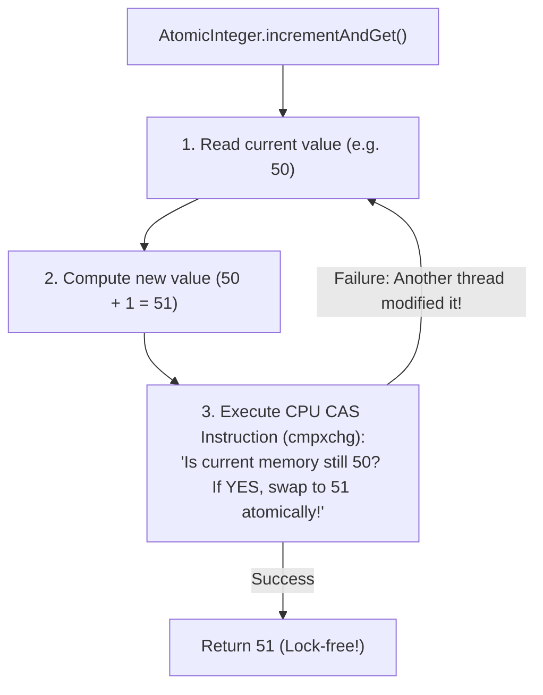

# Memory Visibility, volatile & Atomic Primitives (AtomicInteger)

> **Phase 6: Multithreading & Concurrent Programming**  
> *Estimated Reading Time: 45 minutes | Total Practice Effort: ~3.5 hours | Tier: Core Essential*

---

## 1. Purpose & Prerequisites

### Why This Matters in Full Stack Development
In Topic 6.2, you fixed data corruption using `synchronized`. But what if you have a simple shutdown flag:
```java
private boolean isServerRunning = true;
```
When an admin thread executes `isServerRunning = false;`, worker threads running on other CPU cores might **never see the change**, continuing to run forever in an infinite loop!

Why does this happen? Because modern multi-core processors cache data in high-speed hardware registers and L1/L2 caches to maximize speed. Understanding the **Java Memory Model (JMM)**, the **`volatile`** visibility guarantee, and lock-free hardware **Atomics (`AtomicInteger`)** enables you to build high-throughput concurrent systems without heavy locking overhead.

### Prerequisites
- [Topic 6.1: Threads, The Thread Class & Runnable Lifecycle](01-thread-basics.md)
- [Topic 6.2: Race Conditions, Critical Sections & The synchronized Monitor](02-synchronization.md)

---

## 2. Plain-English Mental Model

Think of multi-core CPU caching like two remote branch offices reading a shared company manual:

```
[ Core 1 (Office A): Worker Thread ]              [ Core 2 (Office B): Admin Thread ]
Local Desk Scratchpad (L1 Cache)                   Local Desk Scratchpad (L1 Cache)
"isServerRunning = true"                           "isServerRunning = false"
                \                                              /
                 v                                            v
         ============================================================
              Shared Central Company File Cabinet (Main RAM)
                 - Without a direct memo (volatile flag),
                   Office A keeps reading its stale local notepad!
         ============================================================
```

- When Thread B updates a variable, the change initially stays inside Core 2's local hardware cache.
- Core 1 continues reading from its own local L1 cache, completely unaware that the value in main RAM has changed!

---

## 3. The `volatile` Keyword: Visibility & Happens-Before

Declaring a variable as **`volatile`** instructs the Java compiler and CPU architecture:
1. **Direct Memory Access:** Every read of a `volatile` variable is fetched directly from **Main Memory** (or through hardware cache-coherency protocols like MESI). Every write is flushed immediately to Main Memory.
2. **Instruction Reordering Barrier:** The compiler and CPU are forbidden from reordering read and write instructions across the `volatile` boundary (establishing a formal **Happens-Before** relationship in the JMM).

```java
// Thread-safe shutdown flag: Guaranteed visibility across all CPU cores!
private volatile boolean running = true;

public void stopServer() {
    this.running = false; // Immediately visible to all cores!
}
```

---

## 4. The Critical Trap: `volatile` is NOT Atomic!

> [!CAUTION] The Most Dangerous Concurrency Fallacy
> **`volatile` DOES NOT make compound operations thread-safe!**

```java
private volatile int counter = 0;

public void increment() {
    counter++; // STILL BROKEN! Race condition still occurs!
}
```

### Why?
`counter++` is still three separate steps (read, add 1, write). While `volatile` guarantees that reads and writes see the latest value in RAM, it does **not prevent two threads from reading the same value simultaneously** and overwriting each other's updates!

| Feature | `volatile` | `synchronized` |
| :--- | :---: | :---: |
| **Guarantees Memory Visibility?** | ✅ Yes | ✅ Yes (at lock acquisition & release) |
| **Guarantees Mutual Exclusion (Atomicity)?** | ❌ **NO!** | ✅ **YES!** |
| **Performance Overhead** | Minimal (No thread blocking) | Higher (Thread blocking & context switches) |

---

## 5. Lock-Free Concurrency: Compare-And-Swap (CAS) & Atomics

If `volatile` doesn't provide atomicity, but `synchronized` is heavy, what is the optimal solution for high-throughput counters?  
The answer is **Atomic Primitives** (`java.util.concurrent.atomic`).

Instead of software locks, Atomics leverage **hardware-level CPU instructions** known as **CAS (Compare-And-Swap)**:



If another thread updated the value in the millisecond between reading and writing, the CPU hardware instruction rejects the update. The method simply loops around, reads the fresh value, and tries again. **No threads are ever blocked or suspended!**

---

## 6. Core Classes in `java.util.concurrent.atomic`

| Class | Equivalent Primitive | Key Methods |
| :--- | :--- | :--- |
| **`AtomicInteger`** | `int` | `incrementAndGet()`, `decrementAndGet()`, `addAndGet(n)`, `compareAndSet(exp, new)` |
| **`AtomicLong`** | `long` | `incrementAndGet()`, `getAndAdd(n)` (Ideal for high-volume metrics & timestamps) |
| **`AtomicBoolean`** | `boolean` | `compareAndSet(false, true)` (Atomic one-time initialization triggers) |
| **`AtomicReference<V>`** | Object Reference | Atomically updates reference pointers to immutable state objects |

---

## 7. Working Code Example: Benchmark of Atomics vs Volatile

```java
// File: AtomicsVsVolatileDemo.java
import java.util.concurrent.atomic.AtomicInteger;

public class AtomicsVsVolatileDemo {
    private static volatile int brokenVolatileCounter = 0;
    private static final AtomicInteger safeAtomicCounter = new AtomicInteger(0);

    public static void main(String[] args) throws InterruptedException {
        int iterations = 20_000;

        Thread t1 = new Thread(() -> runBatch(iterations));
        Thread t2 = new Thread(() -> runBatch(iterations));

        t1.start(); t2.start();
        t1.join();  t2.join();

        System.out.println("Expected Count:        " + (iterations * 2));
        System.out.println("Volatile Count (LOST!): " + brokenVolatileCounter);
        System.out.println("Atomic Count (PERFECT): " + safeAtomicCounter.get());
    }

    public static void runBatch(int iterations) {
        for (int i = 0; i < iterations; i++) {
            brokenVolatileCounter++;            // Non-atomic race condition!
            safeAtomicCounter.incrementAndGet(); // Hardware-level atomic CAS!
        }
    }
}
```

### Exact Output:
```text
Expected Count:        40000
Volatile Count (LOST!): 27814
Atomic Count (PERFECT): 40000
```

---

## 8. Common Rookie Mistakes & Traps

### Trap: Atomic Boolean One-Time Action Failure
```java
// FLAWED: Check-then-act race condition!
if (atomicBool.get() == false) {
    atomicBool.set(true);
    initializeServer(); // Two threads can enter here simultaneously!
}

// CORRECT: Atomic compareAndSet
if (atomicBool.compareAndSet(false, true)) {
    initializeServer(); // GUARANTEED to execute exactly ONCE across all threads!
}
```

---

## 9. Guided Hands-On Exercise

### Challenge: Lock-Free API Request Rate Limiter
Create a program named `LockFreeRateLimiterDemo.java`:
1. Class `RateLimiter`:
   - `private final AtomicInteger currentTokens;`
   - `private final int maxCapacity;`
   - Constructor initializing `currentTokens` to `maxCapacity`.
   - Method `public boolean tryAcquire()`:
     - Uses a loop with `currentTokens.compareAndSet(...)` or `currentTokens.decrementAndGet()`.
     - If tokens remain (`> 0`), decrement and return `true` (Admitted).
     - If tokens are depleted (`<= 0`), restore count and return `false` (Rate Limited).
2. In `main`:
   - Initialize limiter with capacity `5`.
   - Spawn 10 concurrent threads attempting to acquire tokens.
   - Assert that exactly 5 threads are admitted and 5 are blocked.

<details>
<summary>💡 Hint: CAS loop</summary>

```java
while (true) {
    int current = currentTokens.get();
    if (current <= 0) return false;
    if (currentTokens.compareAndSet(current, current - 1)) {
        return true;
    }
}
```
</details>

<details>
<summary>✅ Solution</summary>

```java
import java.util.concurrent.atomic.AtomicInteger;

class RateLimiter {
    private final AtomicInteger availableTokens;

    public RateLimiter(int maxTokens) {
        this.availableTokens = new AtomicInteger(maxTokens);
    }

    public boolean tryAcquire() {
        while (true) {
            int current = availableTokens.get();
            if (current <= 0) {
                return false; // Rate limit exceeded!
            }
            // Lock-free atomic test-and-decrement
            if (availableTokens.compareAndSet(current, current - 1)) {
                return true; // Successfully acquired token!
            }
            // If another thread won the race, loop retries automatically
        }
    }

    public int getRemainingTokens() {
        return availableTokens.get();
    }
}

public class LockFreeRateLimiterDemo {
    public static void main(String[] args) throws InterruptedException {
        RateLimiter limiter = new RateLimiter(3); // Allow only 3 concurrent requests

        Runnable requestTask = () -> {
            String threadName = Thread.currentThread().getName();
            if (limiter.tryAcquire()) {
                System.out.println("[200 OK] Admitted request on " + threadName);
            } else {
                System.err.println("[429 TOO MANY REQUESTS] Blocked on " + threadName);
            }
        };

        Thread[] requests = new Thread[6];
        for (int i = 0; i < requests.length; i++) {
            requests[i] = new Thread(requestTask, "Client-" + (i + 1));
            requests[i].start();
        }

        for (Thread t : requests) t.join();

        System.out.println("\nRemaining available tokens: " + limiter.getRemainingTokens());
    }
}
```

**Terminal Output (Representative):**
```text
[200 OK] Admitted request on Client-1
[200 OK] Admitted request on Client-2
[200 OK] Admitted request on Client-3
[429 TOO MANY REQUESTS] Blocked on Client-4
[429 TOO MANY REQUESTS] Blocked on Client-5
[429 TOO MANY REQUESTS] Blocked on Client-6

Remaining available tokens: 0
```
</details>

---

## 10. Knowledge Check & Interview Defense

### Quick Quiz
1. **What is the primary memory guarantee provided by the `volatile` keyword in Java?**
   - [x] A) Memory Visibility: Reads and writes bypass local CPU registers and caches, ensuring updates made by one thread are immediately visible to all other threads.
   - [ ] B) Atomic incrementing.
   - [ ] C) It locks the class for 5 seconds.
   - [ ] D) It writes data to disk.

2. **Does declaring a variable `volatile int x` make `x++` thread-safe?**
   - [ ] A) Yes, volatile guarantees full thread safety.
   - [x] B) No! `x++` is a compound operation (read-modify-write); volatile guarantees visibility, but does not provide mutual exclusion.
   - [ ] C) Only in Java 21+.
   - [ ] D) Only on 64-bit JVMs.

3. **What underlying CPU mechanism powers `AtomicInteger` without blocking threads?**
   - [ ] A) Operating system mutexes.
   - [x] B) Hardware-level Compare-And-Swap (CAS) instructions (e.g. `cmpxchg`).
   - [ ] C) Soft interrupts.
   - [ ] D) Garbage collection pauses.

---

### Junior Developer Interview Q&A

#### Q: "Explain what Compare-And-Swap (CAS) is and how it enables lock-free concurrency."
> **Model Answer:**  
> "Compare-And-Swap (CAS) is an atomic CPU instruction that takes three operands: a memory location ($V$), the expected old value ($A$), and a new value ($B$).  
> 
> The processor checks: *'Does memory location $V$ currently hold value $A$?'*
> - If yes, the CPU swaps in new value $B$ in a single hardware cycle and returns success.
> - If no (meaning another thread modified the value in the interim), the memory is left untouched and returns failure.  
> 
> Java's atomic classes (`AtomicInteger`, `AtomicReference`) run this CAS check inside a retry loop (known as an optimistic loop). This enables **lock-free concurrency**: threads never sleep, block, or trigger expensive operating system context switches, allowing high-throughput concurrent increments and state updates."

---

## 11. Mastery Checklist & Next Step

Before moving on, verify that you can:
- [ ] Explain CPU cache-coherency and memory visibility issues in multi-core systems.
- [ ] Use `volatile` for status/shutdown flags and explain why it lacks atomicity for compound operations.
- [ ] Implement lock-free thread-safe counters using `AtomicInteger` and `AtomicLong`.
- [ ] Describe the hardware Compare-And-Swap (CAS) instruction in technical interviews.

👉 **Next Lesson:** **[Topic 6.4: Thread Coordination: wait(), notify() & Deadlock Avoidance](04-coordination.md)**
