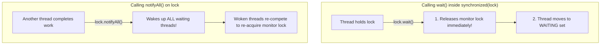
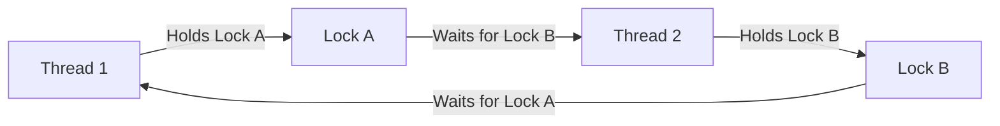

# Thread Coordination: wait(), notify() & Deadlock Avoidance

> **Phase 6: Multithreading & Concurrent Programming**  
> *Estimated Reading Time: 50 minutes | Total Practice Effort: ~3.5 hours | Tier: Core Essential*

---

## 1. Purpose & Prerequisites

### Why This Matters in Full Stack Development
In real-world software, threads cannot simply work in blind isolation; they must coordinate:
- A database ingestion thread produces records into a buffer; an analytics thread consumes them (**Producer-Consumer Pattern**).
- If the buffer is full, the producer must wait; if the buffer is empty, the consumer must sleep until data arrives.

However, coordinating multiple threads introduces the ultimate concurrency hazard: **Deadlock**. A deadlock occurs when two threads freeze forever, each holding a lock that the other needs. Mastering `wait()`, `notifyAll()`, and **Lock Ordering** ensures your concurrent services never hang or freeze in production.

### Prerequisites
- [Topic 6.1: Threads, The Thread Class & Runnable Lifecycle](01-thread-basics.md)
- [Topic 6.2: Race Conditions, Critical Sections & The synchronized Monitor](02-synchronization.md)

---

## 2. Plain-English Mental Model

```
[ Producer-Consumer: The Restaurant Kitchen Counter ]
- Chef (Producer) cooks orders and places them on a 3-plate counter (Buffer).
- Waiter (Consumer) picks up plates and serves customers.
- Counter Full? Chef pauses and waits (wait()).
- Waiter takes a plate? Waiter rings service bell (notifyAll()) to wake the Chef!
- Counter Empty? Waiter pauses and waits until the Chef rings the bell!
```

---

## 3. The `wait()`, `notify()`, and `notifyAll()` Contract

These methods are declared on **`java.lang.Object`** (not `Thread`), because they operate on an object's intrinsic monitor lock:



### The Three Sacred Rules:
1. **Must Hold the Monitor:** Calling `wait()` or `notify()` outside of a `synchronized` block throws an immediate `java.lang.IllegalMonitorStateException`.
2. **`wait()` Releases the Lock:** Unlike `Thread.sleep(ms)` (which holds the lock while sleeping), `wait()` **releases the lock**, allowing other threads to enter and do work!
3. **The `while` Loop Rule (Guarding Against Spurious Wakeups):**
   ```java
   // ALWAYS test conditions in a WHILE loop, NEVER an IF statement!
   while (queue.isEmpty()) {
       lock.wait(); // Might wake up spuriously without a notify!
   }
   ```

---

## 4. `notify()` vs `notifyAll()`

- **`notify()`:** Wakes up **one single arbitrary thread** from the waiting pool. If the wrong thread is woken (e.g. another producer wakes a producer when the queue is already full), both threads go back to sleep, causing a permanent **lost notification freeze**!
- **`notifyAll()`:** Wakes up **all waiting threads**. Each thread tests its condition loop; the appropriate thread proceeds while others return to sleep safely.
> [!IMPORTANT] Production Rule
> **Always use `notifyAll()` instead of `notify()`** unless you have a proven, single-condition, single-step thread pipeline.

---

## 5. Working Code Example: The Classic Bounded Buffer

```java
// File: ProducerConsumerDemo.java
import java.util.LinkedList;
import java.util.Queue;

class BoundedMessageQueue {
    private final Queue<String> queue = new LinkedList<>();
    private final int capacity;

    public BoundedMessageQueue(int capacity) {
        this.capacity = capacity;
    }

    // Producer Method
    public synchronized void produce(String message) throws InterruptedException {
        // While buffer is full, release lock and wait!
        while (queue.size() == capacity) {
            System.out.println("Buffer FULL. Producer waiting...");
            wait(); // Releases lock on 'this'!
        }

        queue.add(message);
        System.out.println("Produced: " + message + " (Queue size: " + queue.size() + ")");
        
        // Wake up sleeping consumers
        notifyAll();
    }

    // Consumer Method
    public synchronized String consume() throws InterruptedException {
        // While buffer is empty, release lock and wait!
        while (queue.isEmpty()) {
            System.out.println("Buffer EMPTY. Consumer waiting...");
            wait(); // Releases lock on 'this'!
        }

        String item = queue.poll();
        System.out.println("Consumed: " + item + " (Queue size: " + queue.size() + ")");
        
        // Wake up sleeping producers
        notifyAll();
        return item;
    }
}

public class ProducerConsumerDemo {
    public static void main(String[] args) throws InterruptedException {
        BoundedMessageQueue buffer = new BoundedMessageQueue(2); // Max capacity of 2 items

        Thread producer = new Thread(() -> {
            try {
                for (int i = 1; i <= 4; i++) {
                    buffer.produce("EVENT-" + i);
                    Thread.sleep(100);
                }
            } catch (InterruptedException e) { Thread.currentThread().interrupt(); }
        }, "Producer-Thread");

        Thread consumer = new Thread(() -> {
            try {
                for (int i = 1; i <= 4; i++) {
                    Thread.sleep(300); // Consumer runs slower than producer!
                    buffer.consume();
                }
            } catch (InterruptedException e) { Thread.currentThread().interrupt(); }
        }, "Consumer-Thread");

        producer.start();
        consumer.start();

        producer.join();
        consumer.join();
        System.out.println("Producer-Consumer coordination concluded successfully!");
    }
}
```

### Exact Output:
```text
Produced: EVENT-1 (Queue size: 1)
Produced: EVENT-2 (Queue size: 2)
Buffer FULL. Producer waiting...
Consumed: EVENT-1 (Queue size: 1)
Produced: EVENT-3 (Queue size: 2)
Consumed: EVENT-2 (Queue size: 1)
Produced: EVENT-4 (Queue size: 2)
Consumed: EVENT-3 (Queue size: 1)
Consumed: EVENT-4 (Queue size: 0)
Producer-Consumer coordination concluded successfully!
```

---

## 6. Deadlocks: The Coffman Conditions & Deadlock Avoidance

A **Deadlock** occurs when two or more threads are blocked forever, each holding a lock that the other needs to proceed:



### The 4 Coffman Conditions Required for Deadlock:
1. **Mutual Exclusion:** Resources cannot be shared.
2. **Hold and Wait:** A thread holds one resource while waiting for another.
3. **No Preemption:** Resources cannot be forcibly taken away.
4. **Circular Wait:** Thread A waits for B, and B waits for A.

### The Universal Solution: Strict Lock Ordering
To eliminate deadlocks, **always acquire multiple locks in the exact same global order across all threads**:

```java
// DEADLOCK PRONE: Dependent on caller argument order!
public void transfer(Account from, Account to, double amount) {
    synchronized (from) {
        synchronized (to) { // If Thread 2 calls transfer(to, from), DEADLOCK!
            from.withdraw(amount);
            to.deposit(amount);
        }
    }
}

// DEADLOCK PROOF: Deterministic Lock Ordering!
public void transfer(Account from, Account to, double amount) {
    // Determine canonical lock order by unique account ID
    Account firstLock = from.getId() < to.getId() ? from : to;
    Account secondLock = from.getId() < to.getId() ? to : from;

    synchronized (firstLock) {
        synchronized (secondLock) {
            from.withdraw(amount);
            to.deposit(amount);
        }
    }
}
```

---

## 7. Common Rookie Mistakes & Traps

### Trap 1: Calling `wait()` on an `if` Condition
```java
// DISASTER: Vulnerable to Spurious Wakeups!
if (queue.isEmpty()) {
    wait();
}
queue.remove(); // If woken spuriously, queue is still empty -> NoSuchElementException!
```
**Fix:** Always use a `while` loop: `while (queue.isEmpty()) { wait(); }`.

### Trap 2: Detecting Deadlocks in Production
When a production server suddenly stops responding with 0% CPU usage, generate a **Thread Dump**:
```bash
jcmd <PID> Thread.print
```
HotSpot automatically analyzes lock graphs and reports:
```text
Found 1 deadlock.
"Thread-1": waiting to lock Monitor@0x0024 held by "Thread-2"
"Thread-2": waiting to lock Monitor@0x0012 held by "Thread-1"
```

---

## 8. Guided Hands-On Exercise

### Challenge: Deadlock-Proof Balance Transfer
Implement a deadlock-proof transfer service:
1. Class `Account`:
   - `int id; double balance;`
2. Method `public static void transfer(Account a, Account b, double amount)`:
   - Must lock both accounts to perform the balance transfer safely.
   - Enforce global lock ordering using `a.id` and `b.id` so that Thread 1 transferring $100 from Account 1 to Account 2, and Thread 2 transferring $50 from Account 2 to Account 1 simultaneously **never deadlock**.

<details>
<summary>💡 Hint: Lock ordering</summary>

```java
Account lock1 = (a.id < b.id) ? a : b;
Account lock2 = (a.id < b.id) ? b : a;
synchronized (lock1) {
    synchronized (lock2) { ... }
}
```
</details>

<details>
<summary>✅ Solution</summary>

```java
class Account {
    final int id;
    double balance;

    public Account(int id, double balance) {
        this.id = id;
        this.balance = balance;
    }
}

public class DeadlockAvoidanceDemo {
    public static void main(String[] args) throws InterruptedException {
        Account acc1 = new Account(101, 1000.0);
        Account acc2 = new Account(202, 1000.0);

        // Thread 1: Transfers 101 -> 202
        Thread t1 = new Thread(() -> {
            for (int i = 0; i < 500; i++) transfer(acc1, acc2, 1.0);
        });

        // Thread 2: Opposite direction: 202 -> 101
        Thread t2 = new Thread(() -> {
            for (int i = 0; i < 500; i++) transfer(acc2, acc1, 1.0);
        });

        t1.start();
        t2.start();

        t1.join();
        t2.join();

        System.out.println("Transfer stress test completed with ZERO deadlocks!");
        System.out.println("Acc 101: $" + acc1.balance + " | Acc 202: $" + acc2.balance);
    }

    public static void transfer(Account from, Account to, double amount) {
        Account firstLock = from.id < to.id ? from : to;
        Account secondLock = from.id < to.id ? to : from;

        synchronized (firstLock) {
            synchronized (secondLock) {
                from.balance -= amount;
                to.balance += amount;
            }
        }
    }
}
```

**Terminal Output:**
```text
Transfer stress test completed with ZERO deadlocks!
Acc 101: $1000.0 | Acc 202: $1000.0
```
</details>

---

## 9. Knowledge Check & Interview Defense

### Quick Quiz
1. **Why must `lock.wait()` and `lock.notifyAll()` be invoked from inside a `synchronized(lock)` block?**
   - [x] A) Because `wait()` must atomically release the monitor lock and suspend the thread; without holding the lock, race conditions between testing conditions and sleeping would cause lost wakeups.
   - [ ] B) Because the compiler requires all methods to be synchronized.
   - [ ] C) To prevent CPU overheating.
   - [ ] D) Only when running on Linux.

2. **Why must `wait()` always be enclosed within a `while` loop rather than an `if` statement?**
   - [x] A) To guard against Spurious Wakeups (the OS waking a thread without a notify) and to re-verify that the condition is still true after re-acquiring the lock.
   - [ ] B) Because `if` statements run slower.
   - [ ] C) `wait()` returns a boolean in while loops.
   - [ ] D) Java forbids `wait()` inside `if`.

3. **What is the simplest way to eliminate deadlocks when acquiring multiple locks across threads?**
   - [ ] A) Increase CPU RAM.
   - [x] B) Enforce a strict, global lock acquisition order across all threads.
   - [ ] C) Use `Thread.sleep(100)` before acquiring each lock.
   - [ ] D) Use daemon threads.

---

### Junior Developer Interview Q&A

#### Q: "What is the difference between `Thread.sleep()` and `Object.wait()`?"
> **Model Answer:**  
> "The key differences are:
> 1. **Lock Release:** `Thread.sleep()` pauses the calling thread for a specified duration, but **retains all held locks**. `Object.wait()` **releases the monitor lock** of the target object immediately, allowing other waiting threads to acquire the lock and perform work.
> 2. **Waking Mechanism:** `sleep()` resumes automatically when the timer expires. `wait()` remains suspended indefinitely until another thread invokes `notify()` or `notifyAll()` on that same monitor (or an optional timeout elapses).
> 3. **Context:** `wait()` must be called from within a `synchronized` block on the target object; `sleep()` can be called anywhere."

---

## 10. Mastery Checklist & Next Step

Before moving on, verify that you can:
- [ ] Implement the Producer-Consumer pattern using `wait()` and `notifyAll()`.
- [ ] Explain why `wait()` must always be wrapped in a `while` loop to guard against spurious wakeups.
- [ ] Identify the 4 Coffman conditions required for a deadlock.
- [ ] Prevent circular-wait deadlocks using deterministic Lock Ordering.

👉 **Next Lesson:** **[Topic 6.5: Production Thread Management: ExecutorService & Thread Pools](05-executors.md)**
