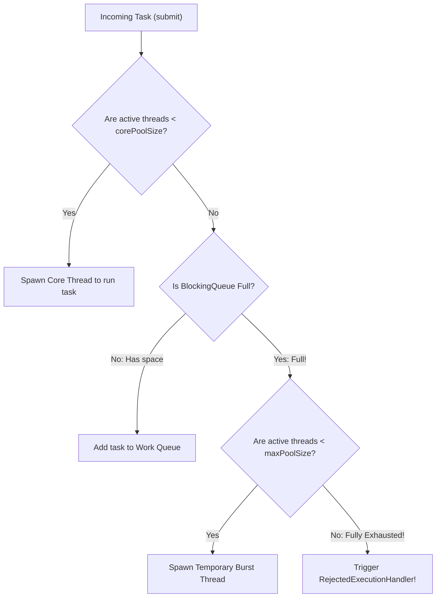

# Production Thread Management: ExecutorService & Thread Pools

> **Phase 6: Multithreading & Concurrent Programming**  
> *Estimated Reading Time: 50 minutes | Total Practice Effort: ~3.5 hours | Tier: Core Essential*

---

## 1. Purpose & Prerequisites

### Why This Matters in Full Stack Development
In Topic 6.1, we created threads directly via `new Thread(task).start()`.  
In enterprise software engineering, doing this in production is a **critical anti-pattern**:
- Spawning an OS thread requires allocating ~1MB of off-heap stack memory (`-Xss`), calling operating system kernel routines, and incurring high context-switching overhead.
- If 10,000 users hit your endpoint simultaneously and your code spawns a `new Thread()` for each request, the OS will run out of native memory and crash with:  
  `java.lang.OutOfMemoryError: Unable to create new native thread`.

In production, **never manage raw threads manually**. Instead, use **Thread Pools** managed by the **`ExecutorService`** framework to recycle a bounded pool of pre-warmed worker threads.

### Prerequisites
- [Topic 6.1: Threads, The Thread Class & Runnable Lifecycle](01-thread-basics.md)
- [Topic 6.4: Thread Coordination: wait(), notify() & Deadlock Avoidance](04-coordination.md)

---

## 2. Plain-English Mental Model

Think of an `ExecutorService` like a taxi dispatch company:

```
[ Incoming Ride Requests (Work Queue) ]
[ Request 1 ][ Request 2 ][ Request 3 ][ Request 4 ][ Request 5 ] ...
                                |
                                v
+---------------------------------------------------------------+
| The Taxi Fleet (Thread Pool: 4 Fixed Drivers)                 |
| [ Driver 1: Busy ]   [ Driver 2: Idle -> Takes Request 1 ]    |
| [ Driver 3: Busy ]   [ Driver 4: Idle -> Takes Request 2 ]    |
+---------------------------------------------------------------+
```

- Instead of manufacturing and destroying a brand-new car for every passenger, the company maintains a fixed fleet of 4 drivers.
- When all 4 drivers are busy, incoming passengers wait in a line (**Blocking Queue**).
- When a driver finishes a ride, they return to the station and immediately pick up the next passenger from the queue.

---

## 3. The `Executors` Factory Methods

Java provides the `java.util.concurrent.Executors` utility class to create standard pools:

```java
// 1. Fixed Thread Pool: Exactly N reusable worker threads (Best for general web services)
ExecutorService fixedPool = Executors.newFixedThreadPool(8);

// 2. Single Thread Executor: Exactly 1 worker thread (Guarantees sequential FIFO task execution)
ExecutorService singlePool = Executors.newSingleThreadExecutor();

// 3. Scheduled Thread Pool: Reusable pool for cron jobs and delayed tasks
ScheduledExecutorService scheduler = Executors.newScheduledThreadPool(4);
scheduler.scheduleAtFixedRate(task, 0, 10, TimeUnit.SECONDS); // Runs every 10 seconds!

// 4. Cached Thread Pool: WARNING!
ExecutorService cachedPool = Executors.newCachedThreadPool();
```

> [!WARNING] The `newCachedThreadPool()` Production Trap
> `Executors.newCachedThreadPool()` has an **unbounded maximum thread limit** ($2^{31}-1$). Under an unexpected traffic spike, it will attempt to spawn thousands of concurrent threads, exhausting OS thread handles and crashing your server. Avoid it in public-facing web services!

---

## 4. Deconstructing `ThreadPoolExecutor`: Production Parameters

In production microservices, senior engineers instantiate `ThreadPoolExecutor` directly with explicit bounds:



```java
ThreadPoolExecutor executor = new ThreadPoolExecutor(
    4,                                     // corePoolSize: Always alive
    10,                                    // maximumPoolSize: Maximum during bursts
    60L, TimeUnit.SECONDS,                 // keepAliveTime: Timeout for burst threads
    new ArrayBlockingQueue<>(500),         // workQueue: Bounded queue (capacity 500)
    new ThreadPoolExecutor.CallerRunsPolicy() // rejectionHandler: Backpressure policy
);
```

### The 4 Rejection Policies (When Pool & Queue are Full):
1. **`AbortPolicy` (Default):** Throws `RejectedExecutionException`.
2. **`CallerRunsPolicy` (Best for Web Servers):** The thread that called `submit()` (e.g. the web server thread) executes the task itself. This automatically slows down incoming traffic, providing natural **backpressure**!
3. **`DiscardPolicy`:** Silently drops the task with no error.
4. **`DiscardOldestPolicy`:** Discards the oldest unhandled task in the queue and retries.

---

## 5. The Graceful Shutdown Lifecycle

If you forget to shut down an `ExecutorService`, your application will **hang forever** because pool threads are non-daemon!  
Always implement the standard two-phase graceful shutdown pattern:

```java
public static void shutdownGracefully(ExecutorService executor) {
    executor.shutdown(); // 1. Rejects new tasks; allows queued tasks to finish
    try {
        // 2. Wait up to 30 seconds for existing tasks to conclude
        if (!executor.awaitTermination(30, TimeUnit.SECONDS)) {
            executor.shutdownNow(); // 3. Cancel running tasks via interrupt()
            // Wait another 10 seconds for tasks to respond to interrupt
            if (!executor.awaitTermination(10, TimeUnit.SECONDS)) {
                System.err.println("Pool did not terminate.");
            }
        }
    } catch (InterruptedException e) {
        executor.shutdownNow();
        Thread.currentThread().interrupt();
    }
}
```

---

## 6. Working Code Example: Production Thread Pool Execution

```java
// File: ExecutorServiceDemo.java
import java.util.concurrent.*;

public class ExecutorServiceDemo {
    public static void main(String[] args) throws InterruptedException {
        // Construct a bounded, production-safe ThreadPoolExecutor
        ThreadPoolExecutor pool = new ThreadPoolExecutor(
            2,                                      // 2 Core Threads
            4,                                      // 4 Max Burst Threads
            10, TimeUnit.SECONDS,                   // Keep-alive for extra threads
            new ArrayBlockingQueue<>(3),            // Bounded Queue of size 3
            new ThreadPoolExecutor.CallerRunsPolicy() // Backpressure handler
        );

        System.out.println("=== Submitting 8 Asynchronous Tasks to Pool ===");

        for (int i = 1; i <= 8; i++) {
            final int taskId = i;
            pool.submit(() -> {
                String threadName = Thread.currentThread().getName();
                System.out.println("Executing Task #" + taskId + " on " + threadName);
                try {
                    Thread.sleep(400); // Simulate network I/O
                } catch (InterruptedException e) {
                    Thread.currentThread().interrupt();
                }
            });
        }

        // Initiate clean shutdown
        pool.shutdown();
        pool.awaitTermination(5, TimeUnit.SECONDS);
        System.out.println("All tasks completed. Pool shut down cleanly.");
    }
}
```

### Exact Output:
```text
=== Submitting 8 Asynchronous Tasks to Pool ===
Executing Task #1 on pool-1-thread-1
Executing Task #2 on pool-1-thread-2
Executing Task #6 on pool-1-thread-3
Executing Task #7 on pool-1-thread-4
Executing Task #8 on main  <-- CallerRunsPolicy throttles main thread!
Executing Task #3 on pool-1-thread-1
Executing Task #4 on pool-1-thread-2
Executing Task #5 on pool-1-thread-3
All tasks completed. Pool shut down cleanly.
```

---

## 7. Guided Hands-On Exercise

### Challenge: Email Blast Dispatcher with FixedThreadPool
Create a program named `EmailBlastDispatcher.java`:
1. Use `Executors.newFixedThreadPool(3)` to model a batch of 3 email sender threads.
2. Submit 6 email tasks: `{"user1@test.com", "user2@test.com", ..., "user6@test.com"}`.
3. Each task prints `"Sending email to [address] via [threadName]..."`, sleeps for 200ms, and prints `"Delivered to [address]!"`.
4. Shut down the executor gracefully using `.shutdown()` and `.awaitTermination(5, TimeUnit.SECONDS)`.

<details>
<summary>💡 Hint: Task submission</summary>

```java
for (String email : emails) {
    pool.submit(() -> sendEmail(email));
}
pool.shutdown();
pool.awaitTermination(5, TimeUnit.SECONDS);
```
</details>

<details>
<summary>✅ Solution</summary>

```java
import java.util.concurrent.ExecutorService;
import java.util.concurrent.Executors;
import java.util.concurrent.TimeUnit;

public class EmailBlastDispatcher {
    public static void main(String[] args) throws InterruptedException {
        String[] recipientList = {
            "sarah@company.com", "alex@company.com", "john@company.com",
            "emma@company.com", "dave@company.com", "lisa@company.com"
        };

        ExecutorService emailPool = Executors.newFixedThreadPool(3);

        for (String recipient : recipientList) {
            emailPool.submit(() -> {
                String thread = Thread.currentThread().getName();
                System.out.println("Dispatching to " + recipient + " via " + thread);
                try {
                    Thread.sleep(200); // Simulate SMTP handshake
                } catch (InterruptedException e) {
                    Thread.currentThread().interrupt();
                }
                System.out.println(" -> Delivered to " + recipient);
            });
        }

        emailPool.shutdown();
        boolean finished = emailPool.awaitTermination(5, TimeUnit.SECONDS);
        System.out.println("Email broadcast finished successfully? " + finished);
    }
}
```

**Terminal Output (Representative):**
```text
Dispatching to sarah@company.com via pool-1-thread-1
Dispatching to alex@company.com via pool-1-thread-2
Dispatching to john@company.com via pool-1-thread-3
 -> Delivered to sarah@company.com
Dispatching to emma@company.com via pool-1-thread-1
 -> Delivered to alex@company.com
Dispatching to dave@company.com via pool-1-thread-2
 -> Delivered to john@company.com
Dispatching to lisa@company.com via pool-1-thread-3
 -> Delivered to emma@company.com
 -> Delivered to dave@company.com
 -> Delivered to lisa@company.com
Email broadcast finished successfully? true
```
</details>

---

## 8. Knowledge Check & Interview Defense

### Quick Quiz
1. **Why should you avoid creating raw `new Thread()` instances inside HTTP request handlers in production?**
   - [x] A) Spawning unbounded threads can exhaust operating system memory and thread limits, crashing the server with `OutOfMemoryError: Unable to create new native thread`.
   - [ ] B) Threads cannot execute in web apps.
   - [ ] C) Java only permits 1 thread per server.
   - [ ] D) Raw threads run 100x slower.

2. **What does the `CallerRunsPolicy` do when a `ThreadPoolExecutor` and its work queue are completely full?**
   - [ ] A) It crashes the JVM.
   - [x] B) It forces the submitting thread (the caller) to execute the task itself, providing natural backpressure that slows down incoming submissions.
   - [ ] C) It deletes the oldest thread.
   - [ ] D) It writes the task to a database.

3. **What is the difference between `executor.shutdown()` and `executor.shutdownNow()`?**
   - [x] A) `shutdown()` permits already-submitted and executing tasks to finish gracefully while rejecting new tasks; `shutdownNow()` attempts to cancel running tasks via `interrupt()` and drains unexecuted tasks.
   - [ ] B) `shutdownNow()` deletes the class files.
   - [ ] C) There is no difference.
   - [ ] D) `shutdown()` is deprecated.

---

### Junior Developer Interview Q&A

#### Q: "How does a ThreadPoolExecutor decide when to create new threads beyond corePoolSize?"
> **Model Answer:**  
> "A `ThreadPoolExecutor` follows a specific 4-step sequence:
> 1. **Core Allocation:** When a task is submitted, if fewer than `corePoolSize` threads are running, a new thread is spawned to execute the task immediately (even if other core threads are idle).
> 2. **Queue Buffering:** If `corePoolSize` threads are active, the executor attempts to place the task into the internal `workQueue`. It does **not** create extra threads yet!
> 3. **Burst Thread Spawning:** If the `workQueue` is completely full and active threads are fewer than `maximumPoolSize`, the executor spawns temporary burst threads to handle the overflow.
> 4. **Rejection:** If active threads equal `maximumPoolSize` AND the `workQueue` is full, the task is rejected according to the configured `RejectedExecutionHandler` (e.g. `AbortPolicy` or `CallerRunsPolicy`)."

---

## 9. Mastery Checklist & Next Step

Before moving on, verify that you can:
- [ ] Explain why raw thread instantiation is dangerous in production web services.
- [ ] Configure `ThreadPoolExecutor` parameters (`corePoolSize`, `maximumPoolSize`, `keepAliveTime`, bounded queues).
- [ ] Choose and explain the 4 standard rejection policies, particularly `CallerRunsPolicy`.
- [ ] Implement two-phase graceful shutdown with `shutdown()` and `awaitTermination()`.

👉 **Next Lesson:** **[Topic 6.6: Asynchronous Tasks: Callable, Future & CompletableFuture [ADVANCED]](06-completablefuture.md)**
