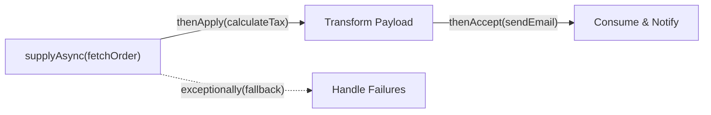

# Asynchronous Tasks: Callable, Future & CompletableFuture [ADVANCED]

> **Phase 6: Multithreading & Concurrent Programming**  
> *Estimated Reading Time: 55 minutes | Total Practice Effort: ~4.0 hours | Tier: Advanced Deep Dive*

---

## 1. Purpose & Prerequisites

### Why This Matters in Full Stack Development
Consider a modern e-commerce dashboard. When a user opens their account page, the backend needs to fetch:
1. User Profile details from the User Microservice (takes 200ms).
2. Recent Orders from the Order Database (takes 250ms).
3. Loyalty Reward Points from the Rewards Microservice (takes 150ms).

If executed sequentially, the user waits $200 + 250 + 150 = 600\text{ ms}$.  
If executed concurrently, all three requests launch in parallel and complete in **250 ms** (the time of the slowest call)!

Historically, Java's `Runnable` couldn't return values. `Callable` and `Future` introduced return values, but `future.get()` blocked the thread. Java 8 introduced **`CompletableFuture`**—a non-blocking, composable promise API (identical in concept to JavaScript Promises) that powers modern reactive full-stack architectures.

### Prerequisites
- [Topic 3.9: Modern Java 8: Functional Interfaces & Lambda Syntax](../03-core/09-lambdas.md)
- [Topic 6.5: Production Thread Management: ExecutorService & Thread Pools](05-executors.md)

---

## 2. Plain-English Mental Model

Think of `Runnable`, `Future`, and `CompletableFuture` like three ways to order food:

```
[ Runnable: Food Donation ]
- You drop off food at a charity. You don't expect any food back (returns void).

[ Future: Fast Food Drive-Through Ticket ]
- The cashier hands you a numbered receipt (Future).
- But to get your food, you must STAND AT THE WINDOW WAITING (future.get() BLOCKS!).
- While you stand there blocked, you cannot do anything else.

[ CompletableFuture: The Smart Food Delivery App (Promises) ]
- You place the order on your smartphone.
- You say: "When the food arrives, put it on my porch (thenApply),
             ring the doorbell (thenAccept), and if the restaurant is closed,
             order pizza instead (exceptionally)!"
- You go about your day completely unblocked!
```

---

## 3. `Callable<V>` vs `Runnable`

| Property | `Runnable` | `Callable<V>` |
| :--- | :--- | :--- |
| **Method** | `public void run()` | **`public V call() throws Exception`** |
| **Return Value?** | ❌ No (returns `void`) | ✅ **Yes (returns generic type `V`)** |
| **Can Throw Checked Exceptions?**| ❌ No (must catch inside `run()`) | ✅ **Yes (throws `Exception`)** |
| **Introduced In** | Java 1.0 | Java 5 (`java.util.concurrent`) |

---

## 4. The Limitation of Traditional `Future<V>`

When you submit a `Callable` to an `ExecutorService`, it returns a `Future<V>`:

```java
Future<Double> future = executor.submit(() -> fetchUserBalance("USR-101"));

// THE FLAW: future.get() is a synchronous blocking call!
Double balance = future.get(); // BLOCKS the caller thread until background calculation finishes!
```

Traditional `Future` has major architectural limitations:
- **Blocking `.get()`:** You cannot attach a callback to be notified when the result is ready.
- **No Chaining:** You cannot easily pipe the result into a second asynchronous task.
- **No Combining:** You cannot easily wait for 5 different futures and combine their outputs without blocking on each one sequentially.

---

## 5. `CompletableFuture<T>`: Non-Blocking Reactive Pipelines

`CompletableFuture<T>` implements both `Future<T>` and `CompletionStage<T>`. It allows you to build declarative, non-blocking asynchronous processing chains:



### Essential `CompletableFuture` Methods:

| Method | Plain-English Action | Analogous To |
| :--- | :--- | :--- |
| **`supplyAsync(Supplier)`** | Starts an asynchronous task that **returns a value**. | `new Promise((resolve) -> ...)` |
| **`runAsync(Runnable)`** | Starts an asynchronous task with **no return value**. | Async background task |
| **`.thenApply(Function)`** | Transforms the result when it arrives (**Map**). | `.then(res => transform(res))` |
| **`.thenAccept(Consumer)`** | Consumes the result without returning anything. | `.then(res => console.log(res))` |
| **`.thenCompose(Function)`**| Chains another asynchronous future (**FlatMap**).| Chained async calls |
| **`.thenCombine(other, BiFn)`**| Waits for **two** futures to finish and merges results. | `Promise.all([f1, f2])` |
| **`.exceptionally(Function)`**| Catches exceptions and returns fallback default. | `.catch(err => fallback)` |
| **`CompletableFuture.allOf(...)`**| Waits for an entire array of futures to complete. | `Promise.all([...])` |

---

## 6. Working Code Example: Parallel E-Commerce Dashboard Aggregator

```java
// File: CompletableFutureDashboardDemo.java
import java.util.concurrent.*;

public class CompletableFutureDashboardDemo {
    public static void main(String[] args) {
        // Dedicated Thread Pool for microservice I/O
        ExecutorService ioPool = Executors.newFixedThreadPool(4);

        System.out.println("Main API Gateway thread: " + Thread.currentThread().getName());
        long startTime = System.currentTimeMillis();

        // 1. Asynchronously fetch User Profile (simulates 200ms)
        CompletableFuture<String> userFuture = CompletableFuture.supplyAsync(() -> {
            simulateLatency(200);
            return "User: Alice Morgan (Tier: GOLD)";
        }, ioPool);

        // 2. Asynchronously fetch Account Balance (simulates 300ms)
        CompletableFuture<Double> balanceFuture = CompletableFuture.supplyAsync(() -> {
            simulateLatency(300);
            return 1450.50;
        }, ioPool);

        // 3. Combine both independent futures concurrently with thenCombine()!
        CompletableFuture<String> combinedDashboardFuture = userFuture.thenCombine(balanceFuture, (user, balance) -> {
            return "=== DASHBOARD RESPONSE ===\n" + user + "\nAvailable Ledger Balance: $" + balance;
        });

        // 4. Attach non-blocking consumer callback
        combinedDashboardFuture.thenAccept(dashboardJson -> {
            long duration = System.currentTimeMillis() - startTime;
            System.out.println(dashboardJson);
            System.out.println("Rendered payload in: " + duration + " ms (Non-blocking!)");
        });

        // Block main thread briefly only to prevent process termination before async callbacks print
        combinedDashboardFuture.join();
        ioPool.shutdown();
    }

    public static void simulateLatency(int ms) {
        try { Thread.sleep(ms); } catch (InterruptedException e) { Thread.currentThread().interrupt(); }
    }
}
```

### Exact Output:
```text
Main API Gateway thread: main
=== DASHBOARD RESPONSE ===
User: Alice Morgan (Tier: GOLD)
Available Ledger Balance: $1450.5
Rendered payload in: 312 ms (Non-blocking!)
```
*Notice that rather than taking $200 + 300 = 500\text{ ms}$, both calls ran in parallel and completed in ~312 ms!*

---

## 7. Common Rookie Mistakes & Production Traps

### Trap 1: Omitting the Custom `Executor`
```java
// DANGEROUS IN PRODUCTION:
CompletableFuture.supplyAsync(() -> callExternalMicroservice());
```
> [!CAUTION] The CommonPool Starvation Trap
> If you omit the executor parameter, `CompletableFuture` executes on the shared **`ForkJoinPool.commonPool()`**.  
> If an external API stalls or times out, your blocking HTTP call starves the shared CPU pool, impacting other critical JVM background operations! Always pass a dedicated thread pool: `supplyAsync(task, ioThreadPool)`.

### Trap 2: Immediately Calling `.join()` or `.get()`
```java
// ANTI-PATTERN: Defeats concurrency completely!
CompletableFuture<User> u = fetchUser().join(); // BLOCKS immediately!
CompletableFuture<Order> o = fetchOrders().join(); // Runs sequentially!
```
Never call `.join()` until you have composed all your futures together using `.thenCombine()` or `allOf()`.

---

## 8. Guided Hands-On Exercise

### Challenge: Concurrent Flight & Hotel Booking Aggregator
Create a program named `TravelAggregatorDemo.java`:
1. Asynchronously fetch flight price:
   - Simulates 250ms delay, returns `$450.0`.
2. Asynchronously fetch hotel price:
   - Simulates 200ms delay, returns `$300.0`.
3. Asynchronously fetch car rental price with an error:
   - Throws `new RuntimeException("Car rental service offline")`.
   - Use `.exceptionally(ex -> 0.0)` to gracefully fall back to `$0.0`.
4. Combine all three prices using `thenCombine` and compute total vacation package price (`450 + 300 + 0 = $750.0`).

<details>
<summary>💡 Hint: Chaining thenCombine</summary>

```java
flightFuture.thenCombine(hotelFuture, Double::sum)
            .thenCombine(carFuture, Double::sum);
```
</details>

<details>
<summary>✅ Solution</summary>

```java
import java.util.concurrent.CompletableFuture;

public class TravelAggregatorDemo {
    public static void main(String[] args) {
        long start = System.currentTimeMillis();

        CompletableFuture<Double> flightFuture = CompletableFuture.supplyAsync(() -> {
            sleep(250);
            return 450.0;
        });

        CompletableFuture<Double> hotelFuture = CompletableFuture.supplyAsync(() -> {
            sleep(200);
            return 300.0;
        });

        // Car future handles exceptions with fallback
        CompletableFuture<Double> carFuture = CompletableFuture.supplyAsync(() -> {
            sleep(100);
            if (true) throw new RuntimeException("Car service timeout");
            return 80.0;
        }).exceptionally(ex -> {
            System.err.println("Warning: " + ex.getMessage() + ". Defaulting car rental to $0.0");
            return 0.0;
        });

        // Combine all 3 futures
        CompletableFuture<Double> totalVacationCost = flightFuture
            .thenCombine(hotelFuture, Double::sum)
            .thenCombine(carFuture, Double::sum);

        totalVacationCost.thenAccept(total -> {
            long elapsed = System.currentTimeMillis() - start;
            System.out.println("Total Vacation Package: $" + total + " (Computed in " + elapsed + " ms)");
        }).join();
    }

    public static void sleep(int ms) {
        try { Thread.sleep(ms); } catch (InterruptedException e) {}
    }
}
```

**Terminal Output:**
```text
Warning: java.lang.RuntimeException: Car service timeout. Defaulting car rental to $0.0
Total Vacation Package: $750.0 (Computed in 265 ms)
```
</details>

---

## 9. Knowledge Check & Interview Defense

### Quick Quiz
1. **What is the primary difference between `Callable<V>` and `Runnable`?**
   - [ ] A) `Callable` runs in parallel; `Runnable` does not.
   - [x] B) `Callable<V>` returns a generic value and can throw checked exceptions; `Runnable` returns void and cannot throw checked exceptions.
   - [ ] C) `Runnable` is deprecated in Java 21.
   - [ ] D) `Callable` only works on numbers.

2. **Why is `CompletableFuture` superior to traditional `Future`?**
   - [x] A) `CompletableFuture` allows non-blocking callback chaining (`thenApply`, `thenAccept`), multi-future combination, and error recovery without blocking the caller thread.
   - [ ] B) `CompletableFuture` does not use memory.
   - [ ] C) `Future` cannot run on Linux.
   - [ ] D) `CompletableFuture` is synchronized.

3. **What default thread pool is used by `CompletableFuture.supplyAsync()` if no executor is specified?**
   - [ ] A) `Executors.newFixedThreadPool(10)`
   - [x] B) The shared `ForkJoinPool.commonPool()`
   - [ ] C) A new thread is created every time.
   - [ ] D) The main thread.

---

### Junior Developer Interview Q&A

#### Q: "What is the difference between `.thenApply()` and `.thenCompose()` in CompletableFuture?"
> **Model Answer:**  
> "The difference is analogous to `map()` versus `flatMap()`:
> - **`.thenApply(Function<T, R>)`:** Used for synchronous data transformation. The mapping function returns a direct value of type `R`. The resulting future is `CompletableFuture<R>`.  
> - **`.thenCompose(Function<T, CompletableFuture<R>>)`:** Used to chain an asynchronous task that itself returns another `CompletableFuture`. If you used `thenApply()` here, you would end up with an unmanageable nested `CompletableFuture<CompletableFuture<R>>`. `thenCompose()` flattens the nested future, returning a clean, single `CompletableFuture<R>`."

---

## 10. Mastery Checklist & Next Step

Before moving on, verify that you can:
- [ ] Differentiate between `Runnable`, `Callable<V>`, `Future<V>`, and `CompletableFuture<T>`.
- [ ] Build non-blocking asynchronous pipelines using `thenApply`, `thenAccept`, and `thenCombine`.
- [ ] Handle asynchronous failures gracefully using `.exceptionally()`.
- [ ] Supply dedicated `Executor` pools to prevent `ForkJoinPool.commonPool` starvation.

👉 **Next Lesson:** **[Topic 6.7: Concurrent Collections: ConcurrentHashMap & BlockingQueue [ADVANCED]](07-concurrent-collections.md)**
