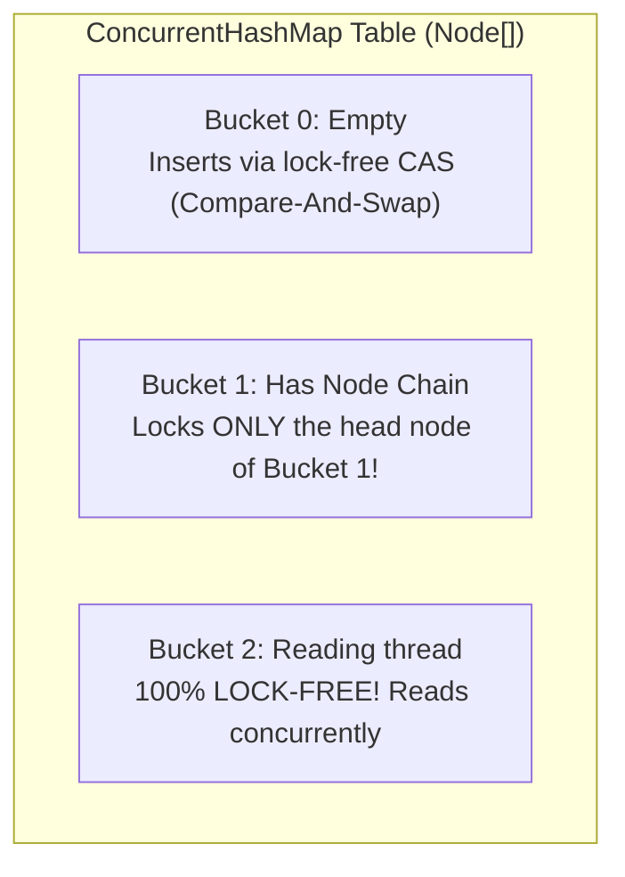

# Concurrent Collections: ConcurrentHashMap & BlockingQueue [ADVANCED]

> **Phase 6: Multithreading & Concurrent Programming**  
> *Estimated Reading Time: 50 minutes | Total Practice Effort: ~3.5 hours | Tier: Advanced Deep Dive*

---

## 1. Purpose & Prerequisites

### Why This Matters in Full Stack Development
In a high-throughput backend service (such as a Spring Boot API gateway handling 10,000 requests per second), multiple threads constantly read and update shared data:
- Active user authentication sessions.
- In-memory rate limiting and request counters.
- Asynchronous message buffers passing events between worker threads.

If you use a standard `HashMap` across multiple threads, concurrent modifications can corrupt internal bucket pointers, causing silent data loss or infinite loops. If you use `Collections.synchronizedMap()`, a coarse-grained lock freezes all threads, destroying throughput.

Java's **Concurrent Collections (`java.util.concurrent`)**—led by **`ConcurrentHashMap`** and **`BlockingQueue`**—deliver thread safety with high concurrency, enabling simultaneous reads and writes without global bottlenecks.

### Prerequisites
- [Topic 4.5: Map Interface: HashMap Fundamentals & Key-Value Usage](../04-collections/05-hashmap-basics.md)
- [Topic 4.6: HashMap Deep Dive: Buckets, Collisions & Treeification [ADVANCED]](../04-collections/06-hashmap-internals.md)
- [Topic 6.3: Memory Visibility, volatile & Atomic Primitives (AtomicInteger)](03-visibility-atomics.md)

---

## 2. Plain-English Mental Model

```
[ Collections.synchronizedMap: The Single-Door Vault ]
- Only ONE person can enter the room at a time, even if they just want to read a poster on the wall.
- Giant line of waiting threads forms outside the door!

[ ConcurrentHashMap: The Multi-Aisle Supermarket (Lock Striping & CAS) ]
- Customer A can pick an item from Aisle 2.
- Customer B can simultaneously pick an item from Aisle 9.
- 100 people can READ labels simultaneously with ZERO locks!
- A lock is only placed on a specific shelf slot while an item is being stocked.
```

---

## 3. `ConcurrentHashMap` Under the Hood: Lock-Free Reads & Node Locking

How does `ConcurrentHashMap` achieve high throughput in modern Java (Java 8+)?



### The Architectural Breakthroughs:
1. **100% Lock-Free Reads:** Read operations (`get()`, `containsKey()`) require **zero synchronization or locks**. Nodes use `volatile` value pointers to guarantee instant memory visibility across CPU cores.
2. **Lock-Free Empty Insertions (CAS):** If a target bucket is empty, `ConcurrentHashMap` inserts the new node using a lock-free hardware CAS instruction.
3. **Bucket-Level Locking for Collisions:** If a bucket already contains a node chain or tree, the JVM synchronizes **only on the head node of that specific bucket**. All other buckets remain unlocked and available for concurrent writes!
4. **No Null Keys or Values Allowed:** Unlike standard `HashMap`, `ConcurrentHashMap` throws an immediate `NullPointerException` if you pass `null` as a key or value. This eliminates ambiguity in concurrent environments (where `map.get(k) == null` could mean "key not found" or "key mapped to null").

---

## 4. `BlockingQueue`: The Gold Standard for Thread Handoffs

In Topic 6.4, we wrote a manual bounded buffer using `wait()` and `notifyAll()`.  
In production, you never write manual wait-notify loops; you use **`java.util.concurrent.BlockingQueue`**:

| Method | Throws Exception | Returns Special Value | Blocks until space/item available | Times Out |
| :--- | :--- | :--- | :--- | :--- |
| **Insert** | `add(e)` | `offer(e)` | **`put(e)` (Thread-safe wait!)** | `offer(e, timeout, unit)` |
| **Remove** | `remove()` | `poll()` | **`take()` (Thread-safe wait!)** | `poll(timeout, unit)` |

```java
// Thread A (Producer): Blocks if queue reaches 1,000 items
blockingQueue.put(new OrderEvent("ORD-101"));

// Thread B (Consumer): Blocks until an item is available
OrderEvent event = blockingQueue.take();
```

### Core `BlockingQueue` Implementations:
- **`ArrayBlockingQueue`:** Bounded buffer backed by a fixed array. Uses a single lock for put and take.
- **`LinkedBlockingQueue`:** Optionally bounded buffer backed by linked nodes. Uses **two separate locks** (one `putLock` and one `takeLock`), allowing producers and consumers to operate concurrently!

---

## 5. Working Code Example: High-Throughput Event Queue

```java
// File: ConcurrentPipelineDemo.java
import java.util.concurrent.BlockingQueue;
import java.util.concurrent.ConcurrentHashMap;
import java.util.concurrent.LinkedBlockingQueue;
import java.util.concurrent.atomic.AtomicInteger;

public class ConcurrentPipelineDemo {
    public static void main(String[] args) throws InterruptedException {
        // 1. ConcurrentHashMap: Thread-safe metrics registry
        ConcurrentHashMap<String, AtomicInteger> eventTelemetry = new ConcurrentHashMap<>();

        // 2. BlockingQueue: Decoupled producer-consumer channel
        BlockingQueue<String> eventChannel = new LinkedBlockingQueue<>(10);

        // Consumer Thread
        Thread consumer = new Thread(() -> {
            try {
                while (true) {
                    String eventType = eventChannel.take(); // Blocks if empty!
                    if ("SHUTDOWN".equals(eventType)) break;

                    // Atomic increment using computeIfAbsent
                    eventTelemetry.computeIfAbsent(eventType, k -> new AtomicInteger(0))
                                  .incrementAndGet();

                    System.out.println("Processed event: " + eventType + " on " + Thread.currentThread().getName());
                }
            } catch (InterruptedException e) {
                Thread.currentThread().interrupt();
            }
        }, "Consumer-Worker");

        consumer.start();

        // Producer: Submitting events concurrently
        String[] incomingBatch = {"LOGIN", "CHECKOUT", "LOGIN", "VIEW_ITEM", "LOGIN", "SHUTDOWN"};
        for (String event : incomingBatch) {
            eventChannel.put(event); // Blocks if full!
        }

        consumer.join();

        System.out.println("\n=== Final Aggregated Telemetry (ConcurrentHashMap) ===");
        eventTelemetry.forEach((event, count) -> {
            System.out.println(event + " -> " + count.get() + " occurrences");
        });
    }
}
```

### Exact Output:
```text
Processed event: LOGIN on Consumer-Worker
Processed event: CHECKOUT on Consumer-Worker
Processed event: LOGIN on Consumer-Worker
Processed event: VIEW_ITEM on Consumer-Worker
Processed event: LOGIN on Consumer-Worker

=== Final Aggregated Telemetry (ConcurrentHashMap) ===
CHECKOUT -> 1 occurrences
VIEW_ITEM -> 1 occurrences
LOGIN -> 3 occurrences
```

---

## 6. Common Rookie Mistakes & Traps

### Trap 1: Non-Atomic Compound Operations on `ConcurrentHashMap`
```java
// RACE CONDITION: Check-then-act is NOT atomic even on ConcurrentHashMap!
if (!map.containsKey(userId)) {
    map.put(userId, new Session()); // Two threads can enter here simultaneously!
}

// CORRECT: Atomic functional method
map.computeIfAbsent(userId, k -> new Session());
```

### Trap 2: Using `CopyOnWriteArrayList` for Write-Heavy Scenarios
`CopyOnWriteArrayList` clones its entire internal array on **every single `add()` or `set()`** call! It is exceptionally fast for read-heavy workloads (like a list of event listeners that are read thousands of times per second and modified once a day), but will cripple memory performance if used for high-volume write queues.

---

## 7. Guided Hands-On Exercise

### Challenge: Concurrent Cache with Atomic Updates
Create a program named `ConcurrentCacheDemo.java`:
1. Use `ConcurrentHashMap<String, Long> accessCounter = new ConcurrentHashMap<>();`
2. Spawn 5 concurrent threads, each simulating 1,000 accesses to `"PAGE_HOME"` and `"PAGE_LOGIN"`.
3. Use atomic operations (`merge()` or `compute()`) to update the visit count:
   ```java
   accessCounter.merge(page, 1L, Long::sum);
   ```
4. Wait for all threads to finish and verify that `"PAGE_HOME"` has exactly 5,000 visits and `"PAGE_LOGIN"` has exactly 5,000 visits.

<details>
<summary>💡 Hint: Thread array and join</summary>

```java
Thread[] workers = new Thread[5];
for (int i = 0; i < 5; i++) {
    workers[i] = new Thread(() -> {
        for (int j = 0; j < 1000; j++) {
            cache.merge("PAGE_HOME", 1L, Long::sum);
            cache.merge("PAGE_LOGIN", 1L, Long::sum);
        }
    });
    workers[i].start();
}
for (Thread t : workers) t.join();
```
</details>

<details>
<summary>✅ Solution</summary>

```java
import java.util.concurrent.ConcurrentHashMap;

public class ConcurrentCacheDemo {
    public static void main(String[] args) throws InterruptedException {
        ConcurrentHashMap<String, Long> accessCounter = new ConcurrentHashMap<>();

        int threadCount = 5;
        int iterations = 1000;
        Thread[] workers = new Thread[threadCount];

        for (int i = 0; i < threadCount; i++) {
            workers[i] = new Thread(() -> {
                for (int j = 0; j < iterations; j++) {
                    accessCounter.merge("PAGE_HOME", 1L, Long::sum);
                    accessCounter.merge("PAGE_LOGIN", 1L, Long::sum);
                }
            });
            workers[i].start();
        }

        for (Thread t : workers) {
            t.join();
        }

        System.out.println("=== Concurrent Cache Verification ===");
        System.out.println("PAGE_HOME  Visits: " + accessCounter.get("PAGE_HOME") 
                           + " (Expected: " + (threadCount * iterations) + ")");
        System.out.println("PAGE_LOGIN Visits: " + accessCounter.get("PAGE_LOGIN") 
                           + " (Expected: " + (threadCount * iterations) + ")");
    }
}
```

**Terminal Output:**
```text
=== Concurrent Cache Verification ===
PAGE_HOME  Visits: 5000 (Expected: 5000)
PAGE_LOGIN Visits: 5000 (Expected: 5000)
```
</details>

---

## 8. Knowledge Check & Interview Defense

### Quick Quiz
1. **How does `ConcurrentHashMap` achieve high write concurrency in modern Java (Java 8+)?**
   - [ ] A) It synchronizes the entire table on every write.
   - [x] B) It uses lock-free CAS instructions for empty buckets and synchronizes only on the head node of the specific collided bucket, allowing simultaneous writes to different buckets.
   - [ ] C) It uses a single thread in the background.
   - [ ] D) It writes updates to disk.

2. **Why does `ConcurrentHashMap` disallow `null` keys and `null` values?**
   - [x] A) To prevent ambiguity in multi-threaded environments, where checking if a key exists cannot be reliably distinguished from a key mapped to null.
   - [ ] B) Because null cannot be hashed.
   - [ ] C) To comply with SQL standards.
   - [ ] D) Only when running on Linux.

3. **Which `BlockingQueue` method suspends the calling thread if the queue is empty until an item becomes available?**
   - [ ] A) `poll()`
   - [ ] B) `remove()`
   - [x] C) `take()`
   - [ ] D) `peek()`

---

### Junior Developer Interview Q&A

#### Q: "Why is `ConcurrentHashMap` vastly superior to `Collections.synchronizedMap()` in high-traffic enterprise systems?"
> **Model Answer:**  
> "`Collections.synchronizedMap()` is a naive wrapper that wraps every method call in a coarse-grained `synchronized` block locking on the entire map instance. As a result, only **one single thread in the entire application** can read or write at any millisecond, creating an intense bottleneck under load.  
> 
> `ConcurrentHashMap` provides fine-grained concurrency:
> 1. **Lock-Free Reads:** Read operations (`get()`, `containsKey()`) do not block and require zero locking, allowing thousands of threads to read concurrently.
> 2. **Localized Locking:** Write operations synchronize only on the specific bucket head node being modified, leaving all other buckets open for simultaneous writes by other threads.  
> 
> This provides nearly linear throughput scaling across multi-core processors."

---

## 9. Phase 6 Mastery Checklist & Next Phase

Congratulations! You have completed **Phase 6: Multithreading & Concurrent Programming**.

### Phase 6 Mastery Self-Audit:
- [x] Threads & Runnable: Understand OS processes vs threads, and trace the 6 thread states.
- [x] Synchronization: Eliminate race conditions using fine-grained synchronized monitor blocks.
- [x] Visibility & Atomics: Enforce memory visibility with `volatile` and implement lock-free CAS atomics.
- [x] Coordination & Deadlocks: Build producer-consumer pipelines with `wait()`/`notifyAll()` and prevent deadlocks with lock ordering.
- [x] ExecutorService: Configure production thread pools with bounded queues and backpressure rejection policies.
- [x] Asynchronous Pipelines: Build non-blocking reactive chains using `CompletableFuture`.
- [x] Concurrent Collections: Leverage `ConcurrentHashMap` and `BlockingQueue` for thread-safe data structures.

👉 **Next Phase:** **[Phase 7: Relational Databases & SQL Mastery — Topic 7.1: Relational Concepts: Tables, Primary Keys, Foreign Keys & Schema](../07-sql/01-db-concepts.md)**
