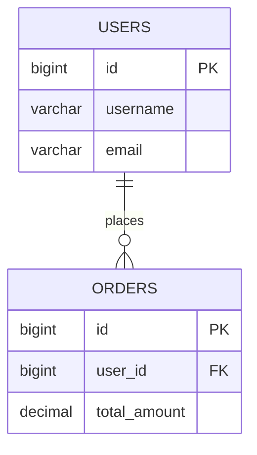

# Relational Concepts: Tables, Primary Keys, Foreign Keys & Schema

> **Phase 7: Relational Databases & SQL Mastery**  
> *Estimated Reading Time: 40 minutes | Total Practice Effort: ~2.5 hours | Tier: Core Essential*

---

## 1. Purpose & Prerequisites

### Why This Matters in Full Stack Development
In Phases 1 through 6, all our objects lived in the computer's volatile RAM (the JVM Heap). The moment your Java server restarts or reboots, everything in RAM evaporates.

A professional application requires a durable, persistent, highly structured storage engine. **Relational Database Management Systems (RDBMS)**—such as MySQL and PostgreSQL—provide secure, durable storage capable of handling millions of concurrent queries while guaranteeing data integrity.

Before writing Java database code (JDBC, JPA, Hibernate), you must master **Relational Schema Design**, primary keys, foreign keys, and constraint modeling.

### Prerequisites
- [Phase 2: OOP & Class Design](../02-oop/01-classes-objects.md)

---

## 2. Plain-English Mental Model

Think of a relational database like an enterprise filing room containing interconnected digital spreadsheets:

```
[ Table: Users ]                              [ Table: Orders ]
+----+-------------+-------------------+      +----+---------+--------+------------+
| id | username    | email             |      | id | user_id | amount | status     |
+----+-------------+-------------------+      +----+---------+--------+------------+
| 1  | alice_dev   | alice@company.com | <----+--| 101| 1       | 150.00 | PAID       |
| 2  | bob_smith   | bob@company.com   |      | 102| 1       |  45.00 | PENDING    |
+----+-------------+-------------------+      +----+---------+--------+------------+
```

- **Table (Relation):** A spreadsheet representing a single business entity (e.g. `Users`, `Orders`).
- **Row (Tuple / Record):** A single instance of that entity (e.g. Alice's user profile).
- **Column (Attribute / Field):** A specific piece of structured data (e.g. `email`).
- **Primary Key (PK):** A unique fingerprint identifying every single row.
- **Foreign Key (FK):** An arrow pointing from a child row back to a parent row, enforcing **Referential Integrity**.

---

## 3. Primary Keys: Surrogate vs Natural Keys

Every relational table must have a Primary Key that satisfies two invariants:
1. It must be **100% UNIQUE** across all rows.
2. It can **NEVER be NULL**.

### Natural Key vs Surrogate Key:
- **Natural Key:** A real-world attribute that happens to be unique (e.g. `email` or `passport_number`).  
  *The Risk:* What happens when a user changes their email address? If `email` is your primary key, updating it requires updating thousands of foreign key records across 10 tables!
- **Surrogate Key (Industry Standard):** An artificial, numeric identifier generated by the database (e.g. `id BIGINT AUTO_INCREMENT` or a `UUID`). It has no business meaning and will never change.

---

## 4. Foreign Keys & Referential Integrity Constraints

A **Foreign Key** links a column in a child table to the Primary Key of a parent table:



### Cascade Deletion Actions (`ON DELETE`):
When a parent record in `users` is deleted, what happens to their `orders`?
- **`ON DELETE RESTRICT` (Default / Safest):** Rejects deletion of the user if active orders exist.
- **`ON DELETE CASCADE`:** Automatically deletes all child orders when the parent user is deleted.
- **`ON DELETE SET NULL`:** Keeps the orders, but sets their `user_id` column to `NULL`.

---

## 5. SQL Column Data Types (MySQL / PostgreSQL)

| Data Type | Java Counterpart | When to Use |
| :--- | :--- | :--- |
| **`BIGINT`** | `long` | Primary keys, high-volume foreign keys, timestamps. |
| **`INT`** | `int` | Quantities, counters, small integer IDs. |
| **`DECIMAL(12, 2)`**| **`BigDecimal`** | **Currency, monetary balances, financial ledger figures!** |
| **`VARCHAR(255)`** | `String` | Names, emails, URLs, short text fields. |
| **`TEXT`** | `String` | Long product descriptions, blog posts, markdown content. |
| **`BOOLEAN`** | `boolean` | Flags, active toggles (`true` / `false`). |
| **`DATETIME` / `TIMESTAMP`**| `java.time.Instant` | Audit timestamps (`created_at`, `updated_at`). |

> [!CAUTION] The Money Rule
> **NEVER use `FLOAT` or `DOUBLE` for monetary amounts in SQL!** Floating point numbers suffer from binary rounding errors. Always use `DECIMAL(12, 2)` (or `NUMERIC`).

---

## 6. Working Code Example: Production E-Commerce DDL Schema

```sql
-- Create Database
CREATE DATABASE IF NOT EXISTS ecommerce_store;
USE ecommerce_store;

-- 1. Parent Table: Users
CREATE TABLE users (
    id BIGINT AUTO_INCREMENT PRIMARY KEY,
    username VARCHAR(50) NOT NULL UNIQUE,
    email VARCHAR(100) NOT NULL UNIQUE,
    is_active BOOLEAN NOT NULL DEFAULT TRUE,
    created_at TIMESTAMP NOT NULL DEFAULT CURRENT_TIMESTAMP
);

-- 2. Parent Table: Products
CREATE TABLE products (
    id BIGINT AUTO_INCREMENT PRIMARY KEY,
    sku VARCHAR(30) NOT NULL UNIQUE,
    title VARCHAR(150) NOT NULL,
    price DECIMAL(10, 2) NOT NULL,
    stock_quantity INT NOT NULL DEFAULT 0,
    CONSTRAINT chk_price_positive CHECK (price >= 0.0)
);

-- 3. Child Table: Orders (One-to-Many with Users)
CREATE TABLE orders (
    id BIGINT AUTO_INCREMENT PRIMARY KEY,
    user_id BIGINT NOT NULL,
    total_amount DECIMAL(10, 2) NOT NULL,
    status VARCHAR(20) NOT NULL DEFAULT 'PENDING',
    created_at TIMESTAMP NOT NULL DEFAULT CURRENT_TIMESTAMP,
    CONSTRAINT fk_orders_user FOREIGN KEY (user_id) 
        REFERENCES users(id) ON DELETE RESTRICT
);

-- 4. Junction Table: Order Items (Many-to-Many between Orders and Products)
CREATE TABLE order_items (
    id BIGINT AUTO_INCREMENT PRIMARY KEY,
    order_id BIGINT NOT NULL,
    product_id BIGINT NOT NULL,
    quantity INT NOT NULL,
    unit_price DECIMAL(10, 2) NOT NULL,
    CONSTRAINT fk_order_items_order FOREIGN KEY (order_id) 
        REFERENCES orders(id) ON DELETE CASCADE,
    CONSTRAINT fk_order_items_product FOREIGN KEY (product_id) 
        REFERENCES products(id) ON DELETE RESTRICT
);
```

---

## 7. Common Rookie Mistakes & Schema Traps

### Trap 1: Missing Foreign Key Indexes
While relational databases automatically build a unique B-Tree index on Primary Keys, **many databases (like PostgreSQL) do NOT automatically index Foreign Key columns**.  
If you join `users` and `orders` on `user_id` without an index, the database must scan the entire `orders` table line by line ($O(N)$ full table scan). Always create an index on foreign keys!

### Trap 2: Using `VARCHAR` for Fixed-Length Codes
If a column always has exactly 2 characters (e.g. Country Code `"US"`, `"CA"`), use `CHAR(2)`, not `VARCHAR(2)`. `VARCHAR` adds a length byte overhead.

---

## 8. Guided Hands-On Exercise

### Challenge: Course Enrollment Junction Schema
Write a SQL script designing an academy enrollment schema:
1. Table `students`: `id` (PK, BigInt auto-increment), `full_name` (Varchar 100), `email` (Varchar 100 unique).
2. Table `courses`: `id` (PK, BigInt auto-increment), `course_code` (Varchar 20 unique), `title` (Varchar 150).
3. Table `enrollments` (Junction Table for Many-to-Many):
   - `id` (PK)
   - `student_id` (FK to `students`, `ON DELETE CASCADE`)
   - `course_id` (FK to `courses`, `ON DELETE RESTRICT`)
   - `enrolled_at` (Timestamp defaulting to current time)
   - Add a unique constraint preventing a student from enrolling in the exact same course twice!

<details>
<summary>💡 Hint: Composite Unique Constraint</summary>

```sql
CONSTRAINT uq_student_course UNIQUE (student_id, course_id)
```
</details>

<details>
<summary>✅ Solution</summary>

```sql
CREATE TABLE students (
    id BIGINT AUTO_INCREMENT PRIMARY KEY,
    full_name VARCHAR(100) NOT NULL,
    email VARCHAR(100) NOT NULL UNIQUE
);

CREATE TABLE courses (
    id BIGINT AUTO_INCREMENT PRIMARY KEY,
    course_code VARCHAR(20) NOT NULL UNIQUE,
    title VARCHAR(150) NOT NULL
);

CREATE TABLE enrollments (
    id BIGINT AUTO_INCREMENT PRIMARY KEY,
    student_id BIGINT NOT NULL,
    course_id BIGINT NOT NULL,
    enrolled_at TIMESTAMP NOT NULL DEFAULT CURRENT_TIMESTAMP,
    CONSTRAINT fk_enroll_student FOREIGN KEY (student_id) REFERENCES students(id) ON DELETE CASCADE,
    CONSTRAINT fk_enroll_course FOREIGN KEY (course_id) REFERENCES courses(id) ON DELETE RESTRICT,
    CONSTRAINT uq_student_course UNIQUE (student_id, course_id)
);
```
</details>

---

## 9. Knowledge Check & Interview Defense

### Quick Quiz
1. **What is the difference between a Natural Key and a Surrogate Key?**
   - [ ] A) Natural keys are numbers; surrogate keys are strings.
   - [x] B) A Natural Key is a real-world business attribute (like SSN or email) that happens to be unique; a Surrogate Key is an artificial, meaningless unique identifier (like an auto-incrementing ID) managed exclusively by the database.
   - [ ] C) Natural keys cannot have foreign keys.
   - [ ] D) Surrogate keys are only used in NoSQL.

2. **Which SQL data type should strictly be used for storing financial currency amounts?**
   - [ ] A) `FLOAT`
   - [ ] B) `DOUBLE`
   - [x] C) `DECIMAL` (or `NUMERIC`)
   - [ ] D) `VARCHAR`

3. **What does the `ON DELETE CASCADE` constraint action enforce?**
   - [x] A) When a parent row is deleted, all matching child rows in the foreign key table are automatically deleted.
   - [ ] B) It prevents the parent row from being deleted.
   - [ ] C) It sets child columns to null.
   - [ ] D) It sends an email alert to the administrator.

---

### Junior Developer Interview Q&A

#### Q: "Why is a surrogate key (auto-increment BIGINT or UUID) generally preferred over a natural key (like email) for database primary keys?"
> **Model Answer:**  
> "A primary key should ideally be immutable, compact, and free of business logic.  
> 
> Natural keys (like a user's email address) are subject to business changes: users frequently change emails, merge accounts, or fix typos. If `email` were the primary key, changing an email would force the database to execute cascading updates across foreign key indexes in dozens of child tables, locking rows and causing massive latency.  
> 
> A surrogate key (such as an auto-incrementing `BIGINT`) has no business meaning and never changes. Foreign key relationships remain stable forever, and 8-byte integers produce much more compact B-Tree index pages than variable-length strings, maximizing caching performance."

---

## 10. Mastery Checklist & Next Step

Before moving on, verify that you can:
- [ ] Model relational tables with primary keys, foreign keys, and unique constraints.
- [ ] Differentiate between Surrogate Keys and Natural Keys in database architecture.
- [ ] Select appropriate column data types (`DECIMAL`, `BIGINT`, `VARCHAR`, `TIMESTAMP`).
- [ ] Implement Many-to-Many relationships using clean Junction Tables.

👉 **Next Lesson:** **[Topic 7.2: SQL CRUD Operations: CREATE, INSERT, SELECT, UPDATE, DELETE](02-crud-operations.md)**
