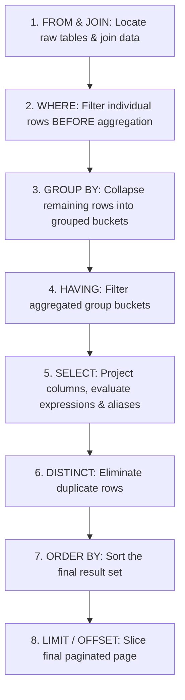

# Filtering, Sorting & Aggregations (WHERE, GROUP BY, HAVING)

> **Phase 7: Relational Databases & SQL Mastery**  
> *Estimated Reading Time: 50 minutes | Total Practice Effort: ~3.5 hours | Tier: Core Essential*

---

## 1. Purpose & Prerequisites

### Why This Matters in Full Stack Development
In real-world web applications, users don't just ask to read raw rows:
- An e-commerce admin needs a dashboard showing: *Total revenue per product category for the current month*.
- A financial auditor asks: *Which customers have processed more than 50 transactions totaling over $10,000?*
- A frontend React table requires paginated data: *Display page 3 with 20 items per page, sorted by highest rating*.

Writing SQL aggregations (`COUNT`, `SUM`, `AVG`, `GROUP BY`, `HAVING`) and understanding the **exact logical order of query execution** allows you to perform powerful data analytics directly inside the database engine at hardware speeds.

### Prerequisites
- [Topic 7.2: SQL CRUD Operations: CREATE, INSERT, SELECT, UPDATE, DELETE](02-crud-operations.md)

---

## 2. The Golden Secret: Written Order vs Execution Order

Every junior developer learns to write SQL queries in this order:
```sql
SELECT ... FROM ... WHERE ... GROUP BY ... HAVING ... ORDER BY ... LIMIT ...
```
However, the database query engine executes the query in a **completely different logical order**:



> [!IMPORTANT] The Column Alias Mystery Solved!
> Ever wonder why you get an error when using an alias in a `WHERE` clause:
> ```sql
> SELECT price * quantity AS total FROM order_items WHERE total > 100; -- ERROR!
> ```
> Look at the execution chart above! `WHERE` runs in **Step 2**, while `total` is defined in `SELECT` during **Step 5**! The alias `total` doesn't exist yet when `WHERE` is evaluating rows!

---

## 3. Aggregate Functions (`COUNT`, `SUM`, `AVG`, `MIN`, `MAX`)

Aggregate functions collapse multiple rows into a single scalar summary value:

| Function | What it Calculates | Crucial Nuance |
| :--- | :--- | :--- |
| **`COUNT(*)`** | Total rows in the group | Includes rows with `NULL` columns! |
| **`COUNT(column)`** | Count of non-null values | **Ignores `NULL` values completely!** |
| **`COUNT(DISTINCT col)`**| Count of unique non-null values| Deduplicates before counting |
| **`SUM(column)`** | Total arithmetic sum | Ignores `NULL`s |
| **`AVG(column)`** | Arithmetic mean (`SUM / COUNT`) | Ignores `NULL`s (does not divide by null rows!) |
| **`MIN(col)` / `MAX(col)`**| Minimum / Maximum value | Works on numbers, dates, and strings |

---

## 4. `GROUP BY`: The Bucket Aggregator

`GROUP BY` groups rows sharing identical values in specified columns into summary buckets:

```sql
SELECT category, COUNT(*) AS item_count, AVG(price) AS average_price
FROM products
GROUP BY category;
```

```
Raw Products Table:                   Grouped Output:
[ Electronics | Laptop | $1000 ]      +-------------+------------+---------------+
[ Electronics | Mouse  | $  50 ] ---> | category    | item_count | average_price |
[ Books       | Novel  | $  20 ]      +-------------+------------+---------------+
[ Books       | Guide  | $  30 ]      | Electronics | 2          | 525.00        |
                                      | Books       | 2          |  25.00        |
                                      +-------------+------------+---------------+
```

> [!CAUTION] The Cardinal Rule of GROUP BY
> Any column in your `SELECT` list that is **not wrapped inside an aggregate function** (like `SUM` or `COUNT`) **MUST be listed in the `GROUP BY` clause**! Otherwise, the query is logically ambiguous and will be rejected by SQL engines running in `ONLY_FULL_GROUP_BY` mode.

---

## 5. `WHERE` vs `HAVING`: What's the Difference?

| Dimension | `WHERE` Clause | `HAVING` Clause |
| :--- | :--- | :--- |
| **When Evaluated** | **Before** `GROUP BY` aggregation (Step 2) | **After** `GROUP BY` aggregation (Step 4) |
| **What it Filters** | Individual raw table **rows** | Aggregated **group buckets** |
| **Can use Aggregates?**| ❌ **NO!** (`WHERE SUM(price) > 100` is illegal) | ✅ **YES!** (`HAVING SUM(price) > 100` is valid) |
| **Performance** | **Fastest** (Uses B-Tree indexes to drop rows early) | Slower (Requires grouping and aggregating first) |

```sql
-- Clean Architecture Example:
SELECT department, COUNT(*) AS employee_count, AVG(salary) AS avg_salary
FROM employees
WHERE is_active = true          -- Step 2: Filter raw rows (Only active employees)
GROUP BY department             -- Step 3: Group by department
HAVING AVG(salary) > 75000.00;  -- Step 4: Filter departments whose average exceeds $75k
```

---

## 6. Sorting & Pagination (`ORDER BY`, `LIMIT`, `OFFSET`)

In web APIs, returning 500,000 records will freeze the browser and crash backend memory. We use pagination:

```sql
-- Page 3 (20 items per page):
-- Formula: OFFSET = (pageNumber - 1) * pageSize = (3 - 1) * 20 = 40
SELECT id, title, price 
FROM products 
ORDER BY price DESC, id ASC 
LIMIT 20 OFFSET 40;
```

> [!WARNING] The Deep Pagination Trap
> Queries like `LIMIT 20 OFFSET 1000000` perform poorly. The database must scan, sort, and discard the first 1,000,000 rows in memory before returning the 20 rows! In production high-scale systems, prefer **Keyset Pagination (Seek Method)**:  
> `WHERE id > last_seen_id ORDER BY id ASC LIMIT 20`.

---

## 7. Working Code Example: E-Commerce Sales Analytics Query

```sql
-- File: analytics_queries.sql

-- Calculate total revenue, order count, and average order value per status,
-- filtering only orders created in 2026, and returning only statuses with > $1000 revenue
SELECT 
    status,
    COUNT(*) AS total_orders,
    SUM(total_amount) AS gross_revenue,
    ROUND(AVG(total_amount), 2) AS avg_order_value
FROM orders
WHERE created_at >= '2026-01-01'           -- Filter raw rows
GROUP BY status                             -- Group by status
HAVING SUM(total_amount) > 1000.00          -- Filter aggregated groups
ORDER BY gross_revenue DESC;                -- Sort highest revenue first
```

### Sample Output:
```text
+-----------+--------------+---------------+-----------------+
| status    | total_orders | gross_revenue | avg_order_value |
+-----------+--------------+---------------+-----------------+
| DELIVERED | 450          | 68250.00      | 151.67          |
| SHIPPED   | 85           | 12420.50      | 146.12          |
| PAID      | 24           |  3850.00      | 160.42          |
+-----------+--------------+---------------+-----------------+
```

---

## 8. Guided Hands-On Exercise

### Challenge: High-Value Customer Analytics
Given a table `transactions`: `id` (PK), `customer_id` (BigInt), `category` (Varchar), `amount` (Decimal), `status` (Varchar).  
Write a query to:
1. Filter only legitimate transactions: `status = 'APPROVED'`.
2. Group the data by `customer_id`.
3. Calculate:
   - `total_spent`: Sum of `amount`.
   - `tx_count`: Total approved transactions.
   - `max_purchase`: Highest single transaction amount.
4. Filter using `HAVING` to retain only VIP customers who have:
   - At least 3 approved transactions (`COUNT(*) >= 3`), **AND**
   - Total spending greater than `$500.00` (`SUM(amount) > 500.00`).
5. Sort by `total_spent` descending.

<details>
<summary>💡 Hint: Query Structure</summary>

```sql
SELECT customer_id, SUM(amount) AS total_spent, ...
FROM transactions
WHERE status = 'APPROVED'
GROUP BY customer_id
HAVING COUNT(*) >= 3 AND SUM(amount) > 500.00
ORDER BY total_spent DESC;
```
</details>

<details>
<summary>✅ Solution</summary>

```sql
SELECT 
    customer_id,
    SUM(amount) AS total_spent,
    COUNT(*) AS tx_count,
    MAX(amount) AS max_purchase
FROM transactions
WHERE status = 'APPROVED'
GROUP BY customer_id
HAVING COUNT(*) >= 3 AND SUM(amount) > 500.00
ORDER BY total_spent DESC;
```
</details>

---

## 9. Knowledge Check & Interview Defense

### Quick Quiz
1. **What is the true logical execution order of a SQL query?**
   - [x] A) `FROM` &rarr; `WHERE` &rarr; `GROUP BY` &rarr; `HAVING` &rarr; `SELECT` &rarr; `ORDER BY` &rarr; `LIMIT`
   - [ ] B) `SELECT` &rarr; `FROM` &rarr; `WHERE` &rarr; `ORDER BY`
   - [ ] C) `WHERE` &rarr; `FROM` &rarr; `SELECT`
   - [ ] D) `LIMIT` runs first.

2. **Why is `WHERE SUM(price) > 500` illegal in SQL?**
   - [x] A) Because `WHERE` executes in Step 2 before rows are grouped or aggregated; group filter conditions must be placed in `HAVING`.
   - [ ] B) Because SUM only works in subqueries.
   - [ ] C) Because price cannot be summed.
   - [ ] D) Only PostgreSQL allows this.

3. **What is the difference between `COUNT(*)` and `COUNT(bonus)`?**
   - [ ] A) There is no difference.
   - [x] B) `COUNT(*)` counts all rows; `COUNT(bonus)` counts only rows where the `bonus` column is not null.
   - [ ] C) `COUNT(*)` only works on primary keys.
   - [ ] D) `COUNT(bonus)` calculates the sum.

---

### Junior Developer Interview Q&A

#### Q: "Why should we prefer filtering data in the WHERE clause rather than the HAVING clause whenever possible?"
> **Model Answer:**  
> "The `WHERE` clause filters individual rows **before** aggregation and grouping occur, whereas `HAVING` filters group buckets **after** the entire dataset has been gathered, sorted, and aggregated.  
> 
> Filtering early in `WHERE` has two massive performance advantages:
> 1. **Index Utilization:** `WHERE` clauses can utilize B-Tree database indexes to quickly isolate relevant rows without scanning the full table.
> 2. **Reduced Memory & CPU Churn:** By eliminating irrelevant rows upfront, the database engine processes significantly fewer rows in RAM during the heavy `GROUP BY` hashing and sorting operations."

---

## 10. Mastery Checklist & Next Step

Before moving on, verify that you can:
- [ ] Trace the 8-step logical execution order of a SQL query.
- [ ] Compute summary statistics using `COUNT`, `SUM`, `AVG`, `MIN`, and `MAX`.
- [ ] Aggregate tabular data cleanly using `GROUP BY`.
- [ ] Differentiate between row filtering (`WHERE`) and group filtering (`HAVING`).

👉 **Next Lesson:** **[Topic 7.4: SQL Joins & MySQL Compatibility (INNER, LEFT, RIGHT, UNION)](04-joins.md)**
