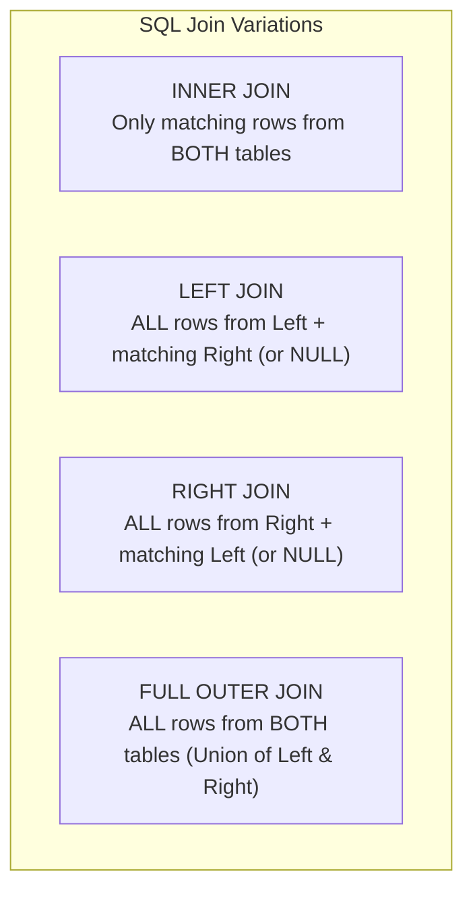

# SQL Joins & MySQL Compatibility (INNER, LEFT, RIGHT, UNION)

> **Phase 7: Relational Databases & SQL Mastery**  
> *Estimated Reading Time: 55 minutes | Total Practice Effort: ~4.0 hours | Tier: Core Essential*

---

## 1. Purpose & Prerequisites

### Why This Matters in Full Stack Development
In normalized relational databases, data is intentionally split across separate tables: `users`, `orders`, `products`, `invoices`.  
When an API endpoint like `GET /api/orders/101` is called by a React frontend, the client expects a single unified JSON object containing the user's name, the order status, and the individual product items.

**SQL Joins** are the mechanism used to stitch relational tables back together at query time. Mastering `INNER JOIN`, `LEFT JOIN`, `RIGHT JOIN`, and MySQL's unique **`FULL OUTER JOIN` workaround via `UNION`** is a fundamental requirement for every full-stack backend developer.

### Prerequisites
- [Topic 7.1: Relational Concepts: Tables, Primary Keys, Foreign Keys & Schema](01-db-concepts.md)
- [Topic 7.3: Filtering, Sorting & Aggregations (WHERE, GROUP BY, HAVING)](03-filtering-aggregations.md)

---

## 2. Plain-English Mental Model

Think of SQL joins as Venn diagrams comparing two sets of data:

```
[ Table A: Customers ]                           [ Table B: Orders ]
+----+-------+                                   +----+-------------+--------+
| id | name  |                                   | id | customer_id | amount |
+----+-------+                                   +----+-------------+--------+
| 1  | Alice |                                   | 10 | 1           | 100.00 |
| 2  | Bob   |                                   | 20 | 1           | 250.00 |
| 3  | Carol | (Has placed NO orders!)           | 30 | 99          |  50.00 | (Guest order: No customer!)
+----+-------+                                   +----+-------------+--------+
```

```
[ INNER JOIN: The Shared Overlap ]
- Returns ONLY customers who have orders AND orders that have customers!
- Output: Alice (Orders 10 & 20). (Bob, Carol, and Order 30 are EXCLUDED).

[ LEFT JOIN: All Customers + Matching Orders ]
- Returns ALL customers from Table A, even if they have zero orders!
- Output: Alice, Bob, Carol (Carol's order columns will be NULL).

[ FULL OUTER JOIN: Everything from Both Sides ]
- Returns ALL customers and ALL orders, matching where possible!
```

---

## 3. The 4 Primary Types of SQL Joins



### 1. `INNER JOIN` (The Default)
Returns rows only when there is a match in **both** tables:
```sql
SELECT c.name, o.id AS order_id, o.amount
FROM customers c
INNER JOIN orders o ON c.id = o.customer_id;
```

### 2. `LEFT JOIN` (Preserving Left Table Rows)
Keeps every row from the left table (`customers`), filling unmatched right columns with `NULL`:
```sql
SELECT c.name, o.id AS order_id, o.amount
FROM customers c
LEFT JOIN orders o ON c.id = o.customer_id;
```

### 3. Finding Unmatched Records (The Anti-Join Pattern)
To find all customers who have **never placed an order**:
```sql
SELECT c.name, c.email
FROM customers c
LEFT JOIN orders o ON c.id = o.customer_id
WHERE o.id IS NULL; -- If order_id is NULL, customer has zero orders!
```

---

## 4. MySQL Compatibility: Emulating `FULL OUTER JOIN` via `UNION`

> [!WARNING] The MySQL Full Outer Join Gotcha
> Unlike PostgreSQL, Oracle, and SQL Server, **MySQL does NOT natively support `FULL OUTER JOIN` syntax!**  
> Running `SELECT * FROM a FULL OUTER JOIN b ...` in MySQL will trigger a syntax error!

### The Standard MySQL Production Workaround:
To achieve a `FULL OUTER JOIN` in MySQL, you execute a **`LEFT JOIN`**, a **`RIGHT JOIN`**, and combine them using **`UNION`**:

```sql
-- MySQL Full Outer Join Emulation:
SELECT c.id AS customer_id, c.name, o.id AS order_id, o.amount
FROM customers c
LEFT JOIN orders o ON c.id = o.customer_id

UNION

SELECT c.id AS customer_id, c.name, o.id AS order_id, o.amount
FROM customers c
RIGHT JOIN orders o ON c.id = o.customer_id;
```

---

## 5. `UNION` vs `UNION ALL`

When stacking the results of two `SELECT` queries vertically:

| Operator | Deduplication | Performance | When to Use |
| :--- | :--- | :--- | :--- |
| **`UNION`** | ✅ Automatically **removes duplicate rows** | Slower (Sorts in RAM to deduplicate) | When combining sets that might overlap (like the Full Outer Join workaround). |
| **`UNION ALL`** | ❌ **Preserves all rows** (includes duplicates)| **Fastest** (Zero sorting or comparison overhead) | In 90% of cases where you know results don't overlap or duplicates are desired. |

---

## 6. Multi-Table Joins & Real-World E-Commerce Reporting

In full-stack systems, queries often join 3 or 4 tables across foreign keys:

```sql
SELECT 
    u.username,
    o.id AS order_id,
    o.created_at,
    p.title AS product_name,
    oi.quantity,
    oi.unit_price,
    (oi.quantity * oi.unit_price) AS line_total
FROM users u
INNER JOIN orders o ON u.id = o.user_id
INNER JOIN order_items oi ON o.id = oi.order_id
INNER JOIN products p ON oi.product_id = p.id
WHERE o.status = 'DELIVERED'
ORDER BY o.created_at DESC;
```

---

## 7. Common Rookie Mistakes & Traps

### Trap 1: The "Accidental Inner Join" Trap on `LEFT JOIN`
```java
// FLAWED: The WHERE clause destroys the LEFT JOIN!
SELECT c.name, o.amount
FROM customers c
LEFT JOIN orders o ON c.id = o.customer_id
WHERE o.amount > 100.00; -- Drops all customers with NULL orders!
```
**Why:** For customers with no orders, `o.amount` is `NULL`. Evaluating `NULL > 100.00` is `FALSE`, silently eliminating customers with no orders and turning your `LEFT JOIN` into an `INNER JOIN`!  
**Fix:** Move the condition to the `ON` clause:
```sql
SELECT c.name, o.amount
FROM customers c
LEFT JOIN orders o ON c.id = o.customer_id AND o.amount > 100.00;
```

### Trap 2: The Cartesian Product Disaster (Missing `ON` Clause)
```sql
SELECT * FROM users, orders; -- MISSING JOIN CONDITION!
```
If `users` has 10,000 rows and `orders` has 10,000 rows, this query generates **100,000,000 rows** ($10,000 \times 10,000$), overwhelming the server CPU and memory!

---

## 8. Guided Hands-On Exercise

### Challenge: Customer Activity & Churn Audit
Given tables:
- `users`: `id`, `name`, `email`
- `orders`: `id`, `user_id`, `amount`, `status`
Write queries to solve:
1. **Active Buyers Report:** Return user name, total order count, and total amount spent for all users who have placed at least 1 order (`INNER JOIN`).
2. **Customer Churn Audit:** Return all users who have registered but have **never placed an order** (`LEFT JOIN` anti-join pattern).
3. **MySQL Full Outer Join:** Emulate a full outer join of `users` and `orders` using `LEFT JOIN`, `RIGHT JOIN`, and `UNION`.

<details>
<summary>💡 Hint: Churn Anti-Join</summary>

```sql
SELECT u.name, u.email
FROM users u
LEFT JOIN orders o ON u.id = o.user_id
WHERE o.id IS NULL;
```
</details>

<details>
<summary>✅ Solution</summary>

```sql
-- 1. Active Buyers Report
SELECT 
    u.name,
    COUNT(o.id) AS total_orders,
    SUM(o.amount) AS total_spent
FROM users u
INNER JOIN orders o ON u.id = o.user_id
GROUP BY u.id, u.name;

-- 2. Customer Churn Audit (Users with ZERO orders)
SELECT u.id, u.name, u.email
FROM users u
LEFT JOIN orders o ON u.id = o.user_id
WHERE o.id IS NULL;

-- 3. MySQL Full Outer Join Workaround
SELECT u.id AS user_id, u.name, o.id AS order_id, o.amount
FROM users u
LEFT JOIN orders o ON u.id = o.user_id

UNION

SELECT u.id AS user_id, u.name, o.id AS order_id, o.amount
FROM users u
RIGHT JOIN orders o ON u.id = o.user_id;
```
</details>

---

## 9. Knowledge Check & Interview Defense

### Quick Quiz
1. **What is the difference between an `INNER JOIN` and a `LEFT JOIN`?**
   - [x] A) `INNER JOIN` returns only rows that have matching records in both tables; `LEFT JOIN` returns all rows from the left table, populating missing right table columns with `NULL`.
   - [ ] B) `INNER JOIN` deletes unmatched rows.
   - [ ] C) `LEFT JOIN` runs in parallel.
   - [ ] D) There is no difference.

2. **How do you execute a `FULL OUTER JOIN` in MySQL, which lacks native support for the syntax?**
   - [ ] A) It is impossible in MySQL.
   - [x] B) Execute a `LEFT JOIN` and a `RIGHT JOIN` of the two tables, combining their results with `UNION`.
   - [ ] C) Use `CROSS JOIN`.
   - [ ] D) By writing a Java loop.

3. **What is the performance advantage of `UNION ALL` over `UNION`?**
   - [x] A) `UNION ALL` simply appends rows without sorting or deduplication, whereas `UNION` performs an expensive in-memory sort to eliminate duplicate rows.
   - [ ] B) `UNION ALL` uses indexes.
   - [ ] C) `UNION` only works on numbers.
   - [ ] D) `UNION ALL` is deprecated.

---

### Junior Developer Interview Q&A

#### Q: "What is an Anti-Join, and how do you write one in SQL?"
> **Model Answer:**  
> "An **Anti-Join** is a relational query pattern used to find rows in Table A that have **no matching records** in Table B (such as finding customers who have never placed an order, or products that have never been purchased).  
> 
> In SQL, the most idiomatic and performant way to write an Anti-Join is using a **`LEFT JOIN` with an `IS NULL` filter**:
> ```sql
> SELECT a.* 
> FROM table_a a 
> LEFT JOIN table_b b ON a.id = b.a_id 
> WHERE b.a_id IS NULL;
> ```
> The `LEFT JOIN` preserves all rows from Table A. If a row in Table A has no match in Table B, all Table B columns are populated with `NULL`. Filtering by `WHERE b.a_id IS NULL` isolates exactly those unmatched records with optimal B-Tree index utilization."

---

## 10. Mastery Checklist & Next Step

Before moving on, verify that you can:
- [ ] Differentiate between `INNER JOIN`, `LEFT JOIN`, and `RIGHT JOIN`.
- [ ] Emulate `FULL OUTER JOIN` in MySQL using `LEFT JOIN`, `RIGHT JOIN`, and `UNION`.
- [ ] Choose between `UNION` (deduplicated) and `UNION ALL` (high speed).
- [ ] Implement Anti-Joins to identify orphan records using `IS NULL`.

👉 **Next Lesson:** **[Topic 7.5: Subqueries, CTEs & Database Locking Mechanics](05-subqueries.md)**
