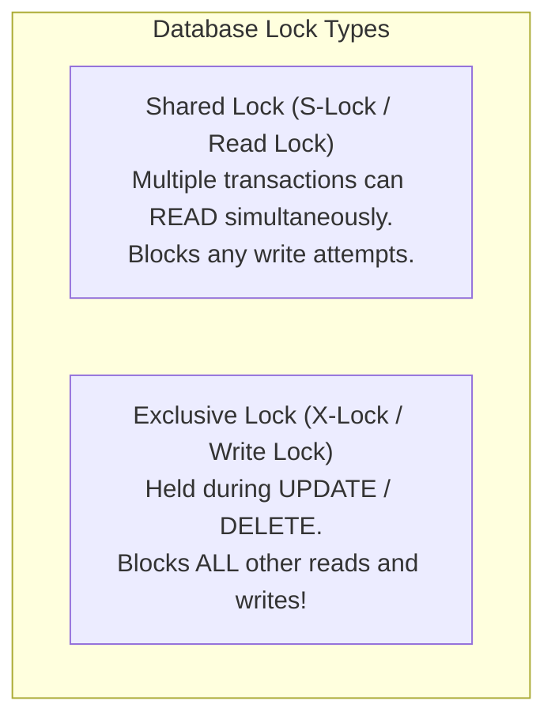

# Subqueries, CTEs & Database Locking Mechanics

> **Phase 7: Relational Databases & SQL Mastery**  
> *Estimated Reading Time: 50 minutes | Total Practice Effort: ~3.5 hours | Tier: Core Essential*

---

## 1. Purpose & Prerequisites

### Why This Matters in Full Stack Development
As business requirements grow complex, a single flat SQL query with simple `WHERE` clauses is rarely enough:
- *Find all products priced higher than the average price in their category.*
- *Identify the top 3 best-selling items per region for an analytics dashboard.*
- *Lock a specific seat reservation in a cinema booking system so no other user can purchase it concurrently.*

To build advanced, clean, and high-concurrency systems, you must understand **Subqueries**, modern **Common Table Expressions (CTEs)**, and **Database Locking Mechanics (`SELECT ... FOR UPDATE`)**.

### Prerequisites
- [Topic 7.3: Filtering, Sorting & Aggregations (WHERE, GROUP BY, HAVING)](03-filtering-aggregations.md)
- [Topic 7.4: SQL Joins & MySQL Compatibility (INNER, LEFT, RIGHT, UNION)](04-joins.md)

---

## 2. Plain-English Mental Model

```
[ Nested Subquery: A Russian Nesting Matryoshka Doll ]
- Query inside a query inside a query.
- Hard to read, difficult to debug, often runs repeatedly for every outer row!

[ Common Table Expression (CTE: WITH syntax): A Cooking Prep Station ]
- Chop the onions and put them in Bowl A (WITH step_one AS ...).
- Marinate the chicken in Bowl B (step_two AS ...).
- Cook the final dish by combining Bowl A and Bowl B!
- Clean, modular, self-documenting SQL!
```

---

## 3. Subqueries: Scalar, Multi-Row & Correlated

A **Subquery** is a `SELECT` statement embedded inside another SQL statement.

### 1. Scalar Subquery (Returns Exactly 1 Value)
Can be used anywhere a literal value is expected:
```sql
-- Find products priced higher than the overall catalog average
SELECT title, price
FROM products
WHERE price > (SELECT AVG(price) FROM products);
```

### 2. Multi-Row Subquery (Used with `IN`, `ANY`, `ALL`)
```sql
-- Find all users who have placed at least one high-value order (> $1,000)
SELECT username, email
FROM users
WHERE id IN (
    SELECT user_id 
    FROM orders 
    WHERE total_amount > 1000.00
);
```

### 3. Correlated Subquery (DANGER: Performance Bottleneck!)
A subquery that references a column from the **outer query**. The database must execute the inner query **once for every single row** in the outer table ($O(N^2)$ execution!):
```java
// SLOW on large tables: Executes 100,000 inner queries for 100,000 outer rows!
SELECT p1.title, p1.price
FROM products p1
WHERE p1.price > (
    SELECT AVG(p2.price) 
    FROM products p2 
    WHERE p2.category_id = p1.category_id -- Correlated to p1!
);
```

---

## 4. Modern SQL: Common Table Expressions (CTEs with `WITH`)

Introduced to MySQL in version 8.0, **Common Table Expressions (CTEs)** allow you to write named temporary result sets that exist only for the duration of a query:


```sql
-- Clean, Modular CTE Example:
WITH DepartmentSalarySummary AS (
    SELECT department_id, AVG(salary) AS avg_dept_salary
    FROM employees
    GROUP BY department_id
)
SELECT e.full_name, e.salary, d.avg_dept_salary
FROM employees e
INNER JOIN DepartmentSalarySummary d ON e.department_id = d.department_id
WHERE e.salary > d.avg_dept_salary;
```

---

## 5. Database Locking Mechanics: Shared vs Exclusive Locks

When hundreds of concurrent backend threads query and update the same database tables, the storage engine (e.g. MySQL **InnoDB**) uses locks to enforce data consistency:



### Lock Granularity:
- **Table-Level Locking (Legacy MyISAM):** Locks the **entire table** for every write. If Thread A updates 1 row, all 10,000 other rows in the table are frozen!
- **Row-Level Locking (Modern InnoDB / PostgreSQL):** Locks **only the specific row(s)** being modified. Other threads can read and update adjacent rows with zero contention.

---

## 6. Pessimistic Locking in SQL: `SELECT ... FOR UPDATE`

In full-stack systems, how do you prevent two users from booking the exact same concert seat or overdrawing a bank account at the same millisecond?  
You use **Pessimistic Locking via `SELECT ... FOR UPDATE`**:

```sql
START TRANSACTION;

-- 1. Read balance and place an EXCLUSIVE ROW LOCK immediately!
-- Any other transaction attempting to read or update this row is BLOCKED!
SELECT balance 
FROM accounts 
WHERE id = 101 
FOR UPDATE;

-- 2. Business logic verifies balance >= 200
UPDATE accounts 
SET balance = balance - 200 
WHERE id = 101;

-- 3. Release the lock and commit changes to disk
COMMIT;
```

> [!CAUTION] The Lock Duration Golden Rule
> **Never hold a database lock while making external network or HTTP API calls!**  
> If you call an external payment gateway inside a `SELECT ... FOR UPDATE` transaction, and the gateway takes 5 seconds to reply, that database row is locked for 5 full seconds, grinding your backend to a halt!

---

## 7. Working Code Example: Chained CTE Analytics

```sql
-- File: cte_analytics_demo.sql

-- Multi-step CTE Pipeline:
-- 1. Calculate user purchase totals
-- 2. Identify top 10% spenders
-- 3. Report user profiles
WITH UserSpending AS (
    SELECT 
        user_id,
        COUNT(id) AS order_count,
        SUM(total_amount) AS total_spent
    FROM orders
    WHERE status = 'DELIVERED'
    GROUP BY user_id
),
HighValueCustomers AS (
    SELECT user_id, order_count, total_spent
    FROM UserSpending
    WHERE total_spent > 500.00 AND order_count >= 2
)
SELECT 
    u.id AS customer_id,
    u.username,
    u.email,
    hvc.order_count,
    hvc.total_spent
FROM users u
INNER JOIN HighValueCustomers hvc ON u.id = hvc.user_id
ORDER BY hvc.total_spent DESC;
```

---

## 8. Guided Hands-On Exercise

### Challenge: Refactoring Nested Subquery to CTE
Examine the following unreadable nested subquery:

```sql
SELECT title, price 
FROM products 
WHERE id IN (
    SELECT product_id 
    FROM order_items 
    WHERE order_id IN (
        SELECT id 
        FROM orders 
        WHERE status = 'RETURNED'
    )
);
```

**Your Mission:**
Refactor this into a clean, modern CTE using `WITH ReturnedOrders AS (...)` and `ReturnedProducts AS (...)` that joins the tables cleanly.

<details>
<summary>💡 Hint: Chained WITH syntax</summary>

```sql
WITH ReturnedOrders AS (
    SELECT id FROM orders WHERE status = 'RETURNED'
),
ReturnedProducts AS (
    SELECT DISTINCT product_id 
    FROM order_items 
    INNER JOIN ReturnedOrders ON order_items.order_id = ReturnedOrders.id
)
SELECT p.title, p.price ...
```
</details>

<details>
<summary>✅ Solution</summary>

```sql
WITH ReturnedOrders AS (
    SELECT id 
    FROM orders 
    WHERE status = 'RETURNED'
),
ReturnedProductIds AS (
    SELECT DISTINCT oi.product_id
    FROM order_items oi
    INNER JOIN ReturnedOrders ro ON oi.order_id = ro.id
)
SELECT p.id, p.title, p.price
FROM products p
INNER JOIN ReturnedProductIds rpi ON p.id = rpi.product_id
ORDER BY p.price DESC;
```
</details>

---

## 9. Knowledge Check & Interview Defense

### Quick Quiz
1. **What is the primary readability and architectural advantage of a Common Table Expression (CTE) over a nested subquery?**
   - [x] A) CTEs modularize complex queries into named, linear, sequential blocks that can be referenced multiple times and are easy to read and debug.
   - [ ] B) CTEs run 1000x faster than any subquery.
   - [ ] C) CTEs automatically create permanent disk tables.
   - [ ] D) Only CTEs support integers.

2. **What does the SQL clause `SELECT * FROM inventory WHERE sku = 'KB-1' FOR UPDATE;` do?**
   - [x] A) It places an Exclusive Row-Level Lock on that specific inventory row, preventing any other concurrent transaction from reading (with lock) or modifying it until `COMMIT` or `ROLLBACK`.
   - [ ] B) It deletes the row immediately.
   - [ ] C) It triggers a database backup.
   - [ ] D) It updates all columns to null.

3. **Why are Correlated Subqueries in a `SELECT` clause often dangerous in production?**
   - [x] A) Because the inner query must be executed repeatedly for every single row returned by the outer query ($O(N^2)$ execution), causing severe latency on large tables.
   - [ ] B) Because they bypass foreign keys.
   - [ ] C) Because they disable primary keys.
   - [ ] D) They only run on MySQL.

---

### Junior Developer Interview Q&A

#### Q: "What is a Database Deadlock, and how does the database engine handle it?"
> **Model Answer:**  
> "A **Database Deadlock** occurs when two or more transactions hold exclusive locks on different rows and each attempts to acquire a lock held by the other.  
> 
> For example:  
> - Transaction A locks Row 1 and requests an exclusive lock on Row 2.  
> - Transaction B locks Row 2 and requests an exclusive lock on Row 1.  
> 
> Neither transaction can proceed. Modern relational engines like MySQL (InnoDB) run an automated **Deadlock Detection** background algorithm that continuously inspects the 'Wait-For Graph' of active transaction locks. When a circular dependency cycle is detected, the engine immediately terminates and **rolls back one of the transactions (the 'victim' transaction)**, returning an error: `Deadlock found when trying to get lock; try restarting transaction`. This allows the remaining transaction to proceed to completion."

---

## 10. Mastery Checklist & Next Step

Before moving on, verify that you can:
- [ ] Differentiate between Scalar, Multi-Row, and Correlated subqueries.
- [ ] Refactor messy nested subqueries into modular, readable Common Table Expressions (CTEs).
- [ ] Understand the difference between Shared (Read) Locks and Exclusive (Write) Locks.
- [ ] Implement pessimistic concurrency control using `SELECT ... FOR UPDATE`.

👉 **Next Lesson:** **[Topic 7.6: Database Normalization: 1NF, 2NF, 3NF & Denormalization Trade-offs](06-normalization.md)**
