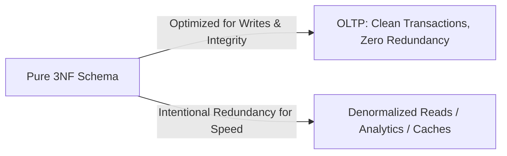

# Database Normalization: 1NF, 2NF, 3NF & Denormalization Trade-offs

> **Phase 7: Relational Databases & SQL Mastery**  
> *Estimated Reading Time: 50 minutes | Total Practice Effort: ~3.5 hours | Tier: Core Essential*

---

## 1. Purpose & Prerequisites

### Why This Matters in Full Stack Development
When designing a backend database schema for an application, poor table structure leads to data anomalies:
- Updating a customer's address in one row while leaving old addresses in others (**Update Anomaly**).
- Being unable to record a newly introduced product until an order has been placed for it (**Insert Anomaly**).
- Deleting an order record and accidentally erasing customer biographical history permanently (**Delete Anomaly**).

**Database Normalization** is the systematic mathematical technique of organizing relational tables to eliminate data redundancy and prevent data modification anomalies.

### Prerequisites
- [Topic 7.1: Relational Concepts: Tables, Primary Keys, Foreign Keys & Schema](01-db-concepts.md)
- [Topic 7.2: SQL CRUD Operations](02-crud-operations.md)
- [Topic 7.4: SQL Joins & MySQL Compatibility](04-joins.md)

---

## 2. Plain-English Mental Model

```
[ Unnormalized Flat Spreadsheet: The "Messy Junk Drawer" ]
- Everything shoved into one giant table: customer name, address, product, price, supplier.
- Change a supplier's phone number? You have to edit 10,000 rows. Miss one, and data is corrupted!

[ Normalized Relational Database: A "Labelled Organization System" ]
- Customers table (only customer facts: id, name, email).
- Orders table (order date, customer_id).
- Products table (product facts: id, title, price, supplier_id).
- Suppliers table (supplier facts: id, company_name, phone).
- Every fact is stored in exactly ONE place. Update in one place, instantly reflected everywhere!
```

---

## 3. Data Modification Anomalies

Consider an unnormalized table `order_records`:

| order_id | customer_name | customer_email | product_name | product_price | supplier_city |
| :--- | :--- | :--- | :--- | :--- | :--- |
| 101 | Sarah Connor | sarah@sky.net | Cyber-Dyne T-800 | 15000.00 | Los Angeles |
| 102 | Sarah Connor | sarah@sky.net | Laser Rifle | 3500.00 | Austin |
| 103 | John Connor | john@res.org | EMP Grenade | 850.00 | Seattle |

### 1. Update Anomaly
If Sarah Connor changes her email address, every single order row she ever placed must be located and modified. If a server crashes mid-update or code misses rows, Sarah has two different emails in the database.

### 2. Insert Anomaly
Suppose your catalog introduces a brand-new cutting-edge item (`Plasma Cannon`, price `$4,000`, supplier `Dallas`). Because the table relies on `order_id` as part of the primary key, **you cannot store the new product in the database until an order is placed for it!**

### 3. Delete Anomaly
If John Connor cancels `order_id = 103`, deleting that row removes the only record that the `EMP Grenade` exists in our catalog and that its supplier is in `Seattle`.

---

## 4. The Core Normal Forms (1NF, 2NF, 3NF)

```mermaid
flowchart TD
    Raw["Unnormalized Table (Spreadsheet Data)"] -->|Rule 1: Atomic values, unique rows| N1["First Normal Form (1NF)"]
    N1 -->|Rule 2: No partial dependencies on composite PK| N2["Second Normal Form (2NF)"]
    N2 -->|Rule 3: No transitive dependencies (non-key determines non-key)| N3["Third Normal Form (3NF)"]
    N3 -->|Clean Enterprise Schema Ready for Production| Prod["Production Normalized DB"]
```

### 1. First Normal Form (1NF): Atomic Values & No Repeating Groups
**Rules:**
1. Each column must contain atomic (indivisible) values. No comma-separated lists or JSON strings in scalar columns.
2. Each record must have a unique identifier (Primary Key).
3. No repeating groups (e.g., columns like `phone_1`, `phone_2`, `phone_3`).

#### Violating 1NF:
```sql
-- BAD: Non-atomic tags column
CREATE TABLE articles (
    id INT PRIMARY KEY,
    title VARCHAR(100),
    tags VARCHAR(255) -- "java,backend,database,sql" (Violates 1NF!)
);
```

#### Achieving 1NF:
Break repeating groups into a related table with a foreign key:
```sql
CREATE TABLE articles (
    id INT PRIMARY KEY AUTO_INCREMENT,
    title VARCHAR(100) NOT NULL
);

CREATE TABLE article_tags (
    article_id INT NOT NULL,
    tag_name VARCHAR(50) NOT NULL,
    PRIMARY KEY (article_id, tag_name),
    FOREIGN KEY (article_id) REFERENCES articles(id) ON DELETE CASCADE
);
```

---

### 2. Second Normal Form (2NF): No Partial Dependencies
**Rules:**
1. Table must be in **1NF**.
2. All non-key attributes must depend on the **entire Primary Key**, not just part of it.
*(Note: 2NF only applies when a table has a **composite primary key** consisting of two or more columns).*

#### Violating 2NF:
Composite Primary Key: `(order_id, product_id)`
```sql
-- BAD: product_name and product_price depend ONLY on product_id, NOT on order_id!
CREATE TABLE order_items (
    order_id INT,
    product_id INT,
    quantity INT,
    product_name VARCHAR(100),  -- Partial dependency on product_id!
    product_price DECIMAL(10,2), -- Partial dependency on product_id!
    PRIMARY KEY (order_id, product_id)
);
```

#### Achieving 2NF:
Separate attributes depending only on `product_id` into a distinct `products` table:
```sql
CREATE TABLE products (
    id INT PRIMARY KEY AUTO_INCREMENT,
    name VARCHAR(100) NOT NULL,
    price DECIMAL(10,2) NOT NULL
);

CREATE TABLE order_items (
    order_id INT NOT NULL,
    product_id INT NOT NULL,
    quantity INT NOT NULL,
    unit_price DECIMAL(10,2) NOT NULL, -- Stored at time of purchase
    PRIMARY KEY (order_id, product_id),
    FOREIGN KEY (order_id) REFERENCES orders(id),
    FOREIGN KEY (product_id) REFERENCES products(id)
);
```

---

### 3. Third Normal Form (3NF): No Transitive Dependencies
**Rules:**
1. Table must be in **2NF**.
2. No non-key attribute may depend on another non-key attribute (**A -> B -> C**). All non-key columns must depend *only on the Primary Key*.

> **The Famous Mnemonic:**  
> *"Every non-key attribute must provide a fact about the key, the whole key, and nothing but the key, so help me Codd."*

#### Violating 3NF:
Primary Key: `id` (Customer ID)
```sql
-- BAD: city and state depend on zip_code, which depends on id (Transitive Dependency!)
CREATE TABLE customers (
    id INT PRIMARY KEY AUTO_INCREMENT,
    name VARCHAR(100) NOT NULL,
    street_address VARCHAR(200) NOT NULL,
    zip_code VARCHAR(10) NOT NULL,
    city VARCHAR(100) NOT NULL, -- Transitive: id -> zip_code -> city
    state VARCHAR(50) NOT NULL  -- Transitive: id -> zip_code -> state
);
```

#### Achieving 3NF:
Extract zip codes into a reference table:
```sql
CREATE TABLE postal_codes (
    zip_code VARCHAR(10) PRIMARY KEY,
    city VARCHAR(100) NOT NULL,
    state VARCHAR(50) NOT NULL
);

CREATE TABLE customers (
    id INT PRIMARY KEY AUTO_INCREMENT,
    name VARCHAR(100) NOT NULL,
    street_address VARCHAR(200) NOT NULL,
    zip_code VARCHAR(10) NOT NULL,
    FOREIGN KEY (zip_code) REFERENCES postal_codes(zip_code)
);
```

---

## 5. End-to-End Normalization Case Study

Let's normalize an unnormalized E-Commerce Order Record:

```
[Raw Order Slip]
Order #5001
Order Date: 2026-10-20
Customer: Jane Doe (jane@corp.com)
Shipping Address: 123 Tech Way, Suite 400, Austin, TX 78701
Billing Address: 123 Tech Way, Suite 400, Austin, TX 78701
Items:
  - 1x Mechanical Keyboard ($120.00), Category: Electronics, Brand: KeyChron
  - 2x USB-C Cable ($15.00 each), Category: Accessories, Brand: Anker
```

### Decomposed 3NF Schema:
```sql
-- 1. Users / Customers Table
CREATE TABLE users (
    id BIGINT PRIMARY KEY AUTO_INCREMENT,
    full_name VARCHAR(100) NOT NULL,
    email VARCHAR(150) NOT NULL UNIQUE,
    created_at TIMESTAMP DEFAULT CURRENT_TIMESTAMP
);

-- 2. Categories Table
CREATE TABLE categories (
    id INT PRIMARY KEY AUTO_INCREMENT,
    name VARCHAR(50) NOT NULL UNIQUE
);

-- 3. Brands Table
CREATE TABLE brands (
    id INT PRIMARY KEY AUTO_INCREMENT,
    name VARCHAR(100) NOT NULL UNIQUE
);

-- 4. Products Table
CREATE TABLE products (
    id BIGINT PRIMARY KEY AUTO_INCREMENT,
    title VARCHAR(150) NOT NULL,
    price DECIMAL(10,2) NOT NULL,
    category_id INT NOT NULL,
    brand_id INT NOT NULL,
    FOREIGN KEY (category_id) REFERENCES categories(id),
    FOREIGN KEY (brand_id) REFERENCES brands(id)
);

-- 5. Orders Table
CREATE TABLE orders (
    id BIGINT PRIMARY KEY AUTO_INCREMENT,
    user_id BIGINT NOT NULL,
    order_status VARCHAR(30) NOT NULL DEFAULT 'PENDING',
    order_date TIMESTAMP DEFAULT CURRENT_TIMESTAMP,
    FOREIGN KEY (user_id) REFERENCES users(id)
);

-- 6. Order Items (Bridge / Join Table)
CREATE TABLE order_items (
    id BIGINT PRIMARY KEY AUTO_INCREMENT,
    order_id BIGINT NOT NULL,
    product_id BIGINT NOT NULL,
    quantity INT NOT NULL CHECK (quantity > 0),
    unit_price DECIMAL(10,2) NOT NULL,
    FOREIGN KEY (order_id) REFERENCES orders(id) ON DELETE CASCADE,
    FOREIGN KEY (product_id) REFERENCES products(id),
    CONSTRAINT uk_order_product UNIQUE (order_id, product_id)
);
```

---

## 6. Denormalization in Modern High-Scale Systems

### Why Normalize First, Denormalize Second?
In pure 3NF, retrieving an order receipt requires joining `orders`, `order_items`, `products`, `brands`, `categories`, and `users`. On a massive database handling 50,000 queries per second, multi-table joins on cold tables can become computationally expensive.

**Denormalization** is the intentional, controlled re-introduction of redundancy into a schema to optimize **read performance** at the expense of write complexity.



### Safe vs Unsafe Denormalization:
1. **Safe Historical Snapshot:** Storing `unit_price` in `order_items`. This is not just a performance optimization; it is a business requirement! If the product's catalog price increases tomorrow from `$120` to `$140`, past orders must still reflect the `$120` actually paid!
2. **Safe Pre-Calculated Rollup:** Adding `order_total` or `items_count` to the `orders` table to avoid `SUM(quantity * unit_price)` on millions of items on every dashboard visit.
3. **Unsafe Denormalization:** Storing customer email in orders, comments, tickets, and reviews without an event-driven mechanism to propagate updates when a user modifies their email.

---

## 7. Common Rookie Mistakes & Compiler / Schema Traps

### Trap 1: The "Everything in One Table" Trap
Beginners often create a single `users` table with 60 columns: `user_id`, `name`, `email`, `shipping_address`, `billing_address`, `stripe_card_id`, `last_login_ip`, `referral_code`, `subscription_tier`, etc.  
*Fix:* Separate concerns into 1-to-1 extension tables (e.g., `user_profiles`, `user_payment_methods`, `user_subscriptions`).

### Trap 2: Using Delimited Strings (CSV in SQL)
```sql
-- WRONG: Impossible to index or query individual IDs efficiently!
SELECT * FROM users WHERE permissions LIKE '%ROLE_ADMIN%';
```
*Fix:* Use a proper junction table: `user_roles (user_id, role_name)`.

### Trap 3: Confusing Historical Integrity with Redundancy
Beginners mistakenly delete `unit_price` from `order_items` because "the price is already in the products table." When product catalog prices change, all historical revenue reports become corrupted! Always capture transactional snapshots.

---

## 8. Guided Hands-On Exercise

### The Scenario
You are building a university portal. A developer created this unnormalized table:

```sql
CREATE TABLE student_courses (
    student_id INT,
    course_code VARCHAR(10),
    student_name VARCHAR(100),
    student_major VARCHAR(50),
    course_title VARCHAR(100),
    instructor_name VARCHAR(100),
    instructor_office VARCHAR(50),
    grade VARCHAR(2),
    PRIMARY KEY (student_id, course_code)
);
```

### Your Challenge:
1. Identify all 2NF partial dependency violations.
2. Identify all 3NF transitive dependency violations.
3. Rewrite the schema into clean 3NF tables with appropriate primary and foreign keys.

<details>
<summary>💡 Hint: Identify What Depends on What</summary>

- `(student_id, course_code)` is the composite primary key.
- `student_name` and `student_major` depend only on `student_id` (Partial dependency -> Violates 2NF).
- `course_title` and `instructor_name` depend only on `course_code` (Partial dependency -> Violates 2NF).
- `instructor_office` depends on `instructor_name` (Transitive dependency -> Violates 3NF).
</details>

<details>
<summary>✅ Solution</summary>

```sql
-- 1. Instructors (eliminates 3NF transitive dependency of office on instructor)
CREATE TABLE instructors (
    id INT PRIMARY KEY AUTO_INCREMENT,
    name VARCHAR(100) NOT NULL,
    office VARCHAR(50) NOT NULL
);

-- 2. Students (eliminates 2NF partial dependency)
CREATE TABLE students (
    id INT PRIMARY KEY,
    name VARCHAR(100) NOT NULL,
    major VARCHAR(50) NOT NULL
);

-- 3. Courses (eliminates 2NF partial dependency)
CREATE TABLE courses (
    code VARCHAR(10) PRIMARY KEY,
    title VARCHAR(100) NOT NULL,
    instructor_id INT NOT NULL,
    FOREIGN KEY (instructor_id) REFERENCES instructors(id)
);

-- 4. Enrollments / Grades (the pure relationship table in 3NF)
CREATE TABLE enrollments (
    student_id INT NOT NULL,
    course_code VARCHAR(10) NOT NULL,
    grade VARCHAR(2),
    PRIMARY KEY (student_id, course_code),
    FOREIGN KEY (student_id) REFERENCES students(id) ON DELETE CASCADE,
    FOREIGN KEY (course_code) REFERENCES courses(code) ON DELETE CASCADE
);
```
</details>

---

## 9. Knowledge Check & Interview Defense

### Quick Quiz
1. **What is the condition required for a table to be in Second Normal Form (2NF)?**
   - [x] A) It must be in 1NF and have no partial dependencies (every non-key column must depend on the whole composite primary key).
   - [ ] B) It must have at least 2 primary keys.
   - [ ] C) It must not use foreign keys.
   - [ ] D) Every column must be numeric.

2. **A table has `student_id (PK)`, `zip_code`, and `city`. `city` is determined by `zip_code`. Which normal form does this table violate?**
   - [x] A) Third Normal Form (3NF), because of a transitive dependency between non-key attributes (`student_id -> zip_code -> city`).
   - [ ] B) First Normal Form (1NF).
   - [ ] C) Second Normal Form (2NF).
   - [ ] D) Fourth Normal Form (4NF).

3. **Why is it acceptable and standard practice to store `unit_price` in both `products` and `order_items`?**
   - [x] A) Because the price in `order_items` represents a historical point-in-time financial snapshot that must never change when future catalog prices adjust.
   - [ ] B) Because SQL requires duplicate columns for speed.
   - [ ] C) To prevent database deadlocks.
   - [ ] D) It is actually forbidden by ISO SQL standards.

---

### Junior Developer Interview Q&A

#### Q: "Can you explain the trade-off between a fully normalized (3NF) schema and a denormalized schema in a production system?"
> **Model Answer:**  
> "A **3NF normalized schema** minimizes data redundancy and guarantees data integrity by ensuring that every fact is stored in exactly one place. This makes `INSERT`, `UPDATE`, and `DELETE` operations fast, safe, and free of anomalies. However, reads often require complex, multi-table `JOIN` operations, which can degrade read throughput under heavy load.
>
> A **denormalized schema** intentionally duplicates specific fields (or pre-computes aggregates like order totals) to allow fast, single-table reads without joins. The trade-off is higher write complexity and the risk of stale or inconsistent data if updates are not strictly synchronized across duplicated fields.
>
> In production architecture, we typically design the core transaction database (OLTP) in 3NF to protect data integrity, and apply selective denormalization or synchronize with read replicas/caches (like Redis or Elasticsearch) for high-frequency read paths."

---

## 10. Mastery Checklist & Next Step

Before moving on, verify that you can:
- [ ] Define and identify Insertion, Update, and Deletion anomalies.
- [ ] State the criteria for 1NF, 2NF, and 3NF from memory.
- [ ] Decompose a flat spreadsheet-style table into clean relational 3NF tables.
- [ ] Explain when and why controlled denormalization is used in production systems.

👉 **Next Lesson:** **[Topic 7.7: ACID Properties & Transaction Isolation Levels](07-acid-transactions.md)**
