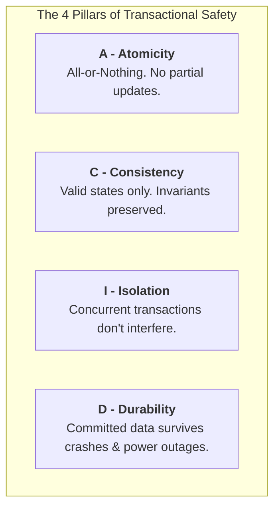
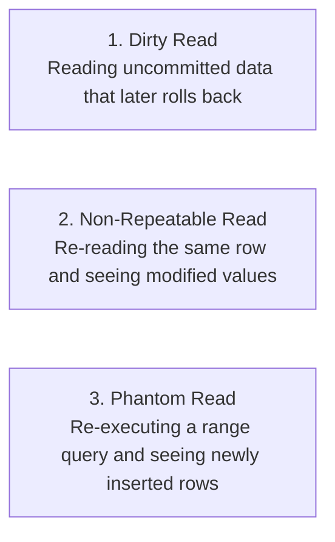

# ACID Properties & Transaction Isolation Levels

> **Phase 7: Relational Databases & SQL Mastery**  
> *Estimated Reading Time: 50 minutes | Total Practice Effort: ~3.5 hours | Tier: Core Essential*

---

## 1. Purpose & Prerequisites

### Why This Matters in Full Stack Development
In a multi-user enterprise application, hundreds of web requests execute SQL queries simultaneously. Imagine a banking system executing a transfer from Alice to Bob:
1. Deduct \$500 from Alice's account.
2. Add \$500 to Bob's account.

What happens if the database server loses power, network disconnects, or an exception throws between step 1 and step 2? Without transactional safety, \$500 disappears into thin air!

To build financial, e-commerce, and mission-critical enterprise systems, every backend engineer must master the **ACID guarantees** and the **four Transaction Isolation Levels**.

### Prerequisites
- [Topic 7.2: SQL CRUD Operations](02-crud-operations.md)
- [Topic 7.5: Subqueries, CTEs & Database Locking Mechanics](05-subqueries.md)
- [Topic 7.6: Database Normalization](06-normalization.md)

---

## 2. Plain-English Mental Model

```
[ A Database Transaction: A Sealed Courier Envelope ]
- You don't hand your documents to a courier one loose paper at a time in the rain.
- You place all the papers into a sealed, waterproof envelope.
- Either the entire envelope is successfully delivered to its destination (COMMIT),
  or if the courier crashes, the entire envelope is rejected and returned to sender (ROLLBACK).
- At no point can half a page be delivered!
```

---

## 3. The ACID Guarantees in Depth



### 1. Atomicity ("All or Nothing")
A transaction is treated as a single indivisible unit of work. Either all SQL statements succeed, or if a single statement fails, **every change is undone via `ROLLBACK`**.
- **Under the hood:** The database engine maintains an **Undo Log** (`innodb_undo_tablespaces`). If a transaction aborts, the database plays the undo log in reverse to restore original row values.

### 2. Consistency ("Preserving Invariants")
The database moves from one valid state to another valid state. All schema constraints (`CHECK`, `UNIQUE`, `FOREIGN KEY`, `NOT NULL`) and application-level business rules must be satisfied. If any constraint is violated, the transaction is rejected.

### 3. Isolation ("Invisible Concurrency")
Transactions executing concurrently should not see uncommitted, transient, or conflicting states from one another. How isolated they are depends on the configured **Isolation Level**.

### 4. Durability ("Written in Stone")
Once a transaction is committed (`COMMIT`), its modifications are guaranteed to be permanent, even if the database server immediately crashes or suffers a catastrophic power outage.
- **Under the hood:** The engine writes changes to an append-only **Write-Ahead Log (WAL / Redo Log)** on non-volatile disk storage *before* updating memory pages. On reboot, the engine scans the Redo Log to replay any committed transactions not yet flushed to the data files.

---

## 4. The 3 Classic Concurrency Anomalies

When multiple transactions read and write to the same tables without full isolation, three classic anomalies can occur:



### 1. Dirty Read
- Transaction A updates Alice's balance to \$1,000, but has **not yet committed**.
- Transaction B reads Alice's balance as \$1,000.
- Transaction A encounters an error and **rolls back** (balance reverts to \$200).
- **Result:** Transaction B made business decisions based on "phantom" data that never legally existed!

### 2. Non-Repeatable Read (Fuzzy Read)
- Transaction A reads Alice's balance: it is \$200.
- Transaction B updates Alice's balance to \$500 and **commits**.
- Transaction A reads Alice's balance again in the same transaction: it is now \$500!
- **Result:** Within the *same* transaction, reading the exact same row twice produced different values.

### 3. Phantom Read
- Transaction A executes a range query: `SELECT COUNT(*) FROM orders WHERE status = 'PENDING';` -> returns **10**.
- Transaction B inserts a new pending order and **commits**.
- Transaction A re-executes the exact same query: -> returns **11**!
- **Result:** A new row ("phantom") appeared within the same transaction range.

---

## 5. The 4 Standard SQL Isolation Levels

ANSI SQL defines four isolation levels offering a trade-off between **concurrency throughput** and **data consistency**:

| Isolation Level | Dirty Read | Non-Repeatable Read | Phantom Read | Concurrency Performance |
| :--- | :---: | :---: | :---: | :--- |
| **READ UNCOMMITTED** | ⚠️ Allowed | ⚠️ Allowed | ⚠️ Allowed | Highest (No read locks) |
| **READ COMMITTED** | 🛡️ Prevented | ⚠️ Allowed | ⚠️ Allowed | High (PostgreSQL / Oracle default) |
| **REPEATABLE READ** | 🛡️ Prevented | 🛡️ Prevented | 🛡️ Prevented* | Medium (MySQL InnoDB default) |
| **SERIALIZABLE** | 🛡️ Prevented | 🛡️ Prevented | 🛡️ Prevented | Lowest (Strict row/range locking) |

*\*Note on MySQL InnoDB: InnoDB prevents phantom reads even under `REPEATABLE READ` through Next-Key Locks (Gap Locking) and MVCC.*

---

## 6. How Modern Engines Implement Isolation: MVCC & Undo Logs

Instead of locking every row whenever a query executes (which would freeze concurrency), modern relational engines like MySQL (InnoDB) and PostgreSQL use **Multi-Version Concurrency Control (MVCC)**:

```
[ Row Data Block ]
-----------------------------------------------------------
Record: user_id=1, balance=$500 
[Hidden DB_TRX_ID: 105] [Hidden DB_ROLL_PTR: -> Pointer to Undo Log]
-----------------------------------------------------------
                              |
                              v
[ Undo Log Entry (Old Version) ]
Balance: $200 (Transaction ID: 98)
```

1. **Read View / Snapshot:** When Transaction 102 begins, the engine takes a snapshot of the current transaction timeline.
2. **Reading Without Locking:** When Transaction 102 queries a row, the engine checks the row's `DB_TRX_ID`. If the row was modified by an uncommitted or later transaction, the engine traverses the **Undo Log pointer** to read the older version that was committed prior to Transaction 102.
3. **Benefit:** **Reads never block writes, and writes never block reads!** High-speed concurrent performance with strict consistency.

---

## 7. Working SQL Transaction Code

Let's inspect how to manage transactions directly in SQL:

```sql
-- Checking the current isolation level in MySQL:
SELECT @@transaction_isolation;

-- Setting isolation level for the next transaction:
SET TRANSACTION ISOLATION LEVEL REPEATABLE READ;

-- 1. Begin the Transaction Block
START TRANSACTION;

-- 2. Deduct $500 from Alice (Account #101)
UPDATE accounts 
SET balance = balance - 500.00 
WHERE id = 101 AND balance >= 500.00;

-- 3. Verify exactly 1 row was updated (checked in application logic)
-- 4. Credit $500 to Bob (Account #202)
UPDATE accounts 
SET balance = balance + 500.00 
WHERE id = 202;

-- 5. Insert an Audit Log Entry
INSERT INTO transfer_logs (sender_id, receiver_id, amount) 
VALUES (101, 202, 500.00);

-- 6. Permanently Commit the Changes
COMMIT;

-- Or if an error occurs:
-- ROLLBACK;
```

---

## 8. Common Rookie Mistakes & Production Traps

### Trap 1: The Long-Running Transaction
Keeping a transaction open while calling third-party HTTP APIs (like Stripe or Twilio):
```java
// DISASTER IN PRODUCTION!
@Transactional
public void processPayment() {
    orderRepository.markProcessing(orderId); // Holds DB lock!
    stripeClient.chargeCreditCard();        // Takes 4 seconds over network!
    orderRepository.markComplete(orderId);
}
```
*Why this fails:* Database connection is held, row locks are held for 4 seconds, connection pool exhausts, and the application freezes!  
*Rule:* **Never make network calls inside a database transaction block.**

### Trap 2: Autocommit Confusion
In standard JDBC and MySQL clients, `autocommit = true` is enabled by default. Every single SQL statement runs in its own individual transaction and commits immediately. If you need multi-statement atomicity, you must explicitly disable autocommit or use transaction boundaries.

### Trap 3: Choosing SERIALIZABLE for Everything
Junior developers often assume "SERIALIZABLE is the most secure, so let's make it the default." In reality, `SERIALIZABLE` introduces heavy lock contention and aborts transactions with deadlock exceptions under concurrent traffic.

---

## 9. Guided Hands-On Exercise

### The Scenario
You are building an e-commerce inventory reservation service. Multiple customers are trying to purchase the last 5 units of a limited-edition sneaker at the same second.

### Your Challenge:
Write a safe transaction script that:
1. Begins a transaction.
2. Selects the current stock for `sku = 'SNKR-001'` using a row-level write lock (`FOR UPDATE`).
3. If stock >= 2, deducts 2 units and inserts an order record.
4. Commits the transaction.

<details>
<summary>💡 Hint: Use SELECT ... FOR UPDATE</summary>

```sql
START TRANSACTION;
SELECT quantity FROM inventory WHERE sku = 'SNKR-001' FOR UPDATE;
-- Apply business check
UPDATE inventory ...
INSERT INTO orders ...
COMMIT;
```
</details>

<details>
<summary>✅ Solution</summary>

```sql
START TRANSACTION;

-- Step 1: Acquire exclusive write-lock on the specific inventory row
SELECT quantity 
FROM inventory 
WHERE sku = 'SNKR-001' 
FOR UPDATE;

-- Step 2: Safe deduction (guaranteed no other transaction can modify it concurrently)
UPDATE inventory 
SET quantity = quantity - 2 
WHERE sku = 'SNKR-001' AND quantity >= 2;

-- Step 3: Record the order
INSERT INTO orders (sku, quantity_purchased, status) 
VALUES ('SNKR-001', 2, 'CONFIRMED');

-- Step 4: Release the lock and persist changes
COMMIT;
```
</details>

---

## 10. Knowledge Check & Interview Defense

### Quick Quiz
1. **Which ACID property ensures that committed transactions survive a power failure or database crash?**
   - [x] A) Durability (via the Write-Ahead / Redo Log written to non-volatile disk).
   - [ ] B) Atomicity.
   - [ ] C) Consistency.
   - [ ] D) Isolation.

2. **What concurrency phenomenon occurs when Transaction A reads a row, Transaction B modifies that row and commits, and Transaction A reads it again to find different values?**
   - [x] A) Non-Repeatable Read.
   - [ ] B) Dirty Read.
   - [ ] C) Phantom Read.
   - [ ] D) Lost Update.

3. **What is the default isolation level in MySQL InnoDB?**
   - [x] A) REPEATABLE READ.
   - [ ] B) READ COMMITTED.
   - [ ] C) READ UNCOMMITTED.
   - [ ] D) SERIALIZABLE.

---

### Junior Developer Interview Q&A

#### Q: "What is MVCC (Multi-Version Concurrency Control) and why is it superior to pure lock-based concurrency?"
> **Model Answer:**  
> "In early database engines, when a transaction wanted to read data, it acquired a Shared Read Lock on the row or table, which blocked all other transactions from writing. When a transaction wanted to write data, it acquired an Exclusive Lock, which blocked all reads. Under heavy traffic, this caused severe thread contention and high query latency.
>
> **MVCC (Multi-Version Concurrency Control)** solves this by maintaining snapshots of data versions using **Undo Logs**. When a row is updated, the engine does not overwrite the old data in place; it writes a new version with a transaction timestamp and preserves the older version in the Undo Log.
>
> When concurrent transactions execute `SELECT` queries, they read the version of the data that was committed prior to their snapshot without acquiring any locks. As a result, **reads never block writes, and writes never block reads**, dramatically improving database throughput in production applications."

---

## 11. Mastery Checklist & Next Step

Before moving on, verify that you can:
- [ ] Define Atomicity, Consistency, Isolation, and Durability with technical precision.
- [ ] Identify Dirty Reads, Non-Repeatable Reads, and Phantom Reads.
- [ ] Contrast the 4 ANSI SQL isolation levels.
- [ ] Explain how MVCC and Undo Logs allow lock-free concurrent reads.
- [ ] Write safe `START TRANSACTION`, `COMMIT`, and `ROLLBACK` blocks.

👉 **Next Lesson:** **[Topic 7.8: B-Tree Indexes, Query Plans (EXPLAIN) & Optimization](08-indexes-explain.md)**
